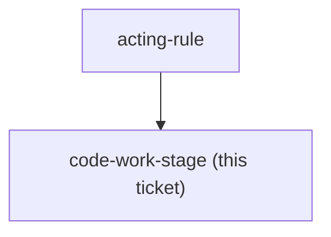

## Question

guide-and-verify is for changes a person makes by hand in a console, and says not to use it for changes the agent can make itself. For a ticket whose work is code the agent can write: which skill does the do stage load, and is the before / after measurement of guide-and-verify still required there?

<!-- decision-map:graph:start -->

<!-- decision-map:graph:end -->
