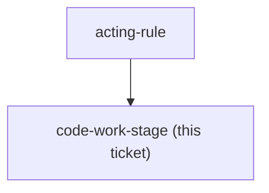
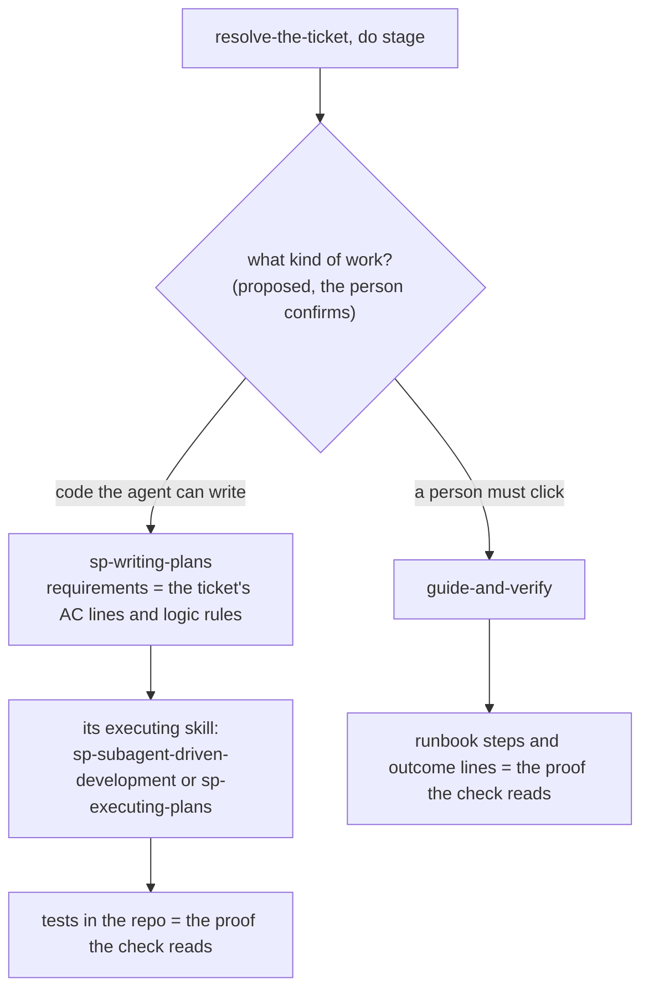

## Question

guide-and-verify is for changes a person makes by hand in a console, and says not to use it for changes the agent can make itself. For a ticket whose work is code the agent can write: which skill does the do stage load, and is the before / after measurement of guide-and-verify still required there?

<!-- decision-map:graph:start -->

<!-- decision-map:graph:end -->

<!-- decision-map:resolution:start -->
## Resolution

Code work loads sp-writing-plans with the ticket's AC lines as requirements, then its executing skill; the tests it leaves are the proof the check reads.

Detail: docs/adr/workflow-daily-work-0342-for-code-work-the-do-stage-loads-the-plan-writing-line.md

Confirming exchange, 2026-11-18: the user picked "A. สายเขียนแผน" over loading nothing, and over guide-and-verify for every ticket.

The agent's reading, not a separate answer from the user: no before / after measurement is asked of code work (the loaded skill's own rules apply, ADR 0339); the kind of work is proposed with the stage and confirmed in the same question; the row list is handed over as in ADR 0340.

<!-- decision-map:resolution:end -->
