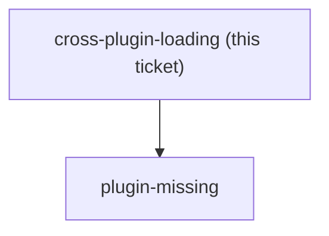
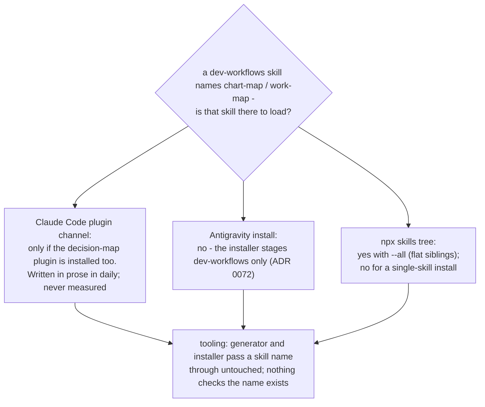

## Question

In this marketplace (C:/Repo/workflow-daily-work): can a skill in the dev-workflows plugin load a skill that ships in the decision-map plugin, by name, in each of the three installs - the Claude Code plugin channel, the Antigravity install (plugins/dev-workflows/.antigravity/), and the npx skills.sh channel (the generated skills/ tree)? Find every existing place where one skill loads a skill from a different plugin (for example daily -> ado-backlog:my-work), what wording it uses, what its 'not installed' fallback is, and whether scripts/generate_skills_tree.py and the Antigravity installer carry such a reference through. Report raw findings with file:line.

<!-- decision-map:graph:start -->

<!-- decision-map:graph:end -->

<!-- decision-map:resolution:start -->
## Resolution

A skill name reaches another plugin's skill only when both are installed side by side; the tooling passes the name through untouched, and no channel has a live test on record.

Research run 2026-11-18 by a read-only subagent over C:/Repo/workflow-daily-work. Raw findings; nothing was tested against a live install.

## 1. Existing loads that cross a plugin

| Source | Wording | Target | Fallback when missing |
|---|---|---|---|
| plugins/dev-workflows/skills/daily/SKILL.md:76-78, 120-122 | "Invoke the `my-work` skill (`ado-backlog:my-work` ...)" | ado-backlog, github-backlog | :80-84 prints "board unavailable: <reason>" and continues; :245-258 "Graceful degradation" prints the install command for Claude Code and Antigravity |
| daily/SKILL.md:131 | "`chart-map` (`/decision-map:chart`) ... `work-map` (`/decision-map:work`)" | decision-map | none - the Graceful degradation block covers ado-backlog and github-backlog only |
| plugins/dev-workflows/skills/career-growth/SKILL.md:82-86, 292 | "if the `ado-backlog` plugin's skills are available in this session ... otherwise tell the user the ADO source is skipped and continue" | ado-backlog | skip with a notice (ADR 0046) |
| plugins/decision-map/skills/work-map/SKILL.md:335 | "Load `dev-workflows:sp-grill-with-doc` the way your harness loads skills" | dev-workflows | none on that line |

Wording model for a harness-neutral load, inside one plugin: invoice-generator/SKILL.md:100-102 ("Load the `management-talk` skill (fully qualified: `dev-workflows:management-talk`) via your harness's skill-loading mechanism") and resolve-the-ticket/SKILL.md:86, 87, 123-124 ("load it through your harness's mechanism").

resolve-the-ticket/SKILL.md:438 names `work-map` only as a "do not confuse with" row. It loads nothing from decision-map today.

## 2. Per install channel

**Claude Code plugin channel.** The pattern exists in prose (daily -> `ado-backlog:my-work`; work-map -> `dev-workflows:*`). ADR 0033:48 accepts a hard cross-plugin dependency, mitigated by a preflight (detect, offer install). ADR 0001:50-51 requires graceful degradation. No ADR or test records that such a load was measured to resolve.

**Antigravity install.** `plugins/dev-workflows/.antigravity/install-antigravity.py` stages one plugin only (`PLUGIN_ROOT`, :34; `discover_skills()`, :50-52) and stages flat (`dest / skill.name`, :119). It is the only `.antigravity/` directory in the repo. ADR 0072:77-83: "Only `dev-workflows` ships an `.antigravity/` installer, so `decision-map` is Claude-Code-only." So chart-map and work-map are not installed on Antigravity by the repo's own mechanism. A bare name would be found only if the user put those skills in the same flat directory another way. daily's fallback text points at "the plugin's .antigravity/INSTALL.md", a file that does not exist for ado-backlog.

**npx skills channel (generated `skills/` tree).** Flat, one directory per skill, keyed by frontmatter `name` (generate_skills_tree.py:357, :479). With `--all`, `chart-map` and `work-map` are sibling directories. The generated `skills/daily/SKILL.md` still carries the plugin-prefixed `ado-backlog:my-work` and `/decision-map:chart` - the generator does not strip the prefix. A single-skill install (`--skill resolve-the-ticket`) would arrive without chart-map or work-map; no fallback text in the repo prints an npx install command.

Side finding: the repo root has a tracked `.agents/skills/` with 55 skills, including chart-map, work-map, my-work and daily side by side. `skills-lock.json` suggests it came from `npx skills add`. It shows a flat directory can hold skills of several plugins; it does not show a cross-reference resolves.

## 3. What the tooling does with a reference

| Shape | generate_skills_tree.py | install-antigravity.py |
|---|---|---|
| bare skill name or `plugin:skill` | left as is (`REF_RE`, :36, matches only `${CLAUDE_PLUGIN_ROOT}/<path>`); nothing checks that the name exists | left as is (ADR 0071:70 "rewrites file paths only, never skill references") |
| `${CLAUDE_PLUGIN_ROOT}/skills/<name>/...` in the same plugin | resolved against the owning plugin root (:356), file copied, missing file raises `MissingReference` | rewritten to `<dest>/...` (:73) |
| the same path pointing into another plugin | not supported - raises `MissingReference` | rewritten, then dangles; the leftover check (:143-152) cannot see it |

Duplicate skill names across plugins fail the tree check (check_skills_tree.py:114-119, ADR 0156).

## 4. ADRs that already rule here

- ADR 0001: a reference to another plugin's skill must degrade gracefully when that plugin is not installed.
- ADR 0033: cross-plugin dependency accepted with a preflight; partly superseded by ADR 0059.
- ADR 0046: soft dependency - use if installed, else skip with a notice.
- ADR 0071 Decision 2: skill references use the short form, because the Antigravity installer stages flat and never rewrites a skill reference; "a long-form reference would be dead on arrival in the second harness."
- ADR 0072 Decision 2: short form, also across plugins. work-map/SKILL.md:335 still reads long form.
- ADR 0190: the neutral wording rule holds even where Antigravity is not tested.
- ADR 0329: resolve-the-ticket lives in dev-workflows because the skills it loads are all there.

## 5. Not answered by the files - needs a live install test

1. Plugin channel: does a load of `chart-map` / `decision-map:chart-map` from inside a running dev-workflows skill resolve?
2. Plugin channel: what comes back when decision-map is not installed - an error, or a silent miss?
3. Antigravity: can a skill named in prose be loaded by name at all, or only by description match?
4. npx: does a bare name resolve under `.claude/skills/<name>/`, and does the plugin-prefixed form fail there?
5. npx single-skill install: nothing handles it today.
6. Should the generator check that a bare skill name in prose exists in the tree? Today a typo passes.

<!-- decision-map:resolution:end -->
