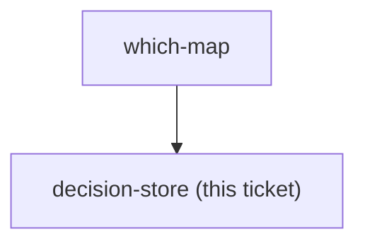

## Question

Decisions now live in three places: the runbook's D1..Dn table, Decision tickets on a map, and ADRs. Which is the record for a decision about one ticket, which only link to it, and which of them does the check accept as a 'written, approved decision' (ADR 0324)?

<!-- decision-map:graph:start -->

<!-- decision-map:graph:end -->
