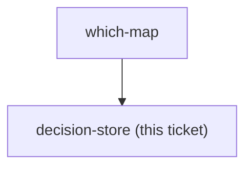
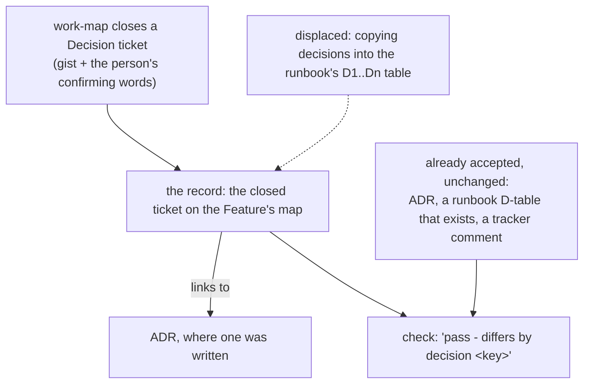

## Question

Decisions now live in three places: the runbook's D1..Dn table, Decision tickets on a map, and ADRs. Which is the record for a decision about one ticket, which only link to it, and which of them does the check accept as a 'written, approved decision' (ADR 0324)?

<!-- decision-map:graph:start -->

<!-- decision-map:graph:end -->

<!-- decision-map:resolution:start -->
## Resolution

The closed Decision ticket on the Feature's map is the record; the check accepts it beside an ADR, an existing runbook table or a tracker comment, and no runbook is converted.

Detail: docs/adr/workflow-daily-work-0347-a-closed-decision-ticket-on-the-features-map-is-the-record-of-a-tickets-decision.md

Confirming exchange, 2026-11-18: the user picked "A. Decision ticket บน map" over the runbook table as the record, and over naming no record.

Only a closed Decision ticket counts. No existing runbook is converted.

<!-- decision-map:resolution:end -->
