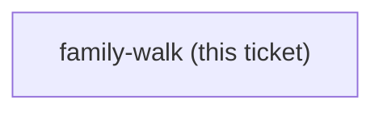
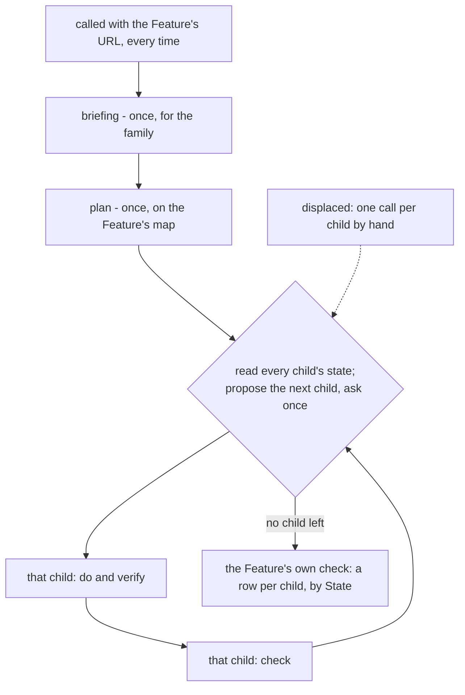

## Question

The decisions of a Feature's children share one map (ADR 0346). For the stages: when resolve-the-ticket is called with a Feature's URL (like #193 with children #194-#197), does it walk the children itself - a briefing for the family, then each child's do and verify and check in turn - or does it brief the family and then ask to be called once per child? And what is the Feature's own check then: its children's State only, as today (ADR 0321), or each child's READY block?

<!-- decision-map:graph:start -->

<!-- decision-map:graph:end -->

<!-- decision-map:resolution:start -->
## Resolution

The Feature's URL is the one address: briefing and plan once for the family, then each call proposes the next child's do and verify and check, in the briefing's order.

Detail: docs/adr/workflow-daily-work-0351-called-with-a-feature-resolve-the-ticket-walks-its-children-one-at-a-time.md

Confirming exchange, 2026-11-18: the user picked "B. แม่พาเดินลูกเอง" over calling the skill once per child, and over nothing special for a Feature.

The Feature's own check stays as ADR 0321 has it. A child's URL still works on its own.

<!-- decision-map:resolution:end -->
