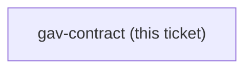

## Question

The check needs, per test: Given / When / Then, the result, and a date (ADRs 0319, 0320, 0335), and ADR 0333 asks guide-and-verify for a runbook file only. What exactly does guide-and-verify have to write, and where in the runbook, so the check reads it without guessing - and does it get a file-only mode?

<!-- decision-map:graph:start -->

<!-- decision-map:graph:end -->
