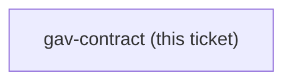
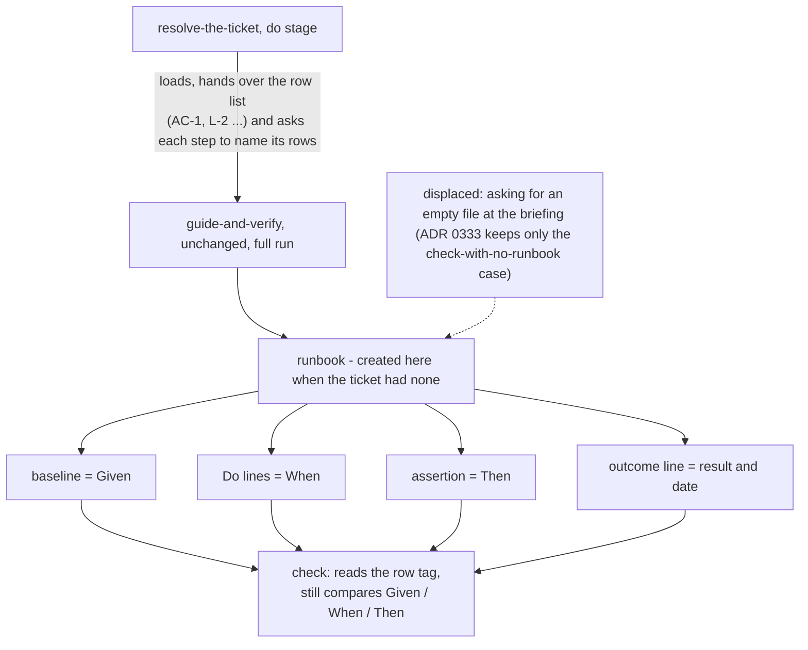

## Question

The check needs, per test: Given / When / Then, the result, and a date (ADRs 0319, 0320, 0335), and ADR 0333 asks guide-and-verify for a runbook file only. What exactly does guide-and-verify have to write, and where in the runbook, so the check reads it without guessing - and does it get a file-only mode?

<!-- decision-map:graph:start -->

<!-- decision-map:graph:end -->

<!-- decision-map:resolution:start -->
## Resolution

guide-and-verify writes nothing new: the check reads its own step fields; the entry hands it the row list, and the runbook is made when the do stage starts.

Detail: docs/adr/workflow-daily-work-0340-the-do-stage-hands-guide-and-verify-the-row-list-and-asks-each-step-to-name-its-rows.md

Second canonical doc: `docs/adr/workflow-daily-work-0341-a-ticket-with-no-runbook-gets-one-when-the-do-stage-starts.md`

Confirming exchange, 2026-11-18:

- Step to row: the user picked "A. ส่งรายการแถวไปด้วย" over pairing only at the check.
- When the runbook is made: the user picked "1. ตอนเริ่ม Do + verify" over an empty file at the briefing.

guide-and-verify is not edited (ADR 0338). Its text was read in the working tree on 2026-11-18, with another session's uncommitted edits in it.

Known, not decided: guide-and-verify records its readings on the ticket as it goes - its own rule.

<!-- decision-map:resolution:end -->
