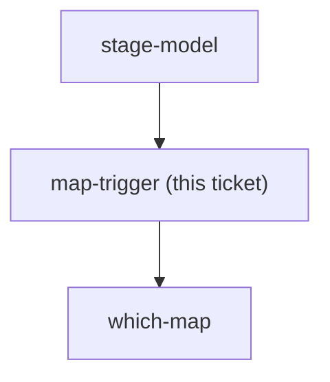
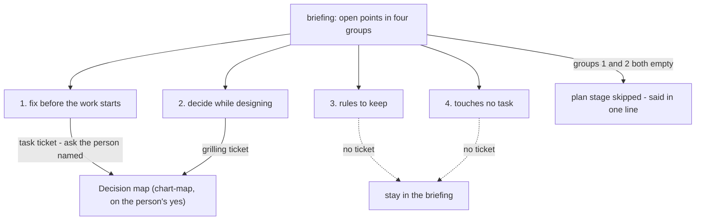

## Question

The briefing sorts open points into four groups (ADR 0336). Which of them become Decision tickets on a map - only 'decide while designing', or 'fix before the work starts' too - and when there are none, is the planning stage skipped without a word?

<!-- decision-map:graph:start -->

<!-- decision-map:graph:end -->

<!-- decision-map:resolution:start -->
## Resolution

Open points of group 1 (as task tickets) and group 2 (as grilling tickets) go on a Decision map through chart-map; when both are empty the plan stage is skipped, said in one line.

Detail: docs/adr/workflow-daily-work-0345-the-plan-stage-puts-every-open-point-of-groups-one-and-two-on-a-decision-map.md

Confirming exchange, 2026-11-18: the user picked "B. กลุ่ม 1 + 2" over group 2 only, and over group 2 with a size question (the agent's recommendation).

Known: chart-map's own no-fog stop still applies on a small ticket; it may not be edited.

<!-- decision-map:resolution:end -->
