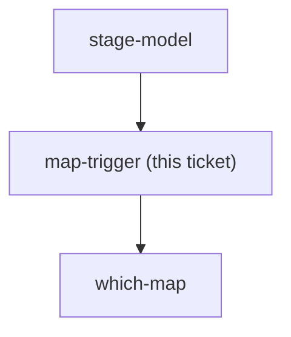

## Question

The briefing sorts open points into four groups (ADR 0336). Which of them become Decision tickets on a map - only 'decide while designing', or 'fix before the work starts' too - and when there are none, is the planning stage skipped without a word?

<!-- decision-map:graph:start -->

<!-- decision-map:graph:end -->
