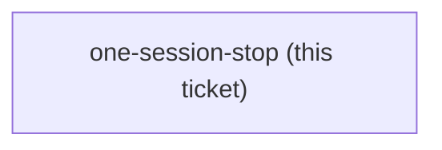

## Question

chart-map ends its session after charting, and work-map resolves exactly one HITL ticket and stops. A single call that walks a whole ticket would run past both stops. Does the entry skill end its own run at each of those stops and resume on the next call, or do the map skills get a mode that returns to the caller?

<!-- decision-map:graph:start -->

<!-- decision-map:graph:end -->
