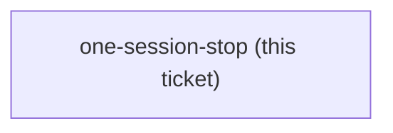
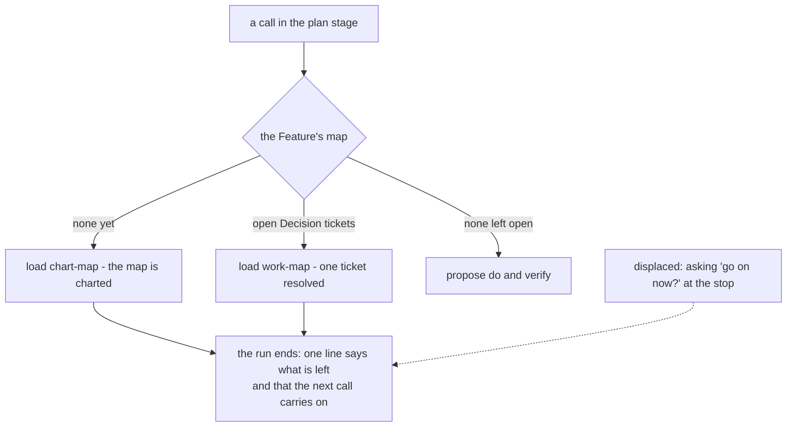

## Question

chart-map ends its session after charting, and work-map resolves exactly one HITL ticket and stops. A single call that walks a whole ticket would run past both stops. Does the entry skill end its own run at each of those stops and resume on the next call, or do the map skills get a mode that returns to the caller?

<!-- decision-map:graph:start -->

<!-- decision-map:graph:end -->

<!-- decision-map:resolution:start -->
## Resolution

The entry's own run ends wherever chart-map or work-map stops; the next call reads the Feature's map and proposes the plan stage again until no Decision ticket is open.

Detail: docs/adr/workflow-daily-work-0348-the-entrys-run-ends-wherever-a-map-skill-stops.md

Confirming exchange, 2026-11-18: the user picked "A. จบรอบเสมอ" over asking "go on now?" at each stop (the agent's recommendation).

<!-- decision-map:resolution:end -->
