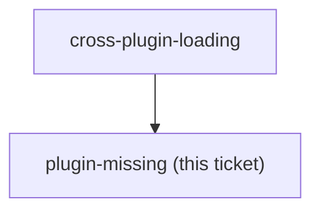

## Question

resolve-the-ticket ships in dev-workflows; chart-map and work-map ship in the decision-map plugin. When decision-map is not installed (or only single skills were installed through npx): does the planning stage stop with an install line, fall back to the runbook's decision table, or skip?

<!-- decision-map:graph:start -->

<!-- decision-map:graph:end -->
