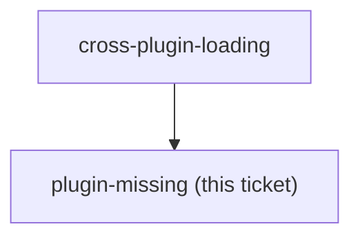
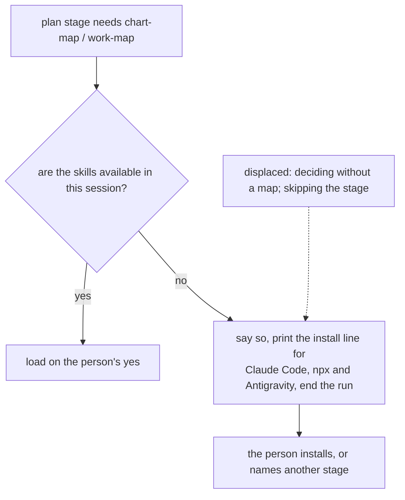

## Question

resolve-the-ticket ships in dev-workflows; chart-map and work-map ship in the decision-map plugin. When decision-map is not installed (or only single skills were installed through npx): does the planning stage stop with an install line, fall back to the runbook's decision table, or skip?

<!-- decision-map:graph:start -->

<!-- decision-map:graph:end -->

<!-- decision-map:resolution:start -->
## Resolution

The plan stage says the map skills are not installed, prints the install line for each channel and ends the run; no fallback without a map and no silent skip.

Detail: docs/adr/workflow-daily-work-0349-with-the-map-skills-not-installed-the-plan-stage-stops-with-the-install-line.md

Confirming exchange, 2026-11-18: the user picked "A. หยุดพร้อมคำสั่งติดตั้ง" over falling back to sp-grill-with-doc, and over skipping the plan stage.

The detection, the short-form names and the three-channel install line are the agent's reading of the research ticket cross-plugin-loading (ADR 0349 says so). No channel has a live test on record.

<!-- decision-map:resolution:end -->
