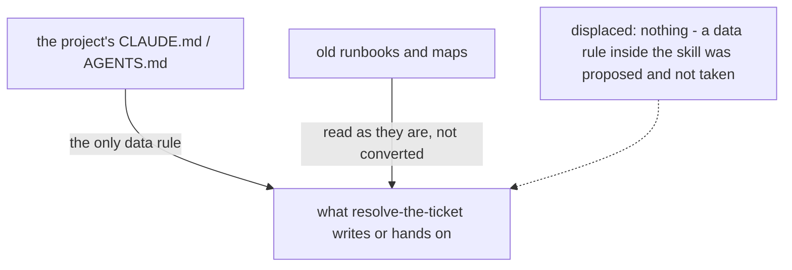

## Question

Runbooks and maps hold ticket text and snapshots of a live system. What must never be written into them (personal data, secrets, tokens), and when the formats change under this map, do existing runbooks and maps have to be converted, or do old and new shapes live side by side?

<!-- decision-map:graph:start -->

<!-- decision-map:graph:end -->

<!-- decision-map:resolution:start -->
## Resolution

The skill carries no data rule of its own - the project's CLAUDE.md decides what may be written - and no old runbook or map is converted.

Detail: docs/adr/workflow-daily-work-0350-resolve-the-ticket-carries-no-data-rule-of-its-own-and-converts-no-old-file.md

Confirming exchange, 2026-11-18: the user picked "C. ไม่มีกฎในสกิล" over a rule against secrets and customers' personal data (the agent's recommendation), and over a rule against secrets only. No reason was given.

No conversion of old files follows from ADRs 0337, 0343 and 0347; the agent said so before asking.

<!-- decision-map:resolution:end -->
