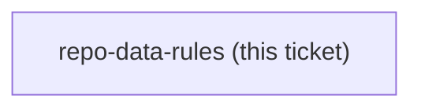

## Question

Runbooks and maps hold ticket text and snapshots of a live system. What must never be written into them (personal data, secrets, tokens), and when the formats change under this map, do existing runbooks and maps have to be converted, or do old and new shapes live side by side?

<!-- decision-map:graph:start -->

<!-- decision-map:graph:end -->
