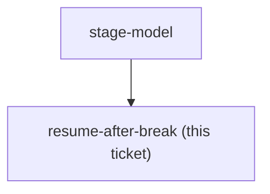
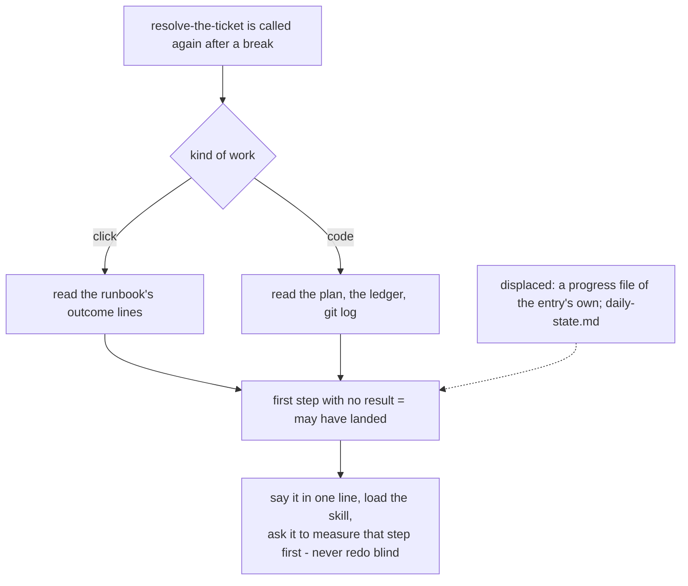

## Question

A session can end or compact while a step of the do stage is half done, or while a loaded skill is running. Where is progress written so the next call continues from the right step and does not redo a step that already landed - the runbook's Outcome log, daily-state.md, or a file of its own?

<!-- decision-map:graph:start -->

<!-- decision-map:graph:end -->

<!-- decision-map:resolution:start -->
## Resolution

The entry reads the loaded skill's own record - runbook outcome lines, or plan, ledger and git log - and a step with no result is measured before it is done again.

Detail: docs/adr/workflow-daily-work-0343-after-a-break-the-entry-reads-the-loaded-skills-own-record-and-a-step-with-no-result-is-measured-before-it-is-done-again.md

Confirming exchange, 2026-11-18: the user picked "A. อ่านบันทึกของสกิลที่โหลด" over a progress file of the entry's own, and over daily-state.md.

Known limit: no record says a step was started, only that it finished.

<!-- decision-map:resolution:end -->
