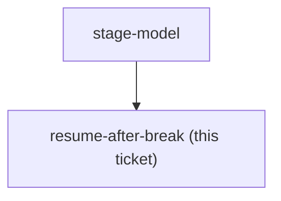

## Question

A session can end or compact while a step of the do stage is half done, or while a loaded skill is running. Where is progress written so the next call continues from the right step and does not redo a step that already landed - the runbook's Outcome log, daily-state.md, or a file of its own?

<!-- decision-map:graph:start -->

<!-- decision-map:graph:end -->
