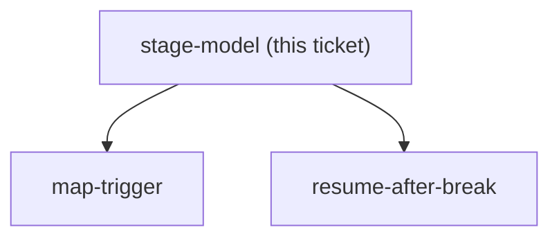

## Question

Today the skill asks 'briefing or check' (ADR 0317). With a planning stage and a do-and-verify stage in between: what are the stages, what ends each one, and when the skill is called again on the same ticket how does it know which stage comes next - by asking, by reading the runbook, or by the ticket's State?

<!-- decision-map:graph:start -->

<!-- decision-map:graph:end -->
