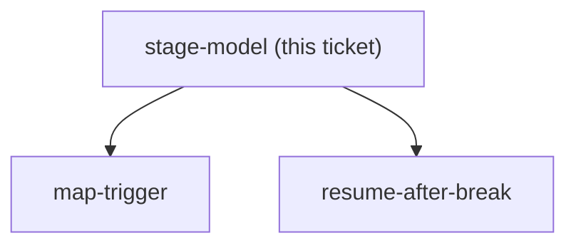
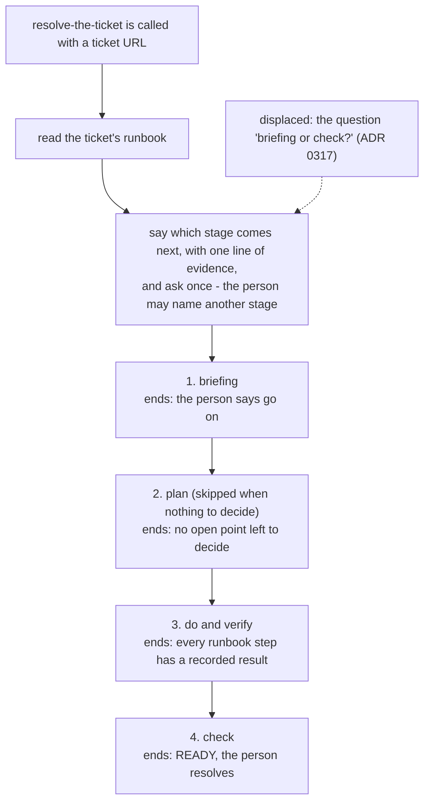

## Question

Today the skill asks 'briefing or check' (ADR 0317). With a planning stage and a do-and-verify stage in between: what are the stages, what ends each one, and when the skill is called again on the same ticket how does it know which stage comes next - by asking, by reading the runbook, or by the ticket's State?

<!-- decision-map:graph:start -->

<!-- decision-map:graph:end -->

<!-- decision-map:resolution:start -->
## Resolution

Four stages - briefing, plan, do and verify, check; on each call the skill reads the runbook, proposes the next stage with one line of evidence, and asks once.

Detail: docs/adr/workflow-daily-work-0337-resolve-the-ticket-walks-four-stages-and-reads-the-runbook-to-know-which-comes-next.md

Confirming exchange, 2026-11-18:

- Stages: the user picked "4 ช่วงตามตาราง" over three stages (plan inside the briefing) and five (do apart from verify).
- Knowing the stage: the user picked "A. อ่าน runbook แล้วเสนอ" over asking every time, the ticket's State, and reading without asking.
- While answering, the user added a rule for the whole map: "ต้องไม่แก้สกิลเก่านะ" - "ห้ามแก้ทุกสกิล ยกเว้น resolve ticket". It is ADR 0338.

The briefing writes no file today, so it gains one line in the runbook - in resolve-the-ticket's own text only.

Not decided here: when the plan stage is skipped (`map-trigger`), and where progress inside a stage is written (`resume-after-break`).

<!-- decision-map:resolution:end -->
