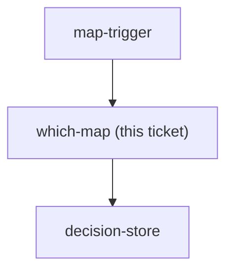
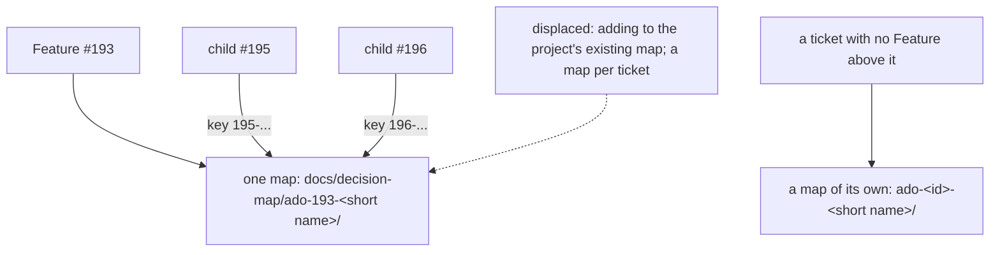

## Question

A project can already have a map (the user's has one with 14 tickets). Do a ticket's decisions go onto that map or onto a new map for the ticket, and how does a Decision ticket name the tracker ticket it touches, so the briefing and the check can find it later?

<!-- decision-map:graph:start -->

<!-- decision-map:graph:end -->

<!-- decision-map:resolution:start -->
## Resolution

One map per Feature, shared by all its children; a ticket with no Feature above it gets its own map; folder and ticket keys carry the tracker numbers.

Detail: docs/adr/workflow-daily-work-0346-a-tickets-decisions-go-on-one-map-per-feature.md

Confirming exchange, 2026-11-18: the user picked "C. map ต่อ Feature" over a new map per ticket, and over the project's existing map.

The folder and key names are the agent's proposal (ADR 0346 says so). The map's fog line about a Feature with several children is half answered: decisions are kept together; how the stages walk a family is still open.

<!-- decision-map:resolution:end -->
