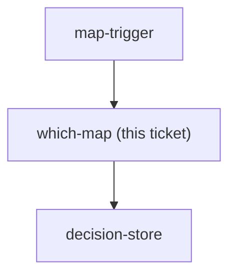

## Question

A project can already have a map (the user's has one with 14 tickets). Do a ticket's decisions go onto that map or onto a new map for the ticket, and how does a Decision ticket name the tracker ticket it touches, so the briefing and the check can find it later?

<!-- decision-map:graph:start -->

<!-- decision-map:graph:end -->
