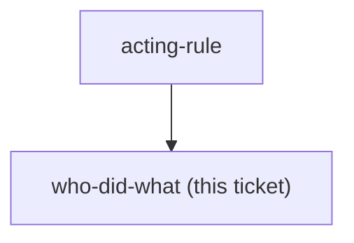

## Question

guide-and-verify logs a step the agent made at the person's request as an Exception; the check marks a pass cited / measured / told. Across the whole line: what one record shows, per step and per decision, whether a person or the agent did it and who approved it - and does the closing comment carry it?

<!-- decision-map:graph:start -->

<!-- decision-map:graph:end -->
