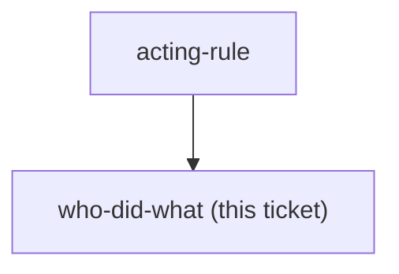
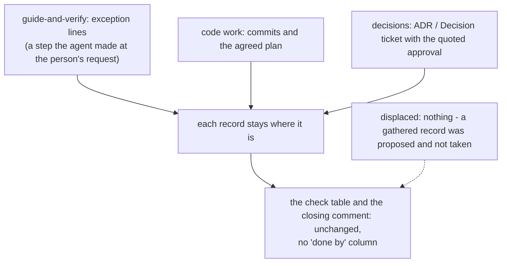

## Question

guide-and-verify logs a step the agent made at the person's request as an Exception; the check marks a pass cited / measured / told. Across the whole line: what one record shows, per step and per decision, whether a person or the agent did it and who approved it - and does the closing comment carry it?

<!-- decision-map:graph:start -->

<!-- decision-map:graph:end -->

<!-- decision-map:resolution:start -->
## Resolution

No gathered record is added: who did a step stays in each skill's own record, and the check table and closing comment stay as they are.

Detail: docs/adr/workflow-daily-work-0344-who-did-a-step-stays-in-each-skills-own-record-and-the-check-gathers-none-of-it.md

Confirming exchange, 2026-11-18: the user picked "C. ไม่รวม" over a 'done by' column in the runbook's check block (the agent's recommendation) and over the full column in the closing comment too. No reason was given.

<!-- decision-map:resolution:end -->
