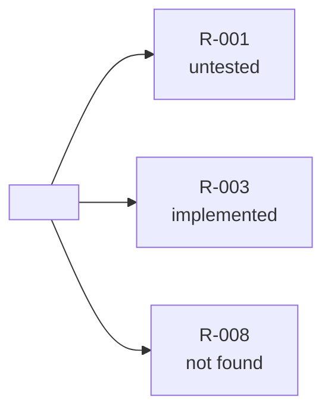

# why-this-logic — requirement traceability Implementation Plan

> **For agentic workers:** REQUIRED SUB-SKILL: Use sp-subagent-driven-development (recommended) or sp-executing-plans to implement this plan task-by-task. Steps use checkbox (`- [ ]`) syntax for tracking.

**Goal:** Give `why-this-logic` a software engineer's requirement traceability — an ID per requirement statement, a per-project register that is the traceability matrix, and a forward trace from any requirement text to the code that implements it and the tests that prove it.

**Architecture:** Prose-only extension of the existing skill on the same branch. `SKILL.md` gains a direction switch in phase 0, ID minting in phase 2, register writes in phases 5/7, and a new "forward run" section (phases F0–F6); one new reference carries the register template; the Why-file template's Source line carries the ID; two eval cases are added; PLAYBOOK row, manifest clauses and supersession banners follow; the generated `skills/` tree is regenerated.

**Tech Stack:** Markdown skills (Claude Code + Antigravity, harness-neutral), JSON evals/manifests, Python 3.10+ tree generator/checker, PowerShell.

**Spec:** `docs/superpowers/specs/2026-10-29-why-this-logic-requirement-trace-design.md` (extends `2026-10-29-why-this-logic-design.md`; ADRs 0278–0281 in `docs/adr/`, already written and uncommitted; glossary entries already in `CONTEXT.md`, uncommitted).

## Global Constraints

- Branch `why-this-logic` (unmerged). Both manifests stay at `0.59.0` unless the merge-time global-max scan (Task 5 Step 1) shows a higher version on another ref — then bump to its max + 1 minor in both.
- Harness-neutral wording in every skill file: `Skill tool`, `Task tool`, `Read tool` must not appear.
- `${CLAUDE_PLUGIN_ROOT}` stays exactly once in `SKILL.md` (`${CLAUDE_PLUGIN_ROOT}/references/diagram-convention.md`); the skill's own files are referenced skill-relative (`references/register-template.md`, …).
- The four verdict words, the three proof marks, the six Why-file block lines and the line `Not clear? Type /wait-what on the sentence.` are unchanged.
- The four coverage statuses are exactly `implemented`, `untested`, `not found`, `source changed`.
- Requirement IDs: the source's own ID when it carries one (`FR-12`, `AC-2`), else `R-001`, `R-002` … per register; IDs are never reused for another statement and never renumbered once merged; the next `R-nnn` is the highest in the register across every branch (ADR 0278).
- The skill never writes to a live system or into a source document/ticket (ADR 0263, 0281); the register is the only new file it writes, at `docs/why/requirements.md` in the traced project.
- `skills/` is generated, never hand-edited; `python scripts/check_skills_tree.py` must exit 0 after Task 6.
- Every commit ends with a `Co-Authored-By:` trailer (the committing model's own, or `Claude Fable 5.1 <noreply@anthropic.com>`).
- Preserve each file's encoding and line endings (skill files: LF, no BOM; JSON manifests, PLAYBOOK.md, CONTEXT.md: CRLF). Run commands from the repo root in PowerShell (the Bash tool does not work on this machine).

---

## File structure

```
docs/adr/workflow-daily-work-0278…0281-*.md                 Task 1 (commit, written)
docs/superpowers/specs/2026-10-29-why-this-logic-requirement-trace-design.md   Task 1
docs/superpowers/specs/2026-10-29-why-this-logic-design.md  Task 1 (banner)
docs/adr/workflow-daily-work-0266-*.md, -0268-*.md          Task 1 (banners)
CONTEXT.md                                                   Task 1 (commit, written)
plugins/dev-workflows/skills/why-this-logic/
  SKILL.md                                                   Task 2
  references/register-template.md                            Task 3 (new)
  references/why-file-template.md                            Task 3
  references/splitting-rules.md                              Task 3
  evals/evals.json                                           Task 4
PLAYBOOK.md                                                  Task 2
plugins/dev-workflows/.claude-plugin/plugin.json             Task 5
.claude-plugin/marketplace.json                              Task 5
skills/why-this-logic/**                                     Task 6 (generated)
```

---

### Task 1: Commit the design docs with their supersession banners

**Files:**
- Commit (already written): `docs/adr/workflow-daily-work-0278-*.md` … `-0281-*.md`, `docs/superpowers/specs/2026-10-29-why-this-logic-requirement-trace-design.md`, `CONTEXT.md`, this plan.
- Modify: `docs/superpowers/specs/2026-10-29-why-this-logic-design.md` (banner), `docs/adr/workflow-daily-work-0266-every-closed-row-carries-one-of-three-proof-marks-cited-told-measured.md` (banner), `docs/adr/workflow-daily-work-0268-why-this-logic-writes-one-markdown-file-with-a-fixed-block-per-row-in-guide-and-verify-s-shape.md` (banner).

**Interfaces:**
- Produces: the ADR numbers 0278–0281 every later task cites; the glossary words **Requirement**, **Register**, **Forward trace**, **Coverage status**.

- [ ] **Step 1: Confirm the uncommitted docs are the expected set**

Run:
```powershell
git status --short
```
Expected: `?? docs/adr/workflow-daily-work-0278-…`, `0279`, `0280`, `0281`, `?? docs/superpowers/specs/2026-10-29-why-this-logic-requirement-trace-design.md`, `?? docs/superpowers/plans/2026-10-29-why-this-logic-requirement-trace.md`, ` M CONTEXT.md` — nothing else.

- [ ] **Step 2: Add the banner to the first spec**

In `docs/superpowers/specs/2026-10-29-why-this-logic-design.md`, directly after the existing banner that begins `> **Amended 2026-10-29 at the final whole-branch review (ADRs 0270–0277):**` (it ends with the line `> phases" are phases 0–8.`), insert a blank line and:

```
> **Extended 2026-10-29 by [2026-10-29-why-this-logic-requirement-trace-design.md](2026-10-29-why-this-logic-requirement-trace-design.md) (ADRs 0278–0281):** §4.2 — a row cited against a document statement carries the statement's requirement ID on its Source line (`cited R-003 (spec:145)`), and the register `docs/why/requirements.md` records the row under that ID (ADR 0280); §7 — the Why file's neighbour in `docs/why/` is the register (ADR 0281); §4.0 — what the user points at picks the direction: a decision point runs these phases backward, a requirement statement runs the forward phases F0–F6 of the extension spec (ADR 0279).
```

- [ ] **Step 3: Add the banner to ADR 0266**

In the 0266 file, directly after the existing line that begins `> **Corrected 2026-10-29 by ADR 0272:**`, insert a blank line and:

```
> **Amended 2026-10-29 by ADR 0280:** a *cited* row whose source is a document statement carries that statement's requirement ID — `cited R-003 (spec:145)`. The mark is unchanged; the citation gains an ID so the register (ADR 0278, 0281) can point back at the row.
```

- [ ] **Step 4: Add the banner to ADR 0268**

In the 0268 file, directly after the existing line that begins `> **Superseded in part 2026-10-29 by ADR 0274:**`, insert a blank line and:

```
> **Amended 2026-10-29 by ADR 0281:** `docs/why/` also holds `requirements.md`, the per-project register of requirement IDs that the Why files cite and that points back at their rows.
```

- [ ] **Step 5: Verify the three banners landed**

Run:
```powershell
(Get-Content docs/superpowers/specs/2026-10-29-why-this-logic-design.md -Raw) -match 'Extended 2026-10-29 by \[2026-10-29-why-this-logic-requirement-trace-design\.md\]'
(Get-Content (Get-Item docs/adr/workflow-daily-work-0266-*.md).FullName -Raw) -match 'Amended 2026-10-29 by ADR 0280'
(Get-Content (Get-Item docs/adr/workflow-daily-work-0268-*.md).FullName -Raw) -match 'Amended 2026-10-29 by ADR 0281'
```
Expected: `True` three times.

- [ ] **Step 6: Commit**

```powershell
git add docs/adr/workflow-daily-work-027[89]-*.md docs/adr/workflow-daily-work-028[01]-*.md docs/adr/workflow-daily-work-0266-*.md docs/adr/workflow-daily-work-0268-*.md docs/superpowers/specs/2026-10-29-why-this-logic-requirement-trace-design.md docs/superpowers/specs/2026-10-29-why-this-logic-design.md docs/superpowers/plans/2026-10-29-why-this-logic-requirement-trace.md CONTEXT.md
git commit -m @'
docs(why-this-logic): ADRs 0278-0281, spec and plan - requirement traceability: an ID per statement, the register that is the matrix, a forward trace from any requirement text

Co-Authored-By: Claude Fable 5.1 <noreply@anthropic.com>
'@
```

---

### Task 2: `SKILL.md` — direction switch, minting, register writes, the forward run; PLAYBOOK row

**Files:**
- Modify: `plugins/dev-workflows/skills/why-this-logic/SKILL.md` (lines 3, 35–48, 86–87, 84, 158–161, 183, 198–209, 211–221 as of the branch head)
- Modify: `PLAYBOOK.md:103` (the why-this-logic row)

**Interfaces:**
- Consumes: ADR numbers from Task 1.
- Produces: the names `references/register-template.md` (Task 3 creates it), the phase labels `F0`–`F6`, the four status words, and the register columns `ID · statement · source · implemented at · tested by · status` that Tasks 3 and 4 assert on.

- [ ] **Step 1: Description — add the forward sentence and triggers**

In the frontmatter `description` (line 3) replace the substring
`Writes docs/why/<thing>.md and starts from its open rows next time.`
with
`Writes docs/why/<thing>.md and starts from its open rows next time. Pointed at a requirement instead - a spec section, a ticket''s acceptance criteria, a sentence, or an R-ID - it runs forward: splits it into statements, gives each an ID, finds the decision points that implement it and the tests that assert it, and writes docs/why/requirements.md, the register that is the traceability matrix; every backward run feeds the same register. Use it too when the user asks "where is this requirement implemented", "is this requirement tested", "traceability", "requirement coverage", "which requirements have no code", "requirement นี้อยู่ตรงไหน", "มี test ไหม", "ทำ traceability matrix".`

(The description is a single-quoted YAML scalar: the apostrophe in `ticket's` is written as two single quotes `ticket''s`, which YAML reads as one. Keep every other character as given.)

- [ ] **Step 2: Phase 0 — the direction switch**

Replace the heading line `## The run - phases 0 to 8` and the three lines after it:

```
## The run - phases 0 to 8

Say this one line before anything else, every run:

> I will break this into rows. For each row I find where it comes from, explain it, then
> ask you one question.
```

with:

```
## Two directions, one skill

What the user points at picks the direction (ADR 0279). Say which you chose, in one line,
before anything else:

| pointed at | direction |
|---|---|
| a `file:line`, a function, a filter inside a ticket, pasted logic, a decision point | **backward** - the phases 0 to 8 below: row -> source -> verdict |
| a spec section, a ticket's acceptance criteria, a document paragraph, a typed requirement sentence, an `R-` ID or the source's own ID | **forward** - the phases F0 to F6 further down: statement -> rows in code -> tests -> status |
| ambiguous - a whole ticket with both a description and logic | ask one question: "Trace the logic backward to its sources, or trace the requirements forward into the code?" |

Both directions write the same register, `docs/why/requirements.md` (ADR 0281); read
column-wise it is the traceability matrix.

## The backward run - phases 0 to 8

Say this one line before anything else, every backward run:

> I will break this into rows. For each row I find where it comes from, explain it, then
> ask you one question.
```

- [ ] **Step 3: Phase 2 — the ID on a cited row, and tests into the register**

Replace the paragraph

```
A row closed here is **cited**: `file:line`, a commit hash, or `ticket #n (comment / image
name)`.
```

with:

```
A row closed here is **cited**: `file:line`, a commit hash, or `ticket #n (comment / image
name)`.

**A document statement gets an ID (ADR 0280).** When the source is a document - a spec, an
ADR, a wiki page, a ticket's description or one of its acceptance criteria; not a commit,
not a test, not a person - find or mint the statement's ID in `docs/why/requirements.md`
(`references/register-template.md`; create the file if absent): the source's own ID if the
statement carries one (`FR-12`, `AC-2`), else the next `R-nnn` of that register. A statement
already registered - same locator, or same text - reuses its ID; never two IDs for one
sentence. The row's Source line then reads `cited R-003 (spec:145)`, and the register's
*implemented at* cell for R-003 gains `<Why file> row N`. Row 0 never mints - an origin is
not a requirement. A test found at order 6 that asserts the row's value goes into the
register's *tested by* cell of every requirement the row implements.
```

- [ ] **Step 4: Phase 5 — the register is written with the Why file**

Replace the paragraph that begins `Then **complete the Why file**:` (four lines, ending `user walks out of still leaves the file (ADR 0274).`) with:

```
Then **complete the Why file**: the plain-words text just shown goes into each block's
*In plain words* line, every Source and Verdict line is filled, and the overview's one-sentence
lead-in names the open rows. From here the file is whole; phases 6 and 7 update it. A run the
user walks out of still leaves the file (ADR 0274). **Refresh the register** at the same
moment - when this run cited or minted any ID: every such ID has its *implemented at*,
*tested by* and *status* cells current (`implemented` when a test is in *tested by*, else
`untested`), a locator whose row's verdict is *contradicts* carries `(contradicts)` after it,
and the header's counts and *Last run* date are updated. A run that cited no document
statement does not touch the register and never creates it.
```

- [ ] **Step 5: Phase 7 — say both paths**

Replace the line

```
Update `docs/why/<thing>.md` (its skeleton was written in phase 1 and completed in phase 5): the *Still to answer* header line if a question stayed open, any row the close changed, and the offer line below. Say the path.
```

with

```
Update `docs/why/<thing>.md` (its skeleton was written in phase 1 and completed in phase 5): the *Still to answer* header line if a question stayed open, any row the close changed, and the offer line below. Say the path - and the register's path when this run touched it.
```

- [ ] **Step 6: The forward run — new section after phase 8**

Directly after the phase-8 paragraph (it ends with `say so and re-split.`) and before the heading `## Rules that keep it honest`, insert:

````
## The forward run - phases F0 to F6

Say this one line before anything else, every forward run:

> I will split this into requirement statements. For each one I find where it is
> implemented and which test proves it, explain it, then ask you one question.

### F0. Open

Open `docs/why/requirements.md`; create it from `references/register-template.md` if it
is absent. Ask only for what the invocation did not give: the requirement text (or its
locator - a spec section, a ticket, an ID) and, if the user has it, the code area it is
expected to live in. The area is a head start, not a limit - F3 searches the whole project.

### F1. Split the text into statements

Apply the *Splitting a requirement text* section of `references/splitting-rules.md`: one
statement per clause that binds behaviour - a value, a condition, a trigger, a recipient, an
ordering. A sentence with "and" between two obligations is two statements; an example, a
rationale or a heading is none. Quote each statement **as written**, with its locator
(`spec:145`, `#151 AC-2`). Write the list before searching anything:

```
id      statement (as written)                          locator
R-001   Runs Mon-Fri 08:00 AEST                         spec:144
R-002   hasthecallbeenactioned eq false                 spec:145
R-003   callDateTime < Now - 7 days                     spec:145
R-004   Sends reminder emails to case staff             spec:146
R-005   increments ReminderCount                        spec:146
R-006   Compiles consolidated table                     spec:147
R-007   converts to PDF                                 spec:147
R-008   emails to MG_AdminEmail / Liquidators            spec:147
```

### F2. Find or mint IDs

The source's own ID when the statement carries one; else the next `R-nnn` of this register.
A statement already registered - same locator, or same text - reuses its ID. The next
`R-nnn` is the highest number in the register across every branch; an ID is never reused
for another statement and never renumbered once merged (ADR 0278). Write every new line into the register now, cells `—`, so the file
exists before the search.

### F3. Search the code for each statement

In this order, recording every hit into the register as it is found:

| order | look for | how |
|---|---|---|
| 1 | the literal value | `7`, `08:00`, `MG_AdminEmail` - grep the project, read each hit as a decision point |
| 2 | the field or variable name | `mgw_hasthecallbeenactioned`, `reminder_age_days` |
| 3 | the flow, function or job name | `mgw_flow_overduereport`, `markOverdue` |
| 4 | an existing Why file | a row whose Source line cites this ID |

Each real hit is a decision point: write it in *implemented at* as `file:line` or
`<Why file> row N`. A hit that only mentions the value in a comment, a log string or a
test is not an implementation. No hit: *implemented at* stays `—`.

### F4. Search the tests for each statement

A code test that asserts the value or the condition (`expect(isOverdue(31)).toBe(true)`), or
a case in a `generating-test-cases` suite whose Evidence or ID column cites the statement's
ID. Write it in *tested by* as `file:line` or `<suite> case <id>`. No hit: `—`.

### Status - one of four, on every statement

| status | meaning |
|---|---|
| **implemented** | at least one decision point in *implemented at* and at least one test in *tested by* |
| **untested** | a decision point, no test - `generating-test-cases`' work |
| **not found** | no decision point - a gap only the forward trace can see |
| **source changed** | on a later run, the text at the locator no longer reads as the register records; keep the old text beside the new, re-derive nothing until the user confirms the new wording |

The forward run never opens a live system. A fact only the live system could confirm (a
schedule inside a flow definition, say) is written *implemented at: told <who, date>* when
the user states it - the same marks as the backward run (ADR 0266, 0272).

### F5. Matrix, then explain - before any question

Print the register's lines for these statements in monospace:

```
id      statement                               implemented at                     tested by               status
R-001   Runs Mon-Fri 08:00 AEST                 mgw_flow_overduereport trigger     —                       untested
R-002   hasthecallbeenactioned eq false         …/elevate-151-overdue-filter.md r1 —                       untested
R-003   callDateTime < Now - 7 days             …filter.md row 2 · overdue.ts:14   overdue.test.ts:14-15   implemented
…       (R-004..R-007 omitted here)
R-008   emails to MG_AdminEmail / Liquidators   —                                  —                       NOT FOUND
```

Then explain **every statement** in plain words - where it lives, what proves it, or that
nothing does - in `wait-what`'s register: short sentences, two or three per statement,
the project's `CONTEXT.md` words. End the block with exactly this line:

> Not clear? Type /wait-what on the sentence.

Then refresh the register: cells, statuses (a locator whose row's verdict is *contradicts*
carries `(contradicts)` after it), the header's counts and *Last run*, and the overview's
one-sentence lead-in naming the *not found* and *untested* statements.

### F6. One question, then close

Pick the statement that matters most: *not found* first, then *untested*, then *source
changed*. Ask **one** question - phase 6's manner, phase 6's answer table, a re-ask always
after a re-explanation:

> In your own words - why has R-008 no code?

When the user states the rule, update the register (the *Still to answer* header line if a
question stayed open). End with at most two one-line offers and stop:

> R-001 has code and no test - generate its case (`generating-test-cases`)?
> R-008 has no code - design it (`grill-then-plan`), or file it as a finding (`findings-to-ado-backlog`)?

The skill writes no test and no code. Say the register's path.

### A later forward run

Open the register first. Re-read each statement's locator: text unchanged -> keep the line
and re-run F3/F4 only for statements still *untested* or *not found*; text changed -> status
*source changed*, old text kept beside the new, and one question before anything else is
re-derived.
````

- [ ] **Step 7: Rules and the Not-this-skill table**

In `## Rules that keep it honest`, after the bullet `- **The origin never closes a row but row 0.** …` insert:

```
- **One ID per statement, for ever.** A requirement ID is never reused or renumbered; a
  statement already registered reuses its ID (ADR 0278).
- **The register is written, never the source.** IDs go into `docs/why/requirements.md`; a
  spec, a ticket or a tracker is never edited (ADR 0281).
```

In `## Not this skill`, after the `study-design-verify` row insert two rows:

```
| `generating-test-cases` | writes the test cases; this skill only shows which requirement has none | the F6 offer line |
| `fit-gap-analysis` | compares a target against a whole system; this skill traces one requirement text into code | - |
```

- [ ] **Step 8: PLAYBOOK row**

In `PLAYBOOK.md` line 103, replace
`` writes `docs/why/<thing>.md`. Not `ticket-trace` — that answers why for one line and stops (ADRs 0261–0277) | ``
with
`` writes `docs/why/<thing>.md`. Pointed at a requirement instead — a spec section, acceptance criteria, a sentence, an R-ID — it runs forward: each statement gets an ID, is traced to the decision points that implement it and the tests that assert it, and lands in `docs/why/requirements.md`, the register that is the traceability matrix (implemented / untested / not found / source changed). Not `ticket-trace` — that answers why for one line and stops (ADRs 0261–0281) | ``

- [ ] **Step 9: Verify**

Run:
```powershell
$s = Get-Content plugins/dev-workflows/skills/why-this-logic/SKILL.md -Raw
"frontmatter first: " + $s.StartsWith("---")
"harness words absent: " + (-not ($s -match "Skill tool|Task tool|Read tool"))
"one plugin-root ref: " + (([regex]::Matches($s, '\$\{CLAUDE_PLUGIN_ROOT\}').Count) -eq 1)
"direction table: " + ($s -match '\| pointed at \| direction \|')
"forward section: " + ($s -match '## The forward run - phases F0 to F6')
"F0..F6 headings: " + (([regex]::Matches($s, '(?m)^### F[0-6]\. ').Count) -eq 7)
"four statuses: " + ($s -match '\*\*implemented\*\*' -and $s -match '\*\*untested\*\*' -and $s -match '\*\*not found\*\*' -and $s -match '\*\*source changed\*\*')
"minting paragraph: " + ($s -match 'A document statement gets an ID \(ADR 0280\)')
"register ref: " + ($s -match 'references/register-template\.md')
"wait-what line count: " + (([regex]::Matches($s, 'Not clear\? Type /wait-what on the sentence\.').Count) -eq 2)
"description has forward: " + ($s -match "it runs forward: splits it into statements")
"playbook: " + ((Get-Content PLAYBOOK.md -Raw) -match 'ADRs 0261–0281')
```
Expected: every line `True`.

- [ ] **Step 10: Commit**

```powershell
git add plugins/dev-workflows/skills/why-this-logic/SKILL.md PLAYBOOK.md
git commit -m @'
feat(why-this-logic): requirement traceability - direction switch, an ID on every cited statement, the forward run F0-F6 (ADRs 0278-0281)

Co-Authored-By: Claude Fable 5.1 <noreply@anthropic.com>
'@
```

---

### Task 3: References — the register template, the Source line, the statement split rules

**Files:**
- Create: `plugins/dev-workflows/skills/why-this-logic/references/register-template.md`
- Modify: `plugins/dev-workflows/skills/why-this-logic/references/why-file-template.md` (rules lines 10–11; template line 49)
- Modify: `plugins/dev-workflows/skills/why-this-logic/references/splitting-rules.md` (append a section before `## Worked split`)

**Interfaces:**
- Consumes: the column names and status words from Task 2.
- Produces: the register's header lines (`Register of`, `Last run`, `Statements`, `Sources`, `Still to answer`) and table columns that Task 4's assertions name.

- [ ] **Step 1: Create `references/register-template.md`**

Write exactly:

````markdown
# The register - `docs/why/requirements.md`

One file per project, beside the Why files. One line per requirement ID. Read column-wise it
is the traceability matrix: an empty *tested by* cell is `generating-test-cases`' work, an
empty *implemented at* cell is a gap (ADR 0281).

## Rules

- **One line per ID; IDs are never reused or renumbered.** The source's own ID when the
  statement carries one (`FR-12`, `AC-2`); else `R-001`, `R-002` … per register (ADR 0278).
- **A statement already registered reuses its ID** - same locator, or same text.
- **statement** is quoted as written in the source; **source** is its locator
  (`spec:145`, `#151 AC-2`, `spec:121 (MG_ReminderAgeDays (7))`).
- **implemented at** and **tested by** hold one or more locators separated by ` · `:
  `file:line`, `<Why file> row N`, `<suite> case <id>`; a cell with nothing carries `—`.
- **status** is one of four words: `implemented`, `untested`, `not found`, `source changed`.
- **A fact only the live system could confirm** is written `told <who, date>` in
  *implemented at* when the user states it - the backward run's marks apply (ADR 0266, 0272).
- The header's counts and *Last run* are refreshed by every run that cited or minted an
  ID, in either direction; a run that cited no document statement leaves the file alone.
- A locator in *implemented at* whose row's verdict is *contradicts* carries `(contradicts)`
  after it - the status says whether code and a test exist, the mark keeps the disagreement
  visible.
- The overview is Mermaid; one lead-in sentence follows it; no double quotes inside labels.

## Template

````markdown
# Requirements - <project>

- **Register of:** <repo or system name>  ·  **Last run:** <YYYY-MM-DD>  ·  **Statements:** <n> · implemented <a> · untested <b> · not found <c> · source changed <d>
- **Sources:** <spec path(s)> · <ticket(s)> · <folder>
- **Still to answer:** <R-nnn — the question, or —>



<One sentence: which statements are not found or untested.>

| ID | statement (as written) | source | implemented at | tested by | status |
|---|---|---|---|---|---|
| R-001 | <statement> | <locator> | <file:line · Why file row N · —> | <file:line · suite case id · —> | <status> |
````

## Worked lines - `Elevate`, spec §4 Workflow 3

| ID | statement (as written) | source | implemented at | tested by | status |
|---|---|---|---|---|---|
| R-001 | Runs Mon-Fri 08:00 AEST | spec:144 | `mgw_flow_overduereport` trigger | — | untested |
| R-003 | callDateTime < Now - 7 days | spec:145 · spec:121 (`MG_ReminderAgeDays (7)`) | `docs/why/elevate-151-overdue-filter.md` row 2 · `src/billing/overdue.ts:14` | `tests/billing/overdue.test.ts:14-15` | implemented |
| R-008 | emails to `MG_AdminEmail` / Liquidators | spec:147 | — | — | not found |
````

- [ ] **Step 2: The Why-file template — the Source line carries the ID**

In `references/why-file-template.md` replace the rule

```
- **The Source line carries exactly one mark or `none`:** `cited <file:line | commit>`,
  `told <who, date>`, `measured <the query>`, or `none`.
```

with

```
- **The Source line carries exactly one mark or `none`:** `cited <file:line | commit>`,
  `told <who, date>`, `measured <the query>`, or `none`. When the cited source is a document
  statement, the citation carries the statement's requirement ID first:
  `cited R-003 (spec:145)` - the register `docs/why/requirements.md` points back at this row
  (ADR 0280).
```

and in the Template replace the line
`**Source:** <cited file:line | told who, date | measured the query | none>`
with
`**Source:** <cited R-nnn (file:line) | cited file:line | told who, date | measured the query | none>`

- [ ] **Step 3: Splitting rules — the statement section**

In `references/splitting-rules.md`, directly before the heading `## Worked split - `Elevate` #151`, insert:

```
## Splitting a requirement text (the forward run)

One statement is one clause that binds behaviour. Split:

| in the text | one statement each |
|---|---|
| a value - `7 days`, `08:00`, `500 ms` | the value and what it bounds |
| a condition - "not yet actioned", "older than" | the condition |
| a trigger - "Mon-Fri 08:00", "on save" | the trigger |
| a recipient or destination - "to MG_AdminEmail", "into the Enquiry table" | the recipient |
| an ordering - "first X, then Y" | each step |
| "A and B" between two obligations | two statements |

Do not split: an example, a rationale ("because…"), a heading, a sentence that restates
another. Quote each statement **as written**, with its locator (`spec:145`, `#151 AC-2`).
A statement that already has an ID in the register keeps it.

### Worked split - spec §4 Workflow 3

```
Runs Mon-Fri 08:00 AEST.                                   -> R-001 (spec:144)
Queries hasthecallbeenactioned eq false                    -> R-002 (spec:145)
   and callDateTime < Now - 7 days.                        -> R-003 (spec:145)
Sends reminder emails to case staff,                       -> R-004 (spec:146)
   increments ReminderCount.                               -> R-005 (spec:146)
Compiles consolidated table,                               -> R-006 (spec:147)
   converts to PDF,                                        -> R-007 (spec:147)
   and emails to MG_AdminEmail / Liquidators.              -> R-008 (spec:147)
```
```

- [ ] **Step 4: Verify**

Run:
```powershell
$r = Get-Content plugins/dev-workflows/skills/why-this-logic/references/register-template.md -Raw
$w = Get-Content plugins/dev-workflows/skills/why-this-logic/references/why-file-template.md -Raw
$p = Get-Content plugins/dev-workflows/skills/why-this-logic/references/splitting-rules.md -Raw
"register header lines: " + ($r -match 'Register of:' -and $r -match 'Last run:' -and $r -match 'Statements:' -and $r -match 'Still to answer:')
"register columns: " + ($r -match '\| ID \| statement \(as written\) \| source \| implemented at \| tested by \| status \|')
"register statuses: " + ($r -match '`implemented`, `untested`, `not found`, `source changed`')
"source line with id: " + ($w -match 'cited R-nnn \(file:line\)')
"source rule: " + ($w -match 'cited R-003 \(spec:145\)')
"statement section: " + ($p -match '## Splitting a requirement text \(the forward run\)')
"no harness words: " + (-not (($r + $w + $p) -match 'Skill tool|Task tool|Read tool'))
```
Expected: every line `True`.

- [ ] **Step 5: Commit**

```powershell
git add plugins/dev-workflows/skills/why-this-logic/references
git commit -m @'
feat(why-this-logic): the register template, the Source line carries the requirement ID, statement split rules

Co-Authored-By: Claude Fable 5.1 <noreply@anthropic.com>
'@
```

---

### Task 4: Evals — cases 4 and 5

**Files:**
- Modify: `plugins/dev-workflows/skills/why-this-logic/evals/evals.json` (append two cases before the closing `]` of `evals`)

**Interfaces:**
- Consumes: the header lines, columns and statuses from Tasks 2–3.

- [ ] **Step 1: Append the two cases**

In `evals.json`, the file currently ends:

```
        "Updates the existing Why file in place rather than creating a second file"
      ]
    }
  ]
}
```

Replace that tail with:

```json
        "Updates the existing Why file in place rather than creating a second file"
      ]
    },
    {
      "id": 4,
      "name": "forward-trace-finds-the-gap",
      "prompt": "Where is this implemented, and is it tested? Spec §4 Workflow 3 (docs/spec.md lines 144-147): \"Runs Mon-Fri 08:00 AEST. Queries mgw_hasthecallbeenactioned eq false and callDateTime < Now - 7 days. Sends reminder emails to case staff, increments ReminderCount. Compiles consolidated table, converts to PDF, and emails to MG_AdminEmail / Liquidators.\" Assume for this run: flows/mgw_flow_overduereport.json line 3 has a recurrence trigger `Mon-Fri 08:00` (no test anywhere mentions it); flows/mgw_flow_overduereport.json line 12 has the filter `mgw_hasthecallbeenactioned eq false and mgw_dateandtimeofcall lt addDays(utcNow(), -7)`; tests/flows/overdue.test.ts lines 14-15 assert that a call 8 days old is selected and a call 7 days old is not; a grep for `ReminderCount`, `PDF`, `MG_AdminEmail` and `Liquidator` finds nothing in the code; docs/why/requirements.md does not exist. When you ask me, in my own words, why the PDF digest has no code, my answer is: nobody built workflow 3's report step yet - the spec is ahead of the code.",
      "expected_output": "The forward shape line. The text split into eight statements quoted as written with locators and IDs R-001..R-008 (schedule; not-actioned; older than 7 days; reminder emails; increment ReminderCount; compile table; convert to PDF; email to MG_AdminEmail / Liquidators). The schedule statement implemented at the trigger, untested. The 7-days statement implemented at the filter and tested by overdue.test.ts:14-15, implemented. The PDF / email statements not found. docs/why/requirements.md created with the header lines, the overview, and the table. The matrix printed BEFORE the explanation; the one question targets a not-found statement; the two offer lines; no code and no test written.",
      "files": [],
      "assertions": [
        "Opens with the forward shape line (split into requirement statements, find where each is implemented and which test proves it, explain, then one question)",
        "Splits the text into eight separate statements quoted as written (line 146 yields two, line 147 three), each with a locator (docs/spec.md line), and gives each an ID R-001..R-008",
        "Marks the schedule statement 'untested' with the trigger at flows/mgw_flow_overduereport.json:3 in 'implemented at'",
        "Marks the 7-days statement 'implemented' with the filter line in 'implemented at' and tests/flows/overdue.test.ts:14-15 in 'tested by'",
        "Marks the PDF and MG_AdminEmail / Liquidators statements 'not found' with '—' in both 'implemented at' and 'tested by'",
        "Creates docs/why/requirements.md with the header lines (Register of, Last run, Statements with counts, Sources, Still to answer), a Mermaid overview with a lead-in sentence, and the table with columns ID, statement (as written), source, implemented at, tested by, status",
        "Prints the matrix in monospace and explains every statement in short plain sentences BEFORE the one question, ending the block with 'Not clear? Type /wait-what on the sentence.'",
        "Asks exactly one 'in your own words' question, and it targets a 'not found' statement",
        "Ends with at most two one-line offers (generating-test-cases for the untested statement; grill-then-plan or findings-to-ado-backlog for the not-found ones) and writes no code and no test",
        "Does not edit docs/spec.md or any ticket, and does not open a live system"
      ]
    },
    {
      "id": 5,
      "name": "backward-run-mints-an-id-and-reuses-it",
      "prompt": "In src/billing/overdue.ts there is `if (daysSinceInvoice > 30) { markOverdue(invoice) }`. Why 30? Assume for this run: git log -S returns one commit a1b2c3d with no ticket number; docs/spec.md line 12 says \"an invoice is overdue after 30 days\"; tests/billing/overdue.test.ts lines 14-15 assert isOverdue(31) true and isOverdue(30) false, and isOverdue wraps that condition; docs/why/requirements.md already exists and holds the line `| R-007 | an invoice is overdue after 30 days | docs/spec.md:12 | — | — | not found |`. When you ask me, in my own words, why the 30 is there, my answer is: the spec fixes it at line 12 and the test proves it.",
      "expected_output": "A backward run. Row 0 cites commit a1b2c3d as origin. The `> 30` row closes against docs/spec.md:12 and its Source line reads `cited R-007 (docs/spec.md:12)` - no new ID is minted because the register already holds that statement. The register's R-007 line gains the Why file row in 'implemented at' and tests/billing/overdue.test.ts:14-15 in 'tested by', and its status becomes 'implemented'. Explanation before the one question; the Why file and the register paths named.",
      "files": [],
      "assertions": [
        "Chooses the backward direction and says so, because a decision point in code was pointed at",
        "Row 0 cites commit a1b2c3d as the origin and does not mint an ID for it",
        "The `> 30` row's Source line reads 'cited R-007 (docs/spec.md:12)' - the existing ID is reused and no R-008 or other new ID is created for that statement",
        "The register's R-007 line gains the Why file row in 'implemented at' and tests/billing/overdue.test.ts:14-15 in 'tested by', and its status changes from 'not found' to 'implemented'",
        "Does not add a second line for the same statement to the register",
        "Explains every row in plain words before asking exactly one question, and names both the Why file path and docs/why/requirements.md"
      ]
    }
  ]
}
```

- [ ] **Step 2: Validate**

Run:
```powershell
python -c "import json; d=json.load(open('plugins/dev-workflows/skills/why-this-logic/evals/evals.json',encoding='utf-8')); assert [e['id'] for e in d['evals']]==[0,1,2,3,4,5]; assert all(set(e)=={'id','name','prompt','expected_output','files','assertions'} for e in d['evals']); assert d['evals'][4]['name']=='forward-trace-finds-the-gap' and d['evals'][5]['name']=='backward-run-mints-an-id-and-reuses-it'; print('ok', len(d['evals']), 'cases', [len(e['assertions']) for e in d['evals']])"
```
Expected: `ok 6 cases [12, 7, 6, 8, 10, 6]`

- [ ] **Step 3: Commit**

```powershell
git add plugins/dev-workflows/skills/why-this-logic/evals/evals.json
git commit -m @'
test(why-this-logic): eval cases 4 and 5 - a forward trace that finds the gap, a backward run that reuses R-007

Co-Authored-By: Claude Fable 5.1 <noreply@anthropic.com>
'@
```

---

### Task 5: Manifests — the forward direction in both clauses; version re-checked

**Files:**
- Modify: `plugins/dev-workflows/.claude-plugin/plugin.json:5` (description)
- Modify: `.claude-plugin/marketplace.json:35` (description)

- [ ] **Step 1: Re-check the global max version**

Run:
```powershell
$seen = @{}
foreach ($ref in (git for-each-ref --format='%(refname)' refs/heads refs/remotes)) {
  foreach ($f in 'plugins/dev-workflows/.claude-plugin/plugin.json','.claude-plugin/marketplace.json') {
    $txt = git show "${ref}:$f" 2>$null
    if ($txt) { foreach ($x in [regex]::Matches(($txt -join "`n"), '"version":\s*"(\d+\.\d+\.\d+)"')) { $seen[$x.Groups[1].Value] = 1 } }
  }
}
$max = ($seen.Keys | ForEach-Object { [version]$_ } | Sort-Object | Select-Object -Last 1)
"global max: $max"
```
Expected: `global max: 0.59.0` (this branch's own). If a higher version appears on another ref, set both manifests to `<that>.minor+1.0` in the same commit as the clause edit.

- [ ] **Step 2: Extend the clause in `plugin.json`**

Replace the one occurrence of
`starts from its open rows next time. ADRs 0261-0277)`
with
`starts from its open rows next time. Pointed at a requirement instead - a spec section, acceptance criteria, a sentence or an R-ID - it runs forward: every statement gets an ID, is traced to the decision points that implement it and the tests that assert it, and lands in docs/why/requirements.md, the register that is the traceability matrix (implemented / untested / not found / source changed); every backward run feeds the same register. ADRs 0261-0281)`

- [ ] **Step 3: Extend the clause in `marketplace.json`**

Replace the one occurrence of
`ADRs 0261-0277). Picture reading`
with
`; pointed at a requirement instead it runs forward - every statement gets an ID and is traced to the code that implements it and the tests that assert it, into docs/why/requirements.md, the register that is the traceability matrix. ADRs 0261-0281). Picture reading`

- [ ] **Step 4: Verify**

Run:
```powershell
python -c "import json; p=json.load(open('plugins/dev-workflows/.claude-plugin/plugin.json',encoding='utf-8')); m=json.load(open('.claude-plugin/marketplace.json',encoding='utf-8')); e=[x for x in m['plugins'] if x['name']=='dev-workflows'][0]; assert p['version']==e['version'], (p['version'],e['version']); assert 'ADRs 0261-0281' in p['description'] and 'ADRs 0261-0281' in e['description']; assert 'docs/why/requirements.md' in p['description'] and 'docs/why/requirements.md' in e['description']; print('manifests ok', p['version'])"
```
Expected: `manifests ok 0.59.0` (or the bumped value).

- [ ] **Step 5: Commit**

```powershell
git add plugins/dev-workflows/.claude-plugin/plugin.json .claude-plugin/marketplace.json
git commit -m @'
chore(dev-workflows): why-this-logic forward trace and the register in both manifest clauses (ADRs 0261-0281)

Co-Authored-By: Claude Fable 5.1 <noreply@anthropic.com>
'@
```

---

### Task 6: Regenerate `skills/`, run the gates, final spec walk

**Files:**
- Create/modify (generated): `skills/why-this-logic/**`

- [ ] **Step 1: Regenerate and restore the autocrlf stat churn**

Run:
```powershell
python scripts/generate_skills_tree.py
git diff --quiet -- skills; "other-skills content change? exit=$LASTEXITCODE (0 = none)"
git ls-files -m -- skills | Where-Object { $_ -notlike 'skills/why-this-logic/*' } | ForEach-Object { git checkout -- $_ }
git status --short
```
Expected: `exit=0`; status shows only `skills/why-this-logic/...` entries.

- [ ] **Step 2: Gates and tests**

Run:
```powershell
python scripts/check_skills_tree.py; "EXIT=$LASTEXITCODE"
python plugins/dev-workflows/scripts/check_vendored_superpowers.py --strict | Select-Object -Last 1; "EXIT=$LASTEXITCODE"
python scripts/test_check_skills_tree.py | Select-Object -Last 1
python scripts/test_generate_skills_tree.py | Select-Object -Last 1
Test-Path skills/why-this-logic/references/register-template.md
```
Expected: `skills/ matches plugins/*/skills/`, `EXIT=0`; vendored `EXIT=0`; `13/13 passed`; `39/40 passed` (the one failure is the Windows symlink-privilege test, WinError 1314 — accepted); `True`.

- [ ] **Step 3: Spec walk**

| spec section | artifact | check |
|---|---|---|
| §3 description sentence + triggers | SKILL.md line 3 | the sentence and the eight trigger phrases present |
| §4 direction switch | SKILL.md "Two directions, one skill" | three-row table; ambiguous → one question |
| §5 backward changes | SKILL.md phase 2 minting paragraph; phase 5 register refresh; phase 7 path line | present; row 0 never mints |
| §6 F0–F6 + statuses + later run | SKILL.md forward section | seven `### F` headings; status table; "A later forward run" |
| §7 register | references/register-template.md | header lines, columns, rules, worked lines |
| §8 boundaries | SKILL.md Not-this-skill | generating-test-cases and fit-gap-analysis rows |
| §9 evals | evals.json ids 4, 5 | names as in the spec |
| §10 banners | first spec, ADR 0266, ADR 0268 | Task 1 |
| PLAYBOOK / manifests | Tasks 2, 5 | `ADRs 0261–0281` / `0261-0281` |

Expected: every row ticks; a miss is fixed in its file with a `fix(why-this-logic): …` commit.

- [ ] **Step 4: Commit the tree**

```powershell
git add skills/why-this-logic
git commit -m @'
chore(skills): regenerate skills/ for why-this-logic (requirement traceability)

Co-Authored-By: Claude Fable 5.1 <noreply@anthropic.com>
'@
git status --short
```
Expected: clean.

---

## Self-review

**Spec coverage.** §1 → SKILL.md's "Two directions" intro; §2 in → Tasks 1–6, out → no second skill/command, no test generation, no source writes (Rules bullet), no validator; §3 → Tasks 2–4; §4 → Task 2 Step 2; §5 → Task 2 Steps 3–5; §6 → Task 2 Step 6; §7 → Task 3 Step 1; §8 → Task 2 Step 7; §9 → Task 4; §10 → Task 1; §11 claims were verified at spec time. No gap.

**Placeholder scan.** `<project>`, `R-nnn`, `<locator>` are run-time slots inside templates; no TBD/TODO; every edit shows its exact text.

**Type consistency.** Status words identical in SKILL.md (Task 2), register-template.md (Task 3), evals.json (Task 4), PLAYBOOK and manifests (Tasks 2, 5), CONTEXT.md **Coverage status**; column names `ID · statement (as written) · source · implemented at · tested by · status` identical in Task 2 Step 6 (F5 print uses short headers but the register file uses the full ones), Task 3 Step 1 and Task 4 assertion 6; the Source line form `cited R-nnn (file:line)` identical in Task 2 Step 3, Task 3 Step 2 and Task 4 case 5; `references/register-template.md` is the name used in SKILL.md phase 2, F0 and the file created in Task 3.
