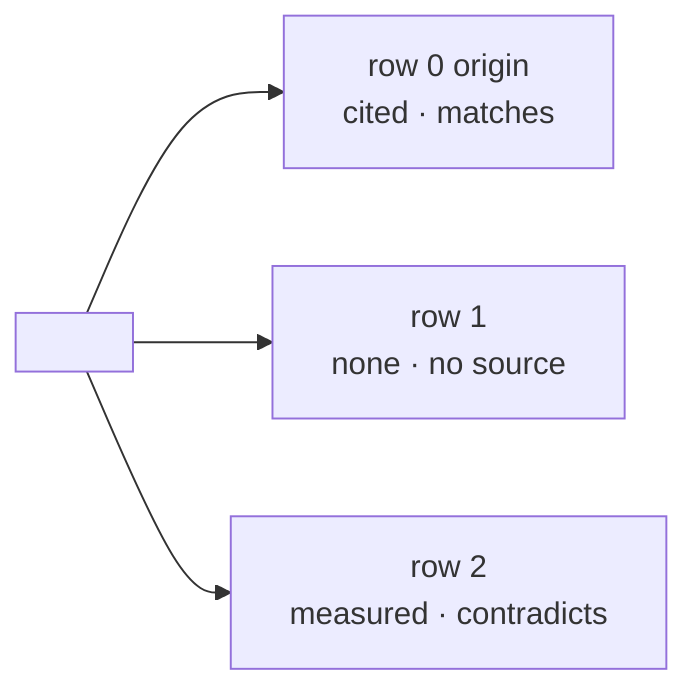

# why-this-logic Implementation Plan

> **For agentic workers:** REQUIRED SUB-SKILL: Use sp-subagent-driven-development (recommended) or sp-executing-plans to implement this plan task-by-task. Steps use checkbox (`- [ ]`) syntax for tracking.

**Goal:** Ship the `why-this-logic` skill in `dev-workflows` — one row per decision point, each with a source, one proof mark and one verdict, explained in plain words and taught until the user states the rule, written to `docs/why/<thing>.md`.

**Architecture:** A prose skill (no scripts): `SKILL.md` carries the eight-phase run; two reference files carry the splitting rules and the Why-file template; `evals/evals.json` carries four cases; a thin command wrapper, one PLAYBOOK row and router edge, a manifest clause and a version bump in both manifests; then the generated `skills/` tree is regenerated. The skill loads `ticket-trace` and `read-picture` for the git → ticket → image chain, borrows `asking-to-understand`'s close, points at `/wait-what` and never invokes it.

**Tech Stack:** Markdown skills (Claude Code + Antigravity, harness-neutral), JSON manifests, Python 3.10+ for the tree generator/checker, PowerShell for the version scan.

**Spec:** `docs/superpowers/specs/2026-10-29-why-this-logic-design.md` (ADRs 0261–0268 in `docs/adr/`; glossary section already in `CONTEXT.md`).

## Global Constraints

- **Harness-neutral wording** in every skill file: "load `ticket-trace` through your harness's mechanism", never "call the Skill tool"; the strings `Skill tool`, `Task tool`, `Read tool` must not appear in the skill.
- **`${CLAUDE_PLUGIN_ROOT}` only in the three rewritable shapes** — `/references/…`, `/scripts/…`, `/skills/…`. The skill uses exactly one: `${CLAUDE_PLUGIN_ROOT}/references/diagram-convention.md`. Its **own** files are referenced skill-relative: `references/splitting-rules.md`, `references/why-file-template.md`.
- **The skill never writes to a live system**, and never reads one without the per-run ask (ADR 0263). The words "read-only" and "run it?" are load-bearing in `SKILL.md` §4.3.
- **`wait-what` is never invoked** (`disable-model-invocation: true`); it is pointed at with one fixed line: `Not clear? Type /wait-what on the sentence.`
- **The four verdict words** are exactly `matches`, `contradicts`, `no source`, `cannot check from the document`; **the three marks** are exactly `cited`, `told`, `measured`; an unclosed row's Source line reads `none`.
- **Versions in sync:** `plugins/dev-workflows/.claude-plugin/plugin.json` and the `dev-workflows` entry in `.claude-plugin/marketplace.json` must report the same version. Today every ref holds `0.58.0`; the bump is to **global max + 1 minor**, recomputed at Task 4 (expected `0.59.0`).
- **PLAYBOOK row lands in the same commit as the skill** (CLAUDE.md convention) — Task 1 carries it.
- **`skills/` is generated, never hand-edited**; `python scripts/check_skills_tree.py` exits 0 today and must exit 0 after Task 5.
- **Commit trailer:** every commit message ends with `Co-Authored-By: Claude Fable 5.1 <noreply@anthropic.com>`.
- Run every command from the repo root in PowerShell.

---

## File structure

```
plugins/dev-workflows/skills/why-this-logic/
  SKILL.md                              the run (Task 1)
  references/splitting-rules.md         what is one decision point (Task 1)
  references/why-file-template.md       the Why file: header, overview, row block (Task 1)
  evals/evals.json                      four cases (Task 2)
plugins/dev-workflows/commands/why-this-logic.md   thin wrapper (Task 3)
PLAYBOOK.md                             one row + one edge (Task 1)
plugins/dev-workflows/.claude-plugin/plugin.json   clause + keywords + version (Task 4)
.claude-plugin/marketplace.json                    clause + version (Task 4)
skills/why-this-logic/…                 generated (Task 5)
```

---

### Task 1: The skill — `SKILL.md`, two references, PLAYBOOK row and edge

**Files:**
- Create: `plugins/dev-workflows/skills/why-this-logic/SKILL.md`
- Create: `plugins/dev-workflows/skills/why-this-logic/references/splitting-rules.md`
- Create: `plugins/dev-workflows/skills/why-this-logic/references/why-file-template.md`
- Modify: `PLAYBOOK.md:60` (router edge, after the `ticket-trace` edge) and `PLAYBOOK.md:100` (table row, after the `ticket-trace` row)

**Interfaces:**
- Produces: the skill name `why-this-logic` (frontmatter `name:`), the reference file names above (Task 5's generator copies `references/`), the phrase `Logic provenance` that Task 4's manifest clause uses, the row block's six line labels (`Where`, `Why it exists`, `Source`, `Verdict`, `To close it yourself`, `In plain words`) that Task 2's assertions check.

- [ ] **Step 1: Write the check that the skill files do not exist yet, and that the conventions can be measured**

Run:
```powershell
Test-Path plugins/dev-workflows/skills/why-this-logic/SKILL.md
```
Expected: `False`

- [ ] **Step 2: Create `SKILL.md`**

Write `plugins/dev-workflows/skills/why-this-logic/SKILL.md` with exactly this content:

````markdown
---
name: why-this-logic
description: 'Find where a condition or a value comes from and whether it is right - one row per decision point (every if, every term of an and/or, every literal, every default), each with its own source, one proof mark (cited / told / measured) and one verdict (matches / contradicts / no source / cannot check from the document) - then explain each row in plain words and ask one question until the user can state the rule themselves. The thing may be code, an Azure DevOps / GitHub / JIRA ticket, a document, or pasted text; the user may name a source folder or document. Use whenever the user asks "is this logic right", "why is this value 30 / 0.15 / 914120001", "where does this condition come from", "what is the reference for this", "ทำไมต้องมี if นี้", "ค่านี้มาจากไหน", "logic นี้ถูกไหม", "แหล่งอ้างอิงคืออะไร", or doubts a filter, a mapping, a threshold or a default they did not write. Searches git, the ticket and its images, the named folder, specs, generating scripts and tests before asking; never opens a live system without asking first, and never writes to one. Writes docs/why/<thing>.md and starts from its open rows next time. Not ticket-trace (one line -> one ticket, no verdict, no teaching), not asking-to-understand (questions about a whole artifact the user owns), not study-design-verify (how it SHOULD work - this skill asks why it IS the way it is).'
effort: max
---

# Why this logic

A developer looks at `if (days > 30)`, at `rate = 0.15`, at
`mgw_loggingstatus eq 914120001 or mgw_loggingstatus eq 914120003`, and cannot say whether
it is right - because they cannot say where it came from. Three things are tangled: *why
does this branch exist*, *where does this value come from*, and *which document, ticket or
person is the reference*. This skill untangles them one row at a time, and does not stop
at the table: it explains every row in plain words and asks one question until the user
can say the rule themselves.

**The failure this prevents:** one answer per function - "this comes from ticket #151" -
when the `30` came from that ticket, the `0.15` was changed later in a commit with no
ticket, and the status numbers map to labels that no document states. A per-function
answer hides that the rows have different origins, and that some have none.

## Three ideas the whole skill rests on

1. **The unit is one decision point, not one function.** Every comparison, every term of
   an `and`/`or`, every literal, every default is its own row with its own source and its
   own verdict (`references/splitting-rules.md`). Row 0 is always the origin of the text
   itself - a ticket body is often a copy of a script.
2. **Every closed row carries one proof mark.** *cited* (a file and line, or a commit),
   *told* (a person and a date), or *measured* (a read-only query against the live system,
   run only after the user said yes this run). A row with no mark is not closed.
3. **The session ends when the user states the rule, not when the table is written.** The
   explanation always comes before the question; the question is one, on the row that
   matters most; a wrong answer re-explains that one row and asks again.

## The run - eight phases

Say this one line before anything else, every run:

> I will break this into rows. For each row I find where it comes from, explain it, then
> ask you one question.

### 0. Open - ask only what the invocation did not give

Two things are needed: **what** to check (a function, a `file:line`, a ticket URL, a
document, pasted text) and, **if the user has one at hand**, a source (a folder, a
document, a ticket). Ask only for what is missing, in one question. An invocation that
carries both asks nothing and goes on. A source given here is a head start, not the whole
search - phase 2 still runs in full.

### 1. Split - one row per decision point

Apply `references/splitting-rules.md`. Write the row list before searching anything:

```
row  decision point (quoted as written)
0    origin of the text itself
1    <first term>
2    <second term>
...
```

More than about twelve rows: say so, and ask which part to trace first.

### 2. Search first - before asking anyone

In this order, per row, stopping when the row closes. **Write each hit on its row as it is
found, not in a batch at the end** - a crash or a compaction loses an unwritten search, and
the hit that contradicts the document is the one nobody can reconstruct.

| order | where | how |
|---|---|---|
| 1 | git | `git log -S "<the literal>" -- <file>`, `git blame -w -L <n>,<n> <file>`, the commit message; a ticket number in the message is followed exactly as `ticket-trace` Operation B follows it - load that skill through your harness's mechanism |
| 2 | the ticket | description, acceptance criteria, every comment, and **every attached image** through `read-picture` (kind `requirement`) - a requirement is often only an annotated screenshot |
| 3 | the folder or document the user named | every file in it, PDFs and images included |
| 4 | specs, ADRs, wikis in the project | the field's definition, the flow's description |
| 5 | generating scripts and templates | anything that could have *produced* the text - a backlog-population script, a scaffold, a template |
| 6 | tests | an assertion on the value is a source, and it names the intent |

A row closed here is **cited**: `file:line`, a commit hash, or `ticket #n (comment / image
name)`.

### 3. Close the rest - told, or measured after a yes

Two kinds of row survive the search:

**no source** - nothing found. Ask the user, *for these rows only*: "Do you have a
document or a person for row N?" A person's answer closes the row as **told: who, date**.
"I do not know" leaves it open.

**cannot check from the document** - the source and the logic use different handles: a
label where the logic has a number, a name where the config has an id, and only the live
system maps them. Write the **exact read-only query** that would close it on the row
(`dataverse:dv-metadata` for an option set, a `SELECT`, a `GET`), then ask **once per
run**, in this shape:

> Row N cannot be checked from the documents. This read-only query would close it:
> `<the query>`
> Run it? On no, the query stays on the row for you to run later.

Yes: run exactly that query, read-only, and close the row as **measured: the query**.
No, or no answer: the row stays open with the query on it. The ask is per run, never a
standing permission. **Never write to a live system, and never widen a yes to a second
query** - a second row needs its own ask.

### 4. Verdict - one of four, on every row

| verdict | meaning | row is |
|---|---|---|
| **matches** | a source exists and the logic agrees with it | closed |
| **contradicts** | a source exists and the logic disagrees - the number maps to a different label than the spec intends, the threshold differs from the ticket, the test asserts another value | closed |
| **no source** | nothing found, and no one asked could say | open |
| **cannot check from the document** | different handles; the query that would close it is on the row | open |

A verdict is written once the row is closed or declared open - never left blank.

### 5. Table, then explain - before any question

Print the table in monospace (a live terminal does not render Mermaid - see
`${CLAUDE_PLUGIN_ROOT}/references/diagram-convention.md`, *two render targets*):

```
row  decision point                       source                      mark      verdict
0    origin of the text                   scripts/populate_x.py:388   cited     matches
1    and mgw_loggingstatus … (the term)   —                           none      no source
2    914120001 / 914120003 (the numbers)  query on the row            none      cannot check from the document
```

Then explain **every row** in plain words - what the row is, where it comes from, what
the verdict means, and for *contradicts* what the source says instead. The register is
`wait-what`'s: a little context, ASD-STE100 Simplified Technical English, the project's
`CONTEXT.md` words. Short sentences. One idea per sentence. Present tense. Two or three
sentences per row. End the block with exactly this line:

> Not clear? Type /wait-what on the sentence.

Never invoke `wait-what` yourself - it runs only when the user types it.

### 6. One question, until the user states the rule

Pick the row that matters most: a *contradicts* row first, then *no source*, then
*cannot check*. Ask **one** question, in the manner of `asking-to-understand`:

> In your own words - why is row N here?

Classify the answer and move:

| the answer | the move |
|---|---|
| states the rule - names the source (or that there is none) and what the verdict means | close; go to phase 7 |
| repeats the code ("because the status is 1 or 3") | re-explain that one row (phase 5, that row only), ask again |
| names a source the search did not find | say what was searched and not found; ask whether they can point at it - a pointer re-enters phase 2 for that row |
| "I don't know" | re-explain that one row with the evidence on screen; ask once more; a second "I don't know" closes the run with the row open and the question written into the Why file |

Never more than one question per turn. Never a list of questions.

### 7. Write the Why file

Write `docs/why/<thing>.md` in the project being traced, from
`references/why-file-template.md` - one Mermaid overview, then one fixed-shape block per
row. Say the path. The *In plain words* line of each block is the same text the user was
shown in phase 5.

If any row's verdict is *contradicts*, end with exactly one line and stop:

> Row N contradicts its source - file it as a finding (`findings-to-ado-backlog`), or take
> it to `grill-then-plan` if the fix is a design choice?

The skill files nothing and fixes nothing.

### 8. A later run on the same thing

If `docs/why/<thing>.md` exists, open it **first**. Rows whose verdict is *matches* or
*contradicts* are not re-traced. Start at phase 3 for the rows still *no source* or
*cannot check*, with their queries already written - the per-run ask applies again. If
row 0's origin hash differs from the thing's current hash, say so and re-split.

## Rules that keep it honest

- **Read-only, always.** A `SELECT`, a `GET`, a metadata read. Never a write, never a
  "harmless" update.
- **Ask per run, per row.** A yes on row 2 is not a yes on row 5.
- **One mark or `none`.** A row with a source and no mark is a row nobody can trust later.
- **A person's word is a source, and is marked as one.** `told: Khun A, 2026-10-29` closes
  the row; it is never written as `cited`.
- **Record as found.** Every hit goes on its row before the next search.
- **Explain before you ask.** A question before the explanation tests memory, not
  understanding.

## Not this skill

| not this | because | hand-off |
|---|---|---|
| `ticket-trace` | answers *why* for one line via git -> ticket -> image, with no split, no verdict, no teaching; this skill **uses** its chain in phase 2 | loaded, not duplicated |
| `asking-to-understand` | questions a whole artifact the user owns; only its close is borrowed here - one grounded question per turn, ends when the rule is stated | borrowed, not invoked |
| `feynman-explain` | a stand-alone explanation card; here the explanation sits beside a row | - |
| `wait-what` | the user's own repair for one sentence; cannot be invoked by a skill | pointed at, every explaining block |
| `study-design-verify` | how it *should* work; this skill asks why it *is* this way | named in the phase-7 line when the fix is a design choice |
| `debug-mantra` | nothing is broken; a *contradicts* row is a finding, not a failure | - |
| `guide-and-verify`, `architect-and-verify` | their row block and their marks are copied; neither is loaded | - |

## Language

Mirror the language the user asked in - Thai in, Thai out, including the explanations and
the one question. Keep identifiers, file paths and the four verdict words in English.
````

- [ ] **Step 3: Create `references/splitting-rules.md`**

Write `plugins/dev-workflows/skills/why-this-logic/references/splitting-rules.md`:

````markdown
# Splitting rules - what is one decision point

One decision point is the smallest thing that could have its own source. If two parts of
a line could have come from two different tickets, two different people or two different
years, they are two rows.

## Split

| in the thing | one row each |
|---|---|
| `a and b`, `a or b` | each term |
| `x > 30`, `status eq 914120001` | the comparison **and** the literal, when the literal could come from somewhere other than the comparison (a threshold from a ticket, a code from an option set); otherwise one row |
| `rate = 0.15`, `"Vehicles"`, `MG_ReminderAgeDays (7)` | the literal |
| a default - `= 0`, `?? "UNMATCHED"`, `Default No` | the default |
| a branch - `if / else`, `case`, `switch` | the branch condition; the literals inside the body get their own rows |
| a filter in a ticket, a query in a flow, a mapping in a config, a rule in a document | the same rules - the thing need not be code |

## Do not split

- `i < list.length`, `item != null`, a loop guard - mechanics with no separate source: one
  row, or none.
- Two literals that the same sentence of the same source fixes together (`Mon-Fri 08:00`)
  - one row, citing that sentence.

## Always

- **Row 0 is the origin of the text itself** - the commit, the generating script, the
  template, the person who wrote the ticket body. On a ticket whose body a script
  produced, row 0 is what shows the ticket is a copy.
- Quote each decision point **as written** - the exact operator, the exact literal, the
  exact field name - so the row can be found again.
- Cap a run at the rows the user pointed at. More than about twelve: say so, and ask which
  part to trace first.

## Worked split - `Elevate` #151

```
and (mgw_loggingstatus eq 914120001 or mgw_loggingstatus eq 914120003)
```

| row | decision point |
|---|---|
| 0 | origin of the story text |
| 1 | `and (mgw_loggingstatus … )` - why the filter has this term at all |
| 2 | `914120001` and `914120003` - what the two numbers mean (one row: the same option set maps both; two rows if the sources turn out to differ) |

Row 1 and row 2 have different answers: the spec's Workflow 3 never names the field
(row 1: no source), and the spec defines the field by label only (row 2: cannot check
from the document).
````

- [ ] **Step 4: Create `references/why-file-template.md`**

Write `plugins/dev-workflows/skills/why-this-logic/references/why-file-template.md`:

````markdown
# The Why file - `docs/why/<thing>.md`

One file per thing traced, in the project being traced. Its shape is copied from
`guide-and-verify`'s runbook step: every block has every line, the reader learns the
shape once. Fill the slots; keep every label.

## Rules

- **Every block has all six lines.** A line with nothing to say carries `—`.
- **The Source line carries exactly one mark or `none`:** `cited <file:line | commit>`,
  `told <who, date>`, `measured <the query>`, or `none`.
- **The Verdict line is one of four words:** `matches`, `contradicts`, `no source`,
  `cannot check from the document`.
- **To close it yourself** on an open row is a command, a document to find, or a person
  to ask - never "ask around".
- **In plain words** is the same text the user saw during the run - two or three short
  sentences, Simplified Technical English, the project's `CONTEXT.md` words.
- The overview is Mermaid (a document renders it); the run's own table was monospace.

## Template

````markdown
# Why: <the thing, in the user's words>

- **Thing:** <file:line | ticket URL | document path>  ·  **Origin hash:** <row 0's commit, or —>
- **Traced:** <YYYY-MM-DD>  ·  **Rows:** <n> · closed <k> · open <n−k>
- **Sources searched:** git · ticket (+<m> images) · <folder> · specs · scripts · tests



## Row 0 — origin of the text

**Where:** <file:line | ticket #n | document path>
**Why it exists:** <one sentence, or "no document says">
**Source:** <cited file:line | told who, date | measured the query | none>
**Verdict:** <matches | contradicts | no source | cannot check from the document>
**To close it yourself:** <the read-only command | the document to find | whom to ask | —>
**In plain words:** <two or three sentences>

## Row 1 — <the decision point, quoted as written>

**Where:** …
**Why it exists:** …
**Source:** …
**Verdict:** …
**To close it yourself:** …
**In plain words:** …
````

## Worked block - `Elevate` #151, row 2, after the user said yes to the query

````markdown
## Row 2 — `914120001` and `914120003`

**Where:** story #151, OData filter, third term (generated by `scripts/populate_teams_agent_backlog.py:388`)
**Why it exists:** limits the reminder sweep to two of the four logging statuses
**Source:** measured `dv-metadata: mgw_telephoneenquiry.mgw_loggingstatus option set` → 914120001 = Created, 914120003 = Failed
**Verdict:** contradicts
**To close it yourself:** —
**In plain words:** The spec names four statuses. The filter keeps two: Created and Failed. It skips Partial. A Partial record is an enquiry that was logged but not fully. It gets no reminder. No document asks for that.
````
````

- [ ] **Step 5: Add the PLAYBOOK router edge**

In `PLAYBOOK.md`, directly after this line (line 60):

```
    WORK -- why does this exist? --> TT["ticket-trace"]
```

insert:

```
    WORK -- is this logic / value right? --> WTL["why-this-logic"]
    TT -. per-row, with a verdict .-> WTL
```

- [ ] **Step 6: Add the PLAYBOOK table row**

In `PLAYBOOK.md`, directly after this row (line 100, now ~102 after Step 5):

```
| "why does this code/ticket exist?" | `ticket-trace` |
```

insert:

```
| "is this condition / value right, and where does it come from?" — a filter, a threshold, a mapping, a default you did not write | `why-this-logic` (`/dev-workflows:why-this-logic`) — one row per decision point, each with its source and one proof mark (cited / told / measured) and one verdict (matches / contradicts / no source / cannot check); searches git, the ticket and its images, your folder, specs, scripts and tests before asking; never opens a live system without a yes; explains every row in plain words, then asks one question until you can state the rule; writes `docs/why/<thing>.md`. Not `ticket-trace` — that answers why for one line and stops (ADRs 0261–0268) |
```

- [ ] **Step 7: Verify the conventions**

Run:
```powershell
$s = Get-Content plugins/dev-workflows/skills/why-this-logic/SKILL.md -Raw
"frontmatter first line: " + ($s.StartsWith("---"))
"name line present: " + ($s -match "(?m)^name: why-this-logic$")
"harness words absent: " + (-not ($s -match "Skill tool|Task tool|Read tool"))
"only rewritable CLAUDE_PLUGIN_ROOT shapes: " + (([regex]::Matches($s, '\$\{CLAUDE_PLUGIN_ROOT\}/(references|scripts|skills)/').Count) -eq ([regex]::Matches($s, '\$\{CLAUDE_PLUGIN_ROOT\}').Count))
"own refs skill-relative: " + ($s -match "references/splitting-rules\.md" -and $s -match "references/why-file-template\.md" -and -not ($s -match "skills/why-this-logic/"))
"wait-what line present: " + ($s -match "Not clear\? Type /wait-what on the sentence\.")
"four verdicts present: " + ($s -match "\*\*matches\*\*" -and $s -match "\*\*contradicts\*\*" -and $s -match "\*\*no source\*\*" -and $s -match "\*\*cannot check from the document\*\*")
"refs exist: " + ((Test-Path plugins/dev-workflows/skills/why-this-logic/references/splitting-rules.md) -and (Test-Path plugins/dev-workflows/skills/why-this-logic/references/why-file-template.md))
"playbook edge: " + ((Get-Content PLAYBOOK.md -Raw) -match 'WTL\["why-this-logic"\]')
"playbook row: " + ((Get-Content PLAYBOOK.md -Raw) -match '\| `why-this-logic` \(`/dev-workflows:why-this-logic`\)')
```
Expected: every line ends with `True`.

- [ ] **Step 8: Commit**

```powershell
git add plugins/dev-workflows/skills/why-this-logic PLAYBOOK.md
git commit -m @'
feat(dev-workflows): why-this-logic - one row per decision point, cited / told / measured, taught until the user states the rule (ADRs 0261-0268)

Co-Authored-By: Claude Fable 5.1 <noreply@anthropic.com>
'@
```

---

### Task 2: The evals — `evals/evals.json`

**Files:**
- Create: `plugins/dev-workflows/skills/why-this-logic/evals/evals.json`

**Interfaces:**
- Consumes: the six row-block labels, the verdict and mark words, and the `/wait-what` line from Task 1.
- Produces: the file Task 5's generator copies into `skills/why-this-logic/evals/`.

- [ ] **Step 1: Write the file**

Write `plugins/dev-workflows/skills/why-this-logic/evals/evals.json`:

```json
{
  "skill_name": "why-this-logic",
  "evals": [
    {
      "id": 0,
      "name": "ticket-filter-numbers-only-live-system-knows",
      "prompt": "https://dev.azure.com/MackayGoodwin/Elevate/_boards/board/t/Elevate%20Team/Stories?workitem=151 — why does the OData filter say `and (mgw_loggingstatus eq 914120001 or mgw_loggingstatus eq 914120003)`? The source documents are in C:\\Repo\\MG-Elevate\\Documents\\2026-10-20_Teams_Calling_Agent_-_Side_Quest_p05UAAA= . Assume for this run: the folder's PROJECT_SPEC_AND_ANTIGRAVITY_PROMPT.md defines `mgw_loggingstatus (Choice): Creating, Created, Partial, Failed` and describes Workflow 3's query as `mgw_hasthecallbeenactioned eq false and callDateTime < Now - 7 days` with no mention of mgw_loggingstatus; the story's body is produced verbatim by scripts/populate_teams_agent_backlog.py line 388; no document in the repo contains the numbers 914120001 or 914120003. You have Dataverse credentials in the environment. If you ask whether to run a live query, my answer is no.",
      "expected_output": "The one-line shape statement first. A row list with row 0 = origin of the text (the generating script, cited), one row for the `and (mgw_loggingstatus …)` term (no source — the spec lists two filter terms and never names the field), one row for the two numbers (cannot check from the document — the spec defines labels only). The exact read-only query that would close the numbers row written on it, an explicit ask whether to run it, and NO query run because the answer is no. Every row explained in plain words BEFORE a single question, the block ending with the /wait-what line; then exactly one question. Writes or describes docs/why/elevate-151-overdue-filter.md with the open rows carrying their query.",
      "files": [],
      "assertions": [
        "Opens with the one-line statement that it will break the thing into rows, find each source, explain, then ask one question",
        "Row 0 is the origin of the story text and cites scripts/populate_teams_agent_backlog.py line 388, stating the ticket is a copy of the script",
        "Has a separate row for the `and (mgw_loggingstatus …)` term with verdict 'no source', citing that the spec's Workflow 3 lists two filter terms and does not name the field",
        "Has a separate row for the numbers 914120001 / 914120003 with verdict 'cannot check from the document', stating the spec defines the field by label only",
        "Writes the exact read-only query (a Dataverse option-set metadata read on mgw_loggingstatus) on the numbers row",
        "Asks the user whether to run that query, and after the user's no does not run it and leaves the query on the row",
        "Does not run any live query before asking, and never writes to the live system",
        "Explains every row in short plain sentences BEFORE asking any question, and ends the explanation block with the line 'Not clear? Type /wait-what on the sentence.'",
        "Asks exactly one question, about one row, in the user's own words form ('in your own words, why is row N here?')",
        "Names the Why file path docs/why/<thing>.md and shows or describes blocks that carry all six lines (Where, Why it exists, Source, Verdict, To close it yourself, In plain words)",
        "Does not present the term row as 'cited' or the numbers row as 'measured' — no mark is claimed that was not earned"
      ]
    },
    {
      "id": 1,
      "name": "threshold-in-code-cited-from-test",
      "prompt": "In src/billing/overdue.ts there is `if (daysSinceInvoice > 30) { markOverdue(invoice) }`. Is 30 right? Where does it come from? Assume for this run: `git log -S \"> 30\" -- src/billing/overdue.ts` returns one commit `a1b2c3d feat: overdue flag` with no ticket number; there is no ticket; tests/billing/overdue.test.ts line 14 asserts `expect(isOverdue(31)).toBe(true)` and line 15 asserts `expect(isOverdue(30)).toBe(false)`; I do not have any document for this.",
      "expected_output": "Git searched first, then tests; the test file and lines cited as the source of the 30; verdict matches; the user is NOT asked for a document for a row the test already closed; the Why file path named.",
      "files": [],
      "assertions": [
        "Searches git (names the git log -S result and the commit) before asking the user for anything",
        "Cites tests/billing/overdue.test.ts lines 14-15 as the source of the 30, with mark 'cited'",
        "Gives the `> 30` row the verdict 'matches' because the test asserts 31 overdue and 30 not",
        "Does not ask the user for a document or a person for the row the test closed",
        "Row 0 (origin of the text) cites commit a1b2c3d and notes it carries no ticket number",
        "Explains the rows in plain words before asking one question, and asks exactly one",
        "Names the Why file path under docs/why/"
      ]
    },
    {
      "id": 2,
      "name": "person-is-the-only-source",
      "prompt": "config/defaults.yaml has `reminder_age_days: 7`. Why 7? Assume for this run: git blame shows the line in the initial commit `0000abc initial commit`; there is no ticket, no spec, no test that mentions it. When you ask me, my answer is: Khun A set it last March, she said a week felt right.",
      "expected_output": "The search is exhausted and reported; the user is asked for a document or a person for that row only; the answer closes the row as told (Khun A, March) and not as cited; the Why file's Source line reads 'told …'.",
      "files": [],
      "assertions": [
        "Reports what was searched (git, ticket, specs, tests) and that nothing was found, before asking the user",
        "Asks the user for a document or a person for the `7` row only",
        "Closes the row with mark 'told' naming Khun A and the date (March), not with mark 'cited'",
        "The Why file block's Source line reads 'told …' and the verdict is 'matches'",
        "Does not present a person's word as a document, and does not leave the row open after the answer",
        "Explains the row in plain words before asking one question, then asks exactly one"
      ]
    },
    {
      "id": 3,
      "name": "rerun-starts-from-open-rows",
      "prompt": "/why-this-logic #151 the status filter again. docs/why/elevate-151-overdue-filter.md already exists from last week: row 0 (origin, cited, matches), row 1 (the mgw_loggingstatus term, told: user 2026-10-29, matches), row 2 (the numbers, cannot check from the document) with this on its To-close line: `dv-metadata: read the option set of mgw_telephoneenquiry.mgw_loggingstatus`. Origin hash unchanged. You have credentials. If you ask, my answer is yes.",
      "expected_output": "The existing Why file is opened first; rows 0 and 1 are not re-traced and nothing is asked about them; the run starts at row 2's query with the per-run ask; on yes the query runs read-only and row 2 closes as measured; the file is updated in place.",
      "files": [],
      "assertions": [
        "Opens docs/why/elevate-151-overdue-filter.md before doing any search",
        "Does not re-trace or re-ask about rows 0 and 1",
        "Starts at row 2 and asks once whether to run the query already written on the row",
        "After the yes, runs only that read-only query and closes row 2 with mark 'measured' and the query on the Source line",
        "Updates the existing Why file in place rather than creating a second file",
        "Explains row 2's new verdict in plain words before asking one question"
      ]
    }
  ]
}
```

- [ ] **Step 2: Validate the JSON and the shape**

Run:
```powershell
python -c "import json,sys; d=json.load(open('plugins/dev-workflows/skills/why-this-logic/evals/evals.json',encoding='utf-8')); assert d['skill_name']=='why-this-logic'; assert [e['id'] for e in d['evals']]==[0,1,2,3]; assert all(set(e)=={'id','name','prompt','expected_output','files','assertions'} for e in d['evals']); print('ok', len(d['evals']), 'cases')"
```
Expected: `ok 4 cases`

- [ ] **Step 3: Commit**

```powershell
git add plugins/dev-workflows/skills/why-this-logic/evals/evals.json
git commit -m @'
test(why-this-logic): four eval cases - a ticket filter only the live system can close, a threshold cited from a test, a person as the only source, a rerun from open rows

Co-Authored-By: Claude Fable 5.1 <noreply@anthropic.com>
'@
```

---

### Task 3: The command wrapper

**Files:**
- Create: `plugins/dev-workflows/commands/why-this-logic.md`

**Interfaces:**
- Consumes: the skill name `why-this-logic` from Task 1.
- Produces: `/dev-workflows:why-this-logic`; Task 5's generator reads this file's `argument-hint`.

- [ ] **Step 1: Write the file**

Write `plugins/dev-workflows/commands/why-this-logic.md`, in the shape of `commands/ask.md`:

```markdown
---
description: Is this condition / value right, and where does it come from? One row per decision point — source, one proof mark (cited / told / measured), one verdict — explained in plain words, then one question until you can state the rule. Writes docs/why/<thing>.md.
argument-hint: "<function, ticket URL, file:line, or pasted text> [source folder or document]"
---

Use the **`why-this-logic`** skill. Say the one-line shape first, split into rows, search before asking, explain before asking, one question until the rule.

Argument: $ARGUMENTS
```

- [ ] **Step 2: Verify the frontmatter parses the same way the other wrappers do**

Run:
```powershell
$c = Get-Content plugins/dev-workflows/commands/why-this-logic.md -Raw
"starts with ---: " + $c.StartsWith("---")
"has description: " + ($c -match "(?m)^description: ")
"has argument-hint: " + ($c -match "(?m)^argument-hint: ")
"hands off ARGUMENTS: " + ($c -match '\$ARGUMENTS')
```
Expected: four `True`.

- [ ] **Step 3: Commit**

```powershell
git add plugins/dev-workflows/commands/why-this-logic.md
git commit -m @'
feat(dev-workflows): /dev-workflows:why-this-logic command wrapper

Co-Authored-By: Claude Fable 5.1 <noreply@anthropic.com>
'@
```

---

### Task 4: Manifests — clause, keywords, version

**Files:**
- Modify: `plugins/dev-workflows/.claude-plugin/plugin.json:5` (description) and `:159-160` (keywords tail), `:4` (version)
- Modify: `.claude-plugin/marketplace.json:35` (description) and `:36` (version)

**Interfaces:**
- Consumes: nothing from code; the skill's one-line summary from the spec.
- Produces: the version both manifests report, which Task 6 re-verifies at merge.

- [ ] **Step 1: Compute the version from the global max**

Run:
```powershell
$seen = @{}
foreach ($ref in (git for-each-ref --format='%(refname)' refs/heads refs/remotes)) {
  foreach ($f in 'plugins/dev-workflows/.claude-plugin/plugin.json','.claude-plugin/marketplace.json') {
    $txt = git show "${ref}:$f" 2>$null
    if ($txt) { foreach ($x in [regex]::Matches(($txt -join "`n"), '"version":\s*"(\d+\.\d+\.\d+)"')) { $seen[$x.Groups[1].Value] = 1 } }
  }
}
$max = ($seen.Keys | ForEach-Object { [version]$_ } | Sort-Object | Select-Object -Last 1)
"global max: $max  ->  next: $($max.Major).$($max.Minor + 1).0"
```
Expected today: `global max: 0.58.0  ->  next: 0.59.0`. **Use the printed `next` value in every step below** — if another branch has landed a higher version, the printed value wins.

- [ ] **Step 2: Insert the clause in `plugin.json`**

In `plugins/dev-workflows/.claude-plugin/plugin.json` line 5, replace the one occurrence of

```
ticket-trace. Picture reading: read-picture
```

with

```
ticket-trace. Logic provenance: why-this-logic (/dev-workflows:why-this-logic - is this condition or value right, and where does it come from: one row per decision point - every if, every and/or term, every literal, every default - each with its source, one proof mark (cited / told / measured) and one verdict (matches / contradicts / no source / cannot check from the document); searches git, the ticket and its images, the named folder, specs, generating scripts and tests before asking, never opens a live system without a per-run yes and never writes to one; explains every row in plain words in wait-what's register, then asks one question until the user states the rule; writes docs/why/<thing>.md and starts from its open rows next time. ADRs 0261-0268). Picture reading: read-picture
```

- [ ] **Step 3: Add the keywords in `plugin.json`**

Replace

```
    "error-analysis"
  ]
```

with

```
    "error-analysis",
    "why-this-logic",
    "provenance",
    "logic-provenance",
    "where-does-this-value-come-from",
    "is-this-logic-right",
    "decision-point",
    "cited-told-measured"
  ]
```

- [ ] **Step 4: Bump the version in `plugin.json`**

Replace `"version": "0.58.0",` (line 4) with `"version": "<next>",` using the value from Step 1 (expected `0.59.0`).

- [ ] **Step 5: Insert the clause in `marketplace.json`**

In `.claude-plugin/marketplace.json` line 35, replace the one occurrence of

```
ticket-trace. Picture reading: read-picture
```

with

```
ticket-trace. Logic provenance: why-this-logic (/dev-workflows:why-this-logic - is this condition or value right, and where does it come from: one row per decision point with its source, one proof mark (cited / told / measured) and one verdict (matches / contradicts / no source / cannot check from the document); searches git, the ticket and its images, the named folder, specs, scripts and tests before asking, never opens a live system without a per-run yes; explains every row in plain words, then asks one question until the user states the rule; writes docs/why/<thing>.md. ADRs 0261-0268). Picture reading: read-picture
```

- [ ] **Step 6: Bump the version in `marketplace.json`**

Replace `"version": "0.58.0",` on line 36 (the `dev-workflows` entry — not the marketplace's own `"version": "0.4.0"` on line 9) with `"version": "<next>",`.

- [ ] **Step 7: Verify both manifests parse and agree**

Run:
```powershell
python -c "import json; p=json.load(open('plugins/dev-workflows/.claude-plugin/plugin.json',encoding='utf-8')); m=json.load(open('.claude-plugin/marketplace.json',encoding='utf-8')); e=[x for x in m['plugins'] if x['name']=='dev-workflows'][0]; assert p['version']==e['version'], (p['version'],e['version']); assert 'Logic provenance: why-this-logic' in p['description'] and 'Logic provenance: why-this-logic' in e['description']; assert 'why-this-logic' in p['keywords']; print('versions agree:', p['version'])"
```
Expected: `versions agree: 0.59.0` (or the Step 1 value).

- [ ] **Step 8: Commit**

```powershell
git add plugins/dev-workflows/.claude-plugin/plugin.json .claude-plugin/marketplace.json
git commit -m @'
chore(dev-workflows): 0.58.0 -> 0.59.0 - why-this-logic in both manifests

Co-Authored-By: Claude Fable 5.1 <noreply@anthropic.com>
'@
```
(Put the real `from -> to` in the subject if Step 1 printed a different value.)

---

### Task 5: Regenerate the `skills/` tree

**Files:**
- Create (generated): `skills/why-this-logic/SKILL.md`, `skills/why-this-logic/references/splitting-rules.md`, `skills/why-this-logic/references/why-file-template.md`, `skills/why-this-logic/references/diagram-convention.md`, `skills/why-this-logic/evals/evals.json`

**Interfaces:**
- Consumes: everything Tasks 1–3 created.
- Produces: the installable copy that `check_skills_tree.py` guards.

- [ ] **Step 1: Confirm the checker fails before regeneration**

Run:
```powershell
python scripts/check_skills_tree.py; "EXIT=$LASTEXITCODE"
```
Expected: findings naming `skills/why-this-logic` as missing, `EXIT=1`.

- [ ] **Step 2: Regenerate**

Run:
```powershell
python scripts/generate_skills_tree.py
```
Expected: no error; `skills/why-this-logic/` now exists.

- [ ] **Step 3: Confirm the checker and the generator's own tests pass**

Run:
```powershell
python scripts/check_skills_tree.py; "EXIT=$LASTEXITCODE"
python scripts/test_generate_skills_tree.py
python scripts/test_check_skills_tree.py
```
Expected: `skills/ matches plugins/*/skills/`, `EXIT=0`; both test files end with `OK`.

- [ ] **Step 4: Confirm the resolved copy reads the diagram convention locally**

Run:
```powershell
(Get-Content skills/why-this-logic/SKILL.md -Raw) -match 'references/diagram-convention\.md'
Test-Path skills/why-this-logic/references/diagram-convention.md
Test-Path skills/why-this-logic/evals/evals.json
```
Expected: `True` three times.

- [ ] **Step 5: Commit**

```powershell
git add skills/why-this-logic
git commit -m @'
chore(skills): regenerate skills/ for why-this-logic

Co-Authored-By: Claude Fable 5.1 <noreply@anthropic.com>
'@
```

---

### Task 6: Final verification against the spec

**Files:**
- Read: `docs/superpowers/specs/2026-10-29-why-this-logic-design.md`, the five files created in Tasks 1–3.

- [ ] **Step 1: Re-verify the version against the global max** (CLAUDE.md: re-verify at merge, not only at creation)

Run the Step 1 script of Task 4 again. Expected: the printed global max is now the version the manifests carry (the bump itself), and no other ref carries a higher one. If one does, bump again to its max + 1 minor in both manifests and amend nothing — make a new commit `chore(dev-workflows): <from> -> <to> - re-minted against the global max`.

- [ ] **Step 2: Walk the spec's §11 consistency list and tick each**

| spec section | plan artifact | check |
|---|---|---|
| §3 frontmatter + description | `SKILL.md` lines 1–5 | description text identical to the spec's quoted block |
| §4.0–4.8 eight phases | `SKILL.md` "The run" | eight `###` headings 0–8 present |
| §4.3 per-run ask wording | `SKILL.md` phase 3 | the three-line ask block present; "never widen a yes" present |
| §4.5 explain before ask + `/wait-what` line | `SKILL.md` phase 5 | the fixed line present verbatim |
| §4.6 answer table | `SKILL.md` phase 6 | four answer classes |
| §4.7 contradicts offer line | `SKILL.md` phase 7 | one line, offers `findings-to-ado-backlog` / `grill-then-plan`, "files nothing" |
| §5 splitting rules | `references/splitting-rules.md` | the six split rows, the do-not-split rules, row 0 rule, the twelve-row cap |
| §6 four verdicts | `SKILL.md` phase 4 | exact four words |
| §7 Why file template | `references/why-file-template.md` | six labelled lines; one mark or `none`; worked block |
| §8 boundaries | `SKILL.md` "Not this skill" | seven rows |
| §9 PLAYBOOK row + edge, manifests, tree | Tasks 1, 4, 5 | committed |
| §10 four evals | `evals/evals.json` | ids 0–3, names as in the spec |

Expected: every row ticks. A miss is fixed in the file it names, with a `fix(why-this-logic): …` commit.

- [ ] **Step 3: Run the two repo gates once more**

Run:
```powershell
python scripts/check_skills_tree.py; "EXIT=$LASTEXITCODE"
python plugins/dev-workflows/scripts/check_vendored_superpowers.py --strict; "EXIT=$LASTEXITCODE"
git status --short
```
Expected: `EXIT=0` twice; `git status --short` prints nothing.

---

## Self-review

**Spec coverage.** §1 problem → the opening of `SKILL.md`; §2 scope in → Tasks 1–5, scope out → nothing in the plan edits `ticket-trace`, `asking-to-understand`, `wait-what`, `read-picture`, `architect-and-verify`, adds no validator script, files nothing; §3 files and frontmatter → Task 1 Step 2, Task 3; §4 the run → `SKILL.md` phases 0–8; §5 → `splitting-rules.md`; §6 → phase 4 table; §7 → `why-file-template.md`; §8 → "Not this skill"; §9 → Task 1 Steps 5–6, Task 4, Task 5; §10 → Task 2; §11 → Task 6. No gap found.

**Placeholder scan.** `<thing>`, `<n>`, `<query>`, `<next>` are run-time or Step-1-computed slots, each defined where it appears; no TBD/TODO; every code step shows its content.

**Type consistency.** The six block labels are spelled identically in `SKILL.md` phase 7, `why-file-template.md`, and `evals.json` case 0's assertion; the four verdict words and three marks are identical across `SKILL.md`, both references, the PLAYBOOK row, both manifest clauses and `CONTEXT.md`; the command name `why-this-logic` matches `name:` in the frontmatter and the PLAYBOOK row's `/dev-workflows:why-this-logic`.
