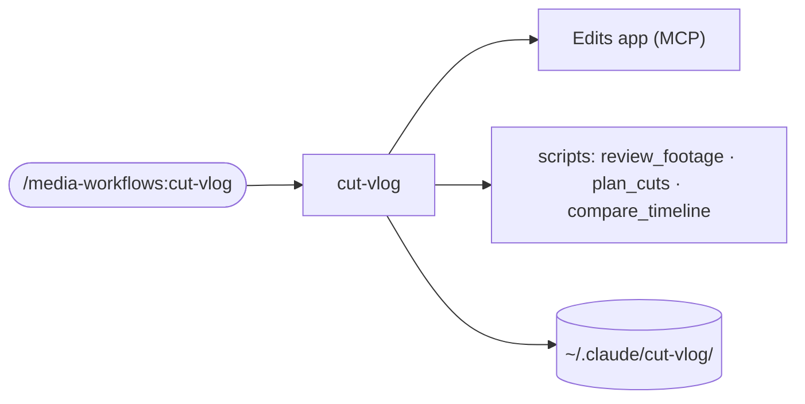

# cut-vlog Implementation Plan

> **Note:** Tasks 0–6 were executed on 2026-11-07/08; review fix rounds changed the code after the plan was written — the committed files are authoritative, not the code blocks below.

> **For agentic workers:** REQUIRED SUB-SKILL: Use sp-subagent-driven-development (recommended) or sp-executing-plans to implement this plan task-by-task. Steps use checkbox (`- [ ]`) syntax for tracking.

**Goal:** Ship a new opt-in plugin, `media-workflows`, whose `cut-vlog` skill cuts a day's footage in Meta's Edits app on a Mac into a vlog on the beat of a song the user picks. Every edit is checked against the plan by three tested Python scripts.

**Architecture:** The skill (`SKILL.md`) is the run: Phases 0–8. Three reference files hold what changes on its own: the Edits tool behaviours, the style-file template and the edit-record layout. Three stdlib-only scripts do the arithmetic. `review_footage.py` reviews the clips with ffmpeg. `plan_cuts.py` turns beats into frame-exact cuts. `compare_timeline.py` checks a timeline read-back against the plan, and checks render onsets. The scripts never call Edits: the agent calls the MCP tools and passes JSON to them. Everything about the user lives in `~/.claude/cut-vlog/` and never enters the repository.

**Tech Stack:** Python 3.10+ standard library (`unittest`, `argparse`, `json`, `subprocess`, `concurrent.futures`); ffmpeg/ffprobe; the Edits MCP server (`metapilot-native`); Markdown skills in this marketplace's plugin layout.

**Spec:** [docs/superpowers/specs/2026-11-07-cut-vlog-design.md](../specs/2026-11-07-cut-vlog-design.md). ADRs 0290–0312 are in `docs/adr/`. Read the spec before any task. The plan argues from it.

## Global Constraints

- **The repo is public.** No family detail, real clip name, person, place or song from the first run goes into any file. Examples are neutral, for example "a wave breaks on the beach" or "no close-ups of the people in the background" (ADR 0291).
- **No secret.** The Edits MCP bearer token (in `~/.claude.json`) is never written into any file.
- **The privacy denylist lives outside the repo,** at `~/.claude/cut-vlog/denylist.txt`, one extended regular expression per line. The owner writes it; it is never committed, and its words never appear in any repo file. Every privacy sweep reads it with `grep -i -E -f ~/.claude/cut-vlog/denylist.txt`, so the sweep covers this plan too.
- **The user's files live only in** `~/.claude/cut-vlog/`: `style.md`, and `projects/<edits-project-id>/{record.md, plan.json, review/, checks/}` (ADRs 0291, 0297, 0308).
- **The skills stay harness-neutral.** Name actions, not one harness's tools. Use `${CLAUDE_PLUGIN_ROOT}` only as `${CLAUDE_PLUGIN_ROOT}/scripts/…`. Reference the skill's own files skill-relative (`references/x.md`).
- **The commands are thin:** `description` and `argument-hint` frontmatter, with the work handed to the skill via `$ARGUMENTS`.
- **Versions:** `media-workflows` is `0.1.0` in its `plugin.json` and in its marketplace entry. The marketplace's own version goes `0.4.0` → `0.5.0`. Both values are minted from the global max: re-check them before merge (Task 7).
- **Python 3.10+, standard library only.** ffmpeg and ffprobe are external tools. The scripts never call Edits (ADR 0298).
- **Run the tests with** `python3 -m unittest discover -s plugins/media-workflows/scripts -p 'test_*.py'` from the repo root. This Mac has no `pytest` and no `python` command, only `python3`.
- **Mac + Edits only** (ADR 0292). If the Edits tools do not load, the skill stops (ADR 0293).
- **Worktree:** `/Users/liusp/Documents/repo/workflow-daily-work-video-edit`, branch `video-edit-skill`. Never touch the main worktree (`/Users/liusp/Documents/repo/workflow-daily-work`). It holds someone else's uncommitted work.
- **Commits:** ask the owner before the first commit of the session. After a yes, commit at each task's commit step. Never push unless the owner asks.
- **Every new skill adds a PLAYBOOK row in the same commit** as the skill. Here that is Task 6: the skill's files land in Tasks 4–5 and are wired up in Task 6, and Tasks 4–6 may be committed together if a reviewer asks.

## File map

```
plugins/media-workflows/
  .claude-plugin/plugin.json          Task 6 - manifest, v0.1.0
  README.md                           Task 6 - plugin overview, requirements, tests
  commands/cut-vlog.md                Task 5 - thin /media-workflows:cut-vlog
  skills/cut-vlog/
    SKILL.md                          Task 5 - the run, Phases 0-8
    references/edits-tools.md         Task 4 - what each Edits tool really does (spec §7)
    references/style-file.md          Task 4 - the style-file template (spec §5)
    references/edit-record.md         Task 4 - the record folder, plan.json, checks/ (spec §8)
    evals/evals.json                  Task 5 - four eval cases (spec §9)
  scripts/
    plan_cuts.py + test_plan_cuts.py              Task 1
    compare_timeline.py + test_compare_timeline.py Task 2
    review_footage.py + test_review_footage.py    Task 3
    fixtures/plan_first_run.json                  Task 1
    fixtures/timeline_first_run.json              Task 2
    fixtures/onsets_first_run.json                Task 2
.claude-plugin/marketplace.json       Task 6 - new entry, marketplace 0.5.0
README.md, PLAYBOOK.md, CLAUDE.md, AGENTS.md   Task 6
skills/cut-vlog/                      Task 6 - generated, never hand-edited
```

---

### Task 0: Commit the design

**Files:** already written during the grilling and still uncommitted in the worktree: `CONTEXT.md` (the video-editing section), `docs/adr/workflow-daily-work-0290-…` through `-0312-…` (23 files), `docs/superpowers/specs/2026-11-07-cut-vlog-design.md`, and this plan.

- [ ] **Step 1: Check that nothing private is in them**

Run:
```bash
cd /Users/liusp/Documents/repo/workflow-daily-work-video-edit
git status --short
{ git diff -U0 CONTEXT.md | grep '^+'; cat docs/adr/workflow-daily-work-0{290..312}-*.md docs/superpowers/specs/2026-11-07-cut-vlog-design.md; } | grep -n -i -E -f ~/.claude/cut-vlog/denylist.txt
```
Expected: `git status` lists only those files. The grep prints nothing.

- [ ] **Step 2: Ask the owner before this first commit, then commit**

```bash
git add CONTEXT.md docs/adr/workflow-daily-work-0{290..312}-*.md docs/superpowers/specs/2026-11-07-cut-vlog-design.md docs/superpowers/plans/2026-11-07-cut-vlog.md
git commit -m "docs: cut-vlog design - spec, plan, ADRs 0290-0312, video-editing terms

Co-Authored-By: Claude Opus 5.5 <noreply@anthropic.com>"
```

---

### Task 1: `plan_cuts.py` — beats to frame-exact cuts

**Files:**
- Create: `plugins/media-workflows/scripts/fixtures/plan_first_run.json`
- Create: `plugins/media-workflows/scripts/test_plan_cuts.py`
- Create: `plugins/media-workflows/scripts/plan_cuts.py`

**Interfaces:**
- Consumes: nothing.
- Produces:
  - `plan_cuts.to_frame(seconds: float, fps: int) -> int`: the nearest frame, with halves rounded up.
  - `plan_cuts.compute(plan: dict) -> tuple[dict, list[str]]`: adds `n, start, end, duration, source_out, trim_start, trim_end` to every shot, all rounded to 3 decimals, plus a top-level `drop_check` dict with keys `ok, drop_timeline, drop_shot, boundary, offset_frames, suggested_song_in`.
  - CLI `plan_cuts.py <plan.json>`: on success it writes the fields back to the file and exits 0. On any error it prints one line per error, leaves the file unchanged and exits 1.
  - Plan fields read: `fps, bpm, song_in, drop, shots[].{clip, alias_id, full_duration, source_in, beats, part}`. `part` is `"slow"` or `"fast"`. The first `fast` shot is the drop shot.

The fixture uses the first run's real numbers under neutral names: 126 BPM, the drop at song time 33.35 s, in-point 18.1 s, 21 shots and 30 fps. That is 32 slow beats followed by 46 fast beats. The drop must land on shot 6's start at 15.233 s, and the whole cut is 78 beats = 37.133 s.

- [ ] **Step 1: Write the fixture**

`plugins/media-workflows/scripts/fixtures/plan_first_run.json`:
```json
{
  "fps": 30, "bpm": 126, "song_in": 18.1, "drop": 33.35,
  "song": {"title": "Example Song", "audio_asset_id": "SONG-1"},
  "shots": [
    {"clip": "clip-01.mov", "alias_id": "ALIAS-01", "full_duration": 8.8, "source_in": 0.5, "beats": 8, "part": "slow"},
    {"clip": "clip-02.mov", "alias_id": "ALIAS-02", "full_duration": 8.8, "source_in": 0.5, "beats": 8, "part": "slow"},
    {"clip": "clip-03.mov", "alias_id": "ALIAS-03", "full_duration": 6.4, "source_in": 0.5, "beats": 4, "part": "slow"},
    {"clip": "clip-04.mov", "alias_id": "ALIAS-04", "full_duration": 7.6, "source_in": 0.5, "beats": 6, "part": "slow"},
    {"clip": "clip-05.mov", "alias_id": "ALIAS-05", "full_duration": 7.6, "source_in": 0.5, "beats": 6, "part": "slow"},
    {"clip": "clip-06.mov", "alias_id": "ALIAS-06", "full_duration": 6.4, "source_in": 0.5, "beats": 4, "part": "fast"},
    {"clip": "clip-07.mov", "alias_id": "ALIAS-07", "full_duration": 5.2, "source_in": 0.5, "beats": 2, "part": "fast"},
    {"clip": "clip-08.mov", "alias_id": "ALIAS-08", "full_duration": 5.2, "source_in": 0.5, "beats": 2, "part": "fast"},
    {"clip": "clip-09.mov", "alias_id": "ALIAS-09", "full_duration": 5.2, "source_in": 0.5, "beats": 2, "part": "fast"},
    {"clip": "clip-10.mov", "alias_id": "ALIAS-10", "full_duration": 5.2, "source_in": 0.5, "beats": 2, "part": "fast"},
    {"clip": "clip-11.mov", "alias_id": "ALIAS-11", "full_duration": 6.4, "source_in": 0.5, "beats": 4, "part": "fast"},
    {"clip": "clip-12.mov", "alias_id": "ALIAS-12", "full_duration": 5.2, "source_in": 0.5, "beats": 2, "part": "fast"},
    {"clip": "clip-13.mov", "alias_id": "ALIAS-13", "full_duration": 5.2, "source_in": 0.5, "beats": 2, "part": "fast"},
    {"clip": "clip-14.mov", "alias_id": "ALIAS-14", "full_duration": 5.2, "source_in": 0.5, "beats": 2, "part": "fast"},
    {"clip": "clip-15.mov", "alias_id": "ALIAS-15", "full_duration": 11.2, "source_in": 0.5, "beats": 12, "part": "fast"},
    {"clip": "clip-16.mov", "alias_id": "ALIAS-16", "full_duration": 5.2, "source_in": 0.5, "beats": 2, "part": "fast"},
    {"clip": "clip-17.mov", "alias_id": "ALIAS-17", "full_duration": 5.2, "source_in": 0.5, "beats": 2, "part": "fast"},
    {"clip": "clip-18.mov", "alias_id": "ALIAS-18", "full_duration": 5.2, "source_in": 0.5, "beats": 2, "part": "fast"},
    {"clip": "clip-19.mov", "alias_id": "ALIAS-19", "full_duration": 5.2, "source_in": 0.5, "beats": 2, "part": "fast"},
    {"clip": "clip-20.mov", "alias_id": "ALIAS-20", "full_duration": 5.2, "source_in": 0.5, "beats": 2, "part": "fast"},
    {"clip": "clip-21.mov", "alias_id": "ALIAS-21", "full_duration": 5.2, "source_in": 0.5, "beats": 2, "part": "fast"}
  ]
}
```

- [ ] **Step 2: Write the failing test**

`plugins/media-workflows/scripts/test_plan_cuts.py`:
```python
import copy
import json
import os
import subprocess
import sys
import tempfile
import unittest
from pathlib import Path

import plan_cuts

HERE = Path(__file__).resolve().parent
FIXTURE = HERE / "fixtures" / "plan_first_run.json"


def load():
    return json.loads(FIXTURE.read_text(encoding="utf-8"))


class FirstRunNumbers(unittest.TestCase):
    """126 BPM, drop at song time 33.35 s, in-point 18.1 s, 21 shots, 30 fps."""

    def setUp(self):
        self.plan, self.errors = plan_cuts.compute(load())

    def test_no_errors(self):
        self.assertEqual(self.errors, [])

    def test_drop_lands_on_the_first_fast_shot_at_15_233(self):
        dc = self.plan["drop_check"]
        self.assertTrue(dc["ok"])
        self.assertEqual(dc["drop_shot"], 6)
        self.assertEqual(dc["boundary"], 15.233)
        self.assertEqual(dc["drop_timeline"], 15.25)
        self.assertAlmostEqual(dc["offset_frames"], 0.51, places=2)

    def test_total_length_is_78_beats_rounded_to_a_frame(self):
        self.assertEqual(self.plan["shots"][-1]["end"], 37.133)

    def test_every_boundary_is_a_whole_frame(self):
        for s in self.plan["shots"]:
            for key in ("start", "end"):
                frames = s[key] * 30
                self.assertAlmostEqual(frames, round(frames), delta=0.02, msg=(s["n"], key))

    def test_shots_are_contiguous(self):
        shots = self.plan["shots"]
        self.assertEqual(shots[0]["start"], 0.0)
        for a, b in zip(shots, shots[1:]):
            self.assertEqual(a["end"], b["start"])

    def test_a_two_beat_shot_and_the_trims(self):
        s = self.plan["shots"][6]  # shot 7: 2 beats from 17.133
        self.assertEqual((s["start"], s["end"], s["duration"]), (17.133, 18.1, 0.967))
        self.assertEqual(s["source_out"], 1.467)
        self.assertEqual(s["trim_start"], 0.5)
        self.assertEqual(s["trim_end"], round(s["full_duration"] - 1.467, 3))

    def test_the_kept_long_shot_runs_12_beats(self):
        s = self.plan["shots"][14]
        self.assertEqual(s["beats"], 12)
        self.assertEqual(s["duration"], 5.733)


class Rejections(unittest.TestCase):
    def test_a_shot_past_its_clip_is_rejected(self):
        plan = load()
        plan["shots"][2]["source_in"] = plan["shots"][2]["full_duration"] - 1.0
        _, errors = plan_cuts.compute(plan)
        self.assertEqual(len(errors), 1)
        self.assertTrue(errors[0].startswith("shot 3: source_out"), errors[0])

    def test_a_drop_off_the_boundary_names_the_in_point_that_fixes_it(self):
        plan = load()
        plan["song_in"] = 17.6  # drop now at 15.75, half a second late
        _, errors = plan_cuts.compute(plan)
        self.assertEqual(len(errors), 1)
        self.assertIn("song_in for that boundary is 18.100", errors[0])

    def test_missing_fields_are_named(self):
        plan = load()
        del plan["bpm"]
        del plan["shots"]
        _, errors = plan_cuts.compute(plan)
        self.assertEqual(errors, ["plan: missing 'bpm'", "plan: missing 'shots'"])
        plan = load()
        del plan["shots"][0]["beats"]
        _, errors = plan_cuts.compute(plan)
        self.assertEqual(errors, ["shot 1: missing beats"])

    def test_halves_round_up_not_to_even(self):
        self.assertEqual(plan_cuts.to_frame(0.5 / 30, 30), 1)
        self.assertEqual(plan_cuts.to_frame(2.5 / 30, 30), 3)


class Cli(unittest.TestCase):
    def run_cli(self, plan):
        with tempfile.TemporaryDirectory() as tmp:
            path = os.path.join(tmp, "plan.json")
            with open(path, "w", encoding="utf-8") as fh:
                json.dump(plan, fh)
            proc = subprocess.run([sys.executable, str(HERE / "plan_cuts.py"), path],
                                  capture_output=True, text=True)
            with open(path, encoding="utf-8") as fh:
                return proc, json.load(fh)

    def test_writes_the_cuts_back_and_exits_0(self):
        proc, written = self.run_cli(load())
        self.assertEqual(proc.returncode, 0, proc.stdout + proc.stderr)
        self.assertIn("drop at 15.250 on shot 6 (15.233, +0.51 frames)", proc.stdout)
        self.assertEqual(written["shots"][5]["start"], 15.233)

    def test_an_error_exits_1_and_leaves_the_file_unchanged(self):
        plan = load()
        plan["song_in"] = 17.6
        before = copy.deepcopy(plan)
        proc, written = self.run_cli(plan)
        self.assertEqual(proc.returncode, 1)
        self.assertEqual(written, before)


if __name__ == "__main__":
    unittest.main()
```

- [ ] **Step 3: Run it to make sure it fails**

Run: `python3 -m unittest discover -s plugins/media-workflows/scripts -p 'test_plan_cuts.py'`
Expected: ERROR with `ModuleNotFoundError: No module named 'plan_cuts'`.

- [ ] **Step 4: Write the implementation**

`plugins/media-workflows/scripts/plan_cuts.py`:
```python
#!/usr/bin/env python3
"""plan_cuts.py - turn a shot plan in beats into frame-exact cuts and trims.

Reads plan.json (fps, bpm, song_in, drop, shots[] with clip, alias_id,
full_duration, source_in, beats, part), writes back per shot: start, end,
duration, source_out, trim_start, trim_end; and a top-level "drop_check".
Exit 0 when every shot fits its clip and the drop lands within one frame of
the first fast shot's start; exit 1 otherwise. Never calls Edits (ADR 0298).

Usage: python3 plan_cuts.py <plan.json>
"""
import json
import math
import sys

REQUIRED_TOP = ("fps", "bpm", "song_in", "drop", "shots")
REQUIRED_SHOT = ("clip", "alias_id", "full_duration", "source_in", "beats", "part")


def to_frame(seconds, fps):
    """Nearest frame, halves rounded up (never banker's rounding)."""
    return math.floor(seconds * fps + 0.5)


def compute(plan):
    """Return (plan with computed fields, list of error strings)."""
    errors = []
    for key in REQUIRED_TOP:
        if key not in plan:
            errors.append(f"plan: missing '{key}'")
    if errors:
        return plan, errors
    fps, beat = plan["fps"], 60.0 / plan["bpm"]
    beats_so_far, prev_frame = 0, 0
    for n, shot in enumerate(plan["shots"], start=1):
        missing = [k for k in REQUIRED_SHOT if k not in shot]
        if missing:
            errors.append(f"shot {n}: missing {', '.join(missing)}")
            continue
        beats_so_far += shot["beats"]
        end_frame = to_frame(beats_so_far * beat, fps)
        shot["n"] = n
        shot["start"] = round(prev_frame / fps, 3)
        shot["end"] = round(end_frame / fps, 3)
        shot["duration"] = round((end_frame - prev_frame) / fps, 3)
        shot["source_out"] = round(shot["source_in"] + shot["duration"], 3)
        shot["trim_start"] = round(shot["source_in"], 3)
        shot["trim_end"] = round(shot["full_duration"] - shot["source_out"], 3)
        if shot["trim_end"] < 0:
            errors.append(
                f"shot {n}: source_out {shot['source_out']:.3f} passes the clip's "
                f"full_duration {shot['full_duration']:.3f}")
        prev_frame = end_frame
    if errors:
        return plan, errors
    plan["drop_check"] = drop_check(plan)
    if not plan["drop_check"]["ok"]:
        dc = plan["drop_check"]
        errors.append(
            f"drop: lands at {dc['drop_timeline']:.3f}, {dc['offset_frames']:+.1f} frames "
            f"from shot {dc['drop_shot']}'s start {dc['boundary']:.3f}; "
            f"song_in for that boundary is {dc['suggested_song_in']:.3f}")
    return plan, errors


def drop_check(plan):
    """Where the drop lands, against the start of the first fast shot."""
    fps, beat = plan["fps"], 60.0 / plan["bpm"]
    fast = [s for s in plan["shots"] if s["part"] == "fast"]
    if not fast:
        return {"ok": False, "drop_timeline": plan["drop"] - plan["song_in"],
                "drop_shot": None, "boundary": None, "offset_frames": None,
                "suggested_song_in": None}
    first = fast[0]
    beats_before = sum(s["beats"] for s in plan["shots"][: first["n"] - 1])
    drop_timeline = plan["drop"] - plan["song_in"]
    offset_frames = (drop_timeline - first["start"]) * fps
    return {
        "ok": abs(offset_frames) <= 1.0 + 1e-9,
        "drop_timeline": round(drop_timeline, 3),
        "drop_shot": first["n"],
        "boundary": first["start"],
        "offset_frames": round(offset_frames, 2),
        # Edits snaps a slipped in-point to a frame, so the suggestion is one too.
        "suggested_song_in": round(to_frame(plan["drop"] - beats_before * beat, fps) / fps, 3),
    }


def main(argv):
    if len(argv) != 2:
        print(__doc__.strip().splitlines()[-1], file=sys.stderr)
        return 2
    path = argv[1]
    with open(path, encoding="utf-8") as fh:
        plan = json.load(fh)
    plan, errors = compute(plan)
    if errors:
        for e in errors:
            print(e)
        return 1
    with open(path, "w", encoding="utf-8") as fh:
        json.dump(plan, fh, indent=2)
        fh.write("\n")
    dc = plan["drop_check"]
    print(f"{len(plan['shots'])} shots, {plan['shots'][-1]['end']:.3f} s; drop at "
          f"{dc['drop_timeline']:.3f} on shot {dc['drop_shot']} "
          f"({dc['boundary']:.3f}, {dc['offset_frames']:+.2f} frames)")
    return 0


if __name__ == "__main__":
    sys.exit(main(sys.argv))
```

- [ ] **Step 5: Run the tests and make sure they pass**

Run: `python3 -m unittest discover -s plugins/media-workflows/scripts -p 'test_plan_cuts.py' -v`
Expected: `Ran 13 tests` … `OK`.

- [ ] **Step 6: Commit**

```bash
git add plugins/media-workflows/scripts/plan_cuts.py plugins/media-workflows/scripts/test_plan_cuts.py plugins/media-workflows/scripts/fixtures/plan_first_run.json
git commit -m "feat(media-workflows): plan_cuts.py - beats to frame-exact cuts and trims

Co-Authored-By: Claude Opus 5.5 <noreply@anthropic.com>"
```

---

### Task 2: `compare_timeline.py` — the second channel

**Files:**
- Create: `plugins/media-workflows/scripts/fixtures/timeline_first_run.json`
- Create: `plugins/media-workflows/scripts/fixtures/onsets_first_run.json`
- Create: `plugins/media-workflows/scripts/test_compare_timeline.py`
- Create: `plugins/media-workflows/scripts/compare_timeline.py`

**Interfaces:**
- Consumes: `plan_cuts.compute` (Task 1). Only the tests import it, to build the computed plan from the Task 1 fixture.
- Produces:
  - `compare_timeline.compare(plan: dict, timeline: dict, stage: str = "final", tolerance_frames: float = 1) -> list[str]`.
    - `stage` is one of `added`, `trimmed`, `final`.
    - `timeline` is `{"tracks": [...], "elements": [...]}`, in the shape the Edits `tracks` and `elements` tools return.
    - The main track is the `video` track with `behavior` `magnetic`. The music is the element on an `audio` track.
    - A mismatch line reads `shot 8: start 18.150 ≠ planned 18.100`.
  - `compare_timeline.check_onsets(plan: dict, onsets: dict) -> tuple[list[str], list[str]]` returns (failures, notes). `onsets` is `{"pieces": [{"start", "duration", "onsets"}]}`. The rules:
    - the drop's hit must be within 1 frame;
    - every other fast cut must be within 2 frames of an onset;
    - a cut with no onset within 0.3 s is a note, not a failure;
    - a cut outside every render is a failure.
  - CLI `compare_timeline.py <plan.json> <timeline.json> [--stage added|trimmed|final] [--tolerance-frames 1] [--onsets <onsets.json>]`. It prints `match: N shots (<stage>)` and exits 0, or prints the mismatch lines and exits 1.

The spec's §6 lists `compare_timeline.py` with plan, timeline and tolerance only. `--stage` and `--onsets` are added here so that two spec requirements need no fourth script (ADR 0298): Phase 5 checks each step (clips added whole, then trimmed, then music), and Phase 6 checks the fast cuts against the render onsets.

- [ ] **Step 1: Write the fixtures**

The timeline is what Edits would read back after a correct cut of the Task 1 plan. Its float values are full precision, as the app returns them:

`plugins/media-workflows/scripts/fixtures/timeline_first_run.json`:
```json
{
  "tracks": [
    {"id": "TRACK-MAIN", "behavior": "magnetic", "elementCount": 21, "type": "video"},
    {"id": "TRACK-MUSIC", "behavior": "free", "elementCount": 1, "type": "audio"}
  ],
  "elements": [
    {"id": "EL-01", "trackId": "TRACK-MAIN", "startTime": 0.0, "endTime": 3.8, "duration": 3.8, "sourceInPoint": 0.5, "sourceOutPoint": 4.3},
    {"id": "EL-02", "trackId": "TRACK-MAIN", "startTime": 3.8, "endTime": 7.633333333333334, "duration": 3.8333333333333335, "sourceInPoint": 0.5, "sourceOutPoint": 4.333333333333334},
    {"id": "EL-03", "trackId": "TRACK-MAIN", "startTime": 7.633333333333334, "endTime": 9.533333333333333, "duration": 1.9, "sourceInPoint": 0.5, "sourceOutPoint": 2.4},
    {"id": "EL-04", "trackId": "TRACK-MAIN", "startTime": 9.533333333333333, "endTime": 12.366666666666667, "duration": 2.8333333333333335, "sourceInPoint": 0.5, "sourceOutPoint": 3.3333333333333335},
    {"id": "EL-05", "trackId": "TRACK-MAIN", "startTime": 12.366666666666667, "endTime": 15.233333333333333, "duration": 2.8666666666666667, "sourceInPoint": 0.5, "sourceOutPoint": 3.3666666666666667},
    {"id": "EL-06", "trackId": "TRACK-MAIN", "startTime": 15.233333333333333, "endTime": 17.133333333333333, "duration": 1.9, "sourceInPoint": 0.5, "sourceOutPoint": 2.4},
    {"id": "EL-07", "trackId": "TRACK-MAIN", "startTime": 17.133333333333333, "endTime": 18.1, "duration": 0.9666666666666667, "sourceInPoint": 0.5, "sourceOutPoint": 1.4666666666666668},
    {"id": "EL-08", "trackId": "TRACK-MAIN", "startTime": 18.1, "endTime": 19.033333333333335, "duration": 0.9333333333333333, "sourceInPoint": 0.5, "sourceOutPoint": 1.4333333333333333},
    {"id": "EL-09", "trackId": "TRACK-MAIN", "startTime": 19.033333333333335, "endTime": 20.0, "duration": 0.9666666666666667, "sourceInPoint": 0.5, "sourceOutPoint": 1.4666666666666668},
    {"id": "EL-10", "trackId": "TRACK-MAIN", "startTime": 20.0, "endTime": 20.966666666666665, "duration": 0.9666666666666667, "sourceInPoint": 0.5, "sourceOutPoint": 1.4666666666666668},
    {"id": "EL-11", "trackId": "TRACK-MAIN", "startTime": 20.966666666666665, "endTime": 22.866666666666667, "duration": 1.9, "sourceInPoint": 0.5, "sourceOutPoint": 2.4},
    {"id": "EL-12", "trackId": "TRACK-MAIN", "startTime": 22.866666666666667, "endTime": 23.8, "duration": 0.9333333333333333, "sourceInPoint": 0.5, "sourceOutPoint": 1.4333333333333333},
    {"id": "EL-13", "trackId": "TRACK-MAIN", "startTime": 23.8, "endTime": 24.766666666666666, "duration": 0.9666666666666667, "sourceInPoint": 0.5, "sourceOutPoint": 1.4666666666666668},
    {"id": "EL-14", "trackId": "TRACK-MAIN", "startTime": 24.766666666666666, "endTime": 25.7, "duration": 0.9333333333333333, "sourceInPoint": 0.5, "sourceOutPoint": 1.4333333333333333},
    {"id": "EL-15", "trackId": "TRACK-MAIN", "startTime": 25.7, "endTime": 31.433333333333334, "duration": 5.733333333333333, "sourceInPoint": 0.5, "sourceOutPoint": 6.233333333333333},
    {"id": "EL-16", "trackId": "TRACK-MAIN", "startTime": 31.433333333333334, "endTime": 32.36666666666667, "duration": 0.9333333333333333, "sourceInPoint": 0.5, "sourceOutPoint": 1.4333333333333333},
    {"id": "EL-17", "trackId": "TRACK-MAIN", "startTime": 32.36666666666667, "endTime": 33.333333333333336, "duration": 0.9666666666666667, "sourceInPoint": 0.5, "sourceOutPoint": 1.4666666666666668},
    {"id": "EL-18", "trackId": "TRACK-MAIN", "startTime": 33.333333333333336, "endTime": 34.3, "duration": 0.9666666666666667, "sourceInPoint": 0.5, "sourceOutPoint": 1.4666666666666668},
    {"id": "EL-19", "trackId": "TRACK-MAIN", "startTime": 34.3, "endTime": 35.233333333333334, "duration": 0.9333333333333333, "sourceInPoint": 0.5, "sourceOutPoint": 1.4333333333333333},
    {"id": "EL-20", "trackId": "TRACK-MAIN", "startTime": 35.233333333333334, "endTime": 36.2, "duration": 0.9666666666666667, "sourceInPoint": 0.5, "sourceOutPoint": 1.4666666666666668},
    {"id": "EL-21", "trackId": "TRACK-MAIN", "startTime": 36.2, "endTime": 37.13333333333333, "duration": 0.9333333333333333, "sourceInPoint": 0.5, "sourceOutPoint": 1.4333333333333333},
    {"id": "EL-MUSIC", "trackId": "TRACK-MUSIC", "startTime": 0, "endTime": 37.13333333333333, "duration": 37.13333333333333, "sourceInPoint": 18.1, "sourceOutPoint": 55.233333333333334}
  ]
}
```

The onsets put a hit 20 ms (0.6 frames) after every fast cut. The renders are three 10-second pieces from 15.0 s:

`plugins/media-workflows/scripts/fixtures/onsets_first_run.json`:
```json
{
  "pieces": [
    {"start": 15.0, "duration": 10.0, "onsets": [0.253, 2.153, 3.12, 4.053, 5.02, 5.987, 7.887, 8.82, 9.787]},
    {"start": 25.0, "duration": 10.0, "onsets": [0.72, 6.453, 7.387, 8.353, 9.32]},
    {"start": 35.0, "duration": 2.133, "onsets": [0.253, 1.22]}
  ]
}
```

- [ ] **Step 2: Write the failing test**

`plugins/media-workflows/scripts/test_compare_timeline.py`:
```python
import copy
import json
import os
import subprocess
import sys
import tempfile
import unittest
from pathlib import Path

import compare_timeline
import plan_cuts

HERE = Path(__file__).resolve().parent
FIX = HERE / "fixtures"


def plan():
    p, errors = plan_cuts.compute(json.loads((FIX / "plan_first_run.json").read_text("utf-8")))
    assert not errors, errors
    return p


def timeline():
    return json.loads((FIX / "timeline_first_run.json").read_text("utf-8"))


def onsets():
    return json.loads((FIX / "onsets_first_run.json").read_text("utf-8"))


def main_clips(tl):
    return [e for e in tl["elements"] if e["trackId"] == "TRACK-MAIN"]


class Trimmed(unittest.TestCase):
    def test_the_first_run_timeline_matches(self):
        self.assertEqual(compare_timeline.compare(plan(), timeline()), [])

    def test_a_shot_one_and_a_half_frames_late_is_named(self):
        tl = timeline()
        main_clips(tl)[7]["startTime"] = 18.1 + 1.5 / 30
        self.assertEqual(compare_timeline.compare(plan(), tl),
                         ["shot 8: start 18.150 ≠ planned 18.100"])

    def test_within_one_frame_is_a_match(self):
        tl = timeline()
        main_clips(tl)[7]["startTime"] = 18.1 + 0.9 / 30
        self.assertEqual(compare_timeline.compare(plan(), tl), [])

    def test_a_negative_trim_that_did_nothing_shows_as_source_out(self):
        tl = timeline()
        clip = main_clips(tl)[3]
        clip["sourceOutPoint"] += 0.5
        self.assertEqual(compare_timeline.compare(plan(), tl, stage="trimmed"),
                         ["shot 4: source out 3.833 ≠ planned 3.333"])

    def test_a_missing_clip_is_counted(self):
        tl = timeline()
        tl["elements"].remove(main_clips(tl)[-1])
        self.assertIn("timeline: 20 clips on the main track, plan has 21",
                      compare_timeline.compare(plan(), tl))

    def test_a_clip_on_an_overlay_track_is_named(self):
        tl = timeline()
        tl["tracks"].append({"id": "TRACK-OVER", "behavior": "free", "type": "video"})
        main_clips(tl)[-1]["trackId"] = "TRACK-OVER"
        out = compare_timeline.compare(plan(), tl)
        self.assertTrue(out[0].startswith("timeline: 1 clip(s) on an overlay track"), out)


class Added(unittest.TestCase):
    def test_whole_clips_in_order(self):
        p = plan()
        t, els = 0.0, []
        for s in p["shots"]:
            d = s["full_duration"]
            els.append({"trackId": "TRACK-MAIN", "startTime": t, "endTime": t + d,
                        "sourceInPoint": 0.0, "sourceOutPoint": d})
            t += d
        tl = {"tracks": timeline()["tracks"], "elements": els}
        self.assertEqual(compare_timeline.compare(p, tl, stage="added"), [])
        els[0], els[1] = dict(els[1], startTime=0.0, endTime=els[1]["sourceOutPoint"]), els[0]
        self.assertTrue(compare_timeline.compare(p, tl, stage="added"))


class Music(unittest.TestCase):
    def test_deleted_music_is_named(self):
        tl = timeline()
        tl["elements"] = [e for e in tl["elements"] if e["trackId"] != "TRACK-MUSIC"]
        out = compare_timeline.compare(plan(), tl)
        self.assertEqual(len(out), 1)
        self.assertTrue(out[0].startswith("music: no element on an audio track"))

    def test_wrong_in_point(self):
        tl = timeline()
        tl["elements"][-1]["sourceInPoint"] = 0.0
        self.assertEqual(compare_timeline.compare(plan(), tl),
                         ["music: in-point 0.000 ≠ planned 18.100"])

    def test_trimmed_stage_ignores_music(self):
        tl = timeline()
        tl["elements"][-1]["sourceInPoint"] = 0.0
        self.assertEqual(compare_timeline.compare(plan(), tl, stage="trimmed"), [])


class Onsets(unittest.TestCase):
    def test_the_first_run_onsets_pass(self):
        self.assertEqual(compare_timeline.check_onsets(plan(), onsets()), ([], []))

    def test_a_drop_hit_two_frames_off_fails(self):
        o = onsets()
        o["pieces"][0]["onsets"][0] += 2 / 30
        failures, _ = compare_timeline.check_onsets(plan(), o)
        self.assertEqual(len(failures), 1)
        self.assertTrue(failures[0].startswith("drop: cut 15.233"), failures)

    def test_a_fast_cut_three_frames_off_fails(self):
        o = onsets()
        o["pieces"][0]["onsets"][1] += 0.1  # shot 7's hit, now 100 ms late
        failures, notes = compare_timeline.check_onsets(plan(), o)
        self.assertEqual(notes, [])
        self.assertEqual(len(failures), 1)
        self.assertTrue(failures[0].startswith("shot 7: cut 17.133"), failures)

    def test_a_cut_with_no_onset_near_is_a_note_not_a_failure(self):
        o = onsets()
        del o["pieces"][0]["onsets"][1]
        failures, notes = compare_timeline.check_onsets(plan(), o)
        self.assertEqual(failures, [])
        self.assertEqual(notes, ["shot 7: cut 17.133 has no onset within 0.3 s"])

    def test_a_cut_outside_every_render_fails(self):
        o = onsets()
        o["pieces"].pop()
        failures, _ = compare_timeline.check_onsets(plan(), o)
        self.assertTrue(any("is not inside any render" in f for f in failures), failures)


class Cli(unittest.TestCase):
    def run_cli(self, tl, *extra):
        with tempfile.TemporaryDirectory() as tmp:
            pp, tp = os.path.join(tmp, "plan.json"), os.path.join(tmp, "timeline.json")
            with open(pp, "w", encoding="utf-8") as fh:
                json.dump(plan(), fh)
            with open(tp, "w", encoding="utf-8") as fh:
                json.dump(tl, fh)
            return subprocess.run([sys.executable, str(HERE / "compare_timeline.py"), pp, tp,
                                   *extra], capture_output=True, text=True)

    def test_match_exits_0(self):
        proc = self.run_cli(timeline(), "--onsets", str(FIX / "onsets_first_run.json"))
        self.assertEqual(proc.returncode, 0, proc.stdout + proc.stderr)
        self.assertEqual(proc.stdout.strip(), "match: 21 shots (final)")

    def test_mismatch_exits_1_and_prints_the_line(self):
        tl = timeline()
        main_clips(tl)[7]["startTime"] = 18.15
        proc = self.run_cli(tl)
        self.assertEqual(proc.returncode, 1)
        self.assertEqual(proc.stdout.strip(), "shot 8: start 18.150 ≠ planned 18.100")


if __name__ == "__main__":
    unittest.main()
```

- [ ] **Step 3: Run it to make sure it fails**

Run: `python3 -m unittest discover -s plugins/media-workflows/scripts -p 'test_compare_timeline.py'`
Expected: ERROR with `ModuleNotFoundError: No module named 'compare_timeline'`.

- [ ] **Step 4: Write the implementation**

`plugins/media-workflows/scripts/compare_timeline.py`:
```python
#!/usr/bin/env python3
"""compare_timeline.py - check an Edits timeline read-back against plan.json.

The second channel of ADR 0296: the agent reads the timeline back with the
Edits tools (`tracks`, `elements`), saves {"tracks": [...], "elements": [...]}
as one JSON file, and this script compares it with the plan. With --onsets it
also checks the fast part's cuts against onsets measured from renders.
Prints one line per mismatch and exits 1 when there is any. Never calls Edits
(ADR 0298).

Stages:
  added    every planned clip whole, in order, on the main track, no overlay
  trimmed  every shot's start, end, source in and source out
  final    trimmed + the music element: present, starts at 0, in-point = song_in

Usage: python3 compare_timeline.py <plan.json> <timeline.json>
           [--stage added|trimmed|final] [--tolerance-frames 1] [--onsets <onsets.json>]
"""
import argparse
import json
import sys

ONSET_NEAR = 0.3  # a cut with no onset this close is reported, not failed


def main_track(tracks):
    for t in tracks:
        if t.get("type") == "video" and t.get("behavior") == "magnetic":
            return t["id"]
    return None


def compare(plan, timeline, stage="final", tolerance_frames=1):
    """Return a list of mismatch strings; empty means the timeline matches."""
    fps = plan["fps"]
    tol = tolerance_frames / fps + 1e-6
    tracks, elements = timeline.get("tracks", []), timeline.get("elements", [])
    main = main_track(tracks)
    if main is None:
        return ["timeline: no main video track"]
    out = []
    video_ids = {t["id"] for t in tracks if t.get("type") == "video"}
    overlay = [e for e in elements if e.get("trackId") in video_ids - {main}]
    if overlay:
        out.append(f"timeline: {len(overlay)} clip(s) on an overlay track - "
                   "add whole clips on the main track, then trim")
    clips = sorted((e for e in elements if e.get("trackId") == main),
                   key=lambda e: e["startTime"])
    shots = plan["shots"]
    if len(clips) != len(shots):
        out.append(f"timeline: {len(clips)} clips on the main track, plan has {len(shots)}")
    expected_start = 0.0
    for shot, clip in zip(shots, clips):
        n = shot["n"]
        if stage == "added":
            want = {"startTime": expected_start,
                    "endTime": expected_start + shot["full_duration"],
                    "sourceInPoint": 0.0, "sourceOutPoint": shot["full_duration"]}
            expected_start += shot["full_duration"]
        else:
            want = {"startTime": shot["start"], "endTime": shot["end"],
                    "sourceInPoint": shot["source_in"], "sourceOutPoint": shot["source_out"]}
        names = {"startTime": "start", "endTime": "end",
                 "sourceInPoint": "source in", "sourceOutPoint": "source out"}
        for key, value in want.items():
            got = clip.get(key)
            if got is None:
                out.append(f"shot {n}: {names[key]} missing from the read-back")
            elif abs(got - value) > tol:
                out.append(f"shot {n}: {names[key]} {got:.3f} ≠ planned {value:.3f}")
    if stage == "final":
        out.extend(check_music(plan, tracks, elements, tol))
    return out


def check_music(plan, tracks, elements, tol):
    audio_ids = {t["id"] for t in tracks if t.get("type") == "audio"}
    music = [e for e in elements if e.get("trackId") in audio_ids]
    if not music:
        return ["music: no element on an audio track - deleting every clip deletes "
                "the music; add the song again"]
    if len(music) > 1:
        return [f"music: {len(music)} elements on audio tracks, plan has one song"]
    m, out = music[0], []
    if abs(m.get("startTime", 0.0)) > tol:
        out.append(f"music: start {m['startTime']:.3f} ≠ planned 0.000")
    got = m.get("sourceInPoint")
    if got is None:
        out.append("music: sourceInPoint missing from the read-back")
    elif abs(got - plan["song_in"]) > tol:
        out.append(f"music: in-point {got:.3f} ≠ planned {plan['song_in']:.3f}")
    return out


def check_onsets(plan, onsets):
    """Return (failures, notes) for the fast part's cuts against measured onsets.

    onsets = {"pieces": [{"start": <timeline s>, "duration": <s>, "onsets": [<s in piece>]}]}
    """
    fps = plan["fps"]
    pieces = onsets.get("pieces", [])
    hits = sorted(p["start"] + o for p in pieces for o in p.get("onsets", []))
    fast = [s for s in plan["shots"] if s["part"] == "fast"]
    failures, notes = [], []
    for i, shot in enumerate(fast):
        cut, n = shot["start"], shot["n"]
        covered = any(p["start"] <= cut < p["start"] + p.get("duration", 10.0) for p in pieces)
        if not covered:
            failures.append(f"shot {n}: cut {cut:.3f} is not inside any render")
            continue
        nearest = min(hits, key=lambda h: abs(h - cut)) if hits else None
        dist = abs(nearest - cut) if nearest is not None else None
        if i == 0:
            if dist is None or dist > 1 / fps + 1e-6:
                where = "none" if nearest is None else f"{nearest:.3f}"
                failures.append(f"drop: cut {cut:.3f}, nearest onset {where} - "
                                "the hit must be within one frame")
        elif dist is None or dist > ONSET_NEAR:
            notes.append(f"shot {n}: cut {cut:.3f} has no onset within {ONSET_NEAR} s")
        elif dist > 2 / fps + 1e-6:
            failures.append(f"shot {n}: cut {cut:.3f}, nearest onset {nearest:.3f} "
                            f"({dist * 1000:.0f} ms) - more than two frames")
    return failures, notes


def main(argv):
    ap = argparse.ArgumentParser(description="Compare an Edits timeline read-back with plan.json.")
    ap.add_argument("plan")
    ap.add_argument("timeline")
    ap.add_argument("--stage", choices=("added", "trimmed", "final"), default="final")
    ap.add_argument("--tolerance-frames", type=float, default=1)
    ap.add_argument("--onsets")
    args = ap.parse_args(argv[1:])
    with open(args.plan, encoding="utf-8") as fh:
        plan = json.load(fh)
    with open(args.timeline, encoding="utf-8") as fh:
        timeline = json.load(fh)
    if "start" not in plan["shots"][0]:
        print("plan: no computed cuts - run plan_cuts.py first")
        return 1
    problems = compare(plan, timeline, args.stage, args.tolerance_frames)
    notes = []
    if args.onsets:
        with open(args.onsets, encoding="utf-8") as fh:
            failures, notes = check_onsets(plan, json.load(fh))
        problems.extend(failures)
    for line in problems + notes:
        print(line)
    if problems:
        return 1
    print(f"match: {len(plan['shots'])} shots ({args.stage})")
    return 0


if __name__ == "__main__":
    sys.exit(main(sys.argv))
```

- [ ] **Step 5: Run the tests and make sure they pass**

Run: `python3 -m unittest discover -s plugins/media-workflows/scripts -p 'test_compare_timeline.py' -v`
Expected: `Ran 17 tests` … `OK`.

- [ ] **Step 6: Commit**

```bash
git add plugins/media-workflows/scripts/compare_timeline.py plugins/media-workflows/scripts/test_compare_timeline.py plugins/media-workflows/scripts/fixtures/timeline_first_run.json plugins/media-workflows/scripts/fixtures/onsets_first_run.json
git commit -m "feat(media-workflows): compare_timeline.py - timeline read-back and onsets against the plan

Co-Authored-By: Claude Opus 5.5 <noreply@anthropic.com>"
```

---

### Task 3: `review_footage.py` — the footage review

**Files:**
- Create: `plugins/media-workflows/scripts/test_review_footage.py`
- Create: `plugins/media-workflows/scripts/review_footage.py`

**Interfaces:**
- Consumes: `ffmpeg` and `ffprobe` on PATH.
- Produces:
  - `review_footage.review(paths: list[str], out_dir: str, frames: int = 8, gap_minutes: float = 20) -> dict`. It writes `<out_dir>/review.json`, one `row_<stem>.jpg` per clip (frames × 240 px wide, 180 px high) and one `part_NN.jpg` per part (the part's rows stacked).
  - Each clip in `review.json` carries `file, name, duration, width, height, capture_time (UTC ISO-8601), capture_source (creation_time | file name | mtime), frame_times, row_image, loudness_step (0.5), loudness_db, part`.
  - Each part carries `n, start, end, clips, sheet`.
  - Pure helpers: `frame_times`, `capture_time`, `display_size`, `split_parts`, `parse_rms`.
  - CLI `review_footage.py <clip>... --out <dir> [--frames 8] [--gap-minutes 20]`. It exits 2 with `brew install ffmpeg` advice when ffmpeg is missing.

Frames are taken at `(i + 0.5) × duration / frames`, seeking before decoding (`-ss` ahead of `-i`). The clips run in parallel threads. This fixes the first run's hand-written loop, which sampled frames unevenly and ran over ten minutes. The tests that need ffmpeg make their own tiny clips with `lavfi`, and they skip when ffmpeg is absent.

- [ ] **Step 1: Write the failing test**

`plugins/media-workflows/scripts/test_review_footage.py`:
```python
import datetime as dt
import json
import os
import shutil
import subprocess
import sys
import tempfile
import unittest
from pathlib import Path

import review_footage as rf

HERE = Path(__file__).resolve().parent
HAVE_FFMPEG = shutil.which("ffmpeg") and shutil.which("ffprobe")


class Pure(unittest.TestCase):
    def test_frame_times_are_centred_in_equal_slices(self):
        self.assertEqual(rf.frame_times(8.0, 4), [1.0, 3.0, 5.0, 7.0])

    def test_creation_time_tag_wins(self):
        info = {"format": {"tags": {"creation_time": "2025-01-01T05:00:00Z"}}}
        self.assertEqual(rf.capture_time(info, "/x/VID_20250101_000000.mp4"),
                         ("2025-01-01T05:00:00+00:00", "creation_time"))

    def test_stream_creation_time_is_used_when_format_has_none(self):
        info = {"format": {}, "streams": [{"tags": {"creation_time": "2026-11-07T07:00:00Z"}}]}
        self.assertEqual(rf.capture_time(info, "/x/a.mp4")[1], "creation_time")

    def test_file_name_is_the_fallback(self):
        self.assertEqual(rf.capture_time({"format": {}}, "/x/VID_20250101_120000.mp4"),
                         ("2025-01-01T12:00:00+00:00", "file name"))

    def test_mtime_is_the_last_resort(self):
        with tempfile.NamedTemporaryFile(suffix=".mp4") as fh:
            os.utime(fh.name, (1_800_000_000, 1_800_000_000))
            when, source = rf.capture_time({"format": {}}, fh.name)
        self.assertEqual(source, "mtime")
        self.assertEqual(dt.datetime.fromisoformat(when).timestamp(), 1_800_000_000)

    def test_a_rotated_portrait_clip_reports_its_shown_size(self):
        info = {"streams": [{"codec_type": "video", "width": 3840, "height": 2160,
                             "side_data_list": [{"rotation": -90}]}]}
        self.assertEqual(rf.display_size(info), (2160, 3840))
        info["streams"][0]["side_data_list"] = [{"rotation": 180}]
        self.assertEqual(rf.display_size(info), (3840, 2160))

    def test_parts_split_at_the_gap(self):
        clips = [{"capture_time": f"2026-11-07T{h}:00+00:00"} for h in
                 ("09:00", "09:15", "09:40", "13:00")]
        parts = rf.split_parts(clips, 20)
        self.assertEqual([len(p) for p in parts], [2, 1, 1])

    def test_rms_lines_are_parsed_and_silence_floors(self):
        text = ("frame:0 pts:0 pts_time:0\nlavfi.astats.Overall.RMS_level=-23.41\n"
                "frame:1 pts:8000 pts_time:0.5\nlavfi.astats.Overall.RMS_level=-inf\n")
        self.assertEqual(rf.parse_rms(text), [-23.4, -120.0])


@unittest.skipUnless(HAVE_FFMPEG, "ffmpeg/ffprobe not installed")
class WithFfmpeg(unittest.TestCase):
    @classmethod
    def setUpClass(cls):
        cls.tmp = tempfile.TemporaryDirectory()
        cls.dir = Path(cls.tmp.name)

        def make(name, size, seconds, when, audio=True):
            cmd = ["ffmpeg", "-v", "error", "-y", "-f", "lavfi",
                   "-i", f"testsrc=size={size}:rate=30:duration={seconds}"]
            if audio:
                cmd += ["-f", "lavfi", "-i", f"sine=frequency=440:duration={seconds}",
                        "-c:a", "aac", "-shortest"]
            cmd += ["-c:v", "libx264", "-pix_fmt", "yuv420p",
                    "-metadata", f"creation_time={when}", str(cls.dir / name)]
            subprocess.run(cmd, check=True)

        make("late.mov", "320x240", 1, "2026-11-07T11:00:00Z")
        make("first.mov", "320x240", 2, "2026-11-07T09:00:00Z")
        make("silent.mov", "240x320", 3, "2026-11-07T09:05:00Z", audio=False)
        cls.out = cls.dir / "review"
        cls.result = rf.review([str(cls.dir / n) for n in ("late.mov", "first.mov", "silent.mov")],
                               str(cls.out), frames=4, gap_minutes=20)

    @classmethod
    def tearDownClass(cls):
        cls.tmp.cleanup()

    def test_clips_are_sorted_by_capture_time_and_split_into_parts(self):
        self.assertEqual([c["name"] for c in self.result["clips"]],
                         ["first.mov", "silent.mov", "late.mov"])
        self.assertEqual([p["clips"] for p in self.result["parts"]],
                         [["first.mov", "silent.mov"], ["late.mov"]])

    def test_numbers_per_clip(self):
        first = self.result["clips"][0]
        self.assertAlmostEqual(first["duration"], 2.0, delta=0.1)
        self.assertEqual((first["width"], first["height"]), (320, 240))
        self.assertEqual(first["frame_times"], rf.frame_times(first["duration"], 4))
        self.assertEqual(len(first["loudness_db"]), 4)  # 2 s in 0.5 s steps
        self.assertGreater(min(first["loudness_db"]), -40)
        self.assertEqual(self.result["clips"][1]["loudness_db"], [])  # no audio stream

    def test_row_image_is_one_cell_per_frame(self):
        info = rf.probe(str(self.out / self.result["clips"][0]["row_image"]))
        self.assertEqual(rf.display_size(info), (rf.CELL_W * 4, rf.CELL_H))

    def test_part_sheet_stacks_the_rows(self):
        info = rf.probe(str(self.out / self.result["parts"][0]["sheet"]))
        self.assertEqual(rf.display_size(info), (rf.CELL_W * 4, rf.CELL_H * 2))

    def test_review_json_is_written(self):
        written = json.loads((self.out / "review.json").read_text("utf-8"))
        self.assertEqual(written, self.result)

    def test_cli(self):
        proc = subprocess.run([sys.executable, str(HERE / "review_footage.py"),
                               str(self.dir / "first.mov"), "--out", str(self.dir / "cli"),
                               "--frames", "2"], capture_output=True, text=True)
        self.assertEqual(proc.returncode, 0, proc.stderr)
        self.assertIn("1 clips, 1 parts", proc.stdout)


if __name__ == "__main__":
    unittest.main()
```

- [ ] **Step 2: Run it to make sure it fails**

Run: `python3 -m unittest discover -s plugins/media-workflows/scripts -p 'test_review_footage.py'`
Expected: ERROR with `ModuleNotFoundError: No module named 'review_footage'`.

- [ ] **Step 3: Write the implementation**

`plugins/media-workflows/scripts/review_footage.py`:
```python
#!/usr/bin/env python3
"""review_footage.py - one row image, a loudness trace and a capture time per clip.

For each clip: duration, display size and capture time (the creation_time tag,
else a YYYYMMDD_HHMMSS file name, else the file's mtime); --frames frames taken
at (i + 0.5) x duration / frames, tiled into one row image; RMS loudness in
0.5-second steps. Clips are sorted by capture time and split into parts wherever
two clips are more than --gap-minutes apart; each part gets one stacked sheet.
Writes <out>/review.json. Needs ffmpeg and ffprobe on PATH. Never calls Edits
(ADR 0298).

Usage: python3 review_footage.py <clip>... --out <dir> [--frames 8] [--gap-minutes 20]
"""
import argparse
import concurrent.futures
import datetime as dt
import json
import os
import re
import shutil
import subprocess
import sys
import tempfile

CELL_W, CELL_H = 240, 180
STEP = 0.5
NAME_RE = re.compile(r"(\d{8})_(\d{6})")


def run(cmd):
    return subprocess.run(cmd, check=True, capture_output=True, text=True).stdout


def probe(path):
    return json.loads(run(["ffprobe", "-v", "error", "-print_format", "json",
                           "-show_format", "-show_streams", path]))


def display_size(info):
    """(width, height) as shown, swapping for a 90 or 270 degree rotation."""
    video = next((s for s in info.get("streams", []) if s.get("codec_type") == "video"), None)
    if video is None:
        return None, None
    w, h = video.get("width"), video.get("height")
    rotation = video.get("tags", {}).get("rotate")
    for side in video.get("side_data_list", []):
        if "rotation" in side:
            rotation = side["rotation"]
    if rotation is not None and int(float(rotation)) % 180 != 0:
        w, h = h, w
    return w, h


def capture_time(info, path):
    """(ISO-8601 time in UTC, where it came from)."""
    tags = dict(info.get("format", {}).get("tags", {}))
    for s in info.get("streams", []):
        tags.setdefault("creation_time", s.get("tags", {}).get("creation_time"))
    value = tags.get("creation_time")
    if value:
        t = dt.datetime.fromisoformat(value.replace("Z", "+00:00"))
        if t.tzinfo is None:
            t = t.replace(tzinfo=dt.timezone.utc)
        return t.astimezone(dt.timezone.utc).isoformat(), "creation_time"
    m = NAME_RE.search(os.path.basename(path))
    if m:
        t = dt.datetime.strptime("".join(m.groups()), "%Y%m%d%H%M%S")
        return t.replace(tzinfo=dt.timezone.utc).isoformat(), "file name"
    t = dt.datetime.fromtimestamp(os.path.getmtime(path), dt.timezone.utc)
    return t.isoformat(), "mtime"


def frame_times(duration, frames):
    return [round((i + 0.5) * duration / frames, 3) for i in range(frames)]


def split_parts(clips, gap_minutes):
    """clips sorted by capture time -> list of lists, split at gaps > gap_minutes."""
    parts, prev = [], None
    for c in clips:
        t = dt.datetime.fromisoformat(c["capture_time"])
        if prev is None or (t - prev).total_seconds() > gap_minutes * 60:
            parts.append([])
        parts[-1].append(c)
        prev = t
    return parts


def parse_rms(text):
    """ametadata print output -> RMS levels in dB, one per STEP (-inf -> -120)."""
    levels = []
    for line in text.splitlines():
        if "lavfi.astats.Overall.RMS_level=" in line:
            v = line.split("=", 1)[1].strip()
            levels.append(-120.0 if v in ("-inf", "inf", "nan") else round(float(v), 1))
    return levels


def loudness(path, info):
    if not any(s.get("codec_type") == "audio" for s in info.get("streams", [])):
        return []
    rate = 16000
    out = subprocess.run(
        ["ffmpeg", "-v", "error", "-i", path, "-vn", "-af",
         f"aresample={rate},asetnsamples=n={int(rate * STEP)}:p=0,"
         "astats=metadata=1:reset=1,"
         "ametadata=print:key=lavfi.astats.Overall.RMS_level:file=-",
         "-f", "null", "-"],
        check=True, capture_output=True, text=True).stdout
    return parse_rms(out)


def row_image(path, times, dest, tmp):
    cells = []
    for i, t in enumerate(times):
        cell = os.path.join(tmp, f"cell_{i:02d}.png")
        run(["ffmpeg", "-v", "error", "-y", "-ss", f"{t:.3f}", "-i", path, "-frames:v", "1",
             "-vf", f"scale={CELL_W}:{CELL_H}:force_original_aspect_ratio=decrease,"
                    f"pad={CELL_W}:{CELL_H}:(ow-iw)/2:(oh-ih)/2", cell])
        cells.append(cell)
    run(["ffmpeg", "-v", "error", "-y", "-i", os.path.join(tmp, "cell_%02d.png"),
         "-vf", f"tile={len(cells)}x1", "-frames:v", "1", dest])


def review_clip(path, out_dir, frames):
    info = probe(path)
    duration = float(info["format"]["duration"])
    width, height = display_size(info)
    when, source = capture_time(info, path)
    name = os.path.basename(path)
    times = frame_times(duration, frames)
    row = os.path.join(out_dir, f"row_{os.path.splitext(name)[0]}.jpg")
    with tempfile.TemporaryDirectory() as tmp:
        row_image(path, times, row, tmp)
    return {"file": os.path.abspath(path), "name": name, "duration": round(duration, 3),
            "width": width, "height": height, "capture_time": when,
            "capture_source": source, "frame_times": times,
            "row_image": os.path.basename(row), "loudness_step": STEP,
            "loudness_db": loudness(path, info)}


def part_sheet(rows, dest):
    if len(rows) == 1:
        shutil.copyfile(rows[0], dest)
        return
    cmd = ["ffmpeg", "-v", "error", "-y"]
    for r in rows:
        cmd += ["-i", r]
    cmd += ["-filter_complex", f"vstack=inputs={len(rows)}", "-frames:v", "1", dest]
    run(cmd)


def review(paths, out_dir, frames=8, gap_minutes=20):
    os.makedirs(out_dir, exist_ok=True)
    with concurrent.futures.ThreadPoolExecutor(max_workers=os.cpu_count() or 4) as pool:
        clips = list(pool.map(lambda p: review_clip(p, out_dir, frames), paths))
    clips.sort(key=lambda c: c["capture_time"])
    parts = []
    for n, group in enumerate(split_parts(clips, gap_minutes), start=1):
        sheet = f"part_{n:02d}.jpg"
        part_sheet([os.path.join(out_dir, c["row_image"]) for c in group],
                   os.path.join(out_dir, sheet))
        for c in group:
            c["part"] = n
        parts.append({"n": n, "start": group[0]["capture_time"],
                      "end": group[-1]["capture_time"],
                      "clips": [c["name"] for c in group], "sheet": sheet})
    result = {"frames": frames, "gap_minutes": gap_minutes, "clips": clips, "parts": parts}
    with open(os.path.join(out_dir, "review.json"), "w", encoding="utf-8") as fh:
        json.dump(result, fh, indent=2)
        fh.write("\n")
    return result


def main(argv):
    ap = argparse.ArgumentParser(description="Review a day's clips for cut-vlog.")
    ap.add_argument("clips", nargs="+")
    ap.add_argument("--out", required=True)
    ap.add_argument("--frames", type=int, default=8)
    ap.add_argument("--gap-minutes", type=float, default=20)
    args = ap.parse_args(argv[1:])
    for tool in ("ffmpeg", "ffprobe"):
        if shutil.which(tool) is None:
            print(f"{tool} not found - install it with: brew install ffmpeg", file=sys.stderr)
            return 2
    result = review(args.clips, args.out, args.frames, args.gap_minutes)
    print(f"{len(result['clips'])} clips, {len(result['parts'])} parts -> "
          f"{os.path.join(args.out, 'review.json')}")
    return 0


if __name__ == "__main__":
    sys.exit(main(sys.argv))
```

- [ ] **Step 4: Run the tests and make sure they pass**

Run: `python3 -m unittest discover -s plugins/media-workflows/scripts -p 'test_review_footage.py' -v`
Expected: `Ran 14 tests` … `OK`. On a machine without ffmpeg, the 6 `WithFfmpeg` tests are reported as skipped.

- [ ] **Step 5: Run all three suites together**

Run: `python3 -m unittest discover -s plugins/media-workflows/scripts -p 'test_*.py'`
Expected: `Ran 44 tests` … `OK`.

- [ ] **Step 6: Commit**

```bash
git add plugins/media-workflows/scripts/review_footage.py plugins/media-workflows/scripts/test_review_footage.py
git commit -m "feat(media-workflows): review_footage.py - row images, loudness, capture-time parts

Co-Authored-By: Claude Opus 5.5 <noreply@anthropic.com>"
```

---

### Task 4: The three reference files

**Files:**
- Create: `plugins/media-workflows/skills/cut-vlog/references/edits-tools.md`
- Create: `plugins/media-workflows/skills/cut-vlog/references/style-file.md`
- Create: `plugins/media-workflows/skills/cut-vlog/references/edit-record.md`

**Interfaces:**
- Consumes:
  - the script interfaces of Tasks 1–3: the `plan.json` fields, the `checks/<step>.json` shape, the `checks/onsets.json` shape;
  - spec §5, §7 and §8.
- Produces: the section names that `SKILL.md` (Task 5) points at: *The tool table*, *Finding the clip files* and *Measuring a licensed song* in `edits-tools.md`, plus the six style-file headings, Shape, Text, Music, People, Moments and Length.

`edits-tools.md` carries every row of spec §7. It also carries three facts that were measured on 2026-11-07 and that the spec's table does not have:
- `slipClip` direction and frame snapping: a slip of +18.107 landed the in-point at 18.100.
- `trimClip`'s `side` values.
- Reading the clip paths from the Edits library databases, read-only (`mode=ro`). The MCP tools give alias ids, not paths.

- [ ] **Step 1: Write `edits-tools.md`**

`plugins/media-workflows/skills/cut-vlog/references/edits-tools.md`:
````markdown
# What the Edits tools really do

Every line was measured against Edits on a Mac on 2026-11-07. A tool's description says
what it is for; this file says what it actually does. When a tool behaves differently from
a line here, correct the line in the same change that works around it.

## The tool table

| Tool | What its description does not say |
|---|---|
| `addMediaPanelItemsToTimeline` | With `sourceIn`/`sourceOut` the clip lands on a **new overlay track** (`"newTrack": true`). Add whole clips by `aliasIds`, then trim. Without `startTime` it inserts at the playhead. |
| `trimClip` | `side` is `start` or `end`; a **positive** `delta` trims inward by that many seconds. A negative delta returns `trimmed: true` and changes nothing. A clip cannot grow: delete it, add it again whole, trim from the full length. |
| `seek` | Can start playback. Call `pause` after it. |
| `setTransform` | `fitMode: "fill"` clamps `scale` to 1. To zoom: `allowBeyondCanvas: true`, `scale`, and `x = 0.5 + scale × (0.5 − focusX)` (the same for `y`). `keyframes: "clear"` removes the keyframes `autoReframe` left. |
| `autoReframe` | Needs a person or a face; a shot without one stays centred. |
| `delete` | Deleting every video clip also deletes the music. Re-add the song after. Element ids change when an element is added again. |
| `addSongToComposition` | A licensed song arrives with the whole song as its window (`licensedMusicStatus`). |
| `slipClip` | `deltaSeconds` positive moves the in-point later in the song. The new in-point is snapped to a frame (a slip to 18.107 landed at 18.100). The music track ripples to the video's length; `elements` reports its `sourceInPoint`. |
| `audioOnsets`, `audioLevels` | On a licensed song's element they answer "no readable source file". Pass the `path` of a `previewVideo` render instead (see below). |
| `beatMarkers` | Empty until the app has analysed the song; then one marker per two beats, `estimatedBpm` at half tempo, and the spacing can wobble after a drop. A cross-check only. |
| `muteTrack` | Takes an element id, not a track id. To silence the clips, `setVolume` 0 on each. |
| `previewVideo` | Renders at most 10 s per call (`startSeconds`, `durationSeconds`, `includeClip: true`). Its clip path is readable by the app's own analysis tools, not by the shell; the HTTP clip route is refused. With the song's alias it fails. |
| `frameSheet` | With `id` and `path` empty and `times` a comma list, it renders those timeline times into one image. |
| `setExportSettings` | Needs every field: `resolution` as `1920x1080`, `resolutionType` (`720p`, `HD`, `2K`, `4K`), `aspectRatio` as its enum name (`sixteenByNine`, `nineBySixteen`, …), `quality`, `dynamicRange`, `frameRate`. `1080p` and `16:9` are rejected. |
| `export` | Returns as soon as the export starts; poll `exportStatus` until it is done. |
| project | SDR 30 fps footage in an HLG 60 fps project: set `setProjectDynamicRange` `SDR` and `setFrameRate` 30 first. |
| `duplicateProject` | On the home screen. The copy shares the media, so it costs no disk. |

## Finding the clip files

The MCP tools give alias ids, not file paths. Read the paths from the Edits library,
read-only (`mode=ro`); never write to these databases:

```bash
L=$(ls -d ~/Movies/Edits/Libraries/*.bsledits | head -1)
sqlite3 "file:$L/Library.db?mode=ro" "select id, name from project_refs;"
P="$L/Projects/<project id from the line above>"
sqlite3 "file:$L/Media.db?mode=ro" \
  "attach 'file:$P/MediaIndex.db?mode=ro' as p;
   select a.source_path from p.media_aliases m join media_assets a on a.id = m.asset_id
   where a.media_type = 'video' order by a.creation_date;"
```

## Measuring a licensed song

A licensed song has no file the agent or the app's analysis can open, so measure it from
the timeline:

1. Clips on the timeline, the song added at timeline 0.
2. `setVolume` 0 on every clip, so only the music is heard.
3. `previewVideo` with `startSeconds` 0, 10, 20, … and `durationSeconds` 10,
   `includeClip: true`. Each result names a render `path`.
4. `audioOnsets` and `audioLevels` (`hop` 0.5) with `path` set to that render and `id` empty.
   Onsets are seconds inside the piece; add the piece's start for timeline time, and the
   song's in-point for song time.
5. Restore every clip's volume.

The drop is a short dip in `levelsDb` followed by a loud hit. The BPM is the onsets'
spacing (`audioOnsets` also reports a `bpm`); check it against `beatMarkers` doubled.
````

- [ ] **Step 2: Write `style-file.md`**

`plugins/media-workflows/skills/cut-vlog/references/style-file.md`:
````markdown
# The style file

`~/.claude/cut-vlog/style.md` holds the user's own rules for every video this skill cuts
for them. It lives in the user's home folder and never in a repository. The skill reads it
at the start of every run, writes it on the first run, and adds to it when the user makes a
correction that is a rule for every video.

Six headings, always in this order. Under each, the user's rules in their own words, and a
dated line saying where each rule came from. The examples below are neutral placeholders —
replace them with what the user said.

```markdown
# Style

## Shape
- 16:9, landscape.
  - asked on the first run, 2026-01-01

## Text
- No text on screen.
  - asked on the first run, 2026-01-01

## Music
- A well-known song that starts slow and builds to a drop; cut on the beat.
- List songs to pick from before any cut.
  - asked on the first run, 2026-01-01

## People
- No close-ups of the people in the background.
  - correction, 2026-01-02

## Moments
- Let a slow moment, like a wave breaking, run long.
- Skip shots that are out of focus.
  - correction, 2026-01-02

## Length
- About 40 seconds.
  - asked on the first run, 2026-01-01
```

A heading with no rule yet says `- none yet`. A rule is never deleted silently: if the user
reverses one, strike it through with the date and add the new rule under it.
````

- [ ] **Step 3: Write `edit-record.md`**

`plugins/media-workflows/skills/cut-vlog/references/edit-record.md`:
`````markdown
# The edit record

One folder per Edits project, in the user's folder, named by the Edits project id:

```
~/.claude/cut-vlog/projects/<edits-project-id>/
  record.md      what a person reads: the run, step by step
  plan.json      the song, the candidates and the shots: the only file the scripts read
  review/        review.json, one row image per clip, one sheet per part (review_footage.py)
  checks/        each step's timeline read-back, the frame sheets, onsets.json
```

## record.md

Opens with one overview diagram, then these sections in order:

````markdown
# <project name> - cut-vlog record


## Project
Edits project `<name>` (`<id>`); working copy `<name> – cut-vlog` if duplicated.
Style file read: dated <the newest date in style.md>.

## Review
<clips> clips, <parts> parts; review/review.json.

## Song
<title> - <artist>. Why: <one line>. BPM, drop and in-point: plan.json.

## Plan
Approved <date>. Shots and cuts: plan.json.

## Steps
| Step | Check | Result |
|---|---|---|
| clips | checks/added.json | match |

## Exports
| Version | Path | Checked |
|---|---|---|
| 1 | ~/Movies/<project>-v1.mp4 | 1920x1080, 37.1 s, video + audio |

## Corrections
| Date | What the user said | Changed | Written to |
|---|---|---|---|
````

`record.md` never repeats the numbers in `plan.json`; it points at them.

## plan.json

```json
{
  "fps": 30,
  "bpm": 126,
  "song_in": 18.1,
  "drop": 33.35,
  "song": {"title": "Example Song", "audio_asset_id": "SONG-1"},
  "measurements": {"pieces": [{"start": 0, "onsets": [0.012, 0.128], "levels_db": [-36, -42.5]}]},
  "candidates": [
    {"clip": "clip-01.mov", "alias_id": "ALIAS-01", "full_duration": 8.8,
     "what": "a wave breaks on the beach", "source_in": 0.5, "sharp": true, "breaks_rule": null}
  ],
  "shots": [
    {"clip": "clip-01.mov", "alias_id": "ALIAS-01", "full_duration": 8.8,
     "source_in": 0.5, "beats": 8, "part": "slow", "note": "opening wide shot"}
  ]
}
```

| Field | Written by | Meaning |
|---|---|---|
| `fps`, `bpm` | the agent, Phase 3 | the project's frame rate; the measured tempo |
| `drop` | the agent, Phase 3 | the drop's time in the song, seconds |
| `song_in` | the agent, Phase 4 | the song time at timeline 0 |
| `song` | the agent, Phase 3 | title and `audio_asset_id`, for `addSongToComposition` |
| `measurements` | the agent, Phase 3 | each render piece's onsets and levels |
| `candidates` | the agent, Phase 2 | every usable clip, with its best in-point |
| `shots[].clip … part` | the agent, Phase 4 | the plan in beats; `part` is `slow` or `fast` |
| `shots[].n, start, end, duration, source_out, trim_start, trim_end` | `plan_cuts.py` | frame-exact cuts and the trims that make them |
| `drop_check` | `plan_cuts.py` | where the drop lands, against the first fast shot |

## checks/<step>.json

The timeline read back after a step, as `compare_timeline.py` reads it:

```json
{"tracks": [<the tracks tool's "tracks">], "elements": [<the elements tool's "elements">]}
```

Read `elements` with the fields `id, trackId, startTime, endTime, duration,
sourceInPoint, sourceOutPoint`. The main track is the `video` track whose `behavior` is
`magnetic`; the music is the element on the `audio` track.

## checks/onsets.json

```json
{"pieces": [{"start": 15.0, "duration": 10.0, "onsets": [0.253, 2.153]}]}
```

`start` is the piece's timeline time; `onsets` are seconds inside the piece.
`````

- [ ] **Step 4: Check every spec §7 tool is in the table, and nothing private is in the files**

Run:
```bash
R=plugins/media-workflows/skills/cut-vlog/references
for t in addMediaPanelItemsToTimeline trimClip seek setTransform autoReframe delete slipClip beatMarkers muteTrack previewVideo setExportSettings; do grep -q "\`$t\`" $R/edits-tools.md || echo "MISSING $t"; done
grep -n -i -E -f ~/.claude/cut-vlog/denylist.txt $R/*.md
```
Expected: no output from either command.

- [ ] **Step 5: Commit**

```bash
git add plugins/media-workflows/skills/cut-vlog/references
git commit -m "feat(media-workflows): cut-vlog references - Edits tools, style file, edit record

Co-Authored-By: Claude Opus 5.5 <noreply@anthropic.com>"
```

---

### Task 5: `SKILL.md`, the command, and the evals

**Files:**
- Create: `plugins/media-workflows/skills/cut-vlog/SKILL.md`
- Create: `plugins/media-workflows/commands/cut-vlog.md`
- Create: `plugins/media-workflows/skills/cut-vlog/evals/evals.json`

**Interfaces:**
- Consumes:
  - the CLIs of Tasks 1–3, called as `python3 ${CLAUDE_PLUGIN_ROOT}/scripts/<name>.py`;
  - the reference section names of Task 4.
- Produces:
  - the skill `cut-vlog`;
  - the command `/media-workflows:cut-vlog [<edits project name>]`;
  - four evals in the repo's `evals.json` shape: `skill_name`, then `evals[]` with `id, name, prompt, expected_output, files, assertions`.

`SKILL.md` follows spec §4 phase by phase, with the rhythm and transitions of §12-c and §12-d (ADRs 0310 and 0311). It differs from the spec's wording in two places, both measured:
- **Phase 5, step 1:** delete every clip first. This also deletes the music (spec §7).
- **Phase 5, step 3:** add the song again, and `slipClip` it by `song_in − sourceInPoint`.

- [ ] **Step 1: Write `SKILL.md`**

`plugins/media-workflows/skills/cut-vlog/SKILL.md`:
````markdown
---
name: cut-vlog
description: 'Cut a day of phone footage into a short vlog in Meta''s Edits app on a Mac, on the beat of a song the user picks, through the Edits MCP tools. The user''s own style rules come first, the song second, a shot plan sheet is approved before any cut, every edit is read back and compared with the plan, and every export is a new numbered file. Use when the user asks to edit, cut or make a vlog, a family video, a day video or a trip clip from an Edits project; says ตัดต่อวีดีโอ, ตัด vlog, ทำคลิปจากวันนี้, put these clips to music, cut it on the beat; or asks to correct a vlog this skill cut before ("make the beach shot longer", "change the song", "take that shot out"). Do not use it for another editor (Premiere, CapCut, Final Cut, DaVinci Resolve), on Windows or Linux, for voiceover, captions or sound effects, or to post a video to a platform.'
---

# Cut a vlog

A day of phone footage becomes one short video that moves with its music. The method is
fixed: **the user's rules first, the song second, the plan seen before the cut, every edit
checked, the arithmetic in tested scripts.** Each phase below ends in something you can show.

```
0 pre-flight → 1 style file + project → 2 footage review → 3 song (user picks) → 4 shot plan (user OKs)
→ 5 cut, each step checked → 6 render check → 7 export vN → 8 corrections
```

## Where things live

| What | Where |
|---|---|
| the user's style file | `~/.claude/cut-vlog/style.md` — template in `references/style-file.md` |
| one project's edit record | `~/.claude/cut-vlog/projects/<edits-project-id>/` — `record.md`, `plan.json`, `review/`, `checks/`; layout in `references/edit-record.md` |
| what each Edits tool really does | `references/edits-tools.md` — read it before Phase 1 and again before Phase 5 |
| the scripts | `${CLAUDE_PLUGIN_ROOT}/scripts/review_footage.py`, `${CLAUDE_PLUGIN_ROOT}/scripts/plan_cuts.py`, `${CLAUDE_PLUGIN_ROOT}/scripts/compare_timeline.py` |
| exports | `~/Movies/<project>-v<N>.mp4` |

Nothing about the user — their rules, their footage, their family — is ever written
anywhere else. The scripts never call Edits: you call the tools and hand the scripts JSON.

## Phase 0 — Pre-flight

1. Load the Edits MCP tools and call `appState`. If the tools are not there, or the call
   fails, **stop**. Tell the user the exact error and these fixes, then end the run — do not
   review footage, list songs, or work around it with HTTP calls:
   - open Edits and an editor window, then start a new session;
   - update Edits and update the agent — a tool list the agent rejects (for example
     `tools/list` complaining about `ttlMs` or `cacheScope`) is a version mismatch;
   - restart Edits, then the agent.
2. Check `ffmpeg -version`, `ffprobe -version` and `python3 --version` (3.10 or newer). If
   ffmpeg is missing, offer `brew install ffmpeg` and run it only on a yes.

## Phase 1 — Style file and project

1. Read `~/.claude/cut-vlog/style.md`. If it is missing, ask **one** round of questions,
   leaving out every one the user has already answered in this conversation:
   frame shape (16:9 or 9:16) · text on screen or none · kind of music · rules for who is
   shown and how · target length. Write the answers into a new `style.md` using the template
   in `references/style-file.md`, each rule dated, and say where you wrote it.
2. Open the Edits project the user named (`projects`, then `openProject`). If the user named
   none, list the projects and ask. If it has no media, ask for a folder and import it.
3. If its timeline already has clips, go back home and `duplicateProject` it as
   `<project> – cut-vlog`, open the copy, and tell the user you are working in the copy.
4. If `~/.claude/cut-vlog/projects/<id>/record.md` exists, read it and `plan.json`, and
   resume at the first phase the record has not finished. A correction goes to Phase 8.
5. Set the project to the footage: `setProjectDynamicRange` `SDR` and `setFrameRate` 30 for
   SDR 30 fps phone footage; `setAspectRatio` to the style file's shape.

## Phase 2 — Footage review

1. List the project's clip files from the Edits library, read-only — the query is in
   `references/edits-tools.md` under *Finding the clip files*.
2. Run:
   `python3 ${CLAUDE_PLUGIN_ROOT}/scripts/review_footage.py <files...> --out ~/.claude/cut-vlog/projects/<id>/review`
3. Look at every row image and every part sheet. For each clip write a candidate into
   `plan.json` under `candidates`: `clip`, `alias_id` (from `getMediaPanelItems`),
   `full_duration`, what happens, the best `source_in`, sharp or not, and any style rule it
   breaks. A soft or shaky clip is not a candidate for a key moment. The parts of the day
   come from the review's time gaps.

## Phase 3 — Song

1. List 5-7 songs that fit the style file's music kind, from the Edits library
   (`searchMusic`, `listMusicTracks` with the trending tab and with searches for known
   songs of that kind). For each: title, artist, its shape (where it builds, where it
   drops, roughly when), and a warning if the lyrics are explicit.
2. **Wait for the pick.** Place no clip on the timeline before the user picks.
3. Measure the song (`references/edits-tools.md`, *Measuring a licensed song*):
   `addSongToComposition`; put the planned clips on the timeline whole if none are there;
   `setVolume` 0 on every clip; render the timeline in 10-second pieces with
   `previewVideo`; run `audioOnsets` and `audioLevels` with each render's `path`; restore
   every volume. Read the BPM (the onsets' spacing; `audioOnsets` also reports one) and the
   drop (a short dip, then a loud hit). Then read `beatMarkers`: double its
   `estimatedBpm` and compare — a disagreement of more than 2 BPM means measure again.
4. Write `bpm`, `drop` (song seconds), the song's `title` and `audio_asset_id`, and every
   measurement into `plan.json`.

## Phase 4 — Shot plan

1. Choose the shots and give each a length in beats:
   - **slow part** (before the drop): whole bars, shots of 4-8 beats; a short dissolve
     only where the day changes place;
   - **the drop**: the strongest moment of the day starts on the hit, on a hard cut;
   - **fast part**: 2 beats per shot, 4 for a key moment, 12 or more for a moment the
     style file says to keep long; hard cuts only;
   - the end: a fade.
   Mark each shot `"part": "slow"` or `"fast"`; the first `fast` shot is the drop shot.
2. Set `song_in` so the drop lands on that shot: `song_in = drop − (beats before it) × 60 / bpm`,
   rounded to a frame. `plan_cuts.py` prints this value when the drop misses.
3. Run `python3 ${CLAUDE_PLUGIN_ROOT}/scripts/plan_cuts.py ~/.claude/cut-vlog/projects/<id>/plan.json`.
   A shot that runs past its clip, or a drop more than one frame off, is printed with the
   fix (the `song_in` that would land it); correct the plan and run it again.
4. Render the **shot plan sheet**: `frameSheet` on each clip's source at its planned middle
   (`source_in + duration / 2`), one cell per shot, and show it with each shot's number,
   length in beats and part. Wait for the user's OK or changes. Change the plan and run
   step 3 again until they say OK.

## Phase 5 — Cut

Read `references/edits-tools.md` first. Then, for every step below: write down what the
timeline must look like after it, do it, read the timeline back (`tracks`, then
`elements` with the fields `id, trackId, startTime, endTime, duration, sourceInPoint,
sourceOutPoint`), save `{"tracks": [...], "elements": [...]}` as
`checks/<step>.json`, and run
`python3 ${CLAUDE_PLUGIN_ROOT}/scripts/compare_timeline.py plan.json checks/<step>.json --stage <stage>`.
Fix any mismatch before the next step.

1. **Clips** (`--stage added`): `delete` every clip on the timeline — this also deletes
   the song; step 3 adds it back. `seek` 0 and `pause`, then
   `addMediaPanelItemsToTimeline` with every planned `alias_id` in order, in one call,
   without `sourceIn`/`sourceOut`.
2. **Trims** (`--stage trimmed`): for each shot, `trimClip` side `start` by `trim_start`
   and side `end` by `trim_end` (skip a zero). Positive deltas only.
3. **Music** (`--stage final`): `addSongToComposition` with the plan's `audio_asset_id`;
   read its `sourceInPoint` from `elements`; `slipClip` it by `song_in − sourceInPoint`
   seconds (a positive delta moves the in-point later in the song; the app snaps it to a
   frame); `setFade` on the music — a short fade in, a 2-second fade out.
4. **Volumes**: clip sound low under the music (0.2-0.4) unless a clip's own sound is the
   moment; read back with `getVolume`.
5. **Framing**: for a clip shot in the other shape, `autoReframe` where it has a person;
   otherwise `setTransform` with `allowBeyondCanvas: true`, `keyframes: "clear"`, and
   `x = 0.5 + scale × (0.5 − focusX)` (same for y). Read back with `getTransform`.
6. **Transitions**: only the dissolves the plan names and the fade at the end.
7. Run `compare_timeline.py --stage final` once more after the last step.

Write each step and its result into `record.md` as you go.

## Phase 6 — Render check

1. `frameSheet` of the timeline with one time per shot, at its middle. Look at every cell
   against the style file: who is shown and how, sharpness, framing. You judge this — no
   script does (a rule like "no close-ups of the people in the background" is a visual call).
2. Set every clip's volume to 0, render from the drop to the end in 10-second pieces with
   `previewVideo`, run `audioOnsets` on each, restore the volumes, and save
   `{"pieces": [{"start": <timeline s>, "duration": <s>, "onsets": [...]}]}` as
   `checks/onsets.json`. Run `compare_timeline.py plan.json checks/final.json --onsets checks/onsets.json`.
   The drop's hit must be within one frame of its cut and every other fast cut within two
   frames of an onset; a cut with no onset within 0.3 s is reported, not failed.
3. A failed shot goes back to Phase 5 for that shot only. Save the sheet and the result
   under `checks/`.

## Phase 7 — Export

1. `saveProject`.
2. `setExportSettings` with every field: `resolution` (`1920x1080` for 16:9,
   `1080x1920` for 9:16), `resolutionType` `HD`, `aspectRatio` (`sixteenByNine` or
   `nineBySixteen`), `quality` `high`, `dynamicRange` `SDR`, `frameRate` 30.
3. `export` to `~/Movies/<project>-v<N>.mp4`, N one more than the highest existing — never
   over an earlier file. Poll `exportStatus` until it is done.
4. `ffprobe` the file: the planned shape, the planned length within 0.1 s, one video stream
   and one audio stream. A file on disk is not proof the export worked.
5. Write the export and its checks into `record.md`. Tell the user the path, what was
   checked, and what was recorded where.

## Phase 8 — Corrections

1. Read `record.md` and `plan.json` — never review the footage or measure the song again
   for a correction that does not change them.
2. Change the rows the correction touches; run `plan_cuts.py`; show only the changed
   shots, before and after, and wait for the OK.
3. Re-cut only what moved (Phase 5 for those shots, then the read-back of the whole
   timeline), run Phase 6, and export the next version (Phase 7).
4. A rule for every video goes to `style.md`; a change for this video goes to
   `record.md`. Tell the user which one you wrote, and where.

## Never

- Place a clip before the user has picked the song, or cut before they OK the plan sheet.
- Trust an Edits tool's `ok: true` — the read-back is the proof.
- Write the user's rules, footage names or people into anything outside `~/.claude/cut-vlog/`.
- Overwrite an export.
````

- [ ] **Step 2: Write the command**

`plugins/media-workflows/commands/cut-vlog.md`:
```markdown
---
description: Cut a day's footage in an Edits project into a vlog on the beat of a song you pick — your style rules first, a shot plan sheet to approve, every edit checked, numbered exports. Mac + Edits only.
argument-hint: "[<edits project name>]"
---

Use the **`cut-vlog`** skill to cut this vlog.

Argument: $ARGUMENTS
```

- [ ] **Step 3: Write the evals**

`plugins/media-workflows/skills/cut-vlog/evals/evals.json`:
```json
{
  "skill_name": "cut-vlog",
  "evals": [
    {
      "id": 0,
      "name": "tools-do-not-load",
      "prompt": "cut yesterday's clips from my Edits project 'Saturday at the lake' into a vlog. (The Edits MCP tools are not available in this session: calling appState fails with 'tool not found'.)",
      "expected_output": "The skill tries to load the Edits tools first, finds them missing, names the failure and the fixes (open Edits and an editor window, update Edits and the agent, restart), and stops. It reviews no footage, lists no song, and does not work around the tools.",
      "files": [],
      "assertions": [
        "Says the Edits tools did not load and quotes or names the error",
        "Gives at least two concrete fixes, including opening Edits and updating or restarting the app or the agent",
        "Stops the run: says it will not continue until the tools load",
        "Runs no footage review, lists no songs, and plans no shots",
        "Does not suggest calling the Edits server over HTTP or curl as a workaround"
      ]
    },
    {
      "id": 1,
      "name": "first-run-asks-only-what-is-open",
      "prompt": "make a vlog from my Edits project 'Beach day'. landscape please, and no text on screen. (There is no file at ~/.claude/cut-vlog/style.md yet. The Edits tools load and work.)",
      "expected_output": "Because no style file exists, the skill asks one round of questions — only the ones still open: the kind of music, the rules for who is shown and how, and the target length. It does not ask again about the shape or about text, which the user already answered, and it says the answers will be written to ~/.claude/cut-vlog/style.md.",
      "files": [],
      "assertions": [
        "Asks about the kind of music",
        "Asks about rules for who is shown on screen and how",
        "Asks about the target length",
        "Does not ask whether the video should be landscape or portrait",
        "Does not ask whether there should be text on screen",
        "Puts all its questions in one message rather than one per turn",
        "Says the answers will be saved to ~/.claude/cut-vlog/style.md",
        "Places no clip on the timeline and lists no song before the answers come back"
      ]
    },
    {
      "id": 2,
      "name": "song-list-before-any-cut",
      "prompt": "ok the review is done, carry on with the 'Beach day' vlog. (~/.claude/cut-vlog/style.md exists and says: Shape 16:9; Text none; Music a well-known song that starts slow and builds to a drop; Length about 40 seconds. The record at ~/.claude/cut-vlog/projects/BEACH-1/ shows Phase 2 finished. The timeline is empty.)",
      "expected_output": "The skill lists 5-7 songs that start slow and build to a drop, each with its title, artist, its shape (where it builds and drops) and a warning when the lyrics are explicit, then waits for the user to pick one. It places no clip and measures no song before the pick.",
      "files": [],
      "assertions": [
        "Lists between 5 and 7 songs",
        "Gives each song's title and artist",
        "Describes each song's shape: where it builds and where it drops",
        "Flags any song with explicit lyrics, or says none of them have explicit lyrics",
        "Asks the user to pick one and waits",
        "Adds no clip to the timeline and starts no cut before the pick"
      ]
    },
    {
      "id": 3,
      "name": "correction-reads-the-record",
      "prompt": "make the beach shot longer. (Project 'Beach day', id BEACH-1. ~/.claude/cut-vlog/projects/BEACH-1/record.md shows export v1 done; plan.json has 18 shots, shot 9 is clip-09.mov 'a wave breaks on the beach', 2 beats, part fast; bpm 120.)",
      "expected_output": "The skill reads record.md and plan.json, changes shot 9's beats (for example 2 to 4 or more), recomputes the cuts with plan_cuts.py, shows only the changed shots before and after for an OK, and says the change is recorded in record.md as a change to this video, not in style.md. It does not review the footage or measure the song again.",
      "files": [],
      "assertions": [
        "Reads the existing record and plan.json rather than starting from the footage",
        "Identifies shot 9 as the beach shot",
        "Proposes a longer length for shot 9 in beats",
        "Shows only the shots that change, before and after, and asks for an OK",
        "Does not run a new footage review or measure the song again",
        "Says the change goes to record.md, not style.md",
        "Says the next export will be a new numbered file (v2), not an overwrite of v1"
      ]
    }
  ]
}
```

- [ ] **Step 4: Check the shapes**

Run:
```bash
python3 - <<'EOF'
import json, re
e = json.load(open("plugins/media-workflows/skills/cut-vlog/evals/evals.json"))
assert e["skill_name"] == "cut-vlog" and [x["id"] for x in e["evals"]] == [0, 1, 2, 3]
for x in e["evals"]:
    assert set(x) == {"id", "name", "prompt", "expected_output", "files", "assertions"}, x["name"]
s = open("plugins/media-workflows/skills/cut-vlog/SKILL.md").read()
fm = s.split("---")[1]
assert re.search(r"^name: cut-vlog$", fm, re.M) and "description:" in fm
for p in re.findall(r"\$\{CLAUDE_PLUGIN_ROOT\}/(\S+?)[`\s]", s):
    assert p.startswith("scripts/"), p
for ref in ("references/edits-tools.md", "references/style-file.md", "references/edit-record.md"):
    assert ref in s, ref
print("shapes ok")
EOF
grep -n -i -E -f ~/.claude/cut-vlog/denylist.txt plugins/media-workflows/skills/cut-vlog/SKILL.md plugins/media-workflows/skills/cut-vlog/evals/evals.json plugins/media-workflows/commands/cut-vlog.md
```
Expected: `shapes ok`, and no grep output.

- [ ] **Step 5: Commit**

```bash
git add plugins/media-workflows/skills/cut-vlog/SKILL.md plugins/media-workflows/skills/cut-vlog/evals plugins/media-workflows/commands
git commit -m "feat(media-workflows): cut-vlog skill, /media-workflows:cut-vlog, four evals

Co-Authored-By: Claude Opus 5.5 <noreply@anthropic.com>"
```

---

### Task 6: Wire the plugin into the marketplace

**Files:**
- Create: `plugins/media-workflows/.claude-plugin/plugin.json`
- Create: `plugins/media-workflows/README.md`
- Modify: `.claude-plugin/marketplace.json` (the top-level `"version"`, plus a new entry in `plugins`)
- Modify: `README.md` (the overview diagram, the plugin table, the install block)
- Modify: `PLAYBOOK.md` (a new section before `## /daily usage`)
- Modify: `CLAUDE.md` (the plugin count and list, the repo layout)
- Modify: `AGENTS.md` (the plugin count and list)
- Regenerate: `skills/` (adds `skills/cut-vlog/`)

**Interfaces:**
- Consumes: everything from Tasks 1–5.
- Produces: an installable plugin, `/plugin install media-workflows@workflow-daily-work`.

- [ ] **Step 1: Re-check the version values against the global max**

Run:
```bash
for r in $(git for-each-ref --format='%(refname)' refs/heads refs/remotes); do git show "$r:.claude-plugin/marketplace.json" 2>/dev/null | python3 -c "import json,sys; m=json.load(sys.stdin); print(m['version'], [p['name'] for p in m['plugins'] if p['name']=='media-workflows'])"; done | sort -u
python3 -c "import json; print(json.load(open('/Users/liusp/Documents/repo/workflow-daily-work/.claude-plugin/marketplace.json'))['version'])"
```
Expected: the highest marketplace version is `0.4.0`, and no ref has a `media-workflows` entry. If a ref shows a higher version, use that value + 1 minor instead of `0.5.0` everywhere below.

- [ ] **Step 2: Write the plugin manifest and README**

`plugins/media-workflows/.claude-plugin/plugin.json`:
```json
{
  "name": "media-workflows",
  "displayName": "Media Workflows",
  "version": "0.1.0",
  "description": "Cut a day of phone footage into a vlog in Meta's Edits app on a Mac, on the beat of a song you pick. Ships cut-vlog: your style rules first, the song second, a shot plan sheet approved before the cut, every edit read back and compared with the plan by tested scripts, numbered exports checked with ffprobe. Opt-in: install it only on a Mac that edits video with Edits.",
  "author": {
    "name": "ThodsaphonSonthiphin",
    "email": "thodsaphon.sonthipin@cartagena.no",
    "url": "https://github.com/ThodsaphonSonthiphin"
  },
  "homepage": "https://github.com/ThodsaphonSonthiphin/workflow-daily-work",
  "repository": "https://github.com/ThodsaphonSonthiphin/workflow-daily-work",
  "license": "MIT",
  "keywords": ["video", "vlog", "edits", "mac", "beat-sync", "music", "ffmpeg"]
}
```

`plugins/media-workflows/README.md`:
````markdown
# media-workflows

Opt-in. Install it only on a Mac that edits video with Meta's Edits app.



| Skill | What it does | Start with |
|---|---|---|
| `cut-vlog` | A day's footage in an Edits project becomes a vlog cut on the beat of a song you pick. Your style rules come first, a shot plan sheet is approved before the cut, every edit is read back and compared with the plan, and every export is a new numbered file. | `/media-workflows:cut-vlog <edits project name>` |

## Requires

- A Mac with Edits installed and its MCP server connected to your agent.
- `ffmpeg` and `ffprobe` (`brew install ffmpeg`).
- Python 3.10 or newer. No third-party packages.

## Your files

Everything about you stays on your machine, in `~/.claude/cut-vlog/`: your style file
(`style.md`) and one folder per project with the edit record. Nothing is written into this
repository.

## Tests

```bash
python3 -m unittest discover -s plugins/media-workflows/scripts -p 'test_*.py'
```

The `review_footage.py` tests that need ffmpeg are skipped when it is not installed.
````

- [ ] **Step 3: Add the marketplace entry and bump the marketplace version**

Run:
```bash
python3 - <<'EOF'
import json
p = ".claude-plugin/marketplace.json"
m = json.load(open(p))
assert m["version"] == "0.4.0", m["version"]
m["version"] = "0.5.0"
assert not any(x["name"] == "media-workflows" for x in m["plugins"])
m["plugins"].append({
    "name": "media-workflows",
    "source": "./plugins/media-workflows",
    "description": "Cut a day of phone footage into a vlog in Meta's Edits app on a Mac, on the beat of a song you pick. Ships cut-vlog (/media-workflows:cut-vlog): your style rules first, the song second, a shot plan sheet approved before the cut, every edit read back and compared with the plan by tested scripts, numbered exports checked with ffprobe. Your rules and records stay in ~/.claude/cut-vlog/, never in a repo. Opt-in — install it only on a Mac that edits video with Edits.",
    "version": "0.1.0",
    "author": {"name": "ThodsaphonSonthiphin", "url": "https://github.com/ThodsaphonSonthiphin"},
    "homepage": "https://github.com/ThodsaphonSonthiphin/workflow-daily-work",
    "repository": "https://github.com/ThodsaphonSonthiphin/workflow-daily-work",
    "license": "MIT",
    "category": "productivity",
    "keywords": ["video", "vlog", "edits", "mac", "beat-sync", "music", "ffmpeg"],
})
with open(p, "w", encoding="utf-8") as fh:
    json.dump(m, fh, indent=2, ensure_ascii=False)
    fh.write("\n")
EOF
git diff --stat .claude-plugin/marketplace.json
python3 -c "import json; a=json.load(open('plugins/media-workflows/.claude-plugin/plugin.json'))['version']; b=[p for p in json.load(open('.claude-plugin/marketplace.json'))['plugins'] if p['name']=='media-workflows'][0]['version']; assert a==b=='0.1.0'; print('versions in sync')"
```
Expected: the diff touches only the version line and the new entry, and the script prints `versions in sync`. If `json.dump` re-escapes characters elsewhere in the file (the diff stat shows more than about 25 changed lines), revert with `git checkout .claude-plugin/marketplace.json`. Then make the same two changes by hand with an editor: change `"version": "0.4.0"` to `"0.5.0"`, and add the entry above after the last plugin.

- [ ] **Step 4: Edit the root `README.md`**

In the overview diagram, after the line `    DAY -.->|"React repos only"| RW["<b>react-workflows</b>"]`, add:
```
    DAY -.->|"Mac + Edits only"| MW["<b>media-workflows</b><br/>/media-workflows:cut-vlog"]
```
In the plugin table, after the `react-workflows` row, add:
```
| **media-workflows** | Opt-in. A day's footage in Meta's Edits app becomes a vlog cut on the beat of a song you pick — your style rules first, a shot plan to approve, every edit checked. Install it only on a Mac that edits video with Edits. | `/media-workflows:cut-vlog <edits project name>` | a Mac with Edits and its MCP server, `ffmpeg`, Python 3.10+ |
```
In the install block, after `/plugin install react-workflows@workflow-daily-work    # React repos only`, add:
```
/plugin install media-workflows@workflow-daily-work    # a Mac that edits video with Edits
```

- [ ] **Step 5: Add the PLAYBOOK section (ADR 0307)**

In `PLAYBOOK.md`, insert immediately before the line `## /daily usage`:
```markdown
## Outside the daily arc

Skills that are not part of a working day. They live in their own opt-in plugins
and are reached by name, never through `/daily` (ADR 0307).

| When… | Reach for |
|---|---|
| a day of phone footage in Meta's Edits app should become a vlog cut on the beat of a song — or a vlog it cut needs a correction ("make the beach shot longer") | `cut-vlog` (`/media-workflows:cut-vlog <edits project name>`) — your style rules first (`~/.claude/cut-vlog/style.md`), then a song list to pick from, a shot plan sheet to approve, every edit read back and compared with the plan by tested scripts, and every export a new numbered file checked with ffprobe. Mac + Edits only; stops if the Edits tools do not load (ADRs 0290–0312) |

```

- [ ] **Step 6: Edit `CLAUDE.md` and `AGENTS.md`**

In `CLAUDE.md`, replace:
```
A Claude Code **plugin marketplace** (`workflow-daily-work`). It ships five
```
with:
```
A Claude Code **plugin marketplace** (`workflow-daily-work`). It ships six
```
and replace:
```
communication skills), `react-workflows` (opt-in React conventions), and
`decision-map` (multi-session decision-ticket planning). [PLAYBOOK.md](PLAYBOOK.md)
```
with:
```
communication skills), `react-workflows` (opt-in React conventions),
`decision-map` (multi-session decision-ticket planning), and `media-workflows`
(opt-in: `cut-vlog`, a vlog cut in Meta's Edits app on a Mac). [PLAYBOOK.md](PLAYBOOK.md)
```
In the repo-layout block, after the line `  references/data-contracts.md      the ops contract both backends answer to`, add:
```
plugins/media-workflows/          opt-in: cut-vlog (Edits on a Mac)
  scripts/review_footage.py         row images, loudness, capture-time parts (ffmpeg)
  scripts/plan_cuts.py              shot plan in beats -> frame-exact cuts and trims
  scripts/compare_timeline.py       timeline read-back + render onsets vs the plan
```

In `AGENTS.md`, replace:
```
A Codex **plugin marketplace** (`workflow-daily-work`). It ships three
**plugins**: `ado-backlog` (findings → Azure DevOps backlog, plus the assigned-work
view), `github-backlog` (the same pipeline against GitHub Issues), and
`dev-workflows` (the daily-work arc: the `/daily` router plus design, debugging,
review, study, and communication skills). [PLAYBOOK.md](PLAYBOOK.md) maps the whole
```
with:
```
A Codex **plugin marketplace** (`workflow-daily-work`). It ships six
**plugins**: `ado-backlog` (findings → Azure DevOps backlog, plus the assigned-work
view), `github-backlog` (the same pipeline against GitHub Issues),
`dev-workflows` (the daily-work arc: the `/daily` router plus design, debugging,
review, study, and communication skills), `react-workflows` (opt-in React
conventions), `decision-map` (multi-session decision-ticket planning), and
`media-workflows` (opt-in: `cut-vlog`, a vlog cut in Meta's Edits app on a Mac).
[PLAYBOOK.md](PLAYBOOK.md) maps the whole
```
(`AGENTS.md` said "three" and was already stale. The spec's "five becomes six" is applied to both files as the true count.)

- [ ] **Step 7: Regenerate `skills/` and check it**

Run:
```bash
python3 scripts/check_skills_tree.py --repo .
python3 scripts/generate_skills_tree.py --repo .
python3 scripts/check_skills_tree.py --repo .
python3 scripts/test_generate_skills_tree.py | tail -1
python3 scripts/test_check_skills_tree.py | tail -1
ls skills/cut-vlog skills/cut-vlog/scripts
grep -c 'CLAUDE_SKILL_DIR}/scripts/' skills/cut-vlog/SKILL.md
```
Expected:
- the first check reports findings for the missing `cut-vlog` (8 of them);
- the generator prints `generated 59 skills into ./skills`;
- the second check prints `skills/ matches plugins/*/skills/`;
- the generator tests print `40/40 passed` and `13/13 passed`;
- `skills/cut-vlog` holds `SKILL.md evals references scripts`, and `scripts/` holds the three `.py` files;
- the grep count is `4`: four lines carry the skill's script references rewritten to `${CLAUDE_SKILL_DIR}`, one of them holding three.

- [ ] **Step 8: Run every test once more**

Run: `python3 -m unittest discover -s plugins/media-workflows/scripts -p 'test_*.py'`
Expected: `Ran 44 tests` … `OK`.

- [ ] **Step 9: Commit**

```bash
git add plugins/media-workflows/.claude-plugin plugins/media-workflows/README.md .claude-plugin/marketplace.json README.md PLAYBOOK.md CLAUDE.md AGENTS.md skills/cut-vlog
git status --short
git commit -m "feat(media-workflows): ship the plugin - marketplace 0.5.0, playbook, README, skills tree

Co-Authored-By: Claude Opus 5.5 <noreply@anthropic.com>"
```
Expected: `git status --short` shows nothing left unstaged under `skills/` or `plugins/media-workflows/`.

---

### Task 7: The live run, then the merge checks (spec §10, ADR 0300)

This task is done with the owner at a Mac with Edits open. An agent cannot do it alone.

**Files:**
- Modify: this plan (record the result under *Live run result* below)
- Modify: `plugins/media-workflows/skills/cut-vlog/references/edits-tools.md`, only if a tool behaves differently from its line

- [ ] **Step 1: Install the plugin from the worktree**

In Claude Code on the Mac:
```text
/plugin marketplace add /Users/liusp/Documents/repo/workflow-daily-work-video-edit
/plugin install media-workflows@workflow-daily-work
/reload-plugins
```

- [ ] **Step 2: Prepare a test project**

The owner makes a fresh Edits project named `cut-vlog test` with 5–10 short test clips. Move the real style file aside so the first-run interview happens:
```bash
[ -f ~/.claude/cut-vlog/style.md ] && mv ~/.claude/cut-vlog/style.md ~/.claude/cut-vlog/style.md.bak
```

- [ ] **Step 3: Run it end to end**

Run `/media-workflows:cut-vlog cut-vlog test` and go through every phase: the pre-flight, the first-run style interview, the review, the song pick, the shot plan sheet, the cut with every check, the render check and export v1. Then give one correction ("make shot 3 longer") and export v2. Time the footage review.

- [ ] **Step 4: Check the pass conditions**

Run:
```bash
for v in 1 2; do ffprobe -v error -show_entries format=duration:stream=codec_type,width,height -of compact ~/Movies/"cut-vlog test"-v$v.mp4; done
P=~/.claude/cut-vlog/projects/<id of the "cut-vlog test" project>
python3 plugins/media-workflows/scripts/compare_timeline.py "$P/plan.json" "$(ls -t "$P"/checks/*.json | grep -v onsets | head -1)" --onsets "$P/checks/onsets.json"
grep -c '' "$P/record.md"
```
Pass when:
- both files show one video and one audio stream, the style file's shape, and the planned length;
- `compare_timeline.py` prints `match: N shots (final)`, with the drop within one frame;
- `record.md` holds every step, both exports, and the correction with where it was written;
- the review of 5–10 clips took well under a minute. The spec's target is under five minutes for 40 clips.

- [ ] **Step 5: Put the real style file back**

```bash
[ -f ~/.claude/cut-vlog/style.md.bak ] && mv ~/.claude/cut-vlog/style.md.bak ~/.claude/cut-vlog/style.md
```

- [ ] **Step 6: Fix what the run found**

A tool that behaved differently from `references/edits-tools.md` gets its line corrected. A phase that failed gets its `SKILL.md` step corrected. After each fix, run Task 6 Step 7 (regenerate `skills/`) and Step 8 (the tests) again; after the review fix rounds the tests' expected total is `Ran 64 tests` … `OK`, not Step 8's 44.

- [ ] **Step 7: Run the merge checks**

Run:
```bash
cd /Users/liusp/Documents/repo/workflow-daily-work-video-edit
# ADR numbers: nothing else may use 0290-0312
for r in $(git for-each-ref --format='%(refname)' refs/heads refs/remotes); do git ls-tree -r --name-only "$r" docs/adr 2>/dev/null; done | sed -E -n 's|.*workflow-daily-work-(0(29[0-9]\|30[0-9]\|31[0-2]))-.*|\1|p' | sort | uniq -c | awk '$1>1'
ls /Users/liusp/Documents/repo/workflow-daily-work/docs/adr | sed -E -n 's|^workflow-daily-work-(0(29[0-9]\|30[0-9]\|31[0-2]))-.*|\1|p'
# privacy sweep over everything this branch adds
git diff --name-only main...HEAD | xargs grep -n -i -E -f ~/.claude/cut-vlog/denylist.txt
```
Expected: no output from any of the three. A collision means renumbering this branch's ADRs from the new global max, and updating every link to them in the spec and `CONTEXT.md`.

- [ ] **Step 8: Record the result and commit**

Fill in *Live run result* below with the date, the clip count, the review time, the two export lengths, the `compare_timeline.py` output, and every fix made in Step 6. Then:
```bash
git add -A plugins/media-workflows skills/cut-vlog docs/superpowers/plans/2026-11-07-cut-vlog.md
git commit -m "test(media-workflows): cut-vlog live run - result recorded

Co-Authored-By: Claude Opus 5.5 <noreply@anthropic.com>"
```

#### Live run result

**Partial — 2026-11-08.** Steps 1–8 above stay unchecked: the run did not reach an export.

- **Project:** Edits' own sample project (5 source clips), worked in a copy so the original was not touched.
- **Phases 0–2 passed.** The footage review of the 5 clips took about 1 s. `media_aliases.id` in the Edits library was confirmed to be the MCP `aliasId`.
- **Phase 3 blocked** by an Edits audio problem, now the *Known issue* in `references/edits-tools.md`: after a project's timeline was emptied with select-all + delete, nothing in it rendered or exported with audio again, and clips and a licensed song added through the MCP tools rendered silent. A song added by hand in a project that was never emptied did render, and `audioOnsets` measured its tempo (126 BPM).
- **Fixed in this wave** (ADR 0313): `compare_timeline.py` finds clips on tracks typed `overlay`, names text/adjustment elements there separately, and counts only `content` `music` as the song (sound effects ignored) — tests 64 → 68; `edits-tools.md` corrected and extended (`appState` size, `duplicateProject`, the tool set following the screen, `tracks`, `getMediaPanelItems`, the library query with alias ids and full paths, frame-snapped whole clips, the known issue); `SKILL.md` asks for a new empty project instead of clearing one, has the user add the song by hand, never empties a timeline, and stops on a render or export without audio; the README names the known issue.
- **Owner's decision:** merge with the known issue documented, and repeat the live run after the next Edits update.

---

## Self-review

- **Spec coverage:**

  | Spec | Task |
  |---|---|
  | §1–2 (problem, scope) | the whole plan; the out-of-scope items are left out of `SKILL.md` and are named in its description's "Do not use" |
  | §3 (files) | the file map, Tasks 1–6 |
  | §4 Phases 0–8 | Task 5 `SKILL.md` |
  | §5 (style file) | Task 4 `style-file.md` |
  | §6 (scripts and fixtures) | Tasks 1–3 |
  | §7 (tool table) | Task 4 `edits-tools.md`, checked in Step 4 |
  | §8 (record) | Task 4 `edit-record.md` |
  | §9 (four evals) | Task 5 |
  | §10 (live run) | Task 7 |
  | §11 (manifests, playbook, README, CLAUDE.md/AGENTS.md, `skills/`, no Antigravity installer) | Task 6, which adds no installer |
  | §12 a–e | `edit-record.md` (a), the file map (b), and `SKILL.md` Phases 4, 5 and 6 (c, d, e) |

- **Placeholders:** none. Every file's full content is in its task. Every command shows its expected output.
- **Type consistency:**
  - `compute`, `to_frame`, `compare`, `check_onsets`, `review` and the helper names match between the tests and the code.
  - The `plan.json` field names are the same in `plan_cuts.py`, `compare_timeline.py`, `edit-record.md` and `SKILL.md`.
  - The read-back shape `{"tracks", "elements"}` and the onsets shape `{"pieces": [{start, duration, onsets}]}` are the same in the code, the fixtures, `edit-record.md` and `SKILL.md`.
- **Fixtures against assertions:** all three scripts and their tests were run on 2026-11-07 before this plan was written: 44 tests passed. The generator and checker were run on a copy of the worktree with the plugin added: 59 skills generated, the tree matches, and the generator tests passed 40/40 and 13/13. Every expected number in this plan comes from those runs, not from arithmetic by hand:
  - drop offset +0.51 frames on shot 6 at 15.233;
  - total length 37.133;
  - suggested `song_in` 18.100;
  - test counts 13 / 17 / 14 / 44.
