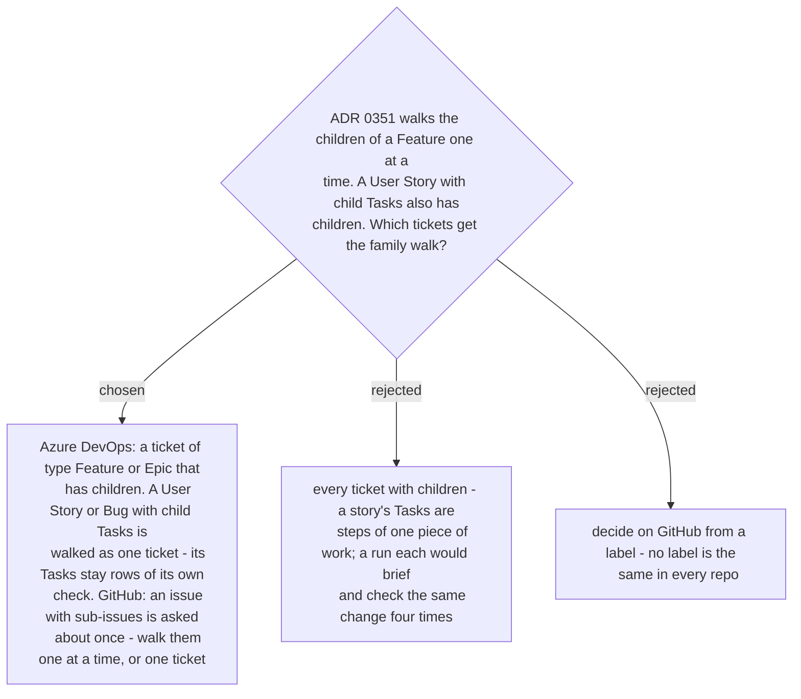

# resolve-the-ticket as the one entry - Implementation Plan

> **For agentic workers:** REQUIRED SUB-SKILL: Use sp-subagent-driven-development (recommended) or sp-executing-plans to implement this plan task-by-task. Steps use checkbox (`- [ ]`) syntax for tracking.

**Goal:** Turn `resolve-the-ticket` from a two-moment helper (briefing, check) into the one entry that carries a ticket through four stages - briefing, plan, do and verify, check - by loading the skill of each stage.

**Architecture:** A prose skill, no script. Only `plugins/dev-workflows/skills/resolve-the-ticket/` changes in behaviour: `SKILL.md` gains a stage proposal, two new stage sections and a family section; `evals/evals.json` gains seven cases and three edits. Every other skill is loaded as it is. Discoverability text, the version, the glossary and supersession banners follow in the last task.

**Tech Stack:** Markdown, YAML frontmatter, JSON; PowerShell; Python 3.10+ for `scripts/generate_skills_tree.py` and `scripts/check_skills_tree.py`.

**Spec:** the closed Decision map `docs/decision-map/one-entry-for-a-ticket/` (14 tickets) and its ADRs `docs/adr/workflow-daily-work-0337-…` to `…-0351-…`. The earlier design `docs/superpowers/specs/2026-11-16-resolve-the-ticket-design.md` still holds for everything those ADRs do not change.

## Global Constraints

- **Only `resolve-the-ticket` may be edited** among the skills. Never edit `guide-and-verify`, `chart-map`, `work-map`, `sp-writing-plans` or any other skill's files (ADR 0338). `plugins/dev-workflows/skills/daily/SKILL.md` gets one table row changed in Task 5 - that row is the router's discoverability text, the same row the first plan added.
- The entry skill does no work itself; it loads a skill only after the person says yes (ADR 0339).
- The skill itself never writes to a tracker (ADR 0318).
- Skill references use the short form (`chart-map`, never `decision-map:chart-map`), loaded "through your harness's mechanism" (ADRs 0071, 0072). Never name one harness's tool.
- `${CLAUDE_PLUGIN_ROOT}` only in the shapes `/references/…`, `/scripts/…`, `/skills/…`; the skill's own files use skill-relative paths.
- Section numbers `4.1` to `4.6` of the check are kept - other text and the evals cite them.
- `skills/` is generated: never hand-edit it. Run `python scripts/generate_skills_tree.py`. On Windows the generator leaves about 118 files under `skills/` modified by line endings only; restore every one that is not `skills/resolve-the-ticket/…` or `skills/daily/…` with `git restore -- <path>`.
- Version: `dev-workflows` `0.65.0` -> `0.66.0` in BOTH `plugins/dev-workflows/.claude-plugin/plugin.json` and `.claude-plugin/marketplace.json`. Re-check the global max across every ref immediately before the version commit; if a ref already holds `0.66.0` or higher, take that max + 1.
- New ADRs take the global max + 1 across every ref and the working tree (max is `0351` on 2026-11-18). File name prefix `workflow-daily-work-`.
- Another session's uncommitted work is in the tree: `plugins/dev-workflows/skills/guide-and-verify/SKILL.md`, `skills/guide-and-verify/SKILL.md`, `docs/adr/workflow-daily-work-0290-guide-and-verify-…md`, `docs/adr/workflow-daily-work-0291-guide-and-verify-…md`, `docs/reflections/2026-11.md`, and `daily-state.md`. Never edit, stage or commit these. Every `git add` names its files; never `git add -A` or `git add .`.
- Work on branch `feat/resolve-the-ticket-one-entry`. Commit only as the steps say.
- Commit messages are written to a file and passed with `git commit -F <file>` (a message with quotes breaks `-m` in PowerShell 5.1). They end with the line `Co-Authored-By: Claude Fable 5.2 <noreply@anthropic.com>`.
- Windows + PowerShell (the Bash tool is denied on this machine). Write files as UTF-8 without BOM. Use `-` (hyphen), not an em dash, in the `resolve-the-ticket` files.
- Plain words, short sentences. Keep the result words, the three marks and the verdict line in English.

## File Structure

| File | Responsibility |
|---|---|
| `plugins/dev-workflows/skills/resolve-the-ticket/SKILL.md` | the whole flow: open, read, find files, propose the stage, the four stages, the family walk |
| `plugins/dev-workflows/skills/resolve-the-ticket/evals/evals.json` | 17 eval cases (ids 0-16) |
| `plugins/dev-workflows/commands/resolve-the-ticket.md` | thin command wrapper |
| `PLAYBOOK.md`, `plugins/dev-workflows/skills/daily/SKILL.md` | discoverability |
| `plugins/dev-workflows/.claude-plugin/plugin.json`, `.claude-plugin/marketplace.json` | version and description |
| `CONTEXT.md` | glossary: Stage, Stage line, Family walk; Briefing and Resolve check reworded |
| `docs/adr/…`, the 2026-11-16 spec and plan | one new ADR, supersession banners, "not yet in the skill" lines made true |
| `skills/resolve-the-ticket/`, `skills/daily/` | generated copies |

How a task is verified: this skill has no executable test. Each task (a) runs the JSON parse of `evals.json`, (b) runs the grep checks its steps list, and in Task 5 (c) the generator and both checkers. The evals are read by a reviewer against the new text; they have never been run against a model, and this plan does not change that.

---

### Task 0: Branch

**Files:** none.

**Interfaces:**
- Produces: branch `feat/resolve-the-ticket-one-entry` from `main` at the commit that holds ADR 0351.

- [ ] **Step 1: Create the branch**

```powershell
git switch main
git pull --ff-only origin main
git switch -c feat/resolve-the-ticket-one-entry
git log --oneline -1
```

Expected: the last line names the plan's commit or a later one; `git ls-files docs/adr | Select-String -- '-0351-'` prints one file.

---

### Task 1: The opening, the stage proposal and the family walk

Covers ADRs 0337, 0341, 0343 (the reading half), 0351.

**Files:**
- Create: `docs/adr/workflow-daily-work-<next>-the-family-walk-is-for-a-feature-or-epic-and-is-asked-about-on-github.md`
- Modify: `plugins/dev-workflows/skills/resolve-the-ticket/SKILL.md` (frontmatter, intro, *What it never does*, *The flow*, section 0, the *No runbook found* paragraph of section 2, new section 3, heading of the briefing, new family section)
- Modify: `plugins/dev-workflows/skills/resolve-the-ticket/evals/evals.json` (edit ids 4 and 6; add ids 10, 14, 16)

**Interfaces:**
- Produces: the headings `## 3. Say which stage comes next`, `## Stage 1 - the briefing`, `## A Feature and its children`; the stage names `briefing`, `plan`, `do and verify`, `check`; the block heading `## Stage - <date> <time UTC> - briefing done`; the map folder name `docs/decision-map/<tracker>-<id>-<short name>/` with `<tracker>` = `ado` or `gh`. Tasks 2-4 add `## Stage 2 - the plan`, `## Stage 3 - do and verify` and rename the check to `## Stage 4 - the check`.

- [ ] **Step 1: Write the new ADR**

Find the number:

```powershell
git fetch -q origin
$n = @(); git for-each-ref --format='%(refname)' | % { git ls-tree -r --name-only $_ -- docs/adr } | % { if ($_ -match '(?:^|[/-])(\d{4})-') { $n += [int]$Matches[1] } }
Get-ChildItem docs/adr -File | % { if ($_.Name -match '(?:^|-)(\d{4})-') { $n += [int]$Matches[1] } }
($n | Measure-Object -Maximum).Maximum + 1
```

Note: the two untracked `0290` / `0291` guide-and-verify files belong to another session and do not affect the max. Use the printed number as `<next>` (expected `352`, written `0352`). Write the file with this content, replacing `<next>` in the file name only:

````markdown
# The family walk is for a Feature or an Epic, and is asked about on GitHub



Ruled 2026-11-18 by the controller while writing the implementation plan
(`docs/superpowers/plans/2026-11-18-resolve-the-ticket-one-entry.md`). ADR 0351 names "a
Feature with several child tickets" and its example is Feature #193 with stories #194-#197;
the existing check already treats a story's child Task as one row (ADR 0321, eval 0). This
ADR only draws the line between the two. The user has not ruled on it; it is the agent's
reading and is flagged to the user with the plan.
````

- [ ] **Step 2: Replace the frontmatter description**

In `SKILL.md`, replace the whole `description:` line with:

```
description: 'The one entry for working a ticket (Azure DevOps or GitHub Issues). Give it the ticket URL: it reads the ticket, its parent and children and the files in the repo, says which of four stages comes next - BRIEFING, PLAN, DO AND VERIFY, CHECK - and asks once. It does no work itself: at each stage it offers the skill that does (chart-map / work-map, guide-and-verify, sp-writing-plans) and loads it on a yes. CHECK: one row per Acceptance Criteria line, logic rule and child ticket, each with its test and result, then READY or NOT READY and, on READY, a closing comment to paste. Use for "resolve the ticket", "work on this ticket", "start this ticket", "what is next on this ticket", "is this ticket ready to resolve", "check before I resolve", "brief me on this ticket", "ticket นี้ resolve ได้ยัง", "เช็คก่อน resolve", "อ่าน ticket นี้ให้หน่อย", "ทำ ticket นี้ต่อ". Never writes to the tracker. Not dual-verifier (one diff).'
```

- [ ] **Step 3: Replace the intro and "What it never does"**

Replace everything from the line `A ticket gets set to Resolved on "I think it is done".` down to and including the line `Its only write is one dated block appended to the ticket's runbook.` with:

```markdown
A ticket gets set to Resolved on "I think it is done". A week later it is reopened, because
one rule in its details had no passing test on that day. This skill is the one door for a
ticket: call it with the ticket's URL at any time, and it says where the ticket is and what
comes next.

**The failure this prevents:** a ticket resolved over a rule nobody tested, a pass that is
older than the last change, a child task nobody did - and a person who has to remember
which skill comes when.

## What it never does

- It **does no work itself.** It builds nothing and fixes nothing. The work happens inside
  the skill it loads, under that skill's own rules (ADR 0339).
- It **never loads a skill without a yes.** It names the skill, says why, and waits.
- It **never writes to the tracker** - no comment, no State change, no ticked box. The
  person does those. A skill it loads follows its own rules: `guide-and-verify` records its
  readings on the ticket as it goes.
- It **never writes a runbook.** `guide-and-verify` creates it.

Its only writes are two kinds of dated block appended to the ticket's runbook: one stage
block after a briefing (only when the runbook exists), and one block per check.
```

- [ ] **Step 4: Replace the flow diagram**

Replace the fenced block under `## The flow` with:

````markdown
```
 ┌──────────────────────────────────┐
 │ 0. Wait for the ticket URL       │
 └────────────────┬─────────────────┘
                  ▼
 ┌──────────────────────────────────┐
 │ 1. Read ticket, parent, children │
 │ 2. Find files by ticket number   │
 └────────────────┬─────────────────┘
                  ▼
 ┌──────────────────────────────────┐
 │ 3. Say which stage comes next,   │
 │    with one line of evidence.    │
 │    Ask once. The person may name │
 │    another stage.                │
 └──┬─────────┬──────────┬────────┬─┘
    ▼         ▼          ▼        ▼
 Stage 1   Stage 2    Stage 3   Stage 4
 BRIEFING  PLAN       DO AND    CHECK
 chat      chart-map  VERIFY    rows +
           work-map   guide-    verdict
                      and-verify
                      or sp-
                      writing-plans
```
````

- [ ] **Step 5: Replace section 0**

Replace everything from `## 0. Open - ask, and wait for the URL` down to and including the line `Then say one line: which moment this is, and for which ticket.` with:

```markdown
## 0. Open - wait for the URL

One thing is needed: the **ticket's URL**. If the invocation did not give it, ask:

> The ticket's URL, please.

Do not ask which stage. Read nothing until you have the URL. A bare number is not enough -
the URL names the tracker, the organization and the project in one string, so the right
number is never read in the wrong project. Do not take the organization or project from an
environment variable.

| URL | tracker |
|---|---|
| `dev.azure.com/<org>/<project>/_workitems/edit/<id>` | Azure DevOps |
| `github.com/<owner>/<repo>/issues/<n>` | GitHub Issues |
| anything else | say "I cannot read this tracker." and stop |

If the person named a stage in the call ("brief me", "check", "start the work"), that is
the stage: steps 1 and 2 still run, step 3 says one line and does not ask.
```

- [ ] **Step 6: Make the no-runbook hand-off a check-only rule**

In section 2, replace the paragraph that starts `**No runbook found.** Say so in one line, then hand off to` and ends `Continue when the
runbook exists.` with:

```markdown
**No runbook found.** Say so in one line. What happens next depends on the stage:

- **briefing or plan** - go on without one. A briefing with no runbook is chat only.
- **do and verify** - the skill that stage loads creates it (Stage 3).
- **check** - the work was done with no runbook. Hand off to `guide-and-verify` (load it
  through your harness's mechanism, on the person's yes) and ask it for the runbook
  **file** only - in its own shape and the project's own naming, holding the title, the
  ticket link, the file list and the boundary line - with no baseline measurement and
  nothing written to the ticket: a baseline cannot be measured after the change. Give it
  what you have already read as its head start; your block is then appended to the file it
  creates (4.6). Do not write a runbook yourself, do not use the parent's runbook, and do
  not go on as if there were none. Continue when the runbook exists.
```

- [ ] **Step 7: Insert section 3 and rename the briefing**

Replace the two lines

```markdown
## 3. Moment one - the briefing

Chat only, in this order, then stop:
```

with:

````markdown
## 3. Say which stage comes next

A ticket has four stages. Each ends on something a file shows:

| stage | what happens | ends when |
|---|---|---|
| 1. briefing | the ticket, its family and its files are read; the open points are shown | the person has read it and says go on |
| 2. plan | the open points of groups 1 and 2 are decided on a Decision map | the map has no open Decision ticket (no such points: skipped) |
| 3. do and verify | the work is done step by step, each step measured | every step has a recorded result |
| 4. check | one row per AC line, logic rule and child; READY or NOT READY | READY, and the person resolves the ticket |

Read the table below from the top. The first row that fits is the proposal:

| what the files show | propose | the evidence line names |
|---|---|---|
| the last `## Resolve check` block says READY, the ticket's revision is the same and nothing changed after it | nothing - say it was READY on that date and the person resolves it on the board; offer a new check | the block's date |
| the last `## Resolve check` block says NOT READY and no work is recorded after it | the gap's skill (4.5), else the check again | the block's gap lines |
| the work record is complete - every runbook step has an outcome line, or every task of the plan file is ticked | check | the count of steps |
| the work record is started and not complete | do and verify, at the first step with no result | which steps have a result and which is first without one |
| the Decision map for this ticket has open Decision tickets | plan | the count of open tickets |
| the briefing is known to be done - a `## Stage` block in the runbook, or a Decision map with no open ticket | plan when that block counts open points in group 1 or 2 and no map exists; else do and verify | the block's date or the map's path |
| none of the above | briefing | "no runbook and no map found" |

**The work record** is what the loaded skill writes, never a file of this skill
(ADR 0343): for click work the runbook's steps and outcome lines; for code work the plan
file under `docs/superpowers/plans/`, the executing skill's ledger and `git log`.

**The Decision map for a ticket** is found like the runbook - by number, matched whole: a
folder under `docs/decision-map/` whose name carries the Feature's number
(`ado-193-…`, `gh-12-…`), or the ticket's own number when no Feature is above it.

Say the proposal in this shape, then wait:

```
Next for #195: do and verify, at step 3.
Steps 1-2 have a result; step 3 has none - it may have partly landed, so it is measured first.
Go on? Or name another stage.
```

One question, once. A yes starts the stage. Another stage's name starts that stage. Never
start a stage on silence.

## Stage 1 - the briefing

Chat, in this order:
````

- [ ] **Step 8: Add the stage block to the end of the briefing**

In the briefing section, replace the last paragraph

```markdown
Show a rule with logic the way the project asks for it (some projects fix a flowchart
shape in their `CLAUDE.md` / `AGENTS.md` - follow it). Write no file. Print no check table
and no verdict.
```

with:

````markdown
Show a rule with logic the way the project asks for it (some projects fix a flowchart
shape in their `CLAUDE.md` / `AGENTS.md` - follow it). Print no check table and no verdict.

**After the briefing.** When the ticket has a runbook, append one block to it, after its
last section, and never edit a line above it:

```
## Stage - <date> <time UTC> - briefing done

Ticket #<id> rev <n> (GitHub: updated <timestamp>). Open points: group 1: <count>, group 2: <count>.
```

When the ticket has no runbook, write no file: the next call proposes the briefing again,
which costs nothing (ADR 0341).

Then propose the next stage in the same turn - plan when group 1 or 2 has a point, else do
and verify - and wait for the yes.
````

- [ ] **Step 9: Add the family section**

Insert this section immediately before the line `## Rules that keep it honest`:

````markdown
## A Feature and its children

When the URL is an Azure DevOps **Feature** or **Epic** with children, the URL is the one
address for the whole family (ADR 0351). On GitHub, an issue with sub-issues is asked
about once: "#12 has 4 sub-issues - walk them one at a time, or treat #12 as one ticket?"
A User Story or Bug with child Tasks is one ticket: its Tasks stay rows of its own check.

| stage | for the family |
|---|---|
| briefing | once, for the Feature and every child |
| plan | once, on the Feature's map |
| do and verify | per child, one at a time, in the order of the briefing's "what depends on what" map |
| check | per child; when no child is left, the Feature's own check (a row per child, by State) |

On every call, run step 3 for each child from its own runbook and work record, then
propose **one** child:

```
Next for Feature #193: #195 - do and verify, from the start.
#194 is READY (checked 2026-11-17). #196 and #197 wait on #195.
Go on? Or name another child or stage.
```

The person may also call the skill with a child's URL. Read the parent as always; when the
parent's map exists, the family's briefing and plan are done - propose that child's own
next stage.
````

- [ ] **Step 10: Edit eval 4 and eval 6, add evals 10, 14, 16**

In `evals/evals.json`:

Eval id 4 - replace the assertion `Writes no file and appends nothing to the runbook` with these two:

```json
"Appends one '## Stage - <date> <time UTC> - briefing done' block to documents/runbook-ado-155-faq.md with the ticket's revision and the open-point counts of groups 1 and 2, and edits no line above it",
"After the briefing, proposes the next stage in one line and waits for a yes - it starts no stage and loads no skill by itself"
```

Eval id 6 - replace its `name` with `opening-asks-for-the-url-only`, its `expected_output` with `One question that asks for the ticket's URL and nothing else.`, and its first assertion `Asks, in one question, whether this is the briefing or the check and for the ticket's URL` with these two:

```json
"Asks for the ticket's URL",
"Does not ask whether this is the briefing or the check"
```

Append these three objects to the `evals` array (after id 9, comma-separated):

```json
{
  "id": 10,
  "name": "resume-proposes-do-and-verify-at-the-first-step-with-no-result",
  "prompt": "resolve the ticket https://dev.azure.com/Contoso/Ops/_workitems/edit/195 . You cannot reach the board from here, so here is what it holds. #195 User Story, Active, rev 5, parent #193 Feature (Active), no children. Acceptance Criteria: 'The flow runs Mon-Fri 08:00.' and 'A failed run sends one email to the admin.' The repo has documents/runbook-ado-195-sync-flow.md. It holds a '## Stage - 2026-11-16 02:10 UTC - briefing done' block (group 1: 0, group 2: 0), then six steps written by guide-and-verify. Step 1 and Step 2 each have an outcome line with a measurement and a time. Steps 3 to 6 have none. There is no '## Resolve check' block and no folder under docs/decision-map/ with 193 or 195 in its name.",
  "expected_output": "One proposal: do and verify, at step 3, with the evidence line, the warning that step 3 may have partly landed and is measured first, and one question. Nothing is loaded yet.",
  "files": [],
  "assertions": [
    "Proposes the stage do and verify, and names step 3 as where it continues",
    "The evidence line says steps 1-2 have a result and step 3 has none",
    "Says step 3 may have partly landed and must be measured before it is done again",
    "Names guide-and-verify as the skill it would load, and asks once whether to go on",
    "Loads no skill and starts no step before the person answers",
    "Does not ask 'briefing or check'",
    "Writes no progress file of its own and does not touch daily-state.md",
    "Prints no check table and no READY verdict"
  ]
},
{
  "id": 14,
  "name": "feature-url-proposes-one-child",
  "prompt": "resolve the ticket https://dev.azure.com/Contoso/Ops/_workitems/edit/193 . You cannot reach the board from here, so here is what it holds. #193 Feature, Active, rev 9, no parent, children #194, #195, #196 (all User Story, Active). The repo has docs/decision-map/ado-193-creditor-sync/ with 4 Decision tickets, all closed, and the map's notes say the briefing order is #194, then #195, then #196 (#196 waits on #195). documents/runbook-ado-194-table.md ends with '## Resolve check - 2026-11-17 03:00 UTC - READY' at #194's current revision, nothing changed after it. There is no runbook and no plan file for #195 or #196.",
  "expected_output": "A family status and one proposal: #195, do and verify from the start, with one question.",
  "files": [],
  "assertions": [
    "Treats #193 as a family: it reports the state of #194, #195 and #196, each from its own files",
    "Says #194 is READY, with the date of its Resolve check block",
    "Proposes exactly one child, #195, and the stage do and verify",
    "Says #196 waits on #195",
    "Does not propose a new briefing or a plan stage for the family - the map exists and has no open Decision ticket",
    "Asks once, and says the person may name another child or stage",
    "Loads no skill before the person answers"
  ]
},
{
  "id": 16,
  "name": "new-ticket-with-no-runbook-gets-a-chat-only-briefing",
  "prompt": "resolve the ticket https://dev.azure.com/Contoso/Ops/_workitems/edit/301 . Yes, go on with what you propose. You cannot reach the board from here, so here is what it holds. #301 User Story, New, rev 1, no parent, no children, no links. Acceptance Criteria: 'The export file is named by date.' You searched the project for 301: no file name, no file content and no commit message carries it, and docs/decision-map/ has no folder with 301.",
  "expected_output": "The proposal 'briefing' with the evidence that no runbook and no map were found, then the briefing in chat, no file written, then a proposal for the next stage.",
  "files": [],
  "assertions": [
    "Proposes the briefing, with the evidence that no runbook and no Decision map were found",
    "Gives the briefing in chat: the ticket line, the family, the AC line quoted with a locator, the files, the open points in four groups",
    "Writes no file: no runbook, no stage block, no progress file",
    "Does not hand off to guide-and-verify for a runbook at the briefing",
    "After the briefing proposes do and verify as the next stage (groups 1 and 2 are empty) and waits for a yes",
    "Says in one line that the plan stage is skipped because there is nothing to decide"
  ]
}
```

- [ ] **Step 11: Verify**

```powershell
Get-Content plugins/dev-workflows/skills/resolve-the-ticket/evals/evals.json -Raw -Encoding utf8 | ConvertFrom-Json | % { $_.evals.Count; ($_.evals.id -join ',') }
Select-String -Path plugins/dev-workflows/skills/resolve-the-ticket/SKILL.md -Pattern 'Briefing \(before you start\) or check|^## 3\. Moment one|Moment two' | Measure-Object | % Count
Select-String -Path plugins/dev-workflows/skills/resolve-the-ticket/SKILL.md -Pattern '^## 3\. Say which stage comes next|^## Stage 1 - the briefing|^## A Feature and its children' | Measure-Object | % Count
```

Expected: `13` then `0,1,2,3,4,5,6,7,8,9,10,14,16`; then `1` (only `## 4. Moment two - the check` remains until Task 4); then `3`.

- [ ] **Step 12: Commit**

Write the message to a scratch file `commit-task1.txt`:

```
feat(resolve-the-ticket): the skill proposes the stage from the files, and a Feature walks its children (ADRs 0337, 0341, 0343, 0351, 0352)

Section 0 asks for the URL only. Section 3 reads the runbook, the work record and
the Decision map and proposes one of four stages. The briefing leaves a stage block
when a runbook exists. The no-runbook hand-off stays for the check only.

Co-Authored-By: Claude Fable 5.2 <noreply@anthropic.com>
```

```powershell
git add -- plugins/dev-workflows/skills/resolve-the-ticket/SKILL.md plugins/dev-workflows/skills/resolve-the-ticket/evals/evals.json (Get-ChildItem docs/adr -Filter "*-the-family-walk-is-for-a-feature-or-epic-*").FullName
git commit -F <scratch>\commit-task1.txt
```

---

### Task 2: Stage 2 - the plan

Covers ADRs 0345, 0346, 0347 (the map half), 0348, 0349.

**Files:**
- Modify: `plugins/dev-workflows/skills/resolve-the-ticket/SKILL.md` (insert one section)
- Modify: `plugins/dev-workflows/skills/resolve-the-ticket/evals/evals.json` (add ids 11, 12)

**Interfaces:**
- Consumes: the heading `## A Feature and its children` and the map folder name from Task 1.
- Produces: the heading `## Stage 2 - the plan`; the Decision ticket key shape `<child id>-<short name>`.

- [ ] **Step 1: Insert the section**

Insert immediately before the line `## 4. Moment two - the check`:

````markdown
## Stage 2 - the plan

The open points of **group 1** and **group 2** of the briefing are decided on a Decision
map (ADR 0345). Groups 3 and 4 never become Decision tickets. When both groups are empty,
say so in one line - "Plan: skipped, nothing to decide" - and propose do and verify.

**The map skills must be there.** The stage needs `chart-map` and `work-map`, which ship in
another plugin. If either skill is not available in this session, say so, print this, and
end the run (ADR 0349). Do not decide the points another way, and do not skip the stage:

```
The plan stage needs the chart-map and work-map skills, and they are not installed.
- Claude Code:  /plugin install decision-map@workflow-daily-work
- npx skills:   npx skills@latest add ThodsaphonSonthiphin/workflow-daily-work --skill chart-map
                npx skills@latest add ThodsaphonSonthiphin/workflow-daily-work --skill work-map
- Antigravity:  the decision-map plugin has no installer. Copy the folders skills/chart-map
                and skills/work-map from the workflow-daily-work repo into your skills directory.
Install them and call resolve-the-ticket again - or name another stage.
```

**One call does one of three things, then the run ends** (ADR 0348). `chart-map` ends its
session after charting and `work-map` stops after one decision; this skill ends there too.

| the ticket's Decision map | this call |
|---|---|
| does not exist | offer `chart-map`; on a yes load it through your harness's mechanism; when it stops, end |
| has open Decision tickets | offer `work-map` for that map; on a yes load it; when it stops, end |
| has no open Decision ticket | the plan is over - propose do and verify |

End a run with one line: what is left, and that the next call carries on - "3 Decision
tickets are still open on `docs/decision-map/ado-193-creditor-sync/`. Call
resolve-the-ticket again for the next one."

**What to hand `chart-map`.** One map per Feature, shared by all its children; a ticket
with no Feature above it gets its own (ADR 0346):

| thing | value |
|---|---|
| the map's folder | `<tracker>-<Feature id>-<short name>` - `ado-193-creditor-sync`, `gh-12-export` |
| a group 1 point | a ticket of type `task`: the question, who must answer (or `not named`) |
| a group 2 point | a ticket of type `grilling` |
| a ticket's key | `<child id>-<short name>` - `195-shared-table`. A point that touches several children takes the first child's id, and its question names every ticket it touches |
| blocking edges | read from the briefing's "what depends on what" map |

`chart-map` asks for the destination and runs its own gate; do not answer its questions
for the person. When the map already exists it only adds what is new. On a small ticket
`chart-map` may say no map is needed and name `grill-then-plan` - say that to the person
as it is, and end the run.

A **closed** Decision ticket is the record of the decision (ADR 0347). The check reads it
(4.2).
````

- [ ] **Step 2: Add evals 11 and 12**

Append to the `evals` array:

```json
{
  "id": 11,
  "name": "plan-stage-offers-chart-map-with-groups-one-and-two",
  "prompt": "resolve the ticket https://dev.azure.com/Contoso/Ops/_workitems/edit/193 - go to the plan stage. The chart-map and work-map skills are available in this session. You cannot reach the board from here, so here is what it holds. #193 Feature 'Creditor sync', Active, rev 9, children #195 and #196 (User Story, New). A briefing was given earlier in this conversation with these open points. Group 1: A 'sandbox or production?' touches #195, must be answered by the system owner (not named). Group 2: B 'shared table or one table per source?' touches #195 and #196. Group 3: C 'never write to production from a test run'. Group 4: D 'the ticket title has a typo'. Dependency map: A before #195; B before #195 and #196. docs/decision-map/ has no folder with 193, 195 or 196.",
  "expected_output": "An offer to load chart-map for a new map named with 193, with the two points handed over as one task ticket and one grilling ticket, and nothing loaded before a yes.",
  "files": [],
  "assertions": [
    "Proposes the plan stage and names chart-map as the skill it would load",
    "Names the map folder with the tracker and the Feature's number, such as ado-193-creditor-sync",
    "Hands over point A as a ticket of type task that names who must answer as not named",
    "Hands over point B as a ticket of type grilling whose question names both #195 and #196",
    "Gives each ticket a key that starts with a child's number, such as 195-shared-table",
    "Does not turn point C or point D into a Decision ticket",
    "Loads chart-map only after the person says yes, and does not answer chart-map's destination question itself",
    "Says the run ends when chart-map stops and that the next call carries on",
    "Does not offer to decide the points in this same run with another skill"
  ]
},
{
  "id": 12,
  "name": "plan-stage-stops-when-the-map-skills-are-missing",
  "prompt": "resolve the ticket https://dev.azure.com/Contoso/Ops/_workitems/edit/195 - plan. The chart-map and work-map skills are NOT available in this session. You cannot reach the board from here, so here is what it holds. #195 User Story, New, rev 2, parent #193 Feature. A briefing was given earlier in this conversation; group 2 holds one open point: 'shared table or one table per source?'. docs/decision-map/ has no folder with 193 or 195.",
  "expected_output": "A plain statement that the map skills are not installed, the install lines for three channels, and the end of the run.",
  "files": [],
  "assertions": [
    "Says plainly that chart-map and work-map are not installed",
    "Prints an install line for Claude Code, for the npx skills channel and for Antigravity",
    "The Antigravity line says the decision-map plugin has no installer and names the two skill folders to copy - it points at no INSTALL.md",
    "Ends the run: it does not load sp-grill-with-doc, grill-then-plan or any other skill to decide the point",
    "Does not skip the plan stage and propose do and verify by itself",
    "Says the person may install and call again, or name another stage"
  ]
}
```

- [ ] **Step 3: Verify**

```powershell
Get-Content plugins/dev-workflows/skills/resolve-the-ticket/evals/evals.json -Raw -Encoding utf8 | ConvertFrom-Json | % { $_.evals.Count }
Select-String -Path plugins/dev-workflows/skills/resolve-the-ticket/SKILL.md -Pattern '^## Stage 2 - the plan|decision-map:chart|decision-map:work' | % Line
```

Expected: `15`; then exactly one line, `## Stage 2 - the plan` (no plugin-prefixed skill name anywhere).

- [ ] **Step 4: Commit**

Message file `commit-task2.txt`:

```
feat(resolve-the-ticket): the plan stage loads chart-map and work-map, one call at a time (ADRs 0345-0349)

Groups 1 and 2 of the briefing go on one map per Feature. The run ends where a map
skill stops. With the map skills not installed the stage stops with the install lines.

Co-Authored-By: Claude Fable 5.2 <noreply@anthropic.com>
```

```powershell
git add -- plugins/dev-workflows/skills/resolve-the-ticket/SKILL.md plugins/dev-workflows/skills/resolve-the-ticket/evals/evals.json
git commit -F <scratch>\commit-task2.txt
```

---

### Task 3: Stage 3 - do and verify

Covers ADRs 0339, 0340, 0341, 0342, 0343 (the hand-over half).

**Files:**
- Modify: `plugins/dev-workflows/skills/resolve-the-ticket/SKILL.md` (insert one section)
- Modify: `plugins/dev-workflows/skills/resolve-the-ticket/evals/evals.json` (add id 13)

**Interfaces:**
- Consumes: section `4.1` (the row list) - unchanged text, cited by number.
- Produces: the heading `## Stage 3 - do and verify`; the phrase "the row list" handed to the loaded skill.

- [ ] **Step 1: Insert the section**

Insert immediately before the line `## 4. Moment two - the check`:

````markdown
## Stage 3 - do and verify

This skill does not do the work. It says what kind of work the ticket is, offers the skill
for it, and loads that skill on a yes (ADR 0339).

| the ticket's work | the skill to load | the proof it leaves for the check |
|---|---|---|
| a person must click in a console, a portal, a settings page | `guide-and-verify` | runbook steps and outcome lines |
| code the agent can write | `sp-writing-plans`, which hands off to its own executing skill | tests in the repo |
| both | each part goes to its own skill, the click part first unless the briefing's order says otherwise | both |

Say the kind with the proposal, in the same question: "#195 is click work (a flow in the
portal) - load `guide-and-verify`?" The person may correct the kind.

**Before loading, write the row list** - the rows of 4.1 (`AC-1`, `L-1` …), quoted as
written. Then hand the loaded skill three things:

1. what you have already read - the ticket, its parent and children, the file list;
2. the row list, with this request: "name on each step (or task, or test) the rows it
   proves, for example `Step 3 - set the schedule (AC-2)`";
3. for a call after a break, the one line of step 3: which steps have a result and which
   is the first without one - "measure it first; do not do it again blind" (ADR 0343).

A row that no step, task or test names is said aloud now - "L-4 has no step that proves
it" - not found later at NOT READY.

**`guide-and-verify`** runs in full: it measures the baseline before the first
instruction and creates the runbook when the ticket has none (ADR 0341). Do not ask it for
a file only here. Its own fields are what the check reads (ADR 0340):

| the check needs | `guide-and-verify` writes |
|---|---|
| Given | the baseline |
| When | the step's **Do** lines |
| Then | the assertion declared before the person acts |
| result and date | the outcome line with its measurement and time |

**`sp-writing-plans`** takes the ticket's AC lines and logic rules as its requirements.
No before / after measurement is asked of code work: a test written first, failing before
and passing after, is its measurement (ADR 0342).

When the loaded skill is done, propose the check and wait for the yes. When it stops
part-way, say what is left in one line and end the run.
````

- [ ] **Step 2: Add eval 13**

Append to the `evals` array:

```json
{
  "id": 13,
  "name": "code-work-loads-sp-writing-plans-with-the-row-list",
  "prompt": "resolve the ticket https://dev.azure.com/Contoso/Ops/_workitems/edit/196 - start the work. You cannot reach the board from here, so here is what it holds. #196 User Story, Active, rev 3, parent #193 Feature, no children. Description logic: 'filter: status eq Created or status eq Partial'. Acceptance Criteria: 'Rows older than 7 days are left out.' The work is one change in src/sync/filter.ts in this repo; nothing has to be clicked in any console. docs/decision-map/ado-193-creditor-sync/ exists and every Decision ticket on it is closed. There is no runbook and no plan file for #196.",
  "expected_output": "A proposal that names the work as code work and offers sp-writing-plans, the row list written out, and nothing loaded or edited before a yes.",
  "files": [],
  "assertions": [
    "Says the ticket is code work and names sp-writing-plans as the skill it would load",
    "Does not offer guide-and-verify for this ticket",
    "Writes the row list before loading: one row for the AC line and two for the filter (the or term, and the codes Created / Partial together)",
    "Says it will hand over the row list and ask that each task or test names the rows it proves",
    "Does not ask for a before / after measurement of a live system",
    "Edits no file in src/ itself and writes no plan file itself",
    "Asks once and loads the skill only after the person says yes"
  ]
}
```

- [ ] **Step 3: Verify**

```powershell
Get-Content plugins/dev-workflows/skills/resolve-the-ticket/evals/evals.json -Raw -Encoding utf8 | ConvertFrom-Json | % { $_.evals.Count }
Select-String -Path plugins/dev-workflows/skills/resolve-the-ticket/SKILL.md -Pattern '^## Stage ' | % Line
```

Expected: `16`; then three lines in this order: `## Stage 1 - the briefing`, `## Stage 2 - the plan`, `## Stage 3 - do and verify`.

- [ ] **Step 4: Commit**

Message file `commit-task3.txt`:

```
feat(resolve-the-ticket): the do stage loads guide-and-verify or sp-writing-plans and hands over the row list (ADRs 0339-0343)

Click work goes to a full guide-and-verify run, which creates the runbook. Code work
goes to sp-writing-plans. After a break the first step with no result is measured first.

Co-Authored-By: Claude Fable 5.2 <noreply@anthropic.com>
```

```powershell
git add -- plugins/dev-workflows/skills/resolve-the-ticket/SKILL.md plugins/dev-workflows/skills/resolve-the-ticket/evals/evals.json
git commit -F <scratch>\commit-task3.txt
```

---

### Task 4: Stage 4 - the check offers the gap's skill and reads Decision tickets

Covers ADRs 0339 (after NOT READY), 0340 (the row tag), 0347 (the check half). ADRs 0344 and 0350 change nothing in the skill.

**Files:**
- Modify: `plugins/dev-workflows/skills/resolve-the-ticket/SKILL.md` (check heading, 4.2 two places, 4.5, *Rules*, *Not this skill*)
- Modify: `plugins/dev-workflows/skills/resolve-the-ticket/evals/evals.json` (edit id 0; add id 15)

**Interfaces:**
- Consumes: the Decision ticket key shape and map folder from Task 2.
- Produces: the heading `## Stage 4 - the check`; the result text `pass - differs by decision <key>`.

- [ ] **Step 1: Rename the heading**

Replace the line `## 4. Moment two - the check` with `## Stage 4 - the check`.

- [ ] **Step 2: A step's row tag, in 4.2**

Replace the paragraph that starts `**Where a test is found.** The runbook's steps and Outcome log,` and ends `Was either tested?"` with:

```markdown
**Where a test is found.** The runbook's steps and Outcome log, a ticket comment, a test
file in the repo, a case in a test-case suite, the register's *tested by* cell. A step,
task or test that names the row (`Step 3 - set the schedule (AC-2)`) is the first place to
look - and it is still compared part by part below; a tag never replaces that comparison
(ADR 0340). Nothing found: ask the user once, naming every such row - "Rows L-1 and AC-3 -
no test found in the runbook, the comments or the repo. Was either tested?"
```

- [ ] **Step 3: A closed Decision ticket counts, in 4.2**

In the paragraph that starts `**Differs.** Compare what the ticket says with what was built`, replace the sentence

```markdown
When they differ, look for a **written,
approved decision** that covers the difference - a runbook decision, an ADR, a ticket
comment, with who approved it. Found: `pass - differs by decision <id>`, with its locator,
when the test passes.
```

with:

```markdown
When they differ, look for a **written,
approved decision** that covers the difference - a **closed** Decision ticket on the
ticket's Decision map (the record, ADR 0347), an ADR, a runbook decision, a ticket
comment, with who approved it. Found: `pass - differs by decision <id>`, with its locator
(for a Decision ticket: its key and path), when the test passes. An open or claimed
Decision ticket is not a decision.
```

- [ ] **Step 4: Replace 4.5**

Replace everything from `### 4.5 On NOT READY - name the next skill, and stop` down to and including the line `Then record the check (4.6) and stop. Do not start any of them.` with:

```markdown
### 4.5 On NOT READY - record, then offer the next skill

Draft no comment. Record the check first (4.6). Then print at most one line per kind of
gap, naming every row of that kind:

| gap | the line offers |
|---|---|
| no test | `generating-test-cases` |
| fail | `debug-mantra` |
| stale | the test step to run again (or: say the change does not touch the row) |
| differs, no decision | `grill-then-plan` - the decision gets written first |
| open child | `resolve-the-ticket` on that child |

> L-4 has no test - load `generating-test-cases` for its case?
> #297 is still New - go on to #297, or say it stays open on purpose?

Offer one gap at a time, in the order of the table. On a yes, load that skill through your
harness's mechanism and hand it the row and what you read. On a no, or no answer, stop.
Never load one without a yes (ADR 0339).
```

- [ ] **Step 5: The rules and the "Not this skill" table**

In `## Rules that keep it honest`, add this bullet as the first bullet:

```markdown
- **It leads; it does not act.** Every act of the work happens in a skill it loaded on a
  yes.
```

In `## Not this skill`, replace the three rows for `work-map`, `guide-and-verify` and `generating-test-cases` with:

```markdown
| `work-map` | it resolves a **Decision ticket** on a Decision map; this skill loads it in the plan stage |
| `guide-and-verify` | owns the runbook and the click work; loaded in do and verify |
| `sp-writing-plans` | owns the plan for code work; loaded in do and verify |
| `generating-test-cases` | writes the test cases a `no test` row needs; offered after NOT READY |
```

- [ ] **Step 6: Edit eval 0, add eval 15**

Eval id 0 - replace the assertion `One gap line names generating-test-cases for both filter rows` with these two:

```json
"One gap line offers generating-test-cases for both filter rows, as a question",
"No skill is loaded before the person answers, and the Resolve check block is recorded before the offer"
```

Append to the `evals` array:

```json
{
  "id": 15,
  "name": "a-closed-decision-ticket-covers-a-difference-and-an-open-one-does-not",
  "prompt": "resolve the ticket - check - https://dev.azure.com/Contoso/Ops/_workitems/edit/195 . You cannot reach the board from here, so here is what it holds. #195 User Story, Active, rev 6, parent #193 Feature, no children. Description logic: L-1 'rows are written to the shared table' and L-2 'the cut-off is local midnight'. What was built: rows go to one table per source; the cut-off is UTC midnight. The runbook documents/runbook-ado-195-sync-flow.md has Step 4 (L-1) with outcome 'Done - 12 rows in table per source, measured 2026-11-17 04:10Z' and Step 5 (L-2) with outcome 'Done - cut-off 00:00 UTC, measured 2026-11-17 04:30Z'; each step's baseline, Do lines and assertion match what was built. Nothing changed after 2026-11-17. docs/decision-map/ado-193-creditor-sync/tickets/195-shared-table.md is CLOSED: 'one table per source', confirmed by Pon 2026-11-16. docs/decision-map/ado-193-creditor-sync/tickets/195-cutoff-zone.md is OPEN.",
  "expected_output": "L-1 passes as differs by decision 195-shared-table; L-2 is DIFFERS; the verdict is NO; grill-then-plan is offered for L-2.",
  "files": [],
  "assertions": [
    "The L-1 row reads pass - differs by decision 195-shared-table, with the Decision ticket's path as its locator",
    "The L-2 row's result is differs - the open Decision ticket 195-cutoff-zone is not accepted as a decision",
    "The verdict line reads READY TO RESOLVE: NO",
    "The gap line for L-2 offers grill-then-plan (or going on with the open Decision ticket) as a question, and loads nothing without a yes",
    "No closing comment is drafted",
    "A '## Resolve check' block is appended to the runbook"
  ]
}
```

- [ ] **Step 7: Verify**

```powershell
Get-Content plugins/dev-workflows/skills/resolve-the-ticket/evals/evals.json -Raw -Encoding utf8 | ConvertFrom-Json | % { $_.evals.Count; (($_.evals.id | Sort-Object) -join ',') }
Select-String -Path plugins/dev-workflows/skills/resolve-the-ticket/SKILL.md -Pattern 'Moment one|Moment two|Do not start any of them|never starts the skill|builds nothing and fixes nothing\.\*\* The work between' | Measure-Object | % Count
Select-String -Path plugins/dev-workflows/skills/resolve-the-ticket/SKILL.md -Pattern '^### 4\.[1-6] ' | Measure-Object | % Count
Select-String -Path plugins/dev-workflows/skills/resolve-the-ticket/SKILL.md -Pattern '\u2014' | Measure-Object | % Count
```

Expected: `17` then `0,1,2,3,4,5,6,7,8,9,10,11,12,13,14,15,16`; then `0`; then `6`; then `0` (no em dash).

- [ ] **Step 8: Read the whole SKILL.md once, top to bottom**

Check by eye: the stage names are spelled the same everywhere (`briefing`, `plan`, `do and verify`, `check`); every `(4.x)` reference points at a heading that exists; no sentence still says the skill has "two moments". Fix what you find in this same task.

- [ ] **Step 9: Commit**

Message file `commit-task4.txt`:

```
feat(resolve-the-ticket): the check offers the gap's skill and accepts a closed Decision ticket (ADRs 0339, 0340, 0347)

After NOT READY the block is recorded, then one skill per gap is offered and loaded
on a yes. A step that names its row is the first place a test is looked for.

Co-Authored-By: Claude Fable 5.2 <noreply@anthropic.com>
```

```powershell
git add -- plugins/dev-workflows/skills/resolve-the-ticket/SKILL.md plugins/dev-workflows/skills/resolve-the-ticket/evals/evals.json
git commit -F <scratch>\commit-task4.txt
```

---

### Task 5: Discoverability, glossary, banners, version, generated tree

**Files:**
- Modify: `plugins/dev-workflows/commands/resolve-the-ticket.md`
- Modify: `PLAYBOOK.md` (lines 65 and 109 on 2026-11-18)
- Modify: `plugins/dev-workflows/skills/daily/SKILL.md` (line 137 on 2026-11-18 - one table row)
- Modify: `plugins/dev-workflows/.claude-plugin/plugin.json`, `.claude-plugin/marketplace.json`
- Modify: `CONTEXT.md` (section *resolve-the-ticket terms*)
- Modify: ADRs 0316, 0317, 0324, 0325, 0327, 0333 (banner); ADRs 0337, 0339-0343, 0345-0349, 0351 (last line); `docs/superpowers/specs/2026-11-16-resolve-the-ticket-design.md`, `docs/superpowers/plans/2026-11-16-resolve-the-ticket.md` (banner)
- Generated: `skills/resolve-the-ticket/`, `skills/daily/`

**Interfaces:**
- Consumes: the final `SKILL.md` of Tasks 1-4.

- [ ] **Step 1: The command wrapper**

Replace the frontmatter of `plugins/dev-workflows/commands/resolve-the-ticket.md` (keep the body) with:

```
---
description: Work a ticket from one door - give the ticket URL and it says which stage comes next (briefing, plan, do and verify, check), then loads the skill of that stage on your yes. The check rows every Acceptance Criteria line, logic rule and child ticket against a test - READY or NOT READY. Never writes to the tracker.
argument-hint: "<ticket URL - Azure DevOps or GitHub issue> [brief|plan|do|check]"
---
```

- [ ] **Step 2: PLAYBOOK.md**

Replace the Mermaid line `    WORK -- starting a ticket / about to resolve it --> RTT["resolve-the-ticket"]` with:

```
    WORK -- working a ticket, start to resolve --> RTT["resolve-the-ticket"]
```

Replace the whole table row that starts `| starting a ticket, or about to set it to Resolved - "resolve the ticket"` with:

```markdown
| working a ticket, from the first read to Resolved - "resolve the ticket", "work on this ticket", "what is next on this ticket", "is this ticket ready to resolve", "ticket นี้ resolve ได้ยัง", "brief me on this ticket" | `resolve-the-ticket` (`/dev-workflows:resolve-the-ticket`) - the one door for a ticket (Azure DevOps or GitHub Issues). Give it the URL: it reads the ticket, its parent and children and the files, says which of four stages comes next and asks once. Briefing: the family, the files, the open points sorted by what they do to the work. Plan: groups 1 and 2 of those points on one Decision map per Feature, by loading `chart-map` / `work-map`, one call at a time. Do and verify: `guide-and-verify` for click work, `sp-writing-plans` for code work, each handed the row list. Check: one row per AC line, logic rule and child - pass (cited / measured / told), no test, fail, stale, differs, open - a test counts only when its Given / When / Then match the row; READY or NOT READY; on READY a closing comment to paste, on NOT READY the skill for each gap, offered. A Feature's URL walks its children one at a time. It does no work itself, loads a skill only on a yes, and never writes to the tracker. Not `dual-verifier` (one diff) (ADRs 0316-0333, 0335-0352) |
```

- [ ] **Step 3: The router's row**

In `plugins/dev-workflows/skills/daily/SKILL.md`, replace the row

```markdown
| starting a ticket, or about to set it to Resolved | `resolve-the-ticket` — a briefing before the work, a read-only check before the resolve |
```

with:

```markdown
| working a ticket, from the first read to Resolved | `resolve-the-ticket` — give it the ticket URL; it says which stage comes next (briefing, plan, do and verify, check) and loads that stage's skill on a yes |
```

- [ ] **Step 4: The manifests' description and version**

In `plugins/dev-workflows/.claude-plugin/plugin.json`, find the sentence in `description` that starts ` Plus RESOLVE-THE-TICKET (/dev-workflows:resolve-the-ticket:` and ends at the closing `)` of that parenthesis. Print it first:

```powershell
$p = Get-Content plugins/dev-workflows/.claude-plugin/plugin.json -Raw -Encoding utf8
[regex]::Match($p, 'Plus RESOLVE-THE-TICKET \(.*?ADRs 0316[^)]*\)').Value
```

Replace exactly that matched text with:

```
Plus RESOLVE-THE-TICKET (/dev-workflows:resolve-the-ticket: the one door for working a ticket - give it the URL and it says which of four stages comes next (briefing, plan, do and verify, check) and loads that stage's skill on a yes: chart-map / work-map for the plan, guide-and-verify for click work, sp-writing-plans for code work; the check rows every Acceptance Criteria line, logic rule and child ticket against a test, marked cited / measured / told, a stale pass and an undecided difference kept NOT READY, the closing comment drafted for the person to paste; a Feature's URL walks its children one at a time; it does no work itself and never writes to the tracker; ADRs 0316-0333, 0335-0352)
```

The match is 640 characters on 2026-11-18 and ends `ADRs 0316-0333, 0335, 0336)`. If the match is empty, stop and report the sentence as it stands - do not guess its boundaries.

`.claude-plugin/marketplace.json` carries a shorter sentence. In the `dev-workflows` entry's `description`, replace exactly

```
Plus resolve-the-ticket: a briefing before the work on a ticket and a read-only check before it is set to Resolved - every acceptance criterion, logic rule and child ticket against a test; never writes to the tracker.
```

with

```
Plus resolve-the-ticket: the one door for working a ticket - it says which of four stages comes next (briefing, plan, do and verify, check) and loads that stage's skill on a yes; the check rows every acceptance criterion, logic rule and child ticket against a test; never writes to the tracker.
```

Add these four strings to the `keywords` array of `plugin.json`, after `"ticket-briefing"`, one per line: `"one-entry-for-a-ticket"`, `"ticket-stages"`, `"work-on-this-ticket"`, `"feature-walk"`.

Then the version. Re-check the global max:

```powershell
git fetch -q origin
git for-each-ref --format='%(refname:short)' | % { git show "${_}:plugins/dev-workflows/.claude-plugin/plugin.json" 2>$null | Select-String '"version"' } | Sort-Object -Unique
```

Expected highest: `0.65.0`. Set `"version": "0.66.0"` in `plugin.json` and in the `dev-workflows` entry of `marketplace.json` (line 36 on 2026-11-18). If a ref shows `0.66.0` or higher, use that max + 1 in both files.

- [ ] **Step 5: The glossary**

In `CONTEXT.md`, section `## resolve-the-ticket terms (dev-workflows plugin)`, replace the **Briefing** entry and the first sentence of the **Resolve check** entry, and add three entries after **Ticket**:

Replace

```markdown
**Briefing**:
The first of the skill's two moments, before the work starts: what the ticket asks, its
parent and children, its linked tickets, the runbook and the files to open. Read-only
(ADR 0316).
_Avoid_: summary, kickoff, plan.
```

with

```markdown
**Stage**:
One of the four parts of a ticket's line, in order: **briefing**, **plan**, **do and
verify**, **check**. The skill reads the files, proposes the next stage with one line of
evidence and asks once; the person may name another (ADR 0337).
_Avoid_: moment, phase, step (a step is one unit inside do and verify).

**Stage block**:
The dated `## Stage - … - briefing done` block the skill appends to a runbook after a
briefing, with the ticket's revision and the open-point counts. Written only when the
runbook exists (ADRs 0337, 0341).
_Avoid_: progress file, status line.

**Family walk**:
How the stages run when the URL is a Feature or Epic with children: briefing and plan
once for the family, then do and verify and the check per child, one at a time
(ADRs 0351, 0352).
_Avoid_: batch run, parent run.

**Briefing**:
The first stage, before the work starts: what the ticket asks, its parent and children,
its linked tickets, the runbook and the files to open, and the open points in four groups.
Read-only (ADRs 0316, 0336).
_Avoid_: summary, kickoff.
```

In the **Resolve check** entry replace `The second moment, before a person sets the ticket to its done State:` with `The last stage, before a person sets the ticket to its done State:`.

- [ ] **Step 6: Banners on the documents this work supersedes in part**

For each file below, insert the banner as a new paragraph directly under the H1 line (before the Mermaid block), followed by one blank line. Find each ADR by its number: `Get-ChildItem docs/adr -Filter "workflow-daily-work-<nnnn>-*"`.

| file | banner |
|---|---|
| ADR 0316 | `> **Amended 2026-11-18 by ADR 0339.** The skill still builds nothing itself, but it no longer "never starts the skill it names": it offers the skill and loads it on the person's yes. It now has four stages, not two moments (ADR 0337).` |
| ADR 0317 | `> **Amended 2026-11-18 by ADR 0337.** The skill still waits for the ticket's URL. It no longer asks "briefing or check": it reads the files, proposes the stage and asks for a yes.` |
| ADR 0324 | `> **Widened 2026-11-18 by ADR 0347.** A closed Decision ticket on the ticket's Decision map is also a written, approved decision, and is the record for new work.` |
| ADR 0325 | `> **Amended 2026-11-18 by ADRs 0337 and 0341.** The check block is no longer the skill's only write: after a briefing it also appends one dated Stage block, when the runbook exists.` |
| ADR 0327 | `> **Amended 2026-11-18 by ADR 0339.** After NOT READY the skill now offers the skill for each gap and loads it on the person's yes.` |
| ADR 0333 | `> **Narrowed 2026-11-18 by ADR 0341.** The file-only hand-off now applies in one case: the check is asked for on a ticket whose work was done with no runbook. In the do-and-verify stage guide-and-verify runs in full and creates the runbook.` |
| `docs/superpowers/specs/2026-11-16-resolve-the-ticket-design.md` | `> **Superseded in part (2026-11-18).** The skill is now the one entry for a ticket with four stages - briefing, plan, do and verify, check - and loads the skill of each stage (ADRs 0337-0352, map docs/decision-map/one-entry-for-a-ticket/). This document still holds for the check's rows, marks and verdict. The committed SKILL.md is authoritative.` |
| `docs/superpowers/plans/2026-11-16-resolve-the-ticket.md` | the same banner as the spec, as a new blockquote paragraph above the existing first banner |

Before writing the ADR 0325 and 0327 banners, read each file's H1 and confirm it is about the runbook block (0325) and about naming the next skill at NOT READY (0327). If either is about something else, stop and report its title - do not write that banner.

- [ ] **Step 7: Make the "not yet in the skill" lines true**

In each of ADRs 0337, 0339, 0340, 0341, 0342, 0343, 0345, 0346, 0347, 0348, 0349 and 0351, replace the paragraph that starts `**Not yet in the skill.**` (one or two lines) with the single line:

```markdown
**In the skill since dev-workflows 0.66.0** (`plugins/dev-workflows/skills/resolve-the-ticket/SKILL.md`).
```

If Step 4 set a version other than `0.66.0`, write that version. Verify:

```powershell
Select-String -Path docs/adr/workflow-daily-work-03[3-5]*.md -Pattern 'Not yet in the skill' | Measure-Object | % Count
Select-String -Path docs/adr/workflow-daily-work-03[3-5]*.md -Pattern '^\*\*In the skill since dev-workflows' | Measure-Object | % Count
```

Expected: `0`, then `12`.

- [ ] **Step 8: Generate the tree and run the checks**

```powershell
python scripts/generate_skills_tree.py
python scripts/check_skills_tree.py
python plugins/dev-workflows/scripts/check_vendored_superpowers.py --strict
git status --short skills | Measure-Object | % Count
```

Expected: both checkers exit `0`. Then restore the line-ending-only files:

```powershell
git status --short -- skills | % { $_.Substring(3) } | ? { $_ -notmatch '^skills/(resolve-the-ticket|daily)/' -and $_ -notmatch '^skills/guide-and-verify/' } | % { git restore -- $_ }
git status --short -- skills
```

Expected after the restore: only paths under `skills/resolve-the-ticket/` and `skills/daily/`, plus ` M skills/guide-and-verify/SKILL.md` (the other session's file - leave it exactly as it is, do not restore it and do not stage it). If `git diff --stat -- skills/daily skills/resolve-the-ticket` shows a file whose only change is line endings, restore that file too.

- [ ] **Step 9: Run the repo's Python tests**

```powershell
python -m pytest scripts plugins/dev-workflows/scripts -q
```

Expected: the same result as on `main` before this branch. Two failures are known on this Windows machine and are unrelated (a symlink-privilege test and a cut-vlog encoding test). Any other failure is yours - fix it before committing.

- [ ] **Step 10: Commit**

Message file `commit-task5.txt`:

```
chore(dev-workflows): resolve-the-ticket is the one entry for a ticket - playbook, router, manifests 0.66.0, glossary, banners

The command, the playbook row, the /daily row and both manifests describe the four
stages. ADRs 0316, 0317, 0324, 0325, 0327 and 0333 and the 2026-11-16 spec and plan
carry banners; ADRs 0337-0351 say the change is in the skill.

Co-Authored-By: Claude Fable 5.2 <noreply@anthropic.com>
```

```powershell
git add -- plugins/dev-workflows/commands/resolve-the-ticket.md PLAYBOOK.md plugins/dev-workflows/skills/daily/SKILL.md plugins/dev-workflows/.claude-plugin/plugin.json .claude-plugin/marketplace.json CONTEXT.md docs/superpowers/specs/2026-11-16-resolve-the-ticket-design.md docs/superpowers/plans/2026-11-16-resolve-the-ticket.md skills/resolve-the-ticket skills/daily
git add -- (Get-ChildItem docs/adr -File | ? { $_.Name -match '-(0316|0317|0324|0325|0327|0333|0337|0339|034[0-3]|034[5-9]|0351)-' } | % FullName)
git diff --cached --name-only
git commit -F <scratch>\commit-task5.txt
```

Before the commit, read the staged list: it must hold no `guide-and-verify` path, no `0290` / `0291` file, no `daily-state.md`, no `docs/reflections/` path.

---

## After the last task

Not part of any task - the controller does these with the user:

1. Merge `feat/resolve-the-ticket-one-entry` into `main` and push, when the user says so.
2. Sync the personal skills copy:
   `powershell -ExecutionPolicy Bypass -File scripts/sync-personal-skills.ps1 -RepoSkills "C:\Repo\workflow-daily-work\plugins\dev-workflows\skills" -RepoConvention "C:\Repo\workflow-daily-work\plugins\dev-workflows\references\diagram-convention.md" -PersonalSkills "$env:USERPROFILE\.claude\skills"`
3. The first real run of the plan stage is the live test of loading `chart-map` from a `dev-workflows` skill (ADR 0349 says none is on record). Report what happened.

## Self-review

- **Coverage.** 0337 -> Task 1 (sections 0, 3, stage block). 0338 -> Global Constraints. 0339 -> Tasks 1, 3, 4. 0340 -> Tasks 3, 4. 0341 -> Tasks 1, 3 and the section 2 paragraph. 0342 -> Task 3. 0343 -> Tasks 1, 3. 0344 -> no change in the skill (stated in Task 4). 0345, 0346, 0348, 0349 -> Task 2. 0347 -> Tasks 2, 4. 0350 -> no change. 0351 -> Task 1. 0352 -> written in Task 1.
- **Names.** Headings used across tasks: `## 3. Say which stage comes next`, `## Stage 1 - the briefing`, `## Stage 2 - the plan`, `## Stage 3 - do and verify`, `## Stage 4 - the check`, `## A Feature and its children`. Sections `4.1`-`4.6` keep their numbers. Eval ids after Task 4: 0-16, no gap.
- **Insert order.** Tasks 2 and 3 both insert "immediately before the check heading". Task 2 runs first, so Stage 2 lands above Stage 3; Task 3's verify step checks that order. Task 4 renames the check heading last, so the anchor `## 4. Moment two - the check` is valid through Tasks 2 and 3.
- **Open readings flagged to the user:** ADR 0352 (which tickets get the family walk); the map folder and key names (ADR 0346, the agent's proposal); the stage block's exact wording.
