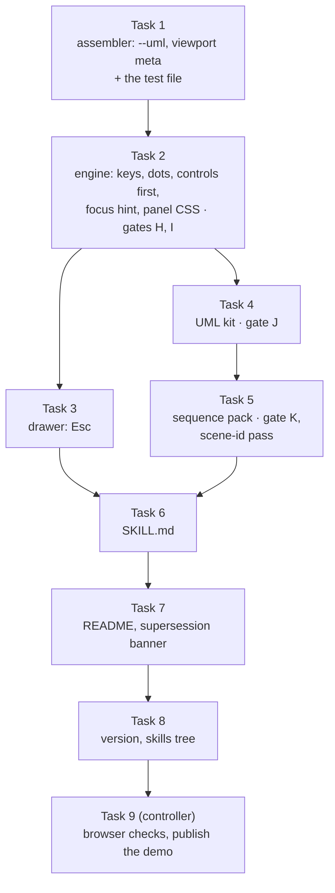

# problem-description: arrow keys, a sequence mode and a UML kit — Implementation Plan

> **For agentic workers:** REQUIRED SUB-SKILL: Use sp-subagent-driven-development (recommended) or sp-executing-plans to implement this plan task-by-task. Steps use checkbox (`- [ ]`) syntax for tracking.

**Goal:** A `problem-description` walkthrough steps on the `→` / `←` keys and on a click on a step dot, can draw a UML sequence diagram as its main diagram, and can show UML class and activity diagrams in its panels — all from single-source references, with `check-walkthrough.py` gating every new part.

**Architecture:** The shared engine (`walkthrough-engine.html`) gains navigation and panel-content CSS, so every mode gets them and no existing mode pack changes. The sequence diagram is a fourth mode pack that registers one renderer and needs no engine edit. The UML kit is a CSS-only reference the assembler inlines on request; its pictures are fixed markup inside panels. `check-walkthrough.py` stays static and gains four gates; a new test file drives both scripts as subprocesses.

**Tech Stack:** Python 3.10+ (standard library only), hand-written HTML / CSS / SVG / JavaScript with no build step and no library, Node (optional — the checker's syntax gate uses `node --check` when Node is on the PATH).

**Spec:** `docs/superpowers/specs/2026-11-21-problem-description-keyboard-and-uml-design.md` — read it with this plan. Decisions: ADRs `workflow-daily-work-0356` to `0367` and `0378` to `0380` in `docs/adr/`.



Do the tasks in number order. Each one leaves the test file green.

## Global Constraints

- **Work only in the worktree this plan was handed to you in** (the folder your dispatch names as your working directory). Never read from or write to the main checkout — the files of `c:\Repo\workflow-daily-work` that are outside your worktree's own folder. Another session is working there. Never run `git stash`, `git checkout <branch>`, `git reset --hard` or `git clean`.
- All paths are relative to the repository root. `SKILL_DIR` below means `plugins/dev-workflows/skills/problem-description`.
- **Transcribe the code exactly.** Every file and every edit in this plan was assembled, run (31 of 31 tests) and opened in a browser before the plan was written, and each task's "expected" output was recorded from a real run. If what you see differs from what a step expects, stop and report it; do not invent a fix.
- **Never edit:** `SKILL_DIR/references/mode-diagram.html`, `mode-tables.html`, `mode-state-machine.html`; anything under `skills/` (it is generated — only Task 8 regenerates it, by script); anything under `.agents/`; `docs/problem-description/*.html`; the `name`, `description` and `effort` lines at the top of `SKILL_DIR/SKILL.md`.
- **Colours:** a `:root` token (`var(--…)`), or a hex that is already in the engine or in `mode-diagram.html`. No new hex, no new `<marker>` (ADR 0022).
- **SKILL.md stays harness-neutral** and names its own files with skill-relative paths (`references/x.html`, `scripts/x.py`). Never write `${CLAUDE_PLUGIN_ROOT}` into it.
- Run every command from the repository root. They are written to work unchanged in PowerShell and in bash. The interpreter is `python`.
- **The test command** is `python plugins/dev-workflows/scripts/test_walkthrough_scripts.py`. It prints one `PASS` or `FAIL` line per test, then `N/N passed`, and exits 0 only when every test passes.
- **Inserting a test block:** Tasks 2 to 7 each insert a block of tests above the line that starts `TESTS = [`. Put two blank lines between the last line of the block and that line, and two blank lines between the block and the code above it. Never remove or reorder the tests of an earlier task.
- In a step's expected `FAIL` lines, the text after the exception name can differ on your machine (it may hold a temp path). The test names, the count and the last line must match.
- **Commit after each task** with the message the task gives, plus the trailer as a second `-m`: `-m "Co-Authored-By: Claude Fable 5.2 <noreply@anthropic.com>"`. Do not push. Do not amend an earlier task's commit.
- The version number is changed in Task 8 only.

## File structure

| File | Task | What happens |
|---|---|---|
| `SKILL_DIR/scripts/assemble-walkthrough.py` | 1 | replaced: `--uml`, viewport meta |
| `plugins/dev-workflows/scripts/test_walkthrough_scripts.py` | 1–7 | created in Task 1; each later task inserts its tests |
| `SKILL_DIR/references/walkthrough-engine.html` | 2 | replaced: `go()`, arrow keys, clickable dots, focus hint, controls above the narration, panel table and note CSS |
| `SKILL_DIR/scripts/check-walkthrough.py` | 2, 4, 5 | edited: gates H and I (Task 2), gate J (Task 4), gate K and the scene-id pass (Task 5) |
| `SKILL_DIR/references/term-drilldown.html` | 3 | edited: Esc closes the drawer |
| `SKILL_DIR/references/uml-kit.html` | 4 | created: kit CSS, class and activity skeletons |
| `SKILL_DIR/references/mode-sequence.html` | 5 | created: the fourth mode pack and its demo |
| `SKILL_DIR/SKILL.md` | 6 | edited: 21 text edits |
| `plugins/dev-workflows/README.md` | 7 | edited: the problem-description section |
| `docs/superpowers/specs/2026-06-27-problem-description-mode-framework-design.md` | 7 | edited: supersession banner |
| `plugins/dev-workflows/.claude-plugin/plugin.json`, `.claude-plugin/marketplace.json` | 8 | version |
| `skills/problem-description/**` | 8 | regenerated by script |

---

### Task 1: The assembler takes the UML kit and writes a viewport meta

**Files:**
- Create: `plugins/dev-workflows/scripts/test_walkthrough_scripts.py`
- Modify (replace the whole file): `plugins/dev-workflows/skills/problem-description/scripts/assemble-walkthrough.py`

**Interfaces:**
- Consumes: nothing from other tasks.
- Produces: the assembler argument `--uml FILE` (inlines only the `§CSS` section of FILE, after the drawer CSS; its final message then ends `+ uml kit)`), and `<meta name="viewport" content="width=device-width, initial-scale=1">` in every assembled page. The test file's helpers, used by every later task: `pack(mode)`, `read(path)`, `write(path, text)`, `run(script, *args) -> (code, text)`, `assemble(tmp, mode, name, *extra) -> (out_path, text)`, `check(path) -> (code, text)`, `broken(tmp, src_path, name, old, new, count=1) -> path`, `css_section(path) -> str`, and the constants `HERE`, `SKILL`, `REF`, `SCR`, `ENGINE`, `DRAWER`, `KIT`.

- [ ] **Step 1: Create the test file with the helpers and the Task 1 tests**

Create `plugins/dev-workflows/scripts/test_walkthrough_scripts.py` with exactly this content:

````python
#!/usr/bin/env python3
"""Tests for the problem-description walkthrough scripts
(skills/problem-description/scripts/assemble-walkthrough.py and check-walkthrough.py)
and for the references they assemble. Run: python test_walkthrough_scripts.py

The two scripts have hyphenated names and are run by path, so every test calls them
as a subprocess and works in a temporary directory.
"""
import os
import re
import subprocess
import sys
import tempfile

HERE = os.path.dirname(os.path.abspath(__file__))
SKILL = os.path.normpath(os.path.join(HERE, "..", "skills", "problem-description"))
REF = os.path.join(SKILL, "references")
SCR = os.path.join(SKILL, "scripts")
ENGINE = os.path.join(REF, "walkthrough-engine.html")
DRAWER = os.path.join(REF, "term-drilldown.html")
KIT = os.path.join(REF, "uml-kit.html")


def pack(mode):
    return os.path.join(REF, "mode-%s.html" % mode)


def read(path):
    with open(path, encoding="utf-8") as f:
        return f.read()


def write(path, text):
    with open(path, "w", encoding="utf-8", newline="\n") as f:
        f.write(text)
    return path


def run(script, *args):
    """Run one of the two scripts. Returns (exit code, stdout + stderr)."""
    env = dict(os.environ, PYTHONIOENCODING="utf-8")
    r = subprocess.run([sys.executable, os.path.join(SCR, script)] + list(args),
                       capture_output=True, text=True, encoding="utf-8", env=env)
    return r.returncode, (r.stdout or "") + (r.stderr or "")


def assemble(tmp, mode, name, *extra):
    """Assemble mode's pack into tmp/name. extra = more assembler arguments.
    Uses the pack's own demo unless extra names a bootstrap file."""
    out = os.path.join(tmp, name)
    args = ["--engine", ENGINE, "--mode", pack(mode), "--title", "test " + mode, "--out", out]
    if "--bootstrap" not in extra:
        args.append("--demo")
    code, text = run("assemble-walkthrough.py", *(args + list(extra)))
    assert code == 0, "assemble failed for %s: %s" % (mode, text)
    return out, text


def check(path):
    return run("check-walkthrough.py", path)


def broken(tmp, src_path, name, old, new, count=1):
    """Copy src_path to tmp/name with `old` replaced by `new`. `old` must be present."""
    text = read(src_path)
    assert old in text, "the text to break is not in the file: %r" % old
    return write(os.path.join(tmp, name), text.replace(old, new, count))


def css_section(path):
    m = re.search(r"/\*\s*=====\s*§CSS\b[^\n]*?\*/(.*?)/\*\s*=====\s*end\s*§CSS", read(path), re.S)
    assert m, "no §CSS section in " + path
    return m.group(1)


# ---------------------------------------------------------------------------
# Task 1 — the assembler: the existing packs, the viewport meta, the uml option
# ---------------------------------------------------------------------------

def test_existing_pack_demos_assemble_and_pass_the_checker():
    with tempfile.TemporaryDirectory() as tmp:
        for mode in ("diagram", "tables", "state-machine"):
            out, _ = assemble(tmp, mode, "demo-%s.html" % mode)
            code, text = check(out)
            assert code == 0, "%s demo failed the checker: %s" % (mode, text)
            assert "OK:" in text and "mode=%s" % mode in text, text


def test_assembled_page_has_a_viewport_meta():
    with tempfile.TemporaryDirectory() as tmp:
        out, _ = assemble(tmp, "diagram", "demo.html")
        assert '<meta name="viewport" content="width=device-width, initial-scale=1">' in read(out)


def test_uml_option_inlines_only_the_kit_css():
    with tempfile.TemporaryDirectory() as tmp:
        kit = write(os.path.join(tmp, "kit.html"),
                    "<style>\n/* ===== §CSS  (test kit) ===== */\n"
                    "svg.uml { display: block; }\n/* ===== end §CSS ===== */\n</style>\n"
                    "<body><p id=\"kitBodyMarker\">skeleton</p></body>\n")
        out, said = assemble(tmp, "diagram", "demo.html", "--uml", kit)
        page = read(out)
        assert "svg.uml { display: block; }" in page, "the kit CSS was not inlined"
        assert "kitBodyMarker" not in page, "the kit body must not be inlined"
        assert "+ uml kit" in said, said


TESTS = [v for k, v in sorted(globals().items()) if k.startswith("test_")]

if __name__ == "__main__":
    failed = 0
    for t in TESTS:
        try:
            t()
            print(f"PASS  {t.__name__}")
        except Exception as e:  # an AssertionError, or a file that does not exist yet
            failed += 1
            print(f"FAIL  {t.__name__}: {type(e).__name__}: {e}")
    print(f"{len(TESTS) - failed}/{len(TESTS)} passed")
    sys.exit(1 if failed else 0)
````

- [ ] **Step 2: Run the tests and see two of them fail**

Run: `python plugins/dev-workflows/scripts/test_walkthrough_scripts.py`

Expected: exit code 1, and this result:

````text
FAIL  test_assembled_page_has_a_viewport_meta: AssertionError
FAIL  test_uml_option_inlines_only_the_kit_css: AssertionError
1/3 passed
````

(The first test passes because the three existing packs already assemble and pass the checker.)

- [ ] **Step 3: Replace the assembler**

Replace the whole content of `plugins/dev-workflows/skills/problem-description/scripts/assemble-walkthrough.py` with:

````python
#!/usr/bin/env python3
"""Assemble a self-contained problem-description walkthrough from the single-source
references (Phase 2 mode framework).

A generated walkthrough = engine § + ONE mode pack § + (optional) drawer § + (optional)
UML kit §CSS + a bootstrap (authored scenes[]+GLOSSARY, or the mode pack's DEMO-BOOTSTRAP
for verification). This script does the deterministic splice the skill would otherwise
hand-perform, so the output is reproducible and the post-assembly self-test
(check-walkthrough.py) has a stable target.

Usage:
  python assemble-walkthrough.py --engine ENGINE.html --mode MODE_PACK.html \
      --out OUT.html [--drawer term-drilldown.html] [--uml uml-kit.html] \
      [--demo | --bootstrap FILE]

  --demo        use the mode pack's DEMO-BOOTSTRAP block as the bootstrap (verification)
  --bootstrap   a file whose content is the authored bootstrap (MODE=…; alias; scenes[]; …)
  --uml         the UML kit; its §CSS is inlined for the supporting diagrams in the panels

Section markers (mirrors term-drilldown.html / walkthrough-engine.html):
  CSS/JS:  /* ===== §NAME ... ===== */  ...  /* ===== end §NAME ===== */
  HTML:    <!-- ===== §NAME ... ===== -->  ...  <!-- ===== end §NAME ===== -->
"""
import argparse, re, sys, pathlib


def _section(text, name, kind, src):
    if kind == 'html':
        op, cl = r'<!--\s*=====\s*§' + name + r'\b[^\n]*?-->', r'<!--\s*=====\s*end\s*§' + name + r'\b[^\n]*?-->'
    else:
        op, cl = r'/\*\s*=====\s*§' + name + r'\b[^\n]*?\*/', r'/\*\s*=====\s*end\s*§' + name + r'\b[^\n]*?\*/'
    m = re.search(op + r'(.*?)' + cl, text, re.S)
    if not m:
        sys.exit(f'ERROR: §{name} ({kind}) section not found in {src}')
    return m.group(1).strip('\n')


def _between(text, start, end, src, what):
    m = re.search(start + r'(.*?)' + end, text, re.S)
    if not m:
        sys.exit(f'ERROR: {what} not found in {src}')
    return m.group(1).strip('\n')


def main():
    ap = argparse.ArgumentParser()
    ap.add_argument('--engine', required=True)
    ap.add_argument('--mode', required=True)
    ap.add_argument('--out', required=True)
    ap.add_argument('--drawer')
    ap.add_argument('--uml')
    ap.add_argument('--demo', action='store_true')
    ap.add_argument('--bootstrap')
    ap.add_argument('--title', default=None)
    a = ap.parse_args()

    eng = pathlib.Path(a.engine).read_text(encoding='utf-8')
    mode = pathlib.Path(a.mode).read_text(encoding='utf-8')
    draw = pathlib.Path(a.drawer).read_text(encoding='utf-8') if a.drawer else None
    kit = pathlib.Path(a.uml).read_text(encoding='utf-8') if a.uml else None

    eng_css, eng_html, eng_js = _section(eng, 'CSS', 'css', a.engine), _section(eng, 'HTML', 'html', a.engine), _section(eng, 'JS', 'js', a.engine)
    mode_css, mode_html, mode_js = _section(mode, 'CSS', 'css', a.mode), _section(mode, 'HTML', 'html', a.mode), _section(mode, 'JS', 'js', a.mode)
    draw_css = draw_html = draw_js = ''
    if draw:
        draw_css = _section(draw, 'CSS', 'css', a.drawer)
        draw_html = _section(draw, 'HTML', 'html', a.drawer)
        draw_js = _section(draw, 'JS', 'js', a.drawer)
    # The UML kit contributes CSS only: its pictures are authored inside the panels.
    kit_css = _section(kit, 'CSS', 'css', a.uml) if kit else ''

    if a.demo:
        bootstrap = _between(mode, r'/\*\s*=====\s*DEMO-BOOTSTRAP START[^\n]*?\*/', r'/\*\s*=====\s*DEMO-BOOTSTRAP END[^\n]*?\*/', a.mode, 'DEMO-BOOTSTRAP')
    elif a.bootstrap:
        bootstrap = pathlib.Path(a.bootstrap).read_text(encoding='utf-8')
    else:
        sys.exit('ERROR: pass --demo or --bootstrap FILE')

    # Process the engine §HTML: drop the DEMO-ONLY content block, insert the mode
    # pack's §HTML at the MODE CONTENT slot, and the drawer §HTML at its marker.
    html = re.sub(r'<!--\s*DEMO ONLY content.*?<!--\s*end DEMO ONLY\s*-->', '', eng_html, flags=re.S)
    # Function replacement so mode_html is treated literally (a raw replacement string would
    # interpret backslashes and \1/\g<> group refs and could corrupt a future pack's §HTML).
    html = re.sub(r'(<!--\s*=====\s*MODE CONTENT[^\n]*?-->)', lambda m: m.group(1) + '\n' + mode_html, html, count=1)
    if draw_html:
        html = html.replace('<!-- term drill-down drawer §HTML inlined here at generation -->', draw_html)

    # Fill BOTH the browser-tab <title> and the on-screen <h1>. The engine ships the h1 as a
    # placeholder; --title (falling back to the out stem) is the single source for both, so a
    # generated walkthrough never displays "[INSERT: walkthrough title]".
    title = a.title or pathlib.Path(a.out).stem
    html = html.replace('[INSERT: walkthrough title]', title)

    js_parts = [eng_js]
    if draw_js:
        js_parts.append(draw_js)
    js_parts.append(mode_js)
    js_parts.append(bootstrap)
    js = '\n\n'.join(js_parts)

    css = '\n'.join([eng_css, mode_css] + ([draw_css] if draw_css else []) + ([kit_css] if kit_css else []))

    # The viewport meta keeps a phone or a narrow embedded viewer from laying the page out
    # at desktop width (ADR 0379).
    out = (
        '<!DOCTYPE html>\n<html lang="th"><head><meta charset="UTF-8">\n'
        '<meta name="viewport" content="width=device-width, initial-scale=1">\n'
        f'<title>{title}</title>\n<style>\n{css}\n</style></head>\n<body>\n'
        f'{html}\n<script>\n{js}\n</script>\n</body></html>\n'
    )
    pathlib.Path(a.out).write_text(out, encoding='utf-8')
    print(f'assembled -> {a.out} (engine + {pathlib.Path(a.mode).stem}' + (' + drawer' if draw else '') + (' + uml kit' if kit else '') + ')')


if __name__ == '__main__':
    main()
````

What changed against the old file, so you can check your transcription: the module docstring mentions the UML kit and `--uml`; a new `ap.add_argument('--uml')`; `kit` is read; `kit_css` is taken from the kit's `§CSS`; `css` appends `kit_css`; the output head has the viewport meta line; the final `print` adds `+ uml kit`.

- [ ] **Step 4: Run the tests and see them pass**

Run: `python plugins/dev-workflows/scripts/test_walkthrough_scripts.py`

Expected: exit code 0, last line `3/3 passed`.

- [ ] **Step 5: Commit**

```
git add plugins/dev-workflows/scripts/test_walkthrough_scripts.py plugins/dev-workflows/skills/problem-description/scripts/assemble-walkthrough.py
git commit -m "feat(problem-description): the assembler takes the UML kit and writes a viewport meta (ADRs 0361, 0379)" -m "Co-Authored-By: Claude Fable 5.2 <noreply@anthropic.com>"
```

---

### Task 2: The engine steps on the arrow keys and the step dots; gates H and I

**Files:**
- Modify (replace the whole file): `plugins/dev-workflows/skills/problem-description/references/walkthrough-engine.html`
- Modify: `plugins/dev-workflows/skills/problem-description/scripts/check-walkthrough.py`
- Test: `plugins/dev-workflows/scripts/test_walkthrough_scripts.py`

**Interfaces:**
- Consumes: the test helpers from Task 1.
- Produces (engine, available to every mode and every later task): the global function `go(step)`; the element ids `keyHint` (inside `.controls`), `stepProgress`, `prevBtn`, `nextBtn`, `resetBtn`, `narration`, in the page order *step dots, controls, narration, mode content*; `.step-dot` elements that carry `data-step`; the CSS classes `.key-hint`, `.wt-panel table`, `.wt-panel .tbl-wrap`, `.wt-note`; `color-scheme: dark` on `:root`. The engine never calls `window.focus()`.
- Produces (checker): gate H (message contains `keydown`) and gate I (message contains `controls`), both placed immediately above the `if errs:` block near the end of `main()`. Tasks 4 and 5 add their gates at that same place.

- [ ] **Step 1: Insert the Task 2 tests**

In `plugins/dev-workflows/scripts/test_walkthrough_scripts.py`, insert this block immediately above the line `TESTS = [v for k, v in sorted(globals().items()) if k.startswith("test_")]`:

````python
# ---------------------------------------------------------------------------
# Task 2 — the engine: keys, dots, controls above the narration; gates H and I
# ---------------------------------------------------------------------------

def test_engine_steps_on_the_arrow_keys_and_the_dots():
    with tempfile.TemporaryDirectory() as tmp:
        out, _ = assemble(tmp, "diagram", "demo.html")
        page = read(out)
        assert "function go(step)" in page
        assert "addEventListener('keydown'" in page
        assert "e.key === 'ArrowRight'" in page and "e.key === 'ArrowLeft'" in page
        assert "e.altKey || e.ctrlKey || e.metaKey || e.shiftKey" in page, "modifier keys must be left alone"
        assert "d.dataset.step = i" in page, "a step dot must carry its step number"
        assert "window.focus()" not in page.split("<script>")[1].replace("Never call window.focus()", ""), \
            "the engine must never take focus"


def test_engine_shows_a_focus_hint_and_controls_come_first():
    with tempfile.TemporaryDirectory() as tmp:
        out, _ = assemble(tmp, "diagram", "demo.html")
        page = read(out)
        assert 'id="keyHint"' in page and "document.hasFocus()" in page
        assert 'class="key-hint off"' in page and ".key-hint.off { visibility: hidden; }" in page, \
            "the hint must keep its room, or the buttons jump under the first click (ADR 0381)"
        assert page.index('id="stepProgress"') < page.index('id="prevBtn"') < page.index('id="narration"'), \
            "order must be: step dots, controls, narration"
        assert "color-scheme: dark" in page


def test_engine_styles_a_table_and_a_note_inside_a_panel():
    css = css_section(ENGINE)
    assert ".wt-panel table" in css and ".wt-panel .tbl-wrap" in css and ".wt-note" in css


def test_gate_h_fails_without_the_arrow_key_listener():
    with tempfile.TemporaryDirectory() as tmp:
        out, _ = assemble(tmp, "diagram", "demo.html")
        bad = broken(tmp, out, "no-keys.html", "e.key === 'ArrowRight'", "e.key === 'x'")
        code, text = check(bad)
        assert code == 1 and "keydown" in text, text


def test_gate_i_fails_when_the_controls_follow_the_narration():
    with tempfile.TemporaryDirectory() as tmp:
        out, _ = assemble(tmp, "diagram", "demo.html")
        page = read(out)
        m = re.search(r'<div class="controls">.*?</div>\s*', page, re.S)
        assert m, "controls block not found"
        moved = page.replace(m.group(0), "", 1).replace("<!-- ===== MODE CONTENT", m.group(0) + "<!-- ===== MODE CONTENT", 1)
        bad = write(os.path.join(tmp, "controls-last.html"), moved)
        code, text = check(bad)
        assert code == 1 and "controls" in text, text
````

- [ ] **Step 2: Run the tests and see the five new ones fail**

Run: `python plugins/dev-workflows/scripts/test_walkthrough_scripts.py`

Expected: exit code 1, and this result:

````text
FAIL  test_engine_shows_a_focus_hint_and_controls_come_first: AssertionError
FAIL  test_engine_steps_on_the_arrow_keys_and_the_dots: AssertionError
FAIL  test_engine_styles_a_table_and_a_note_inside_a_panel: AssertionError
FAIL  test_gate_h_fails_without_the_arrow_key_listener: AssertionError: the text to break is not in the file: "e.key === 'ArrowRight'"
FAIL  test_gate_i_fails_when_the_controls_follow_the_narration: AssertionError
(every other test prints PASS)
3/8 passed
````

- [ ] **Step 3: Replace the engine**

Replace the whole content of `plugins/dev-workflows/skills/problem-description/references/walkthrough-engine.html` with:

````html
<!DOCTYPE html>
<!--
  =============================================================================
  WALKTHROUGH ENGINE — single source of the shared step-engine (Phase 2).
  This file is BOTH (a) the canonical engine copied into every generated
  walkthrough and (b) a standalone runnable demo (open it directly).

  A generated walkthrough is assembled at generation time as ONE self-contained
  .html = engine § + ONE chosen mode pack § (references/mode-<name>.html)
            + drawer § (references/term-drilldown.html)
            + UML kit §CSS (references/uml-kit.html, optional)
            + authored scenes[] + GLOSSARY.
  See SKILL.md "How a walkthrough is assembled".

  COPY THE THREE MARKED SECTIONS into the generated file:
    1. §CSS  → into <style> (engine owns :root tokens, chrome, narration, panels).
    2. §HTML → the container shell + the 5 SVG markerheads. Insert the chosen mode
       pack's §HTML at the "MODE CONTENT" slot; insert the drawer §HTML before
       </div> of .container.
    3. §JS  → into <script>, FIRST (it declares RENDER_HOOKS/modeRenderers/MODE that
       the drawer and the mode pack push/register into). Then drawer §JS, then mode
       pack §JS, then the authored bootstrap (MODE=…, alias setters, scenes[], TOTAL,
       buildProgressDots(), render(0)).
  Everything marked "DEMO ONLY" is the standalone harness — do NOT copy it.

  REGISTRATION-PUSH MODEL: the engine declares empty RENDER_HOOKS=[] and
  modeRenderers={}; the drawer self-registers RENDER_HOOKS.push(closeDrawer); each
  mode self-registers modeRenderers['<name>']={…}. Only ordering rule: engine §JS
  precedes the drawer/mode §JS.

  NAVIGATION (ADRs 0356-0359): one function, go(step), with four ways in — the
  Previous/Next buttons, the Left/Right arrow keys, and a click on a step dot. The
  controls sit ABOVE the narration so they never move. The engine never takes focus;
  while the document has no focus (an embedded page before its first click) it shows
  #keyHint, because the arrow keys cannot reach it yet.
  =============================================================================
-->
<html lang="th"><head><meta charset="UTF-8"><title>walkthrough engine — source + demo</title>
<style>
  /* ===== §CSS  (copy into the generated walkthrough's <style>) ===== */
  :root {
    color-scheme: dark;
    --bg:#0a0e14; --panel:#1a2330; --surface:#0f1722; --surface-2:#0f1419;
    --border:#2a3441; --border-dim:#3d4a5f; --surface-active:#233040;
    --text:#e0e6ed; --text-dim:#b8c4cf; --muted:#6b7785; --muted-2:#8a96a3;
    --accent:#5fb4ff; --accent-bright:#7ed4ff;
    --amber:#ffd479; --warn:#ffaa00; --warn-text:#ffaa44;
    --magic:#b070ff; --magic-text:#d4a4ff; --magic-bg:#2a1a3a;
    --success:#4ade80; --success-text:#a3e8b9;
    --error:#ff5757; --error-text:#ff8888; --conflict:#ff3030;
  }
  * { box-sizing: border-box; }
  body {
    margin: 0; padding: 20px;
    background: var(--bg); color: var(--text);
    font-family: 'Segoe UI', 'Sukhumvit Set', 'Tahoma', sans-serif;
  }
  .container { max-width: 1400px; margin: 0 auto; }
  h1 { color: var(--accent); font-size: 22px; margin: 0 0 4px; }
  h2 { color: var(--text-dim); font-size: 13px; font-weight: 400; margin: 0 0 18px; }
  code { background: var(--panel); padding: 1px 5px; border-radius: 3px;
         font-family: 'Consolas', monospace; color: var(--amber); font-size: 0.9em; }

  /* progress dots — a click on a dot goes to that step (ADR 0359) */
  .step-progress { display: flex; gap: 4px; justify-content: center;
                   margin: 12px 0 14px; flex-wrap: wrap; }
  .step-dot { width: 22px; height: 22px; border-radius: 50%;
              background: var(--panel); color: var(--muted);
              display: flex; align-items: center; justify-content: center;
              font-size: 10px; font-weight: 700; transition: all 0.3s; cursor: pointer; }
  .step-dot:hover   { outline: 2px solid var(--accent); outline-offset: 1px; }
  .step-dot.done    { background: #1a3a5f; color: var(--accent); }
  .step-dot.current { background: var(--accent); color: var(--bg); transform: scale(1.2); }

  /* controls — above the narration, so they never move (ADR 0358) */
  .controls { display: flex; gap: 10px; justify-content: center; align-items: center;
              flex-wrap: wrap; margin: 0 0 14px; }
  button { background: var(--accent); color: var(--bg); border: none;
           padding: 10px 22px; border-radius: 6px; font-size: 14px; font-weight: 700;
           cursor: pointer; transition: background 0.2s, transform 0.1s; }
  button:hover:not(:disabled)  { background: var(--accent-bright); }
  button:active:not(:disabled) { transform: scale(0.97); }
  button.tertiary { background: var(--border); color: var(--text); }
  button.tertiary:hover:not(:disabled) { background: var(--border-dim); }
  button:disabled { opacity: 0.4; cursor: not-allowed; }
  /* the hint keeps a row of its own and its room whether shown or not, so the buttons
     never move under the click that gives the page focus (ADR 0381) */
  .key-hint { flex-basis: 100%; text-align: center; font-size: 12px; color: var(--muted-2); }
  .key-hint.off { visibility: hidden; }

  /* narration — the canonical NESTED shape (badge+title+body inside #narration) */
  .narration {
    background: var(--panel); padding: 12px 18px; border-radius: 6px;
    border-left: 3px solid var(--accent); margin-bottom: 16px;
    font-size: 14.5px; line-height: 1.65; min-height: 60px;
  }
  .narration.warn    { border-color: var(--warn);    background: #2a2018; }
  .narration.error   { border-color: var(--error);   background: #2a1818; }
  .narration.success { border-color: var(--success); background: #182a1f; }
  .narration.magic   { border-color: var(--magic);   background: #1f1830; }
  .narration .step-badge { background: var(--accent); color: var(--bg);
                           padding: 3px 10px; border-radius: 12px; font-size: 12px;
                           font-weight: 700; display: inline-block; margin-right: 8px; }
  .narration .step-title { color: var(--accent); font-weight: 700; font-size: 16px;
                           display: block; margin: 8px 0 6px; }
  .narration.warn    .step-title { color: var(--amber); }
  .narration.error   .step-title { color: var(--error-text); }
  .narration.success .step-title { color: var(--success-text); }
  .narration.magic   .step-title { color: var(--magic-text); }

  /* shared hidden panel (replaces the old .extra-panel/.toggleable/.key-question) */
  .wt-panel { background: var(--panel); border-radius: 6px; padding: 14px 18px;
              margin-bottom: 16px; font-size: 14px; line-height: 1.6; }
  .wt-panel .wt-panel-title { font-weight: 700; margin-bottom: 6px; }
  .wt-panel.question { background: #1f1830; border: 2px solid var(--magic); }
  .wt-panel.question .wt-panel-title { color: var(--magic-text); }
  .wt-panel.race     { background: #2a1818; border: 2px solid var(--error); }
  .wt-panel.race .wt-panel-title { color: var(--error-text); }
  .wt-panel.summary  { background: #182a1f; border: 2px solid var(--success); }
  .wt-panel.summary .wt-panel-title { color: var(--success-text); }

  /* panel content: a small table and a note line (ADR 0378) */
  .wt-panel .tbl-wrap { overflow-x: auto; }
  .wt-panel table { width: 100%; border-collapse: collapse; font-family: inherit; font-size: 13px; }
  .wt-panel th, .wt-panel td { border-bottom: 1px solid var(--border); padding: 5px 6px;
                               text-align: left; vertical-align: top; }
  .wt-panel th { background: none; color: var(--muted-2); font-weight: 600; font-size: 12px;
                 text-transform: none; }
  .wt-note { color: var(--muted-2); font-size: 12px; margin-top: 6px; }

  .hidden { display: none !important; }
  /* ===== end §CSS ===== */

  /* DEMO ONLY — chrome for the standalone engine demo. Do not copy. */
  .demo-box { display:inline-block; min-width:140px; margin:8px; padding:14px 18px;
              border-radius:8px; border:2px solid var(--border); background:var(--panel);
              color:var(--text-dim); font-weight:700; transition:all .3s; }
  .demo-box.active { border-color:var(--accent); color:var(--accent-bright);
                     box-shadow:0 0 8px #5fb4ff88; }
  .demo-box.done   { border-color:var(--success); color:var(--success-text); }
</style></head>
<body>
<!-- ===== §HTML  (copy the container shell + markers into the generated walkthrough) ===== -->
<div class="container">
  <h1>[INSERT: walkthrough title]</h1>
  <h2>กด <strong>→</strong> หรือ <strong>←</strong> บนคีย์บอร์ด หรือกดปุ่มด้านล่าง เพื่อดูทีละ step</h2>

  <div class="step-progress" id="stepProgress"></div>

  <div class="controls">
    <button id="prevBtn" class="tertiary" disabled>← ย้อนกลับ</button>
    <button id="nextBtn">ถัดไป →</button>
    <button id="resetBtn" class="tertiary">↻ เริ่มใหม่</button>
    <span class="key-hint off" id="keyHint">คลิกที่หน้านี้หนึ่งครั้ง เพื่อใช้ปุ่ม ← → บนคีย์บอร์ด</span>
  </div>

  <div class="narration" id="narration">
    <span class="step-badge" id="stepBadge">Step 0 / 0</span>
    <span class="step-title" id="sceneTitle">เริ่มต้น</span>
    <div id="narrationBody"></div>
  </div>

  <!-- ===== MODE CONTENT — assembly inserts the chosen mode pack's §HTML here ===== -->
  <!-- DEMO ONLY content (standalone engine demo; assembly drops this block): -->
  <div id="demoContent" style="text-align:center">
    <div class="demo-box" id="dboxA">A</div>
    <div class="demo-box" id="dboxB">B</div>
    <div class="demo-box" id="dboxC">C</div>
  </div>
  <!-- end DEMO ONLY -->

  <!-- term drill-down drawer §HTML inlined here at generation -->
</div>

<!-- The engine owns the fixed 5 markerheads; SVG modes select from them (ADR 0022). -->
<svg width="0" height="0" style="position:absolute" aria-hidden="true"><defs>
  <marker id="arrowhead"        markerWidth="10" markerHeight="8" refX="9" refY="4" orient="auto"><polygon points="0 0, 10 4, 0 8" fill="#3d4a5f"/></marker>
  <marker id="arrowhead-active" markerWidth="10" markerHeight="8" refX="9" refY="4" orient="auto"><polygon points="0 0, 10 4, 0 8" fill="#5fb4ff"/></marker>
  <marker id="arrowhead-magic"  markerWidth="10" markerHeight="8" refX="9" refY="4" orient="auto"><polygon points="0 0, 10 4, 0 8" fill="#b070ff"/></marker>
  <marker id="arrowhead-done"   markerWidth="10" markerHeight="8" refX="9" refY="4" orient="auto"><polygon points="0 0, 10 4, 0 8" fill="#4ade80"/></marker>
  <marker id="arrowhead-error"  markerWidth="10" markerHeight="8" refX="9" refY="4" orient="auto"><polygon points="0 0, 10 4, 0 8" fill="#ff5757"/></marker>
</defs></svg>
<!-- ===== end §HTML ===== -->

<script>
/* ===== §JS  (copy into the generated walkthrough's <script>, FIRST) ===== */

let currentStep = 0;
let TOTAL = 0;                 // the authored bootstrap sets TOTAL = scenes.length - 1
let MODE = null;              // the authored bootstrap sets MODE = '<mode name>'
const RENDER_HOOKS = [];      // cross-cutting per-render actions; capabilities self-register (e.g. drawer pushes closeDrawer)
const modeRenderers = {};     // modes self-register: modeRenderers['<name>'] = { registry, clear, <setters> }

function show(id) { const el = document.getElementById(id); if (el) el.classList.remove('hidden'); }
function hide(id) { const el = document.getElementById(id); if (el) el.classList.add('hidden'); }

// canonical 3-arg narration (nested shape). setSceneTitle kept for scenes that set only the title.
function setNarration(cls, title, bodyHTML) {
  const n = document.getElementById('narration');
  n.className = 'narration' + (cls ? ' ' + cls : '');
  document.getElementById('sceneTitle').textContent = title;
  document.getElementById('narrationBody').innerHTML = bodyHTML || '';
}
function setSceneTitle(text) { document.getElementById('sceneTitle').textContent = text; }

function buildProgressDots() {
  const p = document.getElementById('stepProgress');
  p.innerHTML = '';
  for (let i = 0; i <= TOTAL; i++) {
    const d = document.createElement('div');
    d.className = 'step-dot'; d.textContent = i; d.id = 'dot' + i;
    d.dataset.step = i; d.title = 'ไป step ' + i;
    p.appendChild(d);
  }
}

function render(step) {
  RENDER_HOOKS.forEach(h => h());                 // runs FIRST (drawer closes here), before any paint
  const R = modeRenderers[MODE];
  if (R && R.clear) R.clear(R.registry);          // engine calls the mode's reset generically
  if (typeof scenes !== 'undefined' && scenes[step]) scenes[step]();
  for (let i = 0; i <= TOTAL; i++) {
    const d = document.getElementById('dot' + i);
    if (!d) continue;
    d.classList.remove('done', 'current');
    if (i < step)  d.classList.add('done');
    if (i === step) d.classList.add('current');
  }
  document.getElementById('stepBadge').textContent = 'Step ' + step + ' / ' + TOTAL;
  document.getElementById('prevBtn').disabled = step === 0;
  document.getElementById('nextBtn').disabled = step === TOTAL;
}

// One way to change step. Jumping is safe because every scene describes the whole state
// and render() clears the mode before it runs a scene.
function go(step) {
  if (step < 0 || step > TOTAL || step === currentStep) return;
  currentStep = step;
  render(step);
}

document.getElementById('prevBtn').onclick  = () => go(currentStep - 1);
document.getElementById('nextBtn').onclick  = () => go(currentStep + 1);
document.getElementById('resetBtn').onclick = () => { currentStep = 0; render(0); };

// a click on a step dot goes to that step (ADR 0359)
document.getElementById('stepProgress').addEventListener('click', (e) => {
  const dot = e.target.closest('.step-dot');
  if (dot) go(Number(dot.dataset.step));
});

// Right arrow = next, Left arrow = previous (ADR 0356). A key held with a modifier is
// left alone (Alt+Left is the browser's Back; Shift+arrow extends a selection), and so is
// a key typed into a form field.
document.addEventListener('keydown', (e) => {
  if (e.defaultPrevented || e.altKey || e.ctrlKey || e.metaKey || e.shiftKey) return;
  const t = e.target;
  if (t && (t.isContentEditable || /^(INPUT|TEXTAREA|SELECT)$/.test(t.tagName))) return;
  if (e.key === 'ArrowRight')     { e.preventDefault(); go(currentStep + 1); }
  else if (e.key === 'ArrowLeft') { e.preventDefault(); go(currentStep - 1); }
});

// The arrow keys reach this page only while it has focus. Embedded in an iframe it has
// none until the reader clicks inside, so say so. Never call window.focus() (ADR 0357).
function syncKeyHint() {
  document.getElementById('keyHint').classList.toggle('off', document.hasFocus());
}
window.addEventListener('focus', syncKeyHint);
window.addEventListener('blur', syncKeyHint);
syncKeyHint();
/* ===== end §JS ===== */

/* DEMO ONLY — standalone engine harness: a built-in _demo mode + bootstrap. Do not copy. */
modeRenderers['_demo'] = {
  registry: { BOXES: ['dboxA', 'dboxB', 'dboxC'] },
  clear(reg) { reg.BOXES.forEach(id => { const el = document.getElementById(id); if (el) el.className = 'demo-box'; }); },
  setBox(id, state) { const el = document.getElementById(id); if (el) el.className = 'demo-box' + (state ? ' ' + state : ''); },
  assertRegistryComplete() { return true; },
};
MODE = '_demo';
const _R = modeRenderers[MODE];
const setBox = _R.setBox;
const scenes = [
  () => { setNarration('', 'เริ่มต้น — engine demo', 'นี่คือ <code>walkthrough-engine.html</code> รันเดี่ยว. กด → หรือปุ่ม ถัดไป เพื่อดู render loop ทำงาน. แทนที่ด้วย mode pack + scenes จริงตอน generate.'); },
  () => { setNarration('warn', 'Step 1 — box A active', 'engine เรียก renderer ของ mode ผ่าน modeRenderers[MODE].'); setBox('dboxA', 'active'); },
  () => { setNarration('success', 'Step 2 — A done, B active', 'RENDER_HOOKS รันก่อน แล้ว R.clear() แล้ว scenes[step]().'); setBox('dboxA', 'done'); setBox('dboxB', 'active'); },
];
TOTAL = scenes.length - 1;
buildProgressDots();
render(0);
</script>
</body></html>
````

What changed against the old file: the header comment gains a NAVIGATION paragraph and the UML kit line; `:root` starts with `color-scheme: dark;`; `.step-dot` has `cursor: pointer` and a `:hover` outline; the `.controls` and `button` rules moved above `.narration`, `.controls` has `align-items`, `flex-wrap` and `margin: 0 0 14px`; new `.key-hint`; new panel-content rules (`.wt-panel .tbl-wrap`, `.wt-panel table`, `th`, `td`, `.wt-note`); in `§HTML` the `<h2>` text names the keys, the `.controls` block moved up to sit between `#stepProgress` and `#narration` and contains `#keyHint`; in `§JS`, `buildProgressDots()` sets `dataset.step` and `title`, the three `onclick` handlers call `go()`, and there are three new blocks — the dot click listener, the `keydown` listener and `syncKeyHint`. The two assembler marker comments (`MODE CONTENT` and `term drill-down drawer`) and every `DEMO ONLY` block are unchanged in wording.

- [ ] **Step 4: Add gates H and I to the checker**

Make these two edits in `plugins/dev-workflows/skills/problem-description/scripts/check-walkthrough.py`:

**Edit 1 of 2 — docstring: list gates G, H and I.** Find this text (it occurs exactly once):

````python
  F. Source order — engine modeRenderers declaration < pack registration < MODE assignment.

Usage: python check-walkthrough.py ASSEMBLED.html
````

Replace it with:

````python
  F. Source order — engine modeRenderers declaration < pack registration < MODE assignment.
  G. JS syntax — node --check the assembled <script> (skipped when node is absent).
  H. Keyboard — the engine's keydown listener for ArrowRight/ArrowLeft is present (ADR 0356).
  I. Controls first — the buttons come before the narration (ADR 0358).

Usage: python check-walkthrough.py ASSEMBLED.html
````

**Edit 2 of 2 — gates H and I, placed just before the result is printed.** Find this text (it occurs exactly once):

````python
    if errs:
        for e in errs:
            print('FAIL:', e)
````

Replace it with:

````python
    # H. keyboard -- the engine's arrow-key listener is present (ADR 0356). A walkthrough
    #    assembled from an engine copy that predates it has no way to step from the keyboard.
    if (not re.search(r"addEventListener\(\s*['\"]keydown['\"]", src)
            or not re.search(r"\.key\s*===\s*'ArrowRight'", src)
            or not re.search(r"\.key\s*===\s*'ArrowLeft'", src)):
        errs.append('engine keydown listener for ArrowRight/ArrowLeft is missing — assembled from a stale engine?')

    # I. controls first -- the buttons come before the narration (ADR 0358)
    _pb, _nb = src.find('id="prevBtn"'), src.find('id="narration"')
    if _pb == -1 or _nb == -1 or _pb > _nb:
        errs.append('controls are not above the narration (id="prevBtn" must come before id="narration") — stale engine?')

    if errs:
        for e in errs:
            print('FAIL:', e)
````

- [ ] **Step 5: Run the tests and see them pass**

Run: `python plugins/dev-workflows/scripts/test_walkthrough_scripts.py`

Expected: exit code 0, last line `8/8 passed`.

- [ ] **Step 6: Commit**

```
git add plugins/dev-workflows/scripts/test_walkthrough_scripts.py plugins/dev-workflows/skills/problem-description/references/walkthrough-engine.html plugins/dev-workflows/skills/problem-description/scripts/check-walkthrough.py
git commit -m "feat(problem-description): the engine steps on the arrow keys and the step dots, controls above the narration (ADRs 0356-0359, 0378)" -m "Co-Authored-By: Claude Fable 5.2 <noreply@anthropic.com>"
```

---

### Task 3: Esc closes the term drawer

**Files:**
- Modify: `plugins/dev-workflows/skills/problem-description/references/term-drilldown.html`
- Test: `plugins/dev-workflows/scripts/test_walkthrough_scripts.py`

**Interfaces:**
- Consumes: the test helpers from Task 1; the engine's `keydown` listener from Task 2 (the test counts two `keydown` listeners in a page with a drawer: the engine's and this one).
- Produces: a `keydown` listener in the drawer's `§JS` that calls `closeDrawer()` when the key is `Escape` and `#termDrawer` is not hidden.

- [ ] **Step 1: Insert the Task 3 test**

In `plugins/dev-workflows/scripts/test_walkthrough_scripts.py`, insert this block immediately above the line `TESTS = [v for k, v in sorted(globals().items()) if k.startswith("test_")]`:

````python
# ---------------------------------------------------------------------------
# Task 3 — the drawer: Esc closes it
# ---------------------------------------------------------------------------

DRAWER_BOOTSTRAP = """MODE = 'diagram';
const { setComp, setArrow, setLabel, setText } = modeRenderers[MODE];
const GLOSSARY = {
  'demo-key': { term: 'demo key', short: 'the lookup key the demo DB stores its value under.', seeAlso: [], source: 'authored' },
};
const scenes = [
  () => { setNarration('', 'Overview', 'The DB keeps one value under a <span class="term" data-term="demo-key">demo key</span>.'); },
  () => { setNarration('', 'Step 1', 'The client asks.'); setComp('compClient', 'firing'); setArrow('arrCS', 'active'); setLabel('lblCS', true); },
];
TOTAL = scenes.length - 1;
modeRenderers[MODE].assertRegistryComplete();
buildProgressDots();
render(0);
"""


def test_drawer_walkthrough_passes_and_closes_on_escape():
    with tempfile.TemporaryDirectory() as tmp:
        boot = write(os.path.join(tmp, "boot.js"), DRAWER_BOOTSTRAP)
        out, _ = assemble(tmp, "diagram", "with-drawer.html", "--drawer", DRAWER, "--bootstrap", boot)
        code, text = check(out)
        assert code == 0, text
        assert "with drawer" in text, text
        page = read(out)
        assert "e.key === 'Escape'" in page, "the drawer must close on Esc"
        assert page.count("addEventListener('keydown'") == 2, "one listener in the engine, one in the drawer"
````

- [ ] **Step 2: Run the tests and see the new one fail**

Run: `python plugins/dev-workflows/scripts/test_walkthrough_scripts.py`

Expected: exit code 1, and this result:

````text
FAIL  test_drawer_walkthrough_passes_and_closes_on_escape: AssertionError: the drawer must close on Esc
(every other test prints PASS)
8/9 passed
````

- [ ] **Step 3: Add the listener to the drawer**

Make this edit in `plugins/dev-workflows/skills/problem-description/references/term-drilldown.html`:

**Edit 1 of 1 — Esc closes an open drawer.** Find this text (it occurs exactly once):

````javascript
document.getElementById('drawerClose').onclick = closeDrawer;
document.getElementById('drawerBack').onclick  = backTerm;
````

Replace it with:

````javascript
document.getElementById('drawerClose').onclick = closeDrawer;
document.getElementById('drawerBack').onclick  = backTerm;

// Esc closes an open drawer (ADR 0356). It lives here, not in the engine: the engine does
// not know the drawer exists. The arrow keys need no code here — stepping closes the
// drawer through RENDER_HOOKS.
document.addEventListener('keydown', (e) => {
  if (e.key === 'Escape' && !document.getElementById('termDrawer').classList.contains('hidden')) closeDrawer();
});
````

- [ ] **Step 4: Run the tests and see them pass**

Run: `python plugins/dev-workflows/scripts/test_walkthrough_scripts.py`

Expected: exit code 0, last line `9/9 passed`.

- [ ] **Step 5: Commit**

```
git add plugins/dev-workflows/scripts/test_walkthrough_scripts.py plugins/dev-workflows/skills/problem-description/references/term-drilldown.html
git commit -m "feat(problem-description): Esc closes the term drawer (ADR 0356)" -m "Co-Authored-By: Claude Fable 5.2 <noreply@anthropic.com>"
```

---

### Task 4: The UML kit, and gate J

**Files:**
- Create: `plugins/dev-workflows/skills/problem-description/references/uml-kit.html`
- Modify: `plugins/dev-workflows/skills/problem-description/scripts/check-walkthrough.py`
- Test: `plugins/dev-workflows/scripts/test_walkthrough_scripts.py`

**Interfaces:**
- Consumes: the assembler's `--uml` from Task 1; the checker's gate position from Task 2; the test helpers and the `KIT` constant from Task 1.
- Produces: the kit's CSS classes — `svg.uml`, `.uml-box` (`.hot`, `.bad`, `.good`), `.uml-t` (`.b`, `.dim`, `.amb`, `.err`, `.ok`, `.mono`), `.uml-line`, `.uml-dep`, `.uml-flow`, `.uml-start`, `.uml-end`, `.uml-end-ring`, `.uml-dia`, `.uml-act` (`.good`, `.bad`), `.uml-cap`. The markup contract of a supporting diagram: `<svg class="uml" data-uml="<type>" …>` followed in the same panel by `<div class="uml-cap">…</div>`; arrows use `marker-end="url(#arrowhead-active)"`. Checker gate J (every message contains `uml`) and the checker variable `kit_present`, which Task 5 does not touch. The test helpers `panel(n, with_type=True, with_caption=True)` and `with_panels(tmp, src_path, name, html)`.

- [ ] **Step 1: Insert the Task 4 tests**

In `plugins/dev-workflows/scripts/test_walkthrough_scripts.py`, insert this block immediately above the line `TESTS = [v for k, v in sorted(globals().items()) if k.startswith("test_")]`:

````python
# ---------------------------------------------------------------------------
# Task 4 — the UML kit and gate J
# ---------------------------------------------------------------------------

def panel(n, with_type=True, with_caption=True):
    """One supporting-diagram panel, for breaking gate J in controlled ways."""
    return ('<div class="wt-panel hidden" id="pnlT%d"><svg class="uml"%s viewBox="0 0 10 10"></svg>%s</div>\n'
            % (n, ' data-uml="class"' if with_type else "",
               '<div class="uml-cap">Answers: a test question.</div>' if with_caption else ""))


def with_panels(tmp, src_path, name, html):
    return broken(tmp, src_path, name, '<div class="narration" id="narration">',
                  html + '<div class="narration" id="narration">')


def test_uml_kit_has_a_css_section_and_two_captioned_skeletons():
    kit = read(KIT)
    css = css_section(KIT)
    assert "svg.uml" in css
    for cls in (".uml-box", ".uml-t", ".uml-line", ".uml-dep", ".uml-flow", ".uml-start",
                ".uml-end", ".uml-end-ring", ".uml-dia", ".uml-act", ".uml-cap"):
        assert cls in css, "kit CSS lacks " + cls
    assert not re.search(r"#[0-9a-fA-F]{3,8}\b", css), "kit CSS must use :root tokens only, no hex colour"
    assert 'data-uml="class"' in kit and 'data-uml="activity"' in kit
    assert kit.count('<svg class="uml"') == 2 and kit.count('class="uml-cap"') == 2
    # every flow out of the decision is a drawn arrow with its guard
    assert "[yes]" in kit and "[no]" in kit


def test_gate_j_fails_on_a_picture_without_the_kit():
    with tempfile.TemporaryDirectory() as tmp:
        out, _ = assemble(tmp, "diagram", "demo.html")
        bad = with_panels(tmp, out, "pic-no-kit.html", panel(1))
        code, text = check(bad)
        assert code == 1 and "pass --uml" in text, text


def test_gate_j_fails_on_the_kit_without_a_picture():
    with tempfile.TemporaryDirectory() as tmp:
        out, _ = assemble(tmp, "diagram", "kit-no-pic.html", "--uml", KIT)
        code, text = check(out)
        assert code == 1 and "drop --uml" in text, text


def test_gate_j_passes_with_the_kit_and_a_captioned_typed_picture():
    with tempfile.TemporaryDirectory() as tmp:
        out, _ = assemble(tmp, "diagram", "demo.html", "--uml", KIT)
        good = with_panels(tmp, out, "kit-and-pic.html", panel(1))
        code, text = check(good)
        assert code == 0, text
        assert "uml kit" in text, text


def test_gate_j_fails_on_a_picture_without_a_type():
    with tempfile.TemporaryDirectory() as tmp:
        out, _ = assemble(tmp, "diagram", "demo.html", "--uml", KIT)
        bad = with_panels(tmp, out, "no-type.html", panel(1, with_type=False))
        code, text = check(bad)
        assert code == 1 and "data-uml" in text, text


def test_gate_j_fails_on_a_picture_without_a_caption():
    with tempfile.TemporaryDirectory() as tmp:
        out, _ = assemble(tmp, "diagram", "demo.html", "--uml", KIT)
        bad = with_panels(tmp, out, "no-caption.html", panel(1, with_caption=False))
        code, text = check(bad)
        assert code == 1 and "caption" in text, text


def test_gate_j_fails_on_more_than_three_pictures():
    with tempfile.TemporaryDirectory() as tmp:
        out, _ = assemble(tmp, "diagram", "demo.html", "--uml", KIT)
        bad = with_panels(tmp, out, "four-pics.html", panel(1) + panel(2) + panel(3) + panel(4))
        code, text = check(bad)
        assert code == 1 and "at most 3" in text, text
````

- [ ] **Step 2: Run the tests and see the seven new ones fail**

Run: `python plugins/dev-workflows/scripts/test_walkthrough_scripts.py`

Expected: exit code 1, and this result (five of them fail because the kit file does not exist yet, so the assembler stops with a traceback):

````text
FAIL  test_gate_j_fails_on_a_picture_without_a_caption: AssertionError
FAIL  test_gate_j_fails_on_a_picture_without_a_type: AssertionError
FAIL  test_gate_j_fails_on_a_picture_without_the_kit: AssertionError
FAIL  test_gate_j_fails_on_more_than_three_pictures: AssertionError
FAIL  test_gate_j_fails_on_the_kit_without_a_picture: AssertionError
FAIL  test_gate_j_passes_with_the_kit_and_a_captioned_typed_picture: AssertionError
FAIL  test_uml_kit_has_a_css_section_and_two_captioned_skeletons: FileNotFoundError
(every other test prints PASS)
9/16 passed
````

- [ ] **Step 3: Create the kit**

Create `plugins/dev-workflows/skills/problem-description/references/uml-kit.html` with exactly this content:

````html
<!DOCTYPE html>
<!--
  =============================================================================
  UML KIT — single source of the parts every SUPPORTING DIAGRAM is drawn from
  (ADR 0361). This file is BOTH (a) the canonical kit and (b) a standalone page
  that shows the two skeletons (open it directly).

  A supporting diagram is a FIXED UML picture inside a .wt-panel. It answers one
  question the main diagram cannot. It has no states: a scene only show()s or
  hide()s its panel (ADR 0362).

  TO USE IT IN A WALKTHROUGH:
    1. Copy a skeleton below (a whole .wt-panel) into the mode pack copy's §HTML,
       give the panel its own id, keep class "hidden", and redraw the picture.
    2. Assemble with the assembler's uml option pointing at this file (SKILL.md,
       Phase 4). The assembler inlines ONLY the §CSS of this file.
    3. show('<panel id>') from the scene that needs it.

  RULES (check-walkthrough.py gate J tests the form; you check the meaning):
    - The <svg> has class="uml" (exactly) and data-uml="<type>" (class, activity, ...).
    - Every picture has a .uml-cap caption: first the question it answers, then how
      to read it (ADR 0364).
    - At most 3 pictures in a walkthrough. None is a correct number.
    - Class diagram: name compartment (stereotype in guillemets where it helps),
      attribute lines "name : Type = value", an association is a solid line with a
      multiplicity at each end, a dependency is a dashed arrow with its stereotype.
    - Activity diagram: initial node, actions, decisions, final node. EVERY flow out
      of a decision is a drawn arrow with its [guard] — never loose text (ADR 0363).
    - Colours are engine :root tokens only; arrows use the engine's markerheads
      (arrowhead-active for a flow or a dependency). No new hex, no new marker.
    - Another UML type is drawn from these same parts. Add its skeleton here when a
      SECOND walkthrough needs it.
  Everything marked "DEMO ONLY" is the standalone harness — it is never inlined.
  =============================================================================
-->
<html lang="th"><head><meta charset="UTF-8"><title>UML kit — source + skeletons</title>
<style>
  /* DEMO ONLY — page chrome, the engine tokens and the panel styles this file needs to
     render when opened raw. In a generated walkthrough the engine provides all of them. */
  :root {
    color-scheme: dark;
    --bg:#0a0e14; --panel:#1a2330; --surface:#0f1722; --surface-2:#0f1419;
    --border:#2a3441; --border-dim:#3d4a5f; --text:#e0e6ed; --text-dim:#b8c4cf;
    --muted:#6b7785; --muted-2:#8a96a3; --accent:#5fb4ff; --amber:#ffd479;
    --success:#4ade80; --success-text:#a3e8b9; --error:#ff5757; --error-text:#ff8888;
  }
  * { box-sizing: border-box; }
  body { margin: 0; padding: 24px; background: var(--bg); color: var(--text);
         font-family: 'Segoe UI', 'Tahoma', sans-serif; }
  .demo-col { max-width: 560px; margin: 0 auto; }
  .wt-panel { background: var(--panel); border-radius: 6px; padding: 14px 18px;
              margin-bottom: 16px; font-size: 14px; line-height: 1.6; }
  .wt-panel .wt-panel-title { font-weight: 700; margin-bottom: 6px; }

  /* ===== §CSS  (the assembler inlines this with the uml flag, after the drawer §CSS) ===== */
  svg.uml { width: 100%; height: auto; display: block; margin: 6px 0; }
  .uml-box { fill: var(--surface); stroke: var(--border-dim); stroke-width: 1.5; }
  .uml-box.hot  { stroke: var(--amber);   stroke-width: 2.5; }
  .uml-box.bad  { stroke: var(--error);   stroke-width: 2.5; }
  .uml-box.good { stroke: var(--success); stroke-width: 2.5; }
  .uml-t { fill: var(--text); font-family: 'Segoe UI', 'Tahoma', sans-serif; font-size: 13px; }
  .uml-t.b    { font-weight: 700; }
  .uml-t.dim  { fill: var(--muted-2); }
  .uml-t.amb  { fill: var(--amber); }
  .uml-t.err  { fill: var(--error-text); }
  .uml-t.ok   { fill: var(--success-text); }
  .uml-t.mono { font-family: 'Consolas', 'Tahoma', monospace; font-size: 12.5px; }
  .uml-line { stroke: var(--muted-2); stroke-width: 1.5; fill: none; }
  .uml-dep  { stroke: var(--accent); stroke-width: 1.5; fill: none; stroke-dasharray: 5 4; }
  .uml-flow { stroke: var(--accent); stroke-width: 1.5; fill: none; }
  .uml-start { fill: var(--text); }
  .uml-end { fill: var(--text); }
  .uml-end-ring { fill: none; stroke: var(--text); stroke-width: 1.5; }
  .uml-dia { fill: var(--surface-2); stroke: var(--amber); stroke-width: 1.5; }
  .uml-act { fill: var(--surface); stroke: var(--accent); stroke-width: 1.5; }
  .uml-act.good { stroke: var(--success); }
  .uml-act.bad  { stroke: var(--error); }
  .uml-cap { color: var(--muted-2); font-size: 12px; line-height: 1.55; margin-top: 4px; }
  /* ===== end §CSS ===== */
</style></head>
<body>
<div class="demo-col">

<!-- ===== SKELETON 1 — class diagram. Copy the whole .wt-panel, add class "hidden". ===== -->
<div class="wt-panel" id="pnlClassSkeleton">
  <div class="wt-panel-title">UML class diagram: token อยู่ที่ไหน</div>
  <svg class="uml" data-uml="class" viewBox="0 0 540 236" xmlns="http://www.w3.org/2000/svg" role="img" aria-label="class diagram: User 1 to 0..* ResetToken, Mail service reads ResetToken">
    <!-- a class box = the box, the name compartment, a separator line, the attribute lines -->
    <rect class="uml-box" x="10" y="16" width="190" height="96" rx="4"/>
    <text class="uml-t dim" x="105" y="33" text-anchor="middle">«table»</text>
    <text class="uml-t b" x="105" y="50" text-anchor="middle">User</text>
    <line class="uml-line" x1="10" y1="58" x2="200" y2="58"/>
    <text class="uml-t mono" x="22" y="80">id : Guid</text>
    <text class="uml-t mono" x="22" y="100">email : Text</text>

    <!-- association: a solid line with a multiplicity at each end -->
    <line class="uml-line" x1="200" y1="70" x2="340" y2="70"/>
    <text class="uml-t" x="208" y="63">1</text>
    <text class="uml-t" x="326" y="63" text-anchor="end">0..*</text>

    <rect class="uml-box hot" x="340" y="16" width="190" height="116" rx="4"/>
    <text class="uml-t dim" x="435" y="33" text-anchor="middle">«table»</text>
    <text class="uml-t b" x="435" y="50" text-anchor="middle">ResetToken</text>
    <line class="uml-line" x1="340" y1="58" x2="530" y2="58"/>
    <text class="uml-t mono" x="352" y="80">userId : Guid</text>
    <text class="uml-t mono amb" x="352" y="100">tokenHash : Text</text>
    <text class="uml-t mono" x="352" y="120">expiresAt : DateTime</text>

    <!-- dependency: a dashed arrow that points at the thing depended on, with its stereotype -->
    <path class="uml-dep" d="M 435 186 L 435 135" marker-end="url(#arrowhead-active)"/>
    <text class="uml-t dim" x="443" y="165">«reads»</text>
    <rect class="uml-box" x="340" y="186" width="190" height="42" rx="4"/>
    <text class="uml-t dim" x="435" y="203" text-anchor="middle">«system»</text>
    <text class="uml-t b" x="435" y="220" text-anchor="middle">Mail service</text>
  </svg>
  <div class="uml-cap">ตอบคำถาม: token เก็บไว้ที่ตารางไหน และ user หนึ่งคนมีได้กี่ token? วิธีอ่าน: กล่อง = ตาราง · บรรทัดในกล่อง = <code>ชื่อ : ชนิด</code> · เส้นทึบ = ความสัมพันธ์ เลขที่ปลายบอกจำนวน (1 user มีได้ 0 ถึงหลาย token) · ลูกศรเส้นประ = ฝั่งต้นลูกศรต้องใช้ฝั่งปลายลูกศร</div>
</div>

<!-- ===== SKELETON 2 — activity diagram. Copy the whole .wt-panel, add class "hidden". ===== -->
<div class="wt-panel" id="pnlActivitySkeleton">
  <div class="wt-panel-title">UML activity diagram: API เช็คอะไรก่อนตอบ</div>
  <svg class="uml" data-uml="activity" viewBox="0 0 540 318" xmlns="http://www.w3.org/2000/svg" role="img" aria-label="activity diagram: find the user, decide, both branches end in the same answer">
    <circle class="uml-start" cx="150" cy="14" r="8"/>
    <path class="uml-flow" d="M 150 22 L 150 40" marker-end="url(#arrowhead-active)"/>
    <rect class="uml-act" x="40" y="42" width="220" height="32" rx="14"/>
    <text class="uml-t" x="150" y="63" text-anchor="middle">Find the user by email</text>
    <path class="uml-flow" d="M 150 74 L 150 94" marker-end="url(#arrowhead-active)"/>

    <!-- decision: EVERY outgoing flow is a drawn arrow with its [guard] -->
    <polygon class="uml-dia" points="150,96 168,112 150,128 132,112"/>
    <text class="uml-t" x="124" y="116" text-anchor="end">user row found?</text>

    <path class="uml-flow" d="M 150 128 L 150 158" marker-end="url(#arrowhead-active)"/>
    <text class="uml-t dim" x="158" y="148">[yes]</text>
    <rect class="uml-act" x="40" y="160" width="220" height="32" rx="14"/>
    <text class="uml-t" x="150" y="181" text-anchor="middle">Make a token, send the link</text>
    <path class="uml-flow" d="M 150 192 L 150 230" marker-end="url(#arrowhead-active)"/>

    <path class="uml-flow" d="M 168 112 L 400 112 L 400 248 L 262 248" marker-end="url(#arrowhead-active)"/>
    <text class="uml-t dim" x="180" y="104">[no]</text>
    <text class="uml-t dim" x="410" y="176">nothing made,</text>
    <text class="uml-t dim" x="410" y="194">nothing sent</text>

    <rect class="uml-act good" x="40" y="232" width="220" height="32" rx="14"/>
    <text class="uml-t ok" x="150" y="253" text-anchor="middle">Answer 200 OK</text>
    <path class="uml-flow" d="M 150 264 L 150 290" marker-end="url(#arrowhead-active)"/>
    <circle class="uml-end-ring" cx="150" cy="302" r="9"/>
    <circle class="uml-end" cx="150" cy="302" r="5"/>
  </svg>
  <div class="uml-cap">ตอบคำถาม: API เช็คอะไร และสองทางจบต่างกันไหม? วิธีอ่าน: จุดทึบ = เริ่ม · กล่องมน = การกระทำ · รูปเพชร = จุดตัดสินใจ เงื่อนไขของแต่ละทางอยู่ใน [ ] · วงกลมซ้อน = จบ</div>
</div>

</div>

<!-- DEMO ONLY — the markerhead this file's pictures use; in a walkthrough the engine owns it. -->
<svg width="0" height="0" style="position:absolute" aria-hidden="true"><defs>
  <marker id="arrowhead-active" markerWidth="10" markerHeight="8" refX="9" refY="4" orient="auto"><polygon points="0 0, 10 4, 0 8" fill="#5fb4ff"/></marker>
</defs></svg>
</body></html>
````

Check three things after you save it: the `§CSS` section contains no `#` hex colour (the `:root` hexes are in the DEMO ONLY part above the section, which is never inlined); the file has exactly two `<svg class="uml"` and two `class="uml-cap"`; the header comment contains no two hyphens in a row (an HTML comment must not).

- [ ] **Step 4: Add gate J to the checker**

Make these three edits in `plugins/dev-workflows/skills/problem-description/scripts/check-walkthrough.py`:

**Edit 1 of 3 — docstring: list gate J.** Find this text (it occurs exactly once):

````python
  I. Controls first — the buttons come before the narration (ADR 0358).
````

Replace it with:

````python
  I. Controls first — the buttons come before the narration (ADR 0358).
  J. UML kit — a kit picture needs the kit CSS and the kit CSS needs a picture; every
     picture declares its type and has a caption; at most 3 pictures (ADRs 0361, 0363, 0364).
````

**Edit 2 of 3 — gate J, placed after gate I.** Find this text (it occurs exactly once):

````python
    if errs:
        for e in errs:
            print('FAIL:', e)
````

Replace it with:

````python
    # J. UML kit composition (ADRs 0361, 0363, 0364)
    _style = ''.join(re.findall(r'<style>(.*?)</style>', src, re.S))
    kit_present = 'svg.uml' in _style
    _pics = re.findall(r'<svg\b[^>]*\bclass="uml"[^>]*>', src)
    if _pics and not kit_present:
        errs.append('uml picture present but the UML kit CSS is not assembled — pass --uml')
    if kit_present and not _pics:
        errs.append('UML kit assembled but no <svg class="uml"> picture uses it — drop --uml')
    for _tag in _pics:
        if not re.search(r'\bdata-uml="[\w-]+"', _tag):
            errs.append('a <svg class="uml"> picture has no data-uml="<type>" attribute')
    _caps = len(re.findall(r'class="uml-cap"', src))
    if _caps < len(_pics):
        errs.append(f'{len(_pics)} uml picture(s) but only {_caps} uml-cap caption(s) — every picture needs its caption')
    if len(_pics) > 3:
        errs.append(f'{len(_pics)} uml pictures — a walkthrough has at most 3 supporting diagrams')

    if errs:
        for e in errs:
            print('FAIL:', e)
````

**Edit 3 of 3 — the OK line names the kit.** Find this text (it occurs exactly once):

````python
    drawer = 'with drawer' if 'id="termDrawer"' in src else 'no drawer'
    print(f'OK: {pathlib.Path(path).name} — mode={mode} ({drawer}); self-contained, RENDER_HOOKS-first, scenes clean, order ok')
````

Replace it with:

````python
    drawer = 'with drawer' if 'id="termDrawer"' in src else 'no drawer'
    uml = ', uml kit' if kit_present else ''
    print(f'OK: {pathlib.Path(path).name} — mode={mode} ({drawer}{uml}); self-contained, RENDER_HOOKS-first, scenes clean, order ok')
````

- [ ] **Step 5: Run the tests and see them pass**

Run: `python plugins/dev-workflows/scripts/test_walkthrough_scripts.py`

Expected: exit code 0, last line `16/16 passed`.

- [ ] **Step 6: Commit**

```
git add plugins/dev-workflows/scripts/test_walkthrough_scripts.py plugins/dev-workflows/skills/problem-description/references/uml-kit.html plugins/dev-workflows/skills/problem-description/scripts/check-walkthrough.py
git commit -m "feat(problem-description): the UML kit for supporting diagrams, and the checker gate for it (ADRs 0361-0364)" -m "Co-Authored-By: Claude Fable 5.2 <noreply@anthropic.com>"
```

---

### Task 5: The sequence mode pack, gate K, and the scene-id pass

**Files:**
- Create: `plugins/dev-workflows/skills/problem-description/references/mode-sequence.html`
- Modify: `plugins/dev-workflows/skills/problem-description/scripts/check-walkthrough.py`
- Test: `plugins/dev-workflows/scripts/test_walkthrough_scripts.py`

**Interfaces:**
- Consumes: the engine from Task 2 (`modeRenderers`, `RENDER_HOOKS`, `setNarration`, `show`, `hide`, `buildProgressDots`, `render`, the five markerheads `arrowhead`, `arrowhead-active`, `arrowhead-done`, `arrowhead-error`, `arrowhead-magic`, the `.wt-panel` styles including the panel table and `.wt-note`); the kit's classes and markup contract from Task 4 (the demo's two UML panels are copies of the kit's two skeletons with class `hidden` added and new ids); the checker's gate position and the test helpers.
- Produces: `modeRenderers['sequence']` with `registry: { LIFELINES: [], MESSAGES: [] }`, `clear(reg)`, `collect()`, `fitLabels()`, `queueFit()`, `setLife(id, state)`, `setMsg(ids, state)` (one id or an array), `setText(id, text)`, `assertRegistryComplete()`. Markup classes `.seq-layout`, `.seq-wrap`, `svg.seq`, `.seq-side`, `.seq-life`, `.seq-line`, `.seq-head`, `.seq-title`, `.seq-sub`, `.seq-val`, `.seq-msg` (with `data-kind="call|reply|self"`), `.seq-arrow`, `.seq-label`, `.seq-label-bg`, `.seq-label-text`, `.seq-frag` (with `data-op`), `.seq-frag-box`, `.seq-frag-tab`, `.seq-frag-op`, `.seq-frag-guard`, `.seq-frag-sep`, `.seq-note-text`, `.seq-legend` with id `seqLegend`, `.seq-sw`. Checker gate K (every message starts `sequence mode:`), and a scene-id pass that also checks `setLife`, `setMsg` and ids inside an array literal. The test helper `sequence_demo(tmp, name="seq.html")`.

- [ ] **Step 1: Insert the Task 5 tests**

In `plugins/dev-workflows/scripts/test_walkthrough_scripts.py`, insert this block immediately above the line `TESTS = [v for k, v in sorted(globals().items()) if k.startswith("test_")]`:

````python
# ---------------------------------------------------------------------------
# Task 5 — the sequence pack, gate K, and the scene-id pass for its setters
# ---------------------------------------------------------------------------

def sequence_demo(tmp, name="seq.html"):
    out, _ = assemble(tmp, "sequence", name, "--uml", KIT)
    return out


def test_sequence_demo_assembles_and_passes_the_checker():
    with tempfile.TemporaryDirectory() as tmp:
        code, text = check(sequence_demo(tmp))
        assert code == 0, text
        assert "mode=sequence" in text and "uml kit" in text, text


def test_sequence_pack_dashes_only_a_reply():
    css = css_section(pack("sequence"))
    assert re.search(r'\.seq-msg\[data-kind="reply"\]\s+\.seq-arrow\s*\{[^}]*stroke-dasharray', css), \
        "a reply must be dashed"
    for rule in re.findall(r"(\.seq-msg\.[a-z]+[^{]*)\{([^}]*)\}", css):
        assert "stroke-dasharray" not in rule[1], "a message state must not add dashes: " + rule[0].strip()
    plain = re.search(r"(?m)^\s*\.seq-arrow\s*\{([^}]*)\}", css)
    assert plain and "stroke-dasharray" not in plain.group(1), "a plain message must be solid"


def test_sequence_pack_adds_no_new_hex_colour():
    known = set(h.lower() for h in re.findall(r"#[0-9a-fA-F]{3,8}\b", css_section(ENGINE) + css_section(pack("diagram"))))
    used = set(h.lower() for h in re.findall(r"#[0-9a-fA-F]{3,8}\b", css_section(pack("sequence"))))
    assert used <= known, "new hex colour(s) in the sequence pack: %s" % sorted(used - known)


def test_sequence_demo_follows_the_grid():
    html = read(pack("sequence"))
    xs = [int(x) for x in re.findall(r'<line class="seq-line" x1="(\d+)"', html)]
    n = len(xs)
    assert 2 <= n <= 5, "2 to 5 lifelines, found %d" % n
    assert xs == [round(1000 * (2 * i - 1) / (2 * n)) for i in range(1, n + 1)], xs
    width = min(180, 1000 / n - 20)
    heads = [(int(x), int(w)) for x, w in re.findall(r'<rect class="seq-head" x="(\d+)" y="12" width="(\d+)" height="70"', html)]
    assert heads == [(round(x - width / 2), round(width)) for x in xs], heads
    rows = [118 + 50 * k for k in range(12)]
    ys = [int(y) for y in re.findall(r'<path class="seq-arrow" d="M \d+ (\d+) ', html)]
    assert ys and all(y in rows for y in ys), "every message starts on a row: %s" % ys
    assert ys == sorted(ys), "messages are in row order"
    assert len(ys) <= 12, "12 messages or fewer"
    height = int(re.search(r'<svg class="seq" viewBox="0 0 1000 (\d+)"', html).group(1))
    assert height == max(ys) + 46, "H = last row + 46, got %d for last row %d" % (height, max(ys))
    ends = set(int(y) for y in re.findall(r'<line class="seq-line" [^>]*y2="(\d+)"', html))
    assert ends == {height - 14}, ends
    # the frame: header row h, box from yH - 26, height (yLast - yH) + 44
    box = re.search(r'<rect class="seq-frag-box" x="18" y="(\d+)" width="964" height="(\d+)"', html)
    y_box, h_box = int(box.group(1)), int(box.group(2))
    y_header = y_box + 26
    assert y_header in rows and y_header not in ys, "the frame header takes a row with no message"
    inside = [y for y in ys if y_header < y < y_box + h_box]
    assert h_box == (max(inside) - y_header) + 44, (h_box, inside)


def test_sequence_demo_exercises_what_the_pack_offers():
    html = read(pack("sequence"))
    for kind in ("call", "reply", "self"):
        assert 'data-kind="%s"' % kind in html, "the demo has no %s message" % kind
    assert 'class="seq-frag" data-op="opt"' in html
    assert 'data-default="' in html and 'id="seqLegend"' in html
    assert 'data-uml="class"' in html and 'data-uml="activity"' in html
    assert "class=\"wt-panel question hidden\"" in html
    assert "setMsg('m6', 'error')" in html, "the demo shows an error message"
    # no width typed on a label background, no id list typed in the registry
    assert not re.search(r'<rect class="seq-label-bg"[^>]*\bwidth=', html)
    assert "registry: { LIFELINES: [], MESSAGES: [] }" in html


def test_gate_k_fails_without_the_legend():
    with tempfile.TemporaryDirectory() as tmp:
        bad = broken(tmp, sequence_demo(tmp), "no-legend.html", 'id="seqLegend"', 'id="legendX"')
        code, text = check(bad)
        assert code == 1 and "sequence mode" in text and "seqLegend" in text, text


def test_gate_k_fails_on_a_message_without_a_kind():
    with tempfile.TemporaryDirectory() as tmp:
        bad = broken(tmp, sequence_demo(tmp), "no-kind.html", '<g class="seq-msg" id="m1" data-kind="call">', '<g class="seq-msg" id="m1">')
        code, text = check(bad)
        assert code == 1 and "sequence mode" in text and "m1" in text and "data-kind" in text, text


def test_gate_k_fails_on_an_unknown_kind():
    with tempfile.TemporaryDirectory() as tmp:
        bad = broken(tmp, sequence_demo(tmp), "bad-kind.html", 'id="m3" data-kind="reply"', 'id="m3" data-kind="return"')
        code, text = check(bad)
        assert code == 1 and "m3" in text and "data-kind" in text, text


def test_scene_id_pass_catches_a_mistyped_message_id():
    with tempfile.TemporaryDirectory() as tmp:
        bad = broken(tmp, sequence_demo(tmp), "typo-msg.html", "setMsg('m1', 'active')", "setMsg('mTypo', 'active')")
        code, text = check(bad)
        assert code == 1 and "mTypo" in text, text


def test_scene_id_pass_catches_a_mistyped_id_inside_an_array():
    with tempfile.TemporaryDirectory() as tmp:
        bad = broken(tmp, sequence_demo(tmp), "typo-array.html", "setMsg(['m1', 'm2'], 'done')", "setMsg(['m1', 'mTypo'], 'done')")
        code, text = check(bad)
        assert code == 1 and "mTypo" in text, text


def test_scene_id_pass_catches_a_mistyped_lifeline_id():
    with tempfile.TemporaryDirectory() as tmp:
        bad = broken(tmp, sequence_demo(tmp), "typo-life.html", "setLife('lfUser', 'firing')", "setLife('lfTypo', 'firing')")
        code, text = check(bad)
        assert code == 1 and "lfTypo" in text, text
````

- [ ] **Step 2: Run the tests and see the eleven new ones fail**

Run: `python plugins/dev-workflows/scripts/test_walkthrough_scripts.py`

Expected: exit code 1, and this result (every one fails because the pack file does not exist yet):

````text
FAIL  test_gate_k_fails_on_a_message_without_a_kind: AssertionError
FAIL  test_gate_k_fails_on_an_unknown_kind: AssertionError
FAIL  test_gate_k_fails_without_the_legend: AssertionError
FAIL  test_scene_id_pass_catches_a_mistyped_id_inside_an_array: AssertionError
FAIL  test_scene_id_pass_catches_a_mistyped_lifeline_id: AssertionError
FAIL  test_scene_id_pass_catches_a_mistyped_message_id: AssertionError
FAIL  test_sequence_demo_assembles_and_passes_the_checker: AssertionError
FAIL  test_sequence_demo_exercises_what_the_pack_offers: FileNotFoundError
FAIL  test_sequence_demo_follows_the_grid: FileNotFoundError
FAIL  test_sequence_pack_adds_no_new_hex_colour: FileNotFoundError
FAIL  test_sequence_pack_dashes_only_a_reply: FileNotFoundError
(every other test prints PASS)
16/27 passed
````

- [ ] **Step 3: Create the sequence pack**

Create `plugins/dev-workflows/skills/problem-description/references/mode-sequence.html` with exactly this content:

````html
<!DOCTYPE html>
<!--
  =============================================================================
  MODE PACK — sequence. A UML sequence diagram: who sends what to whom, in what
  order. One message lights per step (ADR 0360).
  NOT standalone — verified by ASSEMBLY with walkthrough-engine.html. The demo's
  panels draw from the UML kit, so assemble the demo with the uml option too
  (scripts/assemble-walkthrough.py, SKILL.md Phase 4).

  Registers exactly one renderer: modeRenderers['sequence'].
    setLife(id, state)   lifeline: '' | active | firing | locked | blocked | done | error | dimmed
    setMsg(ids, state)   message (one id, or an array of ids):
                         '' | active | done | error | magic | dimmed
                         ('' and dimmed hide the label; the other four show it)
    setText(id, text)    a live value; clear() restores every [data-default]
  Frames and notes are fixed decoration: no states, no setter.

  THE REGISTRY COMES FROM THE MARKUP (ADR 0366). Do not type an id list: at
  registration the pack collects every .seq-life and .seq-msg id. It also sizes
  every message label's background to its text, so write NO width on .seq-label-bg.

  NOTATION (ADR 0363) — a picture that says UML must be right:
    solid arrow  = a message or a call        data-kind="call"
    dashed arrow = a reply                    data-kind="reply"
    arrow back to the same lifeline           data-kind="self"
    frame        = operator (alt | opt | loop) + [guard]
  "Happening now" is a thicker glowing line, NEVER dashes: a reply is dashed in
  every state and nothing else is dashed in any state. One stated departure from
  UML: every arrowhead is the same filled shape (the engine's five markerheads,
  ADR 0022). The legend (#seqLegend) says all of this to the reader — keep it.

  THE GRID — view box 1000 wide. Follow it; the demo below does.
    lifelines   2 to 5. Centre of lifeline i of N:  x = 1000 * (2i - 1) / (2N), rounded
                (N=2: 250 750 · N=3: 167 500 833 · N=4: 125 375 625 875 · N=5: 100 300 500 700 900)
    head box    width w = min(180, 1000/N - 20); x - w/2, y = 12, height 70
                title y = 36 · subtitle y = 55 · live value y = 73
    lifeline    line from y = 82 to y = H - 14
    row k       y = 118 + 50 * (k - 1)        (118 168 218 268 318 368 418 468 518 568 618 668)
    message     left to right:  M (xFrom + 4) y L (xTo - 6) y
                right to left:  M (xFrom - 4) y L (xTo + 6) y
                label text at x = (xFrom + xTo) / 2, y - 11, text-anchor="middle"
    self        takes TWO rows. At row k:
                M (x + 4) y L (x + 72) y L (x + 72) (y + 28) L (x + 10) (y + 28)
                label text at x + 80, y + 19, text-anchor="start". Next message: row k + 2
    frame       its header takes ONE row h with no message.
                box: x = 18, y = yH - 26, width 964, height = (yLast - yH) + 44
                tab: M 18 (yH - 26) h 46 v 16 l -10 10 H 18 Z
                operator text x = 26, guard text x = 74, both at y = yH - 8
    height      H = yLastRow + 46
    size        12 messages or fewer. More than that is the diagram mode's job (ADR 0365).
  Colours: engine :root tokens, plus the state hexes the diagram pack already uses
  for the same state. No new hex, no new <marker>.
  =============================================================================
-->
<html lang="th"><head><meta charset="UTF-8"><title>mode pack — sequence</title>
<style>
  /* ===== §CSS  (copy into the walkthrough's <style>, after the engine §CSS) ===== */
  .seq-layout { display: grid; grid-template-columns: minmax(0, 1.55fr) minmax(0, 1fr);
                gap: 16px; align-items: start; margin-bottom: 16px; }
  /* Two columns only when the diagram column is at least as wide as the diagram's minimum
     (1300px page -> a 756px column). Below that: one column, the diagram first. */
  @media (max-width: 1300px) { .seq-layout { grid-template-columns: minmax(0, 1fr); } }
  .seq-wrap { background: var(--surface-2); border: 1px solid var(--panel); border-radius: 8px;
              padding: 12px; overflow-x: auto; }
  svg.seq { width: 100%; min-width: 740px; height: auto; display: block; }
  .seq-side { display: flex; flex-direction: column; gap: 12px; min-width: 0; }
  .seq-side .wt-panel { margin-bottom: 0; }

  /* lifeline = a head box over a dashed vertical line */
  .seq-line { stroke: var(--border-dim); stroke-width: 1.5; stroke-dasharray: 5 6; }
  .seq-head { fill: var(--panel); stroke: var(--border); stroke-width: 2; transition: all 0.4s; }
  .seq-title { font-family: 'Segoe UI', 'Tahoma', sans-serif; font-size: 15px; font-weight: 700; fill: var(--text-dim); transition: fill 0.4s; }
  .seq-sub { font-family: 'Segoe UI', 'Tahoma', sans-serif; font-size: 12px; fill: var(--muted); transition: fill 0.4s; }
  .seq-val { font-family: 'Consolas', 'Tahoma', monospace; font-size: 12.5px; fill: var(--amber); transition: fill 0.4s; }
  .seq-life.active .seq-head { fill: #1a3a5f; stroke: var(--accent); stroke-width: 3; filter: drop-shadow(0 0 8px #5fb4ff88); }
  .seq-life.active .seq-title { fill: var(--accent-bright); }
  .seq-life.active .seq-sub { fill: var(--text-dim); }
  .seq-life.firing .seq-head { fill: #2a2818; stroke: var(--amber); stroke-width: 3; filter: drop-shadow(0 0 8px #ffd47988); animation: seq-pulse 1.2s ease-in-out infinite; }
  .seq-life.firing .seq-title { fill: var(--amber); }
  @keyframes seq-pulse { 0%, 100% { filter: drop-shadow(0 0 8px #ffd47988); } 50% { filter: drop-shadow(0 0 16px #ffd479dd); } }
  .seq-life.locked .seq-head { fill: var(--magic-bg); stroke: var(--magic); stroke-width: 3; filter: drop-shadow(0 0 10px #b070ff88); }
  .seq-life.locked .seq-title, .seq-life.locked .seq-val { fill: var(--magic-text); }
  .seq-life.blocked .seq-head { fill: #2a1f10; stroke: var(--warn); stroke-width: 2; animation: seq-blink 1s ease-in-out infinite alternate; }
  .seq-life.blocked .seq-title { fill: var(--warn-text); }
  @keyframes seq-blink { from { opacity: 0.55; } to { opacity: 0.9; } }
  .seq-life.done .seq-head { fill: #18301f; stroke: var(--success); stroke-width: 2; }
  .seq-life.done .seq-title, .seq-life.done .seq-val { fill: var(--success-text); }
  .seq-life.error .seq-head { fill: #2a1818; stroke: var(--error); stroke-width: 3; filter: drop-shadow(0 0 10px #ff575788); }
  .seq-life.error .seq-title { fill: var(--error-text); }
  .seq-life.dimmed { opacity: 0.35; }

  /* message = an arrow + its label. A reply is dashed in EVERY state; no state adds dashes. */
  .seq-arrow { fill: none; stroke: var(--border-dim); stroke-width: 2; transition: stroke 0.3s, stroke-width 0.3s; }
  .seq-msg[data-kind="reply"] .seq-arrow { stroke-dasharray: 7 5; }
  .seq-label { opacity: 0; transition: opacity 0.3s; }
  .seq-label-bg { fill: #2a2818; stroke: var(--amber); stroke-width: 1.5; }
  .seq-label-text { fill: var(--amber); font-family: 'Segoe UI', 'Tahoma', sans-serif; font-size: 13px; font-weight: 700; pointer-events: none; }
  .seq-msg.active .seq-arrow { stroke: var(--accent); stroke-width: 3.5; filter: drop-shadow(0 0 5px var(--accent)); }
  .seq-msg.done .seq-arrow { stroke: var(--success); stroke-width: 2.5; }
  .seq-msg.error .seq-arrow { stroke: var(--error); stroke-width: 3; }
  .seq-msg.magic .seq-arrow { stroke: var(--magic); stroke-width: 3.5; filter: drop-shadow(0 0 4px var(--magic)); }
  .seq-msg.dimmed .seq-arrow { opacity: 0.2; }
  .seq-msg.active .seq-label, .seq-msg.done .seq-label, .seq-msg.error .seq-label, .seq-msg.magic .seq-label { opacity: 1; }
  .seq-msg.done .seq-label-text { fill: var(--text-dim); font-weight: 400; }
  .seq-msg.done .seq-label-bg { fill: var(--surface-2); stroke: var(--border-dim); }
  .seq-msg.error .seq-label-text { fill: var(--error-text); }
  .seq-msg.error .seq-label-bg { fill: #2a1818; stroke: var(--error); }
  .seq-msg.magic .seq-label-text { fill: var(--magic-text); }
  .seq-msg.magic .seq-label-bg { fill: #1f1830; stroke: var(--magic); }

  /* frame (alt / opt / loop) and note: fixed decoration, no states */
  .seq-frag-box { fill: none; stroke: var(--magic); stroke-width: 1.2; opacity: 0.7; }
  .seq-frag-tab { fill: var(--magic-bg); stroke: var(--magic); stroke-width: 1.2; }
  .seq-frag-op { fill: var(--magic-text); font-family: 'Consolas', 'Tahoma', monospace; font-size: 13px; font-weight: 700; }
  .seq-frag-guard { fill: var(--magic-text); font-family: 'Segoe UI', 'Tahoma', sans-serif; font-size: 13px; }
  .seq-frag-sep { stroke: var(--magic); stroke-width: 1.2; stroke-dasharray: 6 5; opacity: 0.7; }
  .seq-note-text { fill: var(--muted-2); font-family: 'Segoe UI', 'Tahoma', sans-serif; font-size: 12.5px; font-style: italic; }

  /* legend: always visible. It is NOT a .wt-panel, so clear() never hides it. */
  .seq-legend { background: var(--surface); border: 1px solid var(--border); border-radius: 6px;
                padding: 10px 14px; font-size: 12.5px; line-height: 1.6; color: var(--text-dim); }
  .seq-legend b { color: var(--text); }
  .seq-sw { display: inline-block; width: 22px; height: 0; border-top: 3px solid var(--border-dim);
            vertical-align: middle; margin-right: 6px; }
  .seq-sw.reply { border-top-style: dashed; }
  .seq-sw.now   { border-color: var(--accent); }
  .seq-sw.done  { border-color: var(--success); }
  .seq-sw.bad   { border-color: var(--error); }
  /* ===== end §CSS ===== */
</style></head>
<body>
<!-- ===== §HTML  (assembly inserts this at the engine's MODE CONTENT slot) ===== -->
<div class="seq-layout">
<div class="seq-wrap">
<svg class="seq" viewBox="0 0 1000 514" xmlns="http://www.w3.org/2000/svg" role="img" aria-label="UML sequence diagram: a password reset request">
  <!-- frame first, so it paints behind. Header = row 4 (y 268); last message inside = row 7 (y 418). -->
  <g class="seq-frag" data-op="opt">
    <rect class="seq-frag-box" x="18" y="242" width="964" height="194"/>
    <path class="seq-frag-tab" d="M 18 242 h 46 v 16 l -10 10 H 18 Z"/>
    <text class="seq-frag-op" x="26" y="260">opt</text>
    <text class="seq-frag-guard" x="74" y="260">[user row found]</text>
  </g>

  <!-- lifelines: N = 4, centres 125 / 375 / 625 / 875 -->
  <g class="seq-life" id="lfUser">
    <line class="seq-line" x1="125" y1="82" x2="125" y2="500"/>
    <rect class="seq-head" x="35" y="12" width="180" height="70" rx="8"/>
    <text class="seq-title" x="125" y="36" text-anchor="middle" id="userTitle" data-default="👤 Demo User">👤 Demo User</text>
    <text class="seq-sub" x="125" y="55" text-anchor="middle">browser</text>
  </g>
  <g class="seq-life" id="lfApi">
    <line class="seq-line" x1="375" y1="82" x2="375" y2="500"/>
    <rect class="seq-head" x="285" y="12" width="180" height="70" rx="8"/>
    <text class="seq-title" x="375" y="36" text-anchor="middle">⚙️ Demo API</text>
    <text class="seq-sub" x="375" y="55" text-anchor="middle">reset handler</text>
    <text class="seq-val" x="375" y="73" text-anchor="middle" id="apiVal" data-default="token: none">token: none</text>
  </g>
  <g class="seq-life" id="lfDb">
    <line class="seq-line" x1="625" y1="82" x2="625" y2="500"/>
    <rect class="seq-head" x="535" y="12" width="180" height="70" rx="8"/>
    <text class="seq-title" x="625" y="36" text-anchor="middle">🗄️ Demo DB</text>
    <text class="seq-sub" x="625" y="55" text-anchor="middle">User, ResetToken</text>
  </g>
  <g class="seq-life" id="lfMail">
    <line class="seq-line" x1="875" y1="82" x2="875" y2="500"/>
    <rect class="seq-head" x="785" y="12" width="180" height="70" rx="8"/>
    <text class="seq-title" x="875" y="36" text-anchor="middle">✉️ Mail service</text>
    <text class="seq-sub" x="875" y="55" text-anchor="middle">outbound email</text>
  </g>

  <!-- messages: one group = the arrow and its label. The label background has no size: the pack fits it. -->
  <g class="seq-msg" id="m1" data-kind="call">
    <path class="seq-arrow" d="M 129 118 L 369 118" marker-end="url(#arrowhead)"/>
    <g class="seq-label"><rect class="seq-label-bg" rx="5"/>
      <text class="seq-label-text" x="250" y="107" text-anchor="middle">1: POST /reset (email)</text></g>
  </g>
  <g class="seq-msg" id="m2" data-kind="call">
    <path class="seq-arrow" d="M 379 168 L 619 168" marker-end="url(#arrowhead)"/>
    <g class="seq-label"><rect class="seq-label-bg" rx="5"/>
      <text class="seq-label-text" x="500" y="157" text-anchor="middle">2: find user by email</text></g>
  </g>
  <g class="seq-msg" id="m3" data-kind="reply">
    <path class="seq-arrow" d="M 621 218 L 381 218" marker-end="url(#arrowhead)"/>
    <g class="seq-label"><rect class="seq-label-bg" rx="5"/>
      <text class="seq-label-text" x="500" y="207" text-anchor="middle">3: user row</text></g>
  </g>
  <!-- row 4 is the frame header. Row 5 is a self-message, so it also takes row 6. -->
  <g class="seq-msg" id="m4" data-kind="self">
    <path class="seq-arrow" d="M 379 318 L 447 318 L 447 346 L 385 346" marker-end="url(#arrowhead)"/>
    <g class="seq-label"><rect class="seq-label-bg" rx="5"/>
      <text class="seq-label-text" x="455" y="337" text-anchor="start">4: make token, valid 15 min</text></g>
  </g>
  <g class="seq-msg" id="m5" data-kind="call">
    <path class="seq-arrow" d="M 379 418 L 869 418" marker-end="url(#arrowhead)"/>
    <g class="seq-label"><rect class="seq-label-bg" rx="5"/>
      <text class="seq-label-text" x="625" y="407" text-anchor="middle">5: send the reset link</text></g>
  </g>
  <g class="seq-msg" id="m6" data-kind="reply">
    <path class="seq-arrow" d="M 371 468 L 131 468" marker-end="url(#arrowhead)"/>
    <g class="seq-label"><rect class="seq-label-bg" rx="5"/>
      <text class="seq-label-text" x="250" y="457" text-anchor="middle" id="m6Text" data-default="6: 200 OK">6: 200 OK</text></g>
  </g>
</svg>
</div>

<div class="seq-side">
  <!-- every panel is declared up front and hidden; a scene only show()s it -->
  <div class="wt-panel hidden" id="pnlClass">
    <div class="wt-panel-title">UML class diagram: token อยู่ที่ไหน</div>
    <svg class="uml" data-uml="class" viewBox="0 0 540 236" xmlns="http://www.w3.org/2000/svg" role="img" aria-label="class diagram: User 1 to 0..* ResetToken, Mail service reads ResetToken">
      <rect class="uml-box" x="10" y="16" width="190" height="96" rx="4"/>
      <text class="uml-t dim" x="105" y="33" text-anchor="middle">«table»</text>
      <text class="uml-t b" x="105" y="50" text-anchor="middle">User</text>
      <line class="uml-line" x1="10" y1="58" x2="200" y2="58"/>
      <text class="uml-t mono" x="22" y="80">id : Guid</text>
      <text class="uml-t mono" x="22" y="100">email : Text</text>
      <line class="uml-line" x1="200" y1="70" x2="340" y2="70"/>
      <text class="uml-t" x="208" y="63">1</text>
      <text class="uml-t" x="326" y="63" text-anchor="end">0..*</text>
      <rect class="uml-box hot" x="340" y="16" width="190" height="116" rx="4"/>
      <text class="uml-t dim" x="435" y="33" text-anchor="middle">«table»</text>
      <text class="uml-t b" x="435" y="50" text-anchor="middle">ResetToken</text>
      <line class="uml-line" x1="340" y1="58" x2="530" y2="58"/>
      <text class="uml-t mono" x="352" y="80">userId : Guid</text>
      <text class="uml-t mono amb" x="352" y="100">tokenHash : Text</text>
      <text class="uml-t mono" x="352" y="120">expiresAt : DateTime</text>
      <path class="uml-dep" d="M 435 186 L 435 135" marker-end="url(#arrowhead-active)"/>
      <text class="uml-t dim" x="443" y="165">«reads»</text>
      <rect class="uml-box" x="340" y="186" width="190" height="42" rx="4"/>
      <text class="uml-t dim" x="435" y="203" text-anchor="middle">«system»</text>
      <text class="uml-t b" x="435" y="220" text-anchor="middle">Mail service</text>
    </svg>
    <div class="uml-cap">ตอบคำถาม: token เก็บไว้ที่ตารางไหน และ user หนึ่งคนมีได้กี่ token? วิธีอ่าน: กล่อง = ตาราง · บรรทัดในกล่อง = <code>ชื่อ : ชนิด</code> · เส้นทึบ = ความสัมพันธ์ เลขที่ปลายบอกจำนวน (1 user มีได้ 0 ถึงหลาย token) · ลูกศรเส้นประ = ฝั่งต้นลูกศรต้องใช้ฝั่งปลายลูกศร</div>
  </div>

  <div class="wt-panel question hidden" id="pnlQuestion">
    <div class="wt-panel-title">คำถามสำคัญ: ลองตอบในใจก่อนกด →</div>
    <div>คนแปลกหน้าส่ง <code>nobody@example.com</code> ซึ่งไม่มีใน DB</div>
    <ol style="margin:8px 0 0 18px; padding:0">
      <li>ข้อ 4 และข้อ 5 ยังเกิดไหม?</li>
      <li>ข้อ 6 ควรตอบ <code>200</code> หรือ <code>404</code>?</li>
      <li>ถ้าตอบต่างกัน คนแปลกหน้าได้รู้อะไรเพิ่ม?</li>
    </ol>
  </div>

  <div class="wt-panel race hidden" id="pnlNaive">
    <div class="wt-panel-title">สิ่งที่คนแปลกหน้าเห็น ถ้า API ตอบต่างกัน</div>
    <div class="tbl-wrap"><table>
      <tr><th>อีเมลที่ส่ง</th><th>API ตอบ</th><th>คนแปลกหน้ารู้ว่า</th></tr>
      <tr><td><code>somsri@example.com</code></td><td>200 OK</td><td>มีบัญชีนี้</td></tr>
      <tr><td><code>nobody@example.com</code></td><td>404 Not Found</td><td>ไม่มีบัญชีนี้</td></tr>
    </table></div>
    <div class="wt-note">ข้อมูลสมมติทั้งหมด · เทคนิคนี้เรียกว่า user enumeration</div>
  </div>

  <div class="wt-panel hidden" id="pnlActivity">
    <div class="wt-panel-title">UML activity diagram: API เช็คอะไรก่อนตอบ</div>
    <svg class="uml" data-uml="activity" viewBox="0 0 540 318" xmlns="http://www.w3.org/2000/svg" role="img" aria-label="activity diagram: find the user, decide, both branches end in the same answer">
      <circle class="uml-start" cx="150" cy="14" r="8"/>
      <path class="uml-flow" d="M 150 22 L 150 40" marker-end="url(#arrowhead-active)"/>
      <rect class="uml-act" x="40" y="42" width="220" height="32" rx="14"/>
      <text class="uml-t" x="150" y="63" text-anchor="middle">Find the user by email</text>
      <path class="uml-flow" d="M 150 74 L 150 94" marker-end="url(#arrowhead-active)"/>
      <polygon class="uml-dia" points="150,96 168,112 150,128 132,112"/>
      <text class="uml-t" x="124" y="116" text-anchor="end">user row found?</text>
      <path class="uml-flow" d="M 150 128 L 150 158" marker-end="url(#arrowhead-active)"/>
      <text class="uml-t dim" x="158" y="148">[yes]</text>
      <rect class="uml-act" x="40" y="160" width="220" height="32" rx="14"/>
      <text class="uml-t" x="150" y="181" text-anchor="middle">Make a token, send the link</text>
      <path class="uml-flow" d="M 150 192 L 150 230" marker-end="url(#arrowhead-active)"/>
      <path class="uml-flow" d="M 168 112 L 400 112 L 400 248 L 262 248" marker-end="url(#arrowhead-active)"/>
      <text class="uml-t dim" x="180" y="104">[no]</text>
      <text class="uml-t dim" x="410" y="176">nothing made,</text>
      <text class="uml-t dim" x="410" y="194">nothing sent</text>
      <rect class="uml-act good" x="40" y="232" width="220" height="32" rx="14"/>
      <text class="uml-t ok" x="150" y="253" text-anchor="middle">Answer 200 OK</text>
      <path class="uml-flow" d="M 150 264 L 150 290" marker-end="url(#arrowhead-active)"/>
      <circle class="uml-end-ring" cx="150" cy="302" r="9"/>
      <circle class="uml-end" cx="150" cy="302" r="5"/>
    </svg>
    <div class="uml-cap">ตอบคำถาม: API เช็คอะไร และสองทางจบต่างกันไหม? วิธีอ่าน: จุดทึบ = เริ่ม · กล่องมน = การกระทำ · รูปเพชร = จุดตัดสินใจ เงื่อนไขของแต่ละทางอยู่ใน [ ] · วงกลมซ้อน = จบ</div>
  </div>

  <div class="wt-panel summary hidden" id="pnlSummary">
    <div class="wt-panel-title">สรุป</div>
    <div class="tbl-wrap"><table>
      <tr><th>เรื่อง</th><th>คำตอบ</th></tr>
      <tr><td>ลำดับ</td><td>ขอ → หา user → (ถ้าเจอ) สร้าง token และส่งลิงก์ → ตอบ</td></tr>
      <tr><td>คำตอบของ API</td><td><code>200 OK</code> ข้อความเดียวกันทั้งสองกรณี</td></tr>
      <tr><td>ข้อแลกเปลี่ยน</td><td>คนที่พิมพ์อีเมลผิดจะไม่รู้ว่าพิมพ์ผิด</td></tr>
    </table></div>
  </div>

  <div class="seq-legend" id="seqLegend">
    <b>อ่าน UML sequence diagram นี้ยังไง</b><br/>
    กล่องด้านบน = ผู้เล่น (lifeline) · เส้นประแนวตั้ง = เวลา เดินจากบนลงล่าง<br/>
    <span class="seq-sw"></span>ลูกศรเส้นทึบ = ส่งข้อความหรือเรียก<br/>
    <span class="seq-sw reply"></span>ลูกศรเส้นประ = ข้อความตอบกลับ<br/>
    เลขหน้าข้อความ = ลำดับ · กรอบ <b>opt [เงื่อนไข]</b> = ทำเฉพาะเมื่อเงื่อนไขเป็นจริง<br/>
    <span class="seq-sw now"></span>กำลังเกิด · <span class="seq-sw done"></span>เกิดไปแล้ว · <span class="seq-sw bad"></span>มีปัญหา<br/>
    ต่างจาก UML หนึ่งจุด: หัวลูกศรทุกเส้นเป็นแบบทึบแบบเดียว (UML ใช้หัวโปร่งกับข้อความตอบกลับและข้อความ async)
  </div>
</div>
</div>
<!-- ===== end §HTML ===== -->

<script>
/* ===== §JS  (copy into the walkthrough's <script>, after the engine §JS) ===== */
modeRenderers['sequence'] = {
  registry: { LIFELINES: [], MESSAGES: [] },   // filled from the markup by collect() (ADR 0366)
  clear(reg) {
    reg.LIFELINES.forEach(id => this.setLife(id, ''));
    this.setMsg(reg.MESSAGES, '');
    document.querySelectorAll('.seq-layout [data-default]').forEach(el => { el.textContent = el.dataset.default; });
    document.querySelectorAll('.wt-panel').forEach(p => p.classList.add('hidden'));
    this.queueFit();                               // a restored label text may have a different width
  },
  collect() {
    this.registry.LIFELINES = [].map.call(document.querySelectorAll('.seq-life'), e => e.id);
    this.registry.MESSAGES  = [].map.call(document.querySelectorAll('.seq-msg'),  e => e.id);
  },
  fitLabels() {
    [].forEach.call(document.querySelectorAll('.seq-msg'), (m) => {
      const text = m.querySelector('.seq-label-text'), bg = m.querySelector('.seq-label-bg');
      if (!text || !bg) return;
      try {
        const b = text.getBBox();
        if (!b.width) return;                      // not rendered yet: leave the background as it is
        bg.setAttribute('x', b.x - 8);
        bg.setAttribute('y', b.y - 3);
        bg.setAttribute('width', b.width + 16);
        bg.setAttribute('height', b.height + 6);
      } catch (e) { /* getBBox can throw on an element that is not displayed */ }
    });
  },
  // Fit once the current step's code has finished. Measuring forces a layout; doing it
  // between clear() and the scene would restart every transition and animation.
  fitQueued: false,
  queueFit() {
    const R = modeRenderers['sequence'];
    if (R.fitQueued) return;
    R.fitQueued = true;
    Promise.resolve().then(() => { R.fitQueued = false; R.fitLabels(); });
  },
  setLife(id, state) { const el = document.getElementById(id); if (el) el.setAttribute('class', 'seq-life' + (state ? ' ' + state : '')); },
  setMsg(ids, state) {
    const heads = { '': 'url(#arrowhead)', dimmed: 'url(#arrowhead)', active: 'url(#arrowhead-active)',
                    done: 'url(#arrowhead-done)', error: 'url(#arrowhead-error)', magic: 'url(#arrowhead-magic)' };
    [].concat(ids).forEach((id) => {
      const el = document.getElementById(id);
      if (!el) return;
      el.setAttribute('class', 'seq-msg' + (state ? ' ' + state : ''));
      const arrow = el.querySelector('.seq-arrow');
      if (arrow) arrow.setAttribute('marker-end', heads[state] || 'url(#arrowhead)');
    });
  },
  // The setters are aliased to bare names by the bootstrap, so they must not use `this`.
  setText(id, text) {
    const el = document.getElementById(id);
    if (el) el.textContent = text;
    modeRenderers['sequence'].queueFit();          // the text may be a message label
  },
  assertRegistryComplete() {
    this.collect();
    const bad = [], seen = {}, kinds = ['call', 'reply', 'self'];
    [].forEach.call(document.querySelectorAll('.seq-life, .seq-msg'), (el) => {
      const isMsg = /(^|\s)seq-msg(\s|$)/.test(el.getAttribute('class') || '');
      const what = isMsg ? 'message' : 'lifeline';
      if (!el.id) { bad.push('a ' + what + ' has no id'); return; }
      if (seen[el.id]) bad.push('duplicate id ' + el.id);
      seen[el.id] = true;
      if (isMsg) {
        if (kinds.indexOf(el.getAttribute('data-kind')) === -1) bad.push(el.id + ': data-kind must be call, reply or self');
        if (!el.querySelector('.seq-arrow')) bad.push(el.id + ': no .seq-arrow');
        if (!el.querySelector('.seq-label-text')) bad.push(el.id + ': no .seq-label-text');
      }
    });
    if (!this.registry.LIFELINES.length) bad.push('no lifeline');
    if (!this.registry.MESSAGES.length) bad.push('no message');
    if (!document.getElementById('seqLegend')) bad.push('no #seqLegend');
    if (bad.length) throw new Error('sequence markup: ' + bad.join('; '));
    return true;
  },
};
modeRenderers['sequence'].collect();
modeRenderers['sequence'].fitLabels();
/* ===== end §JS ===== */

/* ===== DEMO-BOOTSTRAP START — the assembler uses this as the authored bootstrap for verification ===== */
MODE = 'sequence';
const { setLife, setMsg, setText } = modeRenderers[MODE];
const scenes = [
  // 0 — overview: every message is drawn faint, so the reader sees the whole exchange
  () => {
    setNarration('', 'ภาพรวม: ขอรีเซ็ตรหัสผ่าน มีผู้เล่น 4 ตัว',
      'ด้านล่างคือ UML sequence diagram ของการขอรีเซ็ตรหัสผ่าน อ่านจากบนลงล่าง ข้อความ 1–6 จะสว่างทีละข้อ กรอบ <b>opt</b> คือส่วนที่ทำเฉพาะเมื่อเจอ user ดู legend ด้านข้างก่อน แล้วกด →');
  },
  // 1
  () => {
    setNarration('warn', 'ข้อ 1 — ผู้ใช้ส่งอีเมลมาขอรีเซ็ต',
      'ผู้ใช้กรอก <code>somsri@example.com</code> แล้วกดส่ง browser เรียก <code>POST /reset</code><br/><b>ทำไมสำคัญ:</b> ทุกคนเรียก endpoint นี้ได้ รวมถึงคนที่ไม่ใช่เจ้าของอีเมล');
    setLife('lfUser', 'firing'); setLife('lfApi', 'active');
    setMsg('m1', 'active');
  },
  // 2
  () => {
    setNarration('', 'ข้อ 2 — API ถาม DB ว่ามีอีเมลนี้ไหม',
      'API ค้นตาราง <code>User</code> ด้วยอีเมล ลูกศรเส้นทึบ = การเรียก (call)');
    setMsg(['m1'], 'done');
    setLife('lfApi', 'firing'); setLife('lfDb', 'active');
    setMsg('m2', 'active');
  },
  // 3
  () => {
    setNarration('', 'ข้อ 3 — DB ตอบกลับ',
      'DB คืนแถวของ user สังเกตว่า<b>ลูกศรเส้นประ</b> = ข้อความตอบกลับ (reply) ของข้อ 2 ไม่ใช่การเรียกครั้งใหม่');
    setMsg(['m1', 'm2'], 'done');
    setLife('lfDb', 'firing'); setLife('lfApi', 'active');
    setMsg('m3', 'active');
  },
  // 4
  () => {
    setNarration('warn', 'ข้อ 4 — API สร้าง token อายุ 15 นาที',
      'ลูกศรที่วนกลับหาตัวเอง = API ทำงานภายในตัวเอง (self-message) token ถูกเก็บเป็น hash ในตาราง <code>ResetToken</code> ดู class diagram ด้านข้าง<br/>ข้อ 4–5 อยู่ในกรอบ <b>opt [user row found]</b> จึงเกิดเฉพาะเมื่อข้อ 3 เจอ user');
    setMsg(['m1', 'm2', 'm3'], 'done');
    setLife('lfApi', 'firing'); setText('apiVal', 'token: 15 min');
    setMsg('m4', 'active');
    show('pnlClass');
  },
  // 5
  () => {
    setNarration('', 'ข้อ 5 — ส่งลิงก์รีเซ็ตทางอีเมล',
      'API สั่ง Mail service ส่งลิงก์ที่มี token ไปที่อีเมลของ user<br/><b>ทำไมส่งทางอีเมล:</b> คนที่เปิดกล่องอีเมลนั้นได้เท่านั้นจึงจะได้ลิงก์');
    setMsg(['m1', 'm2', 'm3', 'm4'], 'done');
    setLife('lfApi', 'firing'); setLife('lfMail', 'active'); setText('apiVal', 'token: 15 min');
    setMsg('m5', 'active');
  },
  // 6
  () => {
    setNarration('success', 'ข้อ 6 — API ตอบ 200 OK',
      'browser ได้ <code>200 OK</code> พร้อมข้อความ “ถ้ามีบัญชีนี้ เราส่งลิงก์ให้แล้ว”<br/>ถึงตรงนี้ทุกอย่างดูเรียบร้อย แต่ยังมีคำถามหนึ่งข้อ');
    setMsg(['m1', 'm2', 'm3', 'm4', 'm5'], 'done');
    setLife('lfApi', 'firing'); setLife('lfUser', 'active'); setText('apiVal', 'token: 15 min');
    setMsg('m6', 'active');
  },
  // 7 — the key question
  () => {
    setNarration('magic', 'คำถามสำคัญ: ถ้าอีเมลนั้นไม่มีใน DB ล่ะ?',
      'ข้อ 3 ไม่เจอ user กรอบ opt จึงไม่ทำงาน แล้วข้อ 6 ควรตอบว่าอะไร? ลองตอบ 3 ข้อในกล่องด้านข้างก่อน แล้วค่อยกด →');
    setMsg(['m1', 'm2', 'm3', 'm4', 'm5', 'm6'], 'done');
    setLife('lfUser', 'locked');
    show('pnlQuestion');
  },
  // 8 — the failure: the naive answer
  () => {
    setNarration('error', 'คำตอบที่ผิด: ตอบ 404 เมื่อไม่เจออีเมล',
      'ถ้า API ตอบ <code>404 Not Found</code> คนแปลกหน้าจะลองส่งอีเมลทีละอัน แล้วดูว่าอันไหนได้ 200 อันไหนได้ 404<br/>เขาจะรู้ว่า<b>ใครมีบัญชี</b> โดยไม่ต้องเจาะระบบเลย');
    setMsg(['m1', 'm2', 'm3'], 'done');
    setMsg(['m4', 'm5'], 'dimmed');
    setMsg('m6', 'error'); setText('m6Text', '6: 404 Not Found');
    setText('userTitle', '🕵️ คนแปลกหน้า');
    setLife('lfUser', 'error'); setLife('lfApi', 'active');
    show('pnlNaive');
  },
  // 9 — the resolution
  () => {
    setNarration('success', 'คำตอบที่ถูก: สองทางจบด้วยคำตอบเดียวกัน',
      'API ตอบ <code>200 OK</code> ด้วยข้อความเดียวกันทั้งสองกรณี ดู activity diagram ด้านข้าง: ทาง [yes] กับทาง [no] มาบรรจบที่การกระทำเดียวกัน คนเรียกจึงแยกสองกรณีไม่ออก');
    setMsg(['m1', 'm2', 'm3'], 'done');
    setMsg(['m4', 'm5'], 'dimmed');
    setMsg('m6', 'done');
    setLife('lfApi', 'done'); setLife('lfUser', 'active');
    show('pnlActivity');
  },
  // 10 — summary, with the trade-off named
  () => {
    setNarration('success', 'สรุป: ลำดับ เงื่อนไข และข้อแลกเปลี่ยน',
      'คำตอบเดียวกันทุกครั้งปิดช่องให้เดาว่าใครมีบัญชี <b>ข้อแลกเปลี่ยน:</b> คนที่พิมพ์อีเมลผิดจะไม่รู้ว่าพิมพ์ผิด และเวลาตอบของสองทางต้องใกล้กันด้วย ไม่อย่างนั้นคนเรียกยังเดาได้จากความเร็ว');
    setMsg(['m1', 'm2', 'm3', 'm4', 'm5', 'm6'], 'done');
    setLife('lfApi', 'done');
    show('pnlSummary');
  },
];
TOTAL = scenes.length - 1;
modeRenderers[MODE].assertRegistryComplete();   // markup self-check: ids, kinds, legend
buildProgressDots();
render(0);
/* ===== DEMO-BOOTSTRAP END ===== */
</script>
</body></html>
````

The numbers in the demo are not free: `test_sequence_demo_follows_the_grid` recomputes them from the grid in the header comment (lifeline centres 125, 375, 625, 875 for four lifelines; rows at 118 + 50·k; view box height = last row + 46 = 514; frame box from 242, height 194). Copy them as they are.

- [ ] **Step 4: Add gate K and extend the scene-id pass**

Make these three edits in `plugins/dev-workflows/skills/problem-description/scripts/check-walkthrough.py`:

**Edit 1 of 3 — docstring: list gate K.** Find this text (it occurs exactly once):

````python
     picture declares its type and has a caption; at most 3 pictures (ADRs 0361, 0363, 0364).
````

Replace it with:

````python
     picture declares its type and has a caption; at most 3 pictures (ADRs 0361, 0363, 0364).
  K. Sequence mode — the legend exists and every message declares its kind (ADR 0363).
````

**Edit 2 of 3 — the scene-id pass learns setLife and setMsg, and reads ids from an array.** Find this text (it occurs exactly once):

````python
        #     logical id that maps to row<ID>/badge<ID>; all other setters use the literal id.
        dom_ids = set(re.findall(r'\bid="([^"]+)"', src))
        prefix = {'setRowClass': 'row', 'setBadge': 'badge'}
        id_setters = r"(setNode|setEdge|setComp|setArrow|setLabel|setText|setRowClass|setBadge|setCell|setRule|show|hide)"
        for setter, sid in re.findall(id_setters + r"""\s*\(\s*['"]([^'"]+)['"]""", scenes_body):
            want = prefix.get(setter, '') + sid
````

Replace it with:

````python
        #     logical id that maps to row<ID>/badge<ID>; all other setters use the literal id.
        #     The first argument is a string, or an array literal of strings (setMsg takes
        #     both); an id built by joining strings cannot be read here, so do not build one.
        dom_ids = set(re.findall(r'\bid="([^"]+)"', src))
        prefix = {'setRowClass': 'row', 'setBadge': 'badge'}
        id_setters = r"(setNode|setEdge|setComp|setArrow|setLabel|setText|setRowClass|setBadge|setCell|setRule|setLife|setMsg|show|hide)"
        targets = re.findall(id_setters + r"""\s*\(\s*['"]([^'"]+)['"]""", scenes_body)
        for setter, arr in re.findall(id_setters + r"\s*\(\s*\[([^\]]*)\]", scenes_body):
            targets += [(setter, sid) for sid in re.findall(r"""['"]([^'"]+)['"]""", arr)]
        for setter, sid in targets:
            want = prefix.get(setter, '') + sid
````

**Edit 3 of 3 — gate K, placed after gate J.** Find this text (it occurs exactly once):

````python
    if errs:
        for e in errs:
            print('FAIL:', e)
````

Replace it with:

````python
    # K. sequence mode (ADR 0363): the legend exists and every message declares its kind
    if mm and mm.group(1) == 'sequence':
        if 'id="seqLegend"' not in src:
            errs.append('sequence mode: no id="seqLegend" legend')
        for _tag in re.findall(r'<g\b[^>]*\bclass="seq-msg"[^>]*>', src):
            if not re.search(r'\bdata-kind="(call|reply|self)"', _tag):
                _mid = re.search(r'\bid="([^"]+)"', _tag)
                errs.append('sequence mode: message ' + (_mid.group(1) if _mid else '(no id)')
                            + ' has no data-kind of call, reply or self')

    if errs:
        for e in errs:
            print('FAIL:', e)
````

- [ ] **Step 5: Run the tests and see them pass**

Run: `python plugins/dev-workflows/scripts/test_walkthrough_scripts.py`

Expected: exit code 0, last line `27/27 passed`.

- [ ] **Step 6: Assemble the demo once by hand and read the checker's line**

Run (one line; replace `OUT` with any path outside the repository, for example a file in your temp folder):

```
python plugins/dev-workflows/skills/problem-description/scripts/assemble-walkthrough.py --engine plugins/dev-workflows/skills/problem-description/references/walkthrough-engine.html --mode plugins/dev-workflows/skills/problem-description/references/mode-sequence.html --uml plugins/dev-workflows/skills/problem-description/references/uml-kit.html --title "sequence demo" --out OUT --demo
python plugins/dev-workflows/skills/problem-description/scripts/check-walkthrough.py OUT
```

Expected: the first prints a line ending `(engine + mode-sequence + uml kit)`; the second prints a line starting `OK:` that contains `mode=sequence (no drawer, uml kit)`. Delete `OUT` afterwards; do not leave it in the repository.

- [ ] **Step 7: Commit**

```
git add plugins/dev-workflows/scripts/test_walkthrough_scripts.py plugins/dev-workflows/skills/problem-description/references/mode-sequence.html plugins/dev-workflows/skills/problem-description/scripts/check-walkthrough.py
git commit -m "feat(problem-description): a sequence mode pack, and the checker gate for it (ADRs 0360, 0363, 0365, 0366)" -m "Co-Authored-By: Claude Fable 5.2 <noreply@anthropic.com>"
```

---

### Task 6: SKILL.md teaches the sequence mode, supporting diagrams and the UML rules

**Files:**
- Modify: `plugins/dev-workflows/skills/problem-description/SKILL.md`
- Test: `plugins/dev-workflows/scripts/test_walkthrough_scripts.py`

**Interfaces:**
- Consumes: the names the earlier tasks produced, exactly as SKILL.md must spell them — `references/mode-sequence.html`, `references/uml-kit.html`, `--uml`, `setLife` / `setMsg` / `setText`, `data-kind`, `#seqLegend`, `.uml-cap`, `data-uml`, `.tbl-wrap`, `.wt-note`.
- Produces: the skill text an author follows. The test helper `flat(path)` (the file's text with whitespace collapsed), which Task 7 uses.

- [ ] **Step 1: Insert the Task 6 tests**

In `plugins/dev-workflows/scripts/test_walkthrough_scripts.py`, insert this block immediately above the line `TESTS = [v for k, v in sorted(globals().items()) if k.startswith("test_")]`:

````python
# ---------------------------------------------------------------------------
# Task 6 — SKILL.md says what the references now do
# ---------------------------------------------------------------------------

def flat(path):
    """The file's text with every run of whitespace collapsed, so a rewrap cannot break a test."""
    return " ".join(read(path).split())


def test_skill_md_teaches_the_sequence_mode_and_the_new_tie_break():
    s = flat(os.path.join(SKILL, "SKILL.md"))
    assert "`references/mode-sequence.html`" in s
    assert "**when in doubt → sequence**" in s
    assert "when in doubt → diagram" not in s, "the old tie-break is still in SKILL.md"
    assert "a future **timeline**" not in s
    assert "12 messages or fewer" in s
    assert "`setLife`/`setMsg`/`setText`" in s
    assert "Standard skeleton (sequence mode)" in s


def test_skill_md_teaches_supporting_diagrams_and_the_uml_rules():
    s = flat(os.path.join(SKILL, "SKILL.md"))
    assert "`references/uml-kit.html`" in s and "--uml references/uml-kit.html" in s
    assert "**At most 3**" in s and "**None is a correct number**" in s
    assert "dashed arrow = a reply" in s and "**never dashes**" in s
    assert "`#seqLegend`" in s and "`.uml-cap`" in s
    assert "Add no CSS of your own" in s
    assert "Never build an id by joining strings" in s


def test_skill_md_names_the_keys_and_keeps_its_frontmatter():
    text = read(os.path.join(SKILL, "SKILL.md"))
    s = " ".join(text.split())
    assert "the `→` / `←` keys" in s and "step dot" in s
    lines = text.splitlines()
    assert lines[0] == "---" and lines[1] == "name: problem-description", lines[:2]
    assert lines[2].startswith("description: Use when the user wants an interactive step-by-step HTML walkthrough")
    assert lines[3] == "effort: max" and lines[4] == "---", lines[3:5]
    assert "${CLAUDE_PLUGIN_ROOT}" not in text, "SKILL.md refers to its own files with skill-relative paths"
````

- [ ] **Step 2: Run the tests and see the three new ones fail**

Run: `python plugins/dev-workflows/scripts/test_walkthrough_scripts.py`

Expected: exit code 1, and this result:

````text
FAIL  test_skill_md_names_the_keys_and_keeps_its_frontmatter: AssertionError
FAIL  test_skill_md_teaches_supporting_diagrams_and_the_uml_rules: AssertionError
FAIL  test_skill_md_teaches_the_sequence_mode_and_the_new_tie_break: AssertionError
(every other test prints PASS)
27/30 passed
````

- [ ] **Step 3: Make the 21 edits to SKILL.md**

Each edit below gives a block to find and the block that replaces it. Every "find" block occurs exactly once in the file. Match it exactly, including the `—`, `→` and `…` characters; do not retype those from the keyboard, copy them. Do not change anything else in the file, and do not touch its first five lines.

**Edit 1 of 21 — Overview: how the reader navigates.** Find this text (it occurs exactly once):

````text
- **Manual step-through navigation** — `Next →`, `← Previous`, `↻ Reset` buttons. Reader controls pace.
````

Replace it with:

````text
- **Manual step-through navigation** — the `→` / `←` keys, the `Next →` / `← Previous` / `↻ Reset` buttons, or a click on a numbered step dot. Reader controls pace.
````

**Edit 2 of 21 — Output location: file name for the two new modes.** Find this text (it occurs exactly once):

````text
> `YYYY-MM-DD-<topic>-walkthrough` (diagram) or `<topic>-explained` (tables).
````

Replace it with:

````text
> `YYYY-MM-DD-<topic>-walkthrough` (sequence, diagram, state-machine) or `<topic>-explained` (tables).
````

**Edit 3 of 21 — Architecture: the assembly formula.** Find this text (it occurs exactly once):

````text
                  +  references/term-drilldown.html        (§ the drawer, optional)
                  +  authored scenes[] + GLOSSARY          (the bootstrap)
````

Replace it with:

````text
                  +  references/term-drilldown.html        (§ the drawer, optional)
                  +  references/uml-kit.html               (§CSS of the UML kit, optional)
                  +  authored scenes[] + GLOSSARY          (the bootstrap)
````

**Edit 4 of 21 — Architecture: what the engine owns.** Find this text (it occurs exactly once):

````text
- **The engine** owns the step loop, navigation, `:root` palette tokens, the canonical
  nested narration, the 5 SVG markerheads, `RENDER_HOOKS`, and `modeRenderers`. Never edit
  it to add a mode.
````

Replace it with:

````text
- **The engine** owns the step loop, navigation (the buttons, the `→` / `←` keys, the
  clickable step dots, and a hint shown while the page has no keyboard focus), `:root`
  palette tokens, the canonical nested narration, the styles of a panel and of a table or
  note inside one, the 5 SVG markerheads, `RENDER_HOOKS`, and `modeRenderers`. Never edit it
  to add a mode.
````

**Edit 5 of 21 — Architecture: the UML kit.** Find this text (it occurs exactly once):

````text
- **Assembly is a script:** `scripts/assemble-walkthrough.py` does the splice
````

Replace it with:

````text
- **The UML kit** (`references/uml-kit.html`) holds the CSS and the two skeletons that
  every supporting diagram in a panel is drawn from. It has no renderer: a supporting
  diagram is a fixed picture.
- **Assembly is a script:** `scripts/assemble-walkthrough.py` does the splice
````

**Edit 6 of 21 — Pick the mode: the table, the tie-break, supporting diagrams, UML notation.** Find this text (it occurs exactly once):

````text
| Mode | Problem is ABOUT… | NOT when → use | Pack |
|---|---|---|---|
| **diagram** | data flow between components (A→B→C) | rows changing state → tables | `references/mode-diagram.html` |
| **tables** | rows changing state under FK/cascade rules | one entity's lifecycle → state-machine | `references/mode-tables.html` |
| **state-machine** | one entity's legal state transitions; an illegal/stuck transition | many rows mutating → tables | `references/mode-state-machine.html` |

Sharp disambiguators: **state-machine** = "ONE entity's status transitions" (*not* "many
rows mutating" → tables); a future **timeline** = "WHEN it happened / ordering" (*not* "what
connects to what" → diagram). Tie-break: **when in doubt → diagram**. Every new mode row
must name its nearest neighbour in the "NOT when" column.
````

Replace it with:

````text
| Mode | Problem is ABOUT… | NOT when → use | Pack |
|---|---|---|---|
| **sequence** | the ORDER of messages between actors: who sends what to whom, and when (a UML sequence diagram) | one wire fires again and again, or a value builds up in a box → diagram | `references/mode-sequence.html` |
| **diagram** | the WIRING between components: what is connected to what, and a value that builds up in a box (counter, lock, queue) | each message happens once and the order is the story → sequence | `references/mode-diagram.html` |
| **tables** | rows changing state under FK/cascade rules | one entity's lifecycle → state-machine | `references/mode-tables.html` |
| **state-machine** | one entity's legal state transitions; an illegal/stuck transition (a UML state machine diagram) | many rows mutating → tables | `references/mode-state-machine.html` |

Sharp disambiguators: **state-machine** = "ONE entity's status transitions" (*not* "many
rows mutating" → tables). **sequence** vs **diagram**, for a flow between components:
sequence when each message happens once, the order is the story, and there are **12
messages or fewer**; diagram when the same wire fires many times, a value builds up inside
a box, or there are more than 12 messages. Tie-break between those two: **when in doubt →
sequence** (ADR 0365) — it puts the order on the picture instead of leaving it to the
narration. Every new mode row must name its nearest neighbour in the "NOT when" column.

### Supporting diagrams — a UML picture in a panel

The mode pack draws the **main diagram**, the one thing that changes at every step. A
**supporting diagram** is a fixed UML picture in a `.wt-panel` beside it. Draw one only when
a step raises a question the main diagram cannot answer, and pick the type from the
question:

| The step asks… | Supporting diagram |
|---|---|
| what the data looks like, which field holds it, how many to how many | **class diagram** |
| what is checked, in what order, and where the path splits | **activity diagram** |

- Write the question as one sentence first. It becomes the first sentence of the picture's
  caption. No sentence, no picture.
- **At most 3** in a walkthrough. **None is a correct number** — never add one to have one.
- It has **no states**. A scene only `show()`s or `hide()`s its panel. If a box must look
  different at a later step, that is a second panel with a second picture.
- Draw it from `references/uml-kit.html` (copy a skeleton). Another UML type is drawn from
  the same parts; its skeleton joins the kit when a second walkthrough needs it.

### UML notation — a picture that says "UML" must be right

A reader who knows UML must not be misled, and a reader who does not must not be taught it
wrongly (ADR 0363).

- **Sequence diagram:** solid arrow = a message or a call (`data-kind="call"`); dashed arrow
  = a reply (`data-kind="reply"`); an arrow back to the same lifeline = a self-message
  (`data-kind="self"`); a frame = an operator (`alt`, `opt`, `loop`) and a `[guard]`.
  "Happening now" is a thicker glowing line, **never dashes**.
- **Class diagram:** a name compartment (a stereotype in guillemets where it helps);
  attribute lines `name : Type = value`; an association is a solid line with a multiplicity
  at each end; a dependency is a dashed arrow with its stereotype.
- **Activity diagram:** initial node, actions, decisions, final node. **Every** flow out of
  a decision is a drawn arrow with its `[guard]` — never loose text beside the diamond.
- **One stated departure:** every arrowhead is the same filled shape (the engine's five
  markerheads, ADR 0022). The legend says so.
- **Legend and captions are mandatory:** the sequence pack's `#seqLegend` stays in the page
  and stays true; every supporting diagram has a `.uml-cap` caption that says how to read it.
````

**Edit 7 of 21 — Phase 1: plan the supporting diagrams.** Find this text (it occurs exactly once):

````text
   A term the reader already knows is **not** made drillable — over-marking turns the
   narration into a sea of dotted underlines.

Then pick the mode using the "How to choose" rule above. Tell the user which mode you're using in your first message.
````

Replace it with:

````text
   A term the reader already knows is **not** made drillable — over-marking turns the
   narration into a sea of dotted underlines.
5. **The supporting diagrams** — list the UML pictures the panels will carry: zero to
   three, each with the one-sentence question it answers that the main diagram cannot (see
   "Supporting diagrams" above). An empty list is a normal answer.

Then pick the mode using the "Pick the mode" table above. Tell the user which mode you're using, and which supporting diagrams you plan with the question each answers, in your first message.
````

**Edit 8 of 21 — Phase 3: the standard skeleton for the sequence mode.** Find this text (it occurs exactly once):

````text
**Standard skeleton (tables mode):**
````

Replace it with:

````text
**Standard skeleton (sequence mode):**

| Step | Purpose |
|---|---|
| **0** | Overview — every lifeline, every message drawn faint, the frames, the legend. No action. Reader sees the whole exchange and learns to read the picture. |
| **1..N** | ONE message per step, in order: the sender `firing`, the receiver `active`, the message `active`; every earlier message `done`. Say in the narration when a message is a reply or a self-message — the reader is learning the notation. |
| **N+1** | **The key question** (REQUIRED) — usually about a message that would NOT happen, or would differ (the frame's guard is false, the caller is not who they claim). |
| **N+2..M** | Failure / what-if — the message in question turns `error`, messages that no longer happen are `dimmed`, a lifeline is `error` or `blocked`. A label can change through `setText` on an element that has `data-default`. |
| **M+1** | Counter-example or the right version — often with a supporting activity or class diagram. |
| **M+2** | Summary / resolution — why it works AND its trade-offs / side-effects. |

**Standard skeleton (tables mode):**
````

**Edit 9 of 21 — Phase 4, step 1: the sequence pack, panels, no CSS of your own.** Find this text (it occurs exactly once):

````text
   `NODE_LIST`/`EDGE_LIST`; diagram: `setComp`/`setArrow`/`setLabel`/`setText`; tables:
   `setRowClass`/`setBadge`/`setCell`/`setRule`). If the pack's built-in content DOM doesn't
   fit your problem, edit a COPY of the pack's `§HTML` (its registry ids must match).
````

Replace it with:

````text
   `NODE_LIST`/`EDGE_LIST`; diagram: `setComp`/`setArrow`/`setLabel`/`setText`; tables:
   `setRowClass`/`setBadge`/`setCell`/`setRule`; sequence: `setLife`/`setMsg`/`setText`). If
   the pack's built-in content DOM doesn't fit your problem, edit a COPY of the pack's
   `§HTML` (its registry ids must match).
   - **Sequence pack:** redraw the SVG on **the grid in the pack's header comment**
     (lifeline centres, 50-unit rows, a self-message takes two rows, a frame header takes
     one). Type **no id list** — the pack reads its registry from the markup — and **no
     width** on a label background — the pack fits it. Every message declares
     `data-kind="call"`, `"reply"` or `"self"`. Keep `#seqLegend` and keep it true.
   - **Panels and supporting diagrams:** declare every `.wt-panel` in the pack copy's
     `§HTML` with class `hidden`. For a UML picture, copy a skeleton from
     `references/uml-kit.html`: `<svg class="uml" data-uml="<type>">` plus its `.uml-cap`.
     A table in a panel is a plain `<table>` inside `<div class="tbl-wrap">`; a source or
     caveat line is `<div class="wt-note">`.
   - **Add no CSS of your own.** Everything a walkthrough needs is styled by the engine, the
     mode pack or the kit. A style that is missing belongs in a reference — say so instead
     of writing it into one walkthrough.
````

**Edit 10 of 21 — Phase 4, step 2: ids are literals.** Find this text (it occurs exactly once):

````text
   - `const scenes = [ … ];` — one function per step, each fully describing DOM state via the
     flat setters + `setNarration(cls, title, bodyHTML)` + `show()/hide()` on `.wt-panel`s.
````

Replace it with:

````text
   - `const scenes = [ … ];` — one function per step, each fully describing DOM state via the
     flat setters + `setNarration(cls, title, bodyHTML)` + `show()/hide()` on `.wt-panel`s.
     Pass ids as **literals** — `setMsg('m3', 'active')`, `setMsg(['m1', 'm2'], 'done')`.
     Never build an id by joining strings (`'m' + n`): the checker reads the literal ids to
     prove each one exists, and a built id slips past it and fails silently in the page.
````

**Edit 11 of 21 — Phase 4, step 3: the uml option.** Find this text (it occurs exactly once):

````text
     --mode references/mode-<name>.html --drawer references/term-drilldown.html \
     --title "<the walkthrough's on-screen heading>" \
     --out <project-root>/docs/problem-description/<name>.html --bootstrap your-bootstrap.js
   ```
   Drop `--drawer` if the walkthrough has no drillable terms. `--title` fills both the
````

Replace it with:

````text
     --mode references/mode-<name>.html --drawer references/term-drilldown.html \
     --uml references/uml-kit.html \
     --title "<the walkthrough's on-screen heading>" \
     --out <project-root>/docs/problem-description/<name>.html --bootstrap your-bootstrap.js
   ```
   Drop `--drawer` if the walkthrough has no drillable terms. Drop `--uml` if no panel
   carries a supporting diagram: the checker fails a kit that nothing uses, and a picture
   without the kit. `--title` fills both the
````

**Edit 12 of 21 — Phase 4.5: file name by mode.** Find this text (it occurs exactly once):

````text
`<project-root>/docs/problem-description/YYYY-MM-DD-<topic>-walkthrough.html` (diagram mode) or
````

Replace it with:

````text
`<project-root>/docs/problem-description/YYYY-MM-DD-<topic>-walkthrough.html` (sequence, diagram or state-machine mode) or
````

**Edit 13 of 21 — Phase 4.5: what to report.** Find this text (it occurs exactly once):

````text
- Which mode (diagram or tables)
- How many steps
- "Open in your browser — `ถัดไป →` / `← ย้อนกลับ` / `↻ เริ่มใหม่` ปุ่มควบคุม pace"
````

Replace it with:

````text
- Which mode (sequence, diagram, tables or state-machine), and the supporting diagrams if any
- How many steps
- "Open in your browser — กด `→` / `←` บนคีย์บอร์ด, ปุ่ม `ถัดไป →` / `← ย้อนกลับ` / `↻ เริ่มใหม่`, หรือคลิกจุด step เพื่อกระโดด (ถ้าหน้าถูกฝังอยู่ใน viewer ให้คลิกในหน้าหนึ่งครั้งก่อนใช้ลูกศร)"
````

**Edit 14 of 21 — Phase 5: the new checklist lines.** Find this text (it occurs exactly once):

````text
- [ ] **Post-assembly self-test passes:** `python scripts/check-walkthrough.py <out>.html`
      reports OK (self-contained, `MODE`+renderer ok, `RENDER_HOOKS`-first, scenes clean, order ok)
````

Replace it with:

````text
- [ ] **Keys and dots:** `→` and `←` step the page and a click on a step dot jumps to it
      (open the file and try — the checker only proves the listener is there)
- [ ] **UML is right (sequence mode):** every reply is `data-kind="reply"` (dashed) and
      every call is `data-kind="call"` (solid); nothing uses dashes to mean "now"; a frame
      has its operator and `[guard]`; `#seqLegend` is present and still describes this page
- [ ] **Supporting diagrams earn their place:** each has its one-sentence question as the
      first sentence of its `.uml-cap`, a `data-uml` type, and no states; at most 3
- [ ] **Activity diagrams:** every flow out of a decision is a drawn arrow with a `[guard]`
- [ ] **No authored CSS, no built ids:** no CSS written for this walkthrough; every setter
      id is a literal string
- [ ] **Post-assembly self-test passes:** `python scripts/check-walkthrough.py <out>.html`
      reports OK (self-contained, `MODE`+renderer ok, `RENDER_HOOKS`-first, scenes clean,
      order ok, arrow-key listener, controls first, UML kit, sequence legend and kinds)
````

**Edit 15 of 21 — Design decisions: a registry may come from the markup.** Find this text (it occurs exactly once):

````text
  registry: { /* one+ flat id-arrays */ },
````

Replace it with:

````text
  registry: { /* one+ flat id-arrays — typed by hand, or filled from the markup (sequence) */ },
````

**Edit 16 of 21 — Design decisions: the sequence pack.** Find this text (it occurs exactly once):

````text
- `references/mode-state-machine.html` — `setNode`/`setEdge`; node states `current/passed/illegal/stuck/key/dimmed`; the illegal/stuck transition IS the conflict step.
````

Replace it with:

````text
- `references/mode-state-machine.html` — `setNode`/`setEdge`; node states `current/passed/illegal/stuck/key/dimmed`; the illegal/stuck transition IS the conflict step.
- `references/mode-sequence.html` — `setLife`/`setMsg`/`setText`; lifeline states `active/firing/locked/blocked/done/error/dimmed`; message states `active/done/error/magic/dimmed`; frames and notes have no states. Its registry is read from the markup (ADR 0366), so there is no id list to keep in step.
````

**Edit 17 of 21 — Idempotent scenes: every mode.** Find this text (it occurs exactly once):

````text
## Idempotent Scenes — The One Rule (both modes)
````

Replace it with:

````text
## Idempotent Scenes — The One Rule (every mode)
````

**Edit 18 of 21 — Common mistakes: wrong mode.** Find this text (it occurs exactly once):

````text
| Wrong mode picked — tables for a flow problem | Use the flat selection table. Flow → diagram. Row state → tables. One entity's transitions → state-machine. |
````

Replace it with:

````text
| Wrong mode picked — tables for a flow problem | Use the flat selection table. Order of messages → sequence. Wiring, or a value that builds up → diagram. Row state → tables. One entity's transitions → state-machine. |
````

**Edit 19 of 21 — Common mistakes: label width is a diagram-mode problem.** Find this text (it occurs exactly once):

````text
| Flying-label rect too small / clipped text | Measure your label text length; widen the `<rect>` to fit comfortably. |
````

Replace it with:

````text
| Flying-label rect too small / clipped text (diagram mode) | Measure your label text length; widen the `<rect>` to fit comfortably. The sequence pack fits its own labels. |
````

**Edit 20 of 21 — Common mistakes: the new rows.** Find this text (it occurs exactly once):

````text
| Apostrophe inside a single-quoted GLOSSARY string breaks the bootstrap JS | Use double-quotes or reword; `check-walkthrough.py` now `node --check`s the assembled `<script>`. |
````

Replace it with:

````text
| Apostrophe inside a single-quoted GLOSSARY string breaks the bootstrap JS | Use double-quotes or reword; `check-walkthrough.py` now `node --check`s the assembled `<script>`. |
| A reply drawn as a solid arrow (`data-kind="call"` on a response) | A reply is `data-kind="reply"` — dashed. The reader learns the notation from your picture (ADR 0363). |
| Dashes used to mean "happening now" | In UML a dashed arrow is a reply. "Now" is the `active` state: thicker and glowing. Never add `stroke-dasharray` to a state. |
| A UML picture in a panel because the page "should have UML" | A supporting diagram answers one question the main diagram cannot. No question, no picture; none is a correct number (ADR 0364). |
| More than 3 supporting diagrams | The panels turn into a gallery. Keep the 3 that answer the hardest questions. |
| A decision's "no" branch written as text beside the diamond | Every flow out of a decision is a drawn arrow with its `[guard]`. |
| The sequence legend deleted, or left describing the demo | `#seqLegend` is mandatory and must describe THIS diagram (its frame operator, its colours). |
| An id built by joining strings (`setMsg('m' + n, …)`, a helper that adds a prefix) | Pass literal ids. The checker proves literals exist; a built id slips past it and silently does nothing. |
| CSS written for one walkthrough (a `<style>` block, new classes) | Add no CSS. The engine styles panels, tables and notes; the pack styles the main diagram; the kit styles UML pictures. A missing style belongs in a reference. |
| A width typed on a sequence label background, or an id list typed into the sequence registry | The sequence pack fits its labels and reads its registry from the markup. Typing either one re-creates the bug it removed (ADR 0366). |
| More than 12 messages in a sequence diagram | It no longer fits a window. That problem is the diagram mode's (ADR 0365). |
````

**Edit 21 of 21 — Reference files: the new pack and the kit.** Find this text (it occurs exactly once):

````text
- `references/mode-diagram.html` · `references/mode-tables.html` · `references/mode-state-machine.html` — the mode packs (each runs its own demo via assembly).
````

Replace it with:

````text
- `references/mode-sequence.html` · `references/mode-diagram.html` · `references/mode-tables.html` · `references/mode-state-machine.html` — the mode packs (each runs its own demo via assembly; the sequence demo needs `--uml`).
- `references/uml-kit.html` — the UML kit: the CSS and the class and activity skeletons for supporting diagrams.
````

- [ ] **Step 4: Run the tests and see them pass**

Run: `python plugins/dev-workflows/scripts/test_walkthrough_scripts.py`

Expected: exit code 0, last line `30/30 passed`.

- [ ] **Step 5: Read the result once as an author would**

Open `plugins/dev-workflows/skills/problem-description/SKILL.md` and check: the mode table has four rows with `sequence` first; the two new `###` sections ("Supporting diagrams — a UML picture in a panel" and "UML notation — a picture that says "UML" must be right") sit between the mode table and "## When to Use This Skill"; Phase 1 has five numbered items; Phase 3 has three "Standard skeleton" tables (diagram, sequence, tables); no line says "when in doubt → diagram". Fix nothing by rewording — if something is wrong, an edit was misapplied; redo that edit.

- [ ] **Step 6: Commit**

```
git add plugins/dev-workflows/scripts/test_walkthrough_scripts.py plugins/dev-workflows/skills/problem-description/SKILL.md
git commit -m "docs(problem-description): SKILL.md teaches the sequence mode, supporting diagrams and the UML rules" -m "Co-Authored-By: Claude Fable 5.2 <noreply@anthropic.com>"
```

---

### Task 7: The plugin README, and a supersession banner on the old spec

**Files:**
- Modify: `plugins/dev-workflows/README.md`
- Modify: `docs/superpowers/specs/2026-06-27-problem-description-mode-framework-design.md`
- Test: `plugins/dev-workflows/scripts/test_walkthrough_scripts.py`

**Interfaces:**
- Consumes: `flat(path)` from Task 6.
- Produces: nothing a later task uses.

- [ ] **Step 1: Insert the Task 7 test**

In `plugins/dev-workflows/scripts/test_walkthrough_scripts.py`, insert this block immediately above the line `TESTS = [v for k, v in sorted(globals().items()) if k.startswith("test_")]`:

````python
# ---------------------------------------------------------------------------
# Task 7 — the plugin README
# ---------------------------------------------------------------------------

def test_plugin_readme_lists_four_modes_the_kit_and_the_keys():
    r = flat(os.path.normpath(os.path.join(HERE, "..", "README.md")))
    assert "- **sequence**: a UML sequence diagram" in r
    assert "**diagram** (default)" not in r, "diagram is no longer the default"
    assert "A tie between sequence and diagram goes to sequence." in r
    assert "`references/uml-kit.html`" in r
    assert "the `→` / `←` keys" in r
````

- [ ] **Step 2: Run the tests and see the new one fail**

Run: `python plugins/dev-workflows/scripts/test_walkthrough_scripts.py`

Expected: exit code 1, and this result:

````text
FAIL  test_plugin_readme_lists_four_modes_the_kit_and_the_keys: AssertionError
(every other test prints PASS)
30/31 passed
````

- [ ] **Step 3: Edit the README**

In `plugins/dev-workflows/README.md`, section "## problem-description":

**Edit 1 of 1 — README: the problem-description section.** Find this text (it occurs exactly once):

````text
Use when an interactive artifact would explain a problem better than prose — the reader
controls the pace (`Next →` / `← Previous` / `↻ Reset`) and can point at any element and
understand why it is in its current state.

- **diagram** (default): components positioned spatially, arrows fire between them with
  flying value labels. Best for architecture, data flow, concurrency, locking.
- **tables**: a grid whose cells change state per step. Best for row/record-level problems,
  query results, FK cascades.
- **state-machine**: one entity's legal state transitions, where an illegal/stuck transition
  is the conflict. Best for lifecycles (D365 statecode/statuscode, BPF stages).

A walkthrough is assembled from single-source references — one shared engine
([`skills/problem-description/references/walkthrough-engine.html`](skills/problem-description/references/walkthrough-engine.html))
plus one mode pack (`references/mode-<name>.html`) plus the drill-down drawer — into one
self-contained file via [`scripts/assemble-walkthrough.py`](skills/problem-description/scripts/assemble-walkthrough.py),
validated by `scripts/check-walkthrough.py`. Adding a mode is a new pack — zero engine edits.
````

Replace it with:

````text
Use when an interactive artifact would explain a problem better than prose — the reader
controls the pace (the `→` / `←` keys, the `Next →` / `← Previous` / `↻ Reset` buttons, or
a click on a step dot) and can point at any element and understand why it is in its
current state.

- **sequence**: a UML sequence diagram — lifelines, numbered messages, `alt`/`opt`/`loop`
  frames; one message lights per step. Best when the order of messages between actors is
  the story. A tie between sequence and diagram goes to sequence.
- **diagram**: components positioned spatially, arrows fire between them with flying value
  labels. Best when the wiring is the story, or a value builds up in a box (concurrency,
  locking, counters).
- **tables**: a grid whose cells change state per step. Best for row/record-level problems,
  query results, FK cascades.
- **state-machine**: one entity's legal state transitions, where an illegal/stuck transition
  is the conflict. Best for lifecycles (D365 statecode/statuscode, BPF stages).

A panel beside the main diagram can carry a **supporting diagram** — a fixed UML class or
activity diagram drawn from `references/uml-kit.html` — when a step raises a question the
main diagram cannot answer. At most three; none is normal.

A walkthrough is assembled from single-source references — one shared engine
([`skills/problem-description/references/walkthrough-engine.html`](skills/problem-description/references/walkthrough-engine.html))
plus one mode pack (`references/mode-<name>.html`), plus the drill-down drawer and the UML
kit when they are used — into one self-contained file via [`scripts/assemble-walkthrough.py`](skills/problem-description/scripts/assemble-walkthrough.py),
validated by `scripts/check-walkthrough.py`. Adding a mode is a new pack — zero engine edits.
````

- [ ] **Step 4: Add the supersession banner to the old spec**

The repository's rule (CLAUDE.md): a design document that a later decision contradicts gets a banner at its top in the same change. In `docs/superpowers/specs/2026-06-27-problem-description-mode-framework-design.md`:

**Edit 1 of 1 — Supersession banner on the mode-framework spec.** Find this text (it occurs exactly once):

````text
# Design — problem-description mode framework + state-machine mode (Phase 2)
````

Replace it with:

````text
# Design — problem-description mode framework + state-machine mode (Phase 2)

> ⚠️ **SUPERSEDED IN PART — historical design record, not the current behaviour.** This is
> the spec as approved on 2026-06-27. The engine / mode pack / assembly architecture it
> describes still stands. Three things it says have since changed; the current design is
> [2026-11-21-problem-description-keyboard-and-uml-design.md](2026-11-21-problem-description-keyboard-and-uml-design.md).
>
> | This spec says | Actually |
> |---|---|
> | "Tie-break stays 'when in doubt → diagram'" | **A tie between the diagram and sequence modes goes to sequence** ([ADR 0365](../../adr/workflow-daily-work-0365-between-the-diagram-and-sequence-modes-a-tie-goes-to-sequence.md)) |
> | three mode packs: diagram, tables, state-machine; a time-ordered mode is only dry-sketched | **There is a fourth pack, `mode-sequence.html`**, a UML sequence diagram. It needed no engine layout hook ([ADR 0360](../../adr/workflow-daily-work-0360-sequence-is-a-fourth-mode-pack-and-the-diagram-pack-stays.md)) |
> | the engine's navigation is the three buttons | **The engine also steps on the arrow keys and on a click on a step dot, and its controls sit above the narration** ([ADR 0356](../../adr/workflow-daily-work-0356-the-walkthrough-engine-steps-on-the-left-and-right-arrow-keys-only.md), [ADR 0358](../../adr/workflow-daily-work-0358-the-walkthrough-controls-sit-above-the-narration.md), [ADR 0359](../../adr/workflow-daily-work-0359-a-click-on-a-step-dot-goes-to-that-step.md)) |
````

The "find" block is the title line and the line break after it; the banner goes between the title and the paragraph that starts "Turns the `problem-description` skill's two hard-coded visualization modes". Nothing else in that file changes.

- [ ] **Step 5: Run the tests and see them pass**

Run: `python plugins/dev-workflows/scripts/test_walkthrough_scripts.py`

Expected: exit code 0, last line `31/31 passed`.

- [ ] **Step 6: Check the banner's six links resolve**

The banner links to one spec and to five ADR files. Confirm each file exists (use your file-search tool on the names): `docs/superpowers/specs/2026-11-21-problem-description-keyboard-and-uml-design.md`, and in `docs/adr/` the files whose names start `workflow-daily-work-0365-`, `-0360-`, `-0356-`, `-0358-`, `-0359-`. All six are in this worktree. If one is missing, stop and report; do not edit the link.

- [ ] **Step 7: Commit**

```
git add plugins/dev-workflows/scripts/test_walkthrough_scripts.py plugins/dev-workflows/README.md docs/superpowers/specs/2026-06-27-problem-description-mode-framework-design.md
git commit -m "docs(problem-description): the plugin README and a supersession banner on the mode-framework spec" -m "Co-Authored-By: Claude Fable 5.2 <noreply@anthropic.com>"
```

---

### Task 8: The version and the generated skills tree

**Files:**
- Modify: `plugins/dev-workflows/.claude-plugin/plugin.json`
- Modify: `.claude-plugin/marketplace.json`
- Regenerate (by script only): `skills/problem-description/**`

**Interfaces:**
- Consumes: everything committed by Tasks 1 to 7.
- Produces: the version number the branch ships as; a `skills/` tree that `scripts/check_skills_tree.py` accepts. The workflow `.github/workflows/skills-tree.yml` fails a push whose tree is stale.

- [ ] **Step 1: Find the highest `dev-workflows` version on any branch**

The version is minted from the highest value across every ref, never from this checkout (CLAUDE.md, ADR 0056). First run `git fetch origin`. Then run the one that matches your shell.

PowerShell:

```powershell
git for-each-ref --format='%(refname:short)' refs/heads refs/remotes | ForEach-Object { $c = git show "${_}:plugins/dev-workflows/.claude-plugin/plugin.json" 2>$null; if ($c) { ($c | Select-String '"version"\s*:\s*"([^"]+)"').Matches[0].Groups[1].Value } } | Sort-Object { [version]$_ } -Unique | Select-Object -Last 1
```

bash:

```bash
git for-each-ref --format='%(refname:short)' refs/heads refs/remotes | while read -r r; do git show "$r:plugins/dev-workflows/.claude-plugin/plugin.json" 2>/dev/null | sed -n 's/.*"version"[^"]*"\([^"]*\)".*/\1/p' | head -1; done | sort -V -u | tail -1
```

Expected on 2026-11-22: `0.67.0`. The new version is that value with its middle number raised by one and its last number set to 0 (from `0.67.0`: `0.68.0`). If the command prints something higher than `0.67.0`, use that higher value as the base instead and say so in your report. Below, `OLD` is the version now in this worktree's `plugin.json` and `NEW` is the version you worked out.

- [ ] **Step 2: Write the new version into both manifests**

In `plugins/dev-workflows/.claude-plugin/plugin.json` there is exactly one `"version": "OLD"` line; change `OLD` to `NEW`.

In `.claude-plugin/marketplace.json` there are several `"version"` lines, one per plugin. Change only the one inside the entry whose `"name"` is `"dev-workflows"` (it holds the same `OLD` value; no other entry does). Change nothing else in either file — not the descriptions, not the keywords.

Verify: search both files for `NEW`; each must contain it exactly once. Search both for `OLD`; neither may contain it.

- [ ] **Step 3: See that the tree is stale, regenerate it, and see that it is clean**

Run: `python scripts/check_skills_tree.py`

Expected: a non-zero exit code and seven `FINDING` lines, all under `problem-description`: two `missing from skills/` (`references/mode-sequence.html`, `references/uml-kit.html`) and five `differs from what the sources generate` (`SKILL.md`, `references/term-drilldown.html`, `references/walkthrough-engine.html`, `scripts/assemble-walkthrough.py`, `scripts/check-walkthrough.py`). A finding for any other skill means something outside this plan changed: stop and report.

Run: `python scripts/generate_skills_tree.py`

Expected: one line, `generated N skills into …skills` (N was 64 on 2026-11-22).

Run: `python scripts/check_skills_tree.py`

Expected: exit code 0 and the line `skills/ matches plugins/*/skills/`.

- [ ] **Step 4: Confirm only this skill's folder changed in the tree**

Run: `git status --short skills`

Expected: exactly these seven lines, in any order, and no other:

```
 M skills/problem-description/SKILL.md
 M skills/problem-description/references/term-drilldown.html
 M skills/problem-description/references/walkthrough-engine.html
 M skills/problem-description/scripts/assemble-walkthrough.py
 M skills/problem-description/scripts/check-walkthrough.py
?? skills/problem-description/references/mode-sequence.html
?? skills/problem-description/references/uml-kit.html
```

The test file is not in the tree: the generator leaves out `test_*` files.

- [ ] **Step 5: Run every test that covers what this branch touched**

Run each:

```
python plugins/dev-workflows/scripts/test_walkthrough_scripts.py
python scripts/test_check_skills_tree.py
python scripts/test_generate_skills_tree.py
```

Expected: the first ends `31/31 passed` (exit 0). The second ends `13/13 passed` (exit 0). The third ends `40/40 passed` on a machine that may create symbolic links; on a Windows account without that privilege it ends `39/40 passed` with exactly one failure, `test_build_leaves_a_symlink_in_the_output_root_alone: OSError: [WinError 1314]`. That one failure was measured on `main` on 2026-11-22 before this work and is not caused by it. Any other failing test in any of the three files: stop and report.

- [ ] **Step 6: Commit**

Use the version you worked out in place of `NEW` in the message:

```
git add plugins/dev-workflows/.claude-plugin/plugin.json .claude-plugin/marketplace.json skills/problem-description
git commit -m "chore(dev-workflows): both manifests NEW, and the skills tree for problem-description" -m "Co-Authored-By: Claude Fable 5.2 <noreply@anthropic.com>"
```

---

### Task 9 (the controller does this, not a subagent): browser checks, then publish the demo

This task needs a browser tool and the tool that publishes a private page; it is the measurement the spec's section 10 asks for (items 2 to 5) and ADR 0367's proof. It changes no file in the repository.

**Files:** none in the repository. Work in a folder outside it.

- [ ] **Step 1: Assemble the four demos outside the repository**

Assemble `sequence` (with `--uml`), `diagram`, `tables` and `state-machine` with `--demo` into a temp folder, run `check-walkthrough.py` on each, and expect four `OK:` lines. Give the sequence demo the title `ขอรีเซ็ตรหัสผ่าน: ทำไม API ตอบ 200 เสมอ`.

- [ ] **Step 2: Sequence demo, opened directly**

Serve the temp folder from a local web server and open the sequence demo. Check, and record each result:

| Do | Expect |
|---|---|
| read the badge | `Step 0 / 10`; the hint beside the buttons is not shown |
| press Right arrow | `Step 1 / 10` |
| press Left arrow | `Step 0 / 10` |
| focus the Next button, press Right arrow | one step forward, not two |
| press Alt+Right, then Shift+Right | the step does not change |
| click step dot 8 | `Step 8 / 10`; message 6 is red, dashed, and its label reads `6: 404 Not Found` with a background at least as wide as the text |
| press Right arrow | `Step 9 / 10`; the activity diagram panel shows; the label of message 6 is back to `6: 200 OK` |
| read the browser console | no error other than a missing favicon |
| compare `scrollWidth` and `clientWidth` of the document | the page does not scroll sideways |

- [ ] **Step 3: Sequence demo, embedded**

Serve the same file from a second port and open a host page that holds a focused text input and `<iframe sandbox="allow-scripts">` pointing at the second port. Check: before any click, a Right arrow does not move the step and the hint is shown; after one click inside the frame the hint is gone and a Right arrow moves the step.

- [ ] **Step 4: The three older demos**

Open each of `diagram`, `tables`, `state-machine`: the controls are above the narration, the Right arrow steps, a dot click jumps, the last step renders without a console error.

- [ ] **Step 5: Publish the sequence demo as a new private page, and ask the owner**

Publish the assembled sequence demo (invented data only) as a new private artifact. Do not touch the 2026-11-20 artifact. Ask the owner to open it and report three things: the hint shows before the first click; the arrow keys step after it; the hint is then gone. Record the answer in the final report of this work.

---

## After the last task

Before the branch is merged: read the highest ADR number and the highest `dev-workflows` version across every ref and worktree one more time (CLAUDE.md: "Re-verify the number immediately before merging"). This branch's ADRs are `0356`–`0367` and `0378`–`0380`; if another branch has taken one of those numbers since, renumber this branch's file and its citations before merging.
