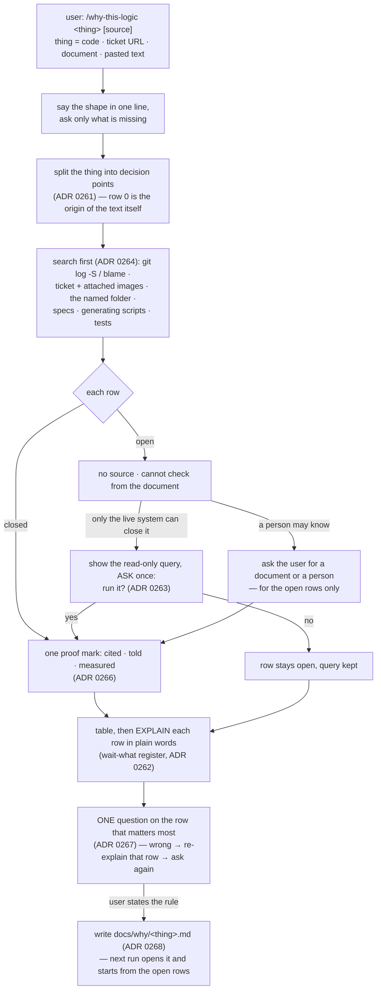
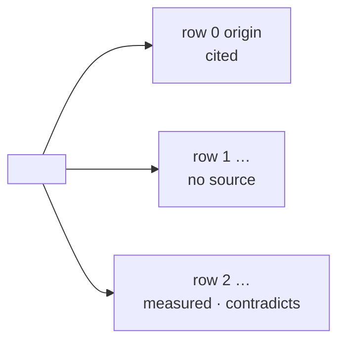

# why-this-logic — is this condition / value right, and where does it come from? One row per decision point, taught until the user states the rule

- **Date:** 2026-10-29
- **Status:** Approved for planning (pending owner sign-off on this spec)
- **ADRs:**
  [0261](../../adr/workflow-daily-work-0261-the-provenance-check-s-unit-is-one-decision-point-not-one-function.md) unit = one decision point ·
  [0262](../../adr/workflow-daily-work-0262-the-provenance-check-teaches-in-wait-what-s-register-not-feynman-s-card.md) teach in wait-what's register ·
  [0263](../../adr/workflow-daily-work-0263-a-row-the-documents-cannot-close-stops-by-default-and-the-live-read-is-offered-not-taken.md) live read offered, never taken ·
  [0264](../../adr/workflow-daily-work-0264-the-provenance-check-searches-before-it-asks-and-asks-only-for-the-rows-still-open.md) search first, ask for open rows only ·
  [0265](../../adr/workflow-daily-work-0265-the-provenance-check-is-named-why-this-logic.md) the name ·
  [0266](../../adr/workflow-daily-work-0266-every-closed-row-carries-one-of-three-proof-marks-cited-told-measured.md) cited / told / measured ·
  [0267](../../adr/workflow-daily-work-0267-why-this-logic-ends-when-the-user-states-the-rule-not-when-the-table-is-written.md) explain, then one question, until the user states the rule ·
  [0268](../../adr/workflow-daily-work-0268-why-this-logic-writes-one-markdown-file-with-a-fixed-block-per-row-in-guide-and-verify-s-shape.md) the Why file
  (precedents: `ticket-trace` for the git → ticket → image chain, `asking-to-understand` for the
  one-question close, `architect-and-verify` for the measured / told marks, `guide-and-verify` for
  the fixed step block)
- **Plugin:** `dev-workflows` — one minor bump above the global max at merge time. Today every
  ref holds `0.58.0`, so this is `0.58.0 → 0.59.0`; the plan computes it, it does not assume it.
  `plugin.json` and `marketplace.json` together.
- **Glossary:** `CONTEXT.md` gains a *why-this-logic terms* section — **Decision point**,
  **Proof mark**, **Verdict**, **Why file** (already written).

> **Amended 2026-10-29 at the final whole-branch review (ADRs 0270–0277):** §4.2 — the
> origin of the text never closes a row but row 0 (0270); §6 — a source silent on a point is
> *no source*, not *contradicts* (0271); §4.3, §11 — a pasted query output is *measured*, and
> the marks differ from architect-and-verify's in one place (0272); §4.3, §7 — the live read
> is the explicit metadata GET, not `dataverse:dv-metadata` (0273); §4.1, §4.5, §4.7, §7 — the
> Why file's skeleton is written after the split, completed after the explanation, updated by
> the close (0274); §4.3 — the ask is per query (0275); §7 — a *Still to answer* header line
> (0276); §4.3 — one phase-3 question naming every no-source row, with what was searched
> (0277). Also: §8's `study-design-verify` row — it is not named in the §4.7 line, which names
> `grill-then-plan`; §10 row 0's "one row per `or` term and per number" reads as one row for
> the term and one row for both numbers, as §1 and `splitting-rules.md` show; §4's "eight
> phases" are phases 0–8.



Read top to bottom: one opening question, a search, a table whose every closed row says what
kind of proof closed it, an explanation before any question, one question until the user can
say the rule, one file.

## 1. The problem

A developer looks at a condition — `if (days > 30)`, `rate = 0.15`,
`mgw_loggingstatus eq 914120001 or mgw_loggingstatus eq 914120003` — and cannot say whether
it is right, because they cannot say where it came from. Three things are tangled: *why does
this branch exist*, *where does this value come from*, and *what document, ticket or person is
the reference*. The owner's own framing (2026-10-29): *"ไม่รู้ว่า function or flow and logic
if else and value in that is correct … หาว่าทำไมต้องมีฟังก์ชันนี้ logic มาจากไหน ค่ามาจากไหน
อะไรคือแหล่งอ้างอิง"* — and the second requirement, that the skill must *teach*, so that the
user comes away understanding, not holding a table.

The example that shaped every decision — `Elevate` story #151, the OData filter of the daily
reminder flow, with `C:\Repo\MG-Elevate\Documents\2026-10-20_Teams_Calling_Agent_-_Side_Quest_p05UAAA=`
given as the source:

| Row | Decision point | Found | Verdict |
|---|---|---|---|
| 0 | where the story's text comes from | generated verbatim by `scripts/populate_teams_agent_backlog.py:388` — the script is the origin, the ticket is a copy | matches (cited) |
| 1 | why the filter has a `mgw_loggingstatus` term at all | the spec's Workflow 3 (`PROJECT_SPEC_AND_ANTIGRAVITY_PROMPT.md:145`) lists two filter terms and never names this field; the ticket's acceptance criteria do not either | no source |
| 2 | what `914120001` and `914120003` mean | the spec defines the field by label only — `Creating`, `Created`, `Partial`, `Failed` (line 104); the number-to-label map exists in no document, only in the live Dataverse | cannot check from the document |

A per-function answer would have said "it comes from #151" and been wrong three times.

## 2. Scope

- **In:** the new skill — `SKILL.md`, two reference files, `evals/evals.json`; a thin command
  wrapper `commands/why-this-logic.md`; one PLAYBOOK row and one router edge; a description
  clause and the version in `plugin.json` and in `marketplace.json`; the regenerated `skills/`
  tree; ADRs 0261–0268 and the glossary (done).
- **Out (deliberate):**
  - any edit to `ticket-trace`, `asking-to-understand`, `wait-what`, `read-picture` or
    `architect-and-verify` — the skill loads or borrows from them, it does not change them;
  - invoking `wait-what` from inside the skill — it is `disable-model-invocation: true`
    (ADR 0262);
  - reading a live system without a per-run yes (ADR 0263), and writing to one, ever;
  - filing a *contradicts* row as a work item — the skill offers `findings-to-ado-backlog`
    in one line and stops;
  - fixing the logic — a *contradicts* row with a design choice behind it goes to
    `grill-then-plan`; a mechanical one is the user's edit;
  - a validator script for the Why file — the evals measure the shape (as ADR 0257 ruled
    for `architect-and-verify`).

## 3. Files

```
plugins/dev-workflows/skills/why-this-logic/
  SKILL.md                          the skill (§4–§8)
  references/why-file-template.md   the Why file: overview diagram + the row block (§7)
  references/splitting-rules.md     what counts as one decision point (§5)
  evals/evals.json                  four cases (§10)
plugins/dev-workflows/commands/why-this-logic.md
                                    thin wrapper: /dev-workflows:why-this-logic <thing> [source]
```

The skill-relative paths above are referenced from `SKILL.md` as `references/…` (its own
files); the diagram convention is referenced as
`${CLAUDE_PLUGIN_ROOT}/references/diagram-convention.md` (one of the three shapes the
Antigravity installer rewrites).

**Frontmatter.** `name: why-this-logic`, `effort: max`, and this `description`:

> Find where a condition or a value comes from and whether it is right — one row per decision
> point (every if, every term of an and/or, every literal, every default), each with its own
> source, one proof mark (cited / told / measured) and one verdict (matches / contradicts /
> no source / cannot check from the document) — then explain each row in plain words and ask
> one question until the user can state the rule themselves. The thing may be code, an Azure
> DevOps / GitHub / JIRA ticket, a document, or pasted text; the user may name a source folder
> or document. Use whenever the user asks "is this logic right", "why is this value 30 / 0.15 /
> 914120001", "where does this condition come from", "what is the reference for this",
> "ทำไมต้องมี if นี้", "ค่านี้มาจากไหน", "logic นี้ถูกไหม", "แหล่งอ้างอิงคืออะไร", or
> doubts a filter, a mapping, a threshold or a default they did not write. Searches git, the
> ticket and its images, the named folder, specs, generating scripts and tests before asking;
> never opens a live system without asking first, and never writes to one. Writes
> docs/why/<thing>.md and starts from its open rows next time. Not ticket-trace (one line → one
> ticket, no verdict, no teaching), not asking-to-understand (questions about a whole artifact
> the user owns), not study-design-verify (how it SHOULD work — this skill asks why it IS the
> way it is).

The command wrapper carries `description` and `argument-hint: "<function, ticket URL, file:line,
or pasted text> [source folder or document]"` and hands `$ARGUMENTS` to the skill, as
`commands/ask.md` does.

## 4. The run — eight phases

```mermaid
sequenceDiagram
    participant U as user
    participant W as why-this-logic
    participant S as sources (git · ticket · folder · specs · scripts · tests)
    participant L as live system
    U->>W: /why-this-logic #151 "why this filter?" <folder>
    W->>U: one line: the shape of the run (§4.0); asks only what is missing
    W->>W: split into decision points — row 0 = origin of the text (§5)
    W->>S: git log -S · blame · ticket + images · folder · spec · generating script · tests
    S-->>W: row 0 cited · row 1 nothing · row 2 labels only, no numbers
    W->>U: table; row 1 no source, row 2 cannot check — the exact read-only query; run it?
    U-->>W: yes
    W->>L: the one query, read-only
    L-->>W: 914120001 = Created, 914120003 = Failed
    W->>U: row 2 measured → verdict contradicts (Partial skipped, Failed reminded)
    W->>U: do you have a document or a person for row 1?
    U-->>W: "Mark asked for it in the stand-up"
    W->>U: row 1 told (user, 2026-10-29); EXPLAIN every row in plain words; "/wait-what if unclear"
    W->>U: ONE question: in your words, why are only two of four statuses in the filter?
    U-->>W: states the rule
    W->>W: write docs/why/elevate-151-overdue-filter.md
```

### 4.0 Open — say the shape, ask only what is missing

The first message is one line the user reads before anything else:

> I will break this into rows. For each row I find where it comes from, explain it, then ask
> you one question.

Then one question, **only for what the invocation did not give**: *what* to check (a function,
a `file:line`, a ticket URL, a document, pasted text) and, if the user has one at hand, *a
source* (a folder, a document, a ticket). A source given here is a head start, not the whole
search (ADR 0264). An invocation that carries both asks nothing and goes on.

### 4.1 Split — one row per decision point (ADR 0261)

Apply `references/splitting-rules.md` (§5). **Row 0 is always the origin of the text itself**:
where did this function / ticket body / document paragraph come from — a commit, a generating
script, a template, a person. On #151 row 0 is what revealed that the ticket is a copy of a
script.

### 4.2 Search first (ADR 0264)

In this order, stopping per row when it closes; every hit is written on its row **as it is
found, not in a batch at the end** (the rule `guide-and-verify` states for measurements):

1. **git** — `git log -S "<the literal>"`, `git blame` on the line, the commit message; a
   ticket number in the message is followed as `ticket-trace` follows it.
2. **the ticket** — its description, acceptance criteria, comments, and **attached images**
   through `read-picture` (requirements often live only in an annotated screenshot).
3. **the folder or document the user named** — every file in it, including PDFs and images.
4. **specs, ADRs, wikis** in the project.
5. **generating scripts and templates** — anything that could have *produced* the text.
6. **tests** — an assertion on the value is a source, and names the intent.

A row closed here is **cited**: `file:line`, or a commit hash, or `ticket #n (comment / image
name)`.

### 4.3 Close the rest — told, or measured after a yes

Two kinds of row stay open after the search:

- **no source** — nothing found. Ask the user, *for these rows only*, whether a document or a
  person exists. A person's answer closes the row as **told: who, date** (ADR 0266). "I do
  not know" leaves it open.
- **cannot check from the document** — the source names the thing by a different handle (a
  label where the logic has a number; a name where the config has an id) and only the live
  system maps them. The skill writes the **exact read-only query** that would close it
  (`dataverse:dv-metadata` for an option set; a `SELECT`; a `GET`) on the row and asks
  **once per run**: *run it?* Yes → run exactly that query, read-only, close the row as
  **measured: the query**. No → the row stays open and the query stays on it for the user to
  run later (ADR 0263). The ask is per run, never a standing permission; the skill never
  writes to a live system.

### 4.4 Verdict — one of four per row (§6)

### 4.5 Table, then explain — before any question (ADR 0262, 0267)

Print the table (one line per row: decision point · source · mark · verdict). Then explain
**every row** in plain words: what the row is, where it comes from, what the verdict means,
and — for *contradicts* — what the source says instead. The register is `wait-what`'s: a little
context, ASD-STE100 Simplified Technical English, the project's `CONTEXT.md` words, short
sentences. The block ends with one line: *"Not clear? Type `/wait-what` on the sentence."*
The skill never invokes `wait-what` itself.

### 4.6 One question, until the rule (ADR 0267)

Pick the row that matters most — a *contradicts* row first, then *no source*, then
*cannot check*. Ask **one** question in `asking-to-understand`'s manner: *"In your own words,
why is this row here?"* Classify the answer:

| the answer | the move |
|---|---|
| states the rule (names the source, or names that there is none, and the verdict) | close — go to 4.7 |
| repeats the code ("because the status is 1 or 3") | re-explain that one row (4.5, that row only), ask again |
| guesses a source the search did not find | say what was searched and not found; ask whether they can point at it — a pointer re-enters 4.2 for that row |
| "I don't know" | re-explain that one row with the evidence on screen, ask again once; a second "I don't know" closes with the row marked open and the question written into the Why file |

Never more than one question per turn; never a list.

### 4.7 Write the Why file (ADR 0268)

`docs/why/<thing>.md` in the project being traced (§7). Say the path. If a *contradicts* row
exists, end with one line: *"Row N contradicts its source — file it as a finding
(`findings-to-ado-backlog`), or take it to `grill-then-plan` if the fix is a design choice?"*
— and stop; the skill files nothing and fixes nothing.

### 4.8 A later run on the same thing

If `docs/why/<thing>.md` exists, open it **first**. Rows with verdict *matches* or
*contradicts* are not re-traced; the run starts at 4.3 for the rows still *no source* or
*cannot check*, with their queries already written. If the thing's text has changed since
(the git hash on row 0 differs), say so and re-split.

## 5. Splitting rules — `references/splitting-rules.md`

One decision point is the smallest thing that could have its own source. Split:

| in the thing | one row each |
|---|---|
| `a and b`, `a or b` | each term |
| `x > 30`, `status eq 914120001` | the comparison **and** the literal, when the literal could come from somewhere else than the comparison (a threshold from a ticket, a code from an option set) — otherwise one row |
| `rate = 0.15`, `"Vehicles"`, `MG_ReminderAgeDays (7)` | the literal |
| a default (`= 0`, `?? "UNMATCHED"`, `Default No`) | the default |
| a branch (`if / else`, `case`) | the branch condition; the body's own literals get their own rows |
| a filter in a ticket, a query in a flow, a mapping in a config | the same rules — the thing need not be code |

Do not split what cannot have a separate source: `i < list.length` is one row, or none.
Row 0 — the origin of the text — is always present. Cap a run at the rows the user pointed at;
if a function has more than ~12 rows, say so and ask which part to trace first.

## 6. The four verdicts

| verdict | meaning | the row is |
|---|---|---|
| **matches** | a source exists (cited / told / measured) and the logic agrees with it | closed |
| **contradicts** | a source exists and the logic disagrees — the number maps to a different label than the spec intends, the threshold differs from the ticket, the test asserts another value | closed; ends the run with the one-line offer of §4.7 |
| **no source** | the search found nothing and no one asked could say | open |
| **cannot check from the document** | the source and the logic use different handles and only the live system maps them; the query that would close it is written on the row | open until a yes (ADR 0263) |

A row's verdict is written once the row is closed or declared open — never left blank.

## 7. The Why file — `references/why-file-template.md`

```markdown
# Why: <the thing, in the user's words>

- **Thing:** <file:line | ticket URL | document path>  ·  **Origin hash:** <row 0's commit, or —>
- **Traced:** <date>  ·  **Rows:** <n> · closed <k> · open <n−k>
- **Sources searched:** git · ticket (+<m> images) · <folder> · specs · scripts · tests



## Row 0 — origin of the text

**Where:** <file:line | ticket #n | document path>
**Why it exists:** <one sentence, or "no document says">
**Source:** cited <file:line / commit> | told <who, date> | measured <the query> | none
**Verdict:** matches | contradicts | no source | cannot check from the document
**To close it yourself:** <the read-only command, the document to find, or whom to ask — or —>
**In plain words:** <two or three sentences in wait-what's register>

## Row 1 — <the decision point, quoted as written>
…
```

Rules that keep the shape honest, carried from `guide-and-verify`: every row has every line,
a line with nothing to say carries `—`; the *Source* line carries exactly one mark or `none`;
*To close it yourself* on an open row is a command or a name, never "ask around"; the
*In plain words* block is the same text the user was shown in §4.5. The overview diagram is
the Mermaid family (a document renders Mermaid); the table shown in the terminal during the
run is monospace text (`references/diagram-convention.md`, two render targets).

## 8. Boundaries

| not this skill | because | hand-off |
|---|---|---|
| `ticket-trace` | answers *why* for one line via git → ticket → image, with no split, no verdict and no teaching; this skill **uses** its chain in §4.2 step 1–2 | loaded, not duplicated |
| `asking-to-understand` | questions a whole artifact the user owns; this skill borrows only its close — one grounded question per turn, ends when the rule is stated — about its own rows | borrowed manner, not invoked |
| `feynman-explain` | the owner ruled it out (ADR 0262); the explanation here sits beside a row, not alone | — |
| `wait-what` | the user's repair for one sentence; cannot be invoked by a skill | pointed at, every explaining block |
| `study-design-verify` | how it *should* work; this skill asks why it *is* this way — a *contradicts* row may feed it | named in the §4.7 line when the fix is a design choice |
| `debug-mantra` | nothing is broken here; a *contradicts* row is a finding, not a failure | — |
| `guide-and-verify` / `architect-and-verify` | their step block and their marks are copied; neither is loaded | — |

## 9. PLAYBOOK, router, manifests

- **PLAYBOOK row** (WORKING table), after the `ticket-trace` row:

  > | "is this condition / value right, and where does it come from?" — a filter, a threshold, a mapping, a default you did not write | `why-this-logic` (`/dev-workflows:why-this-logic`) — one row per decision point, each with its source and one proof mark (cited / told / measured) and one verdict (matches / contradicts / no source / cannot check); searches git, the ticket and its images, your folder, specs, scripts and tests before asking; never opens a live system without a yes; explains every row in plain words, then asks one question until you can state the rule; writes `docs/why/<thing>.md`. Not `ticket-trace` — that answers why for one line and stops (ADRs 0261–0268) |

- **Router edge** in the WORKING mermaid: `WORK -- is this logic / value right? --> WTL["why-this-logic"]`
  and a dotted `TT -. per-row, with a verdict .-> WTL`.
- **Manifests:** one clause *Logic provenance: why-this-logic (…)* in both descriptions,
  directly after the *System study* clause (which names `ticket-trace`); keywords
  `why-this-logic`, `provenance`, `logic-provenance`, `where-does-this-value-come-from`,
  `is-this-logic-right`, `decision-point`, `cited-told-measured`; version per the header.
- **`skills/` tree:** regenerated with `scripts/generate_skills_tree.py`; the generator copies
  `references/` and `evals/`.

## 10. Evals — `evals/evals.json`

> **Amended 2026-10-29 by ADR 0269 (Task 2 review, during execution):** every prompt
> scripts each answer the skill will ask for — case 0 the phase-3 "document or person?"
> (no) and the phase-6 rule; cases 1–3 the phase-6 rule; case 3 also the query's result
> (`914120001 = Created`, `914120003 = Failed`), so case 3 is the suite's `contradicts`
> case and measures the "what the source says instead" explanation and the phase-7 offer
> line. Case 0's "before any question" assertions mean the phase-6 question; the phase-3
> asks precede the explanation by design (§4). The table below reads with that amendment.

Same shape as `guide-and-verify`'s file: `skill_name`, and `evals` with `id`, `name`,
`prompt`, `expected_output`, `files`, `assertions`. Four cases:

| id | name | the situation | what it must show |
|---|---|---|---|
| 0 | `ticket-filter-numbers-only-live-system-knows` | a ticket's OData filter uses option-set numbers; the user names a spec folder that defines the field by label only; the agent has no live access unless asked | the opening one-liner; row 0 finds the generating script; one row per `or` term and per number; the label-only spec yields *cannot check*; the exact read-only query is written on the row; the agent **asks** before running it and does not run it when the prompt says no; the missing-term row is *no source*; explanation precedes the question; exactly one question |
| 1 | `threshold-in-code-cited-from-test` | `if (days > 30)` in code; no ticket; a test asserts `31 → overdue`, `30 → not`; the user has no document | git searched before asking; the test cited as the source, with file and line; verdict *matches*; the user is not asked for a source for a row the test closed; the Why file path is said |
| 2 | `person-is-the-only-source` | a default value with no git history beyond "initial commit" and no document; the user answers "Khun A set it, last March" | the row closes as **told** with who and when, not as cited; the Why file's *Source* line carries `told`; the agent does not present it as a document |
| 3 | `rerun-starts-from-open-rows` | a `docs/why/<thing>.md` exists with two closed rows and one open row carrying a query; the user runs the skill again | the file is opened first; the closed rows are not re-traced; the run starts at the open row's query with the per-run ask; nothing is asked about the closed rows |

Each case's assertions also check the shape: every row block has all six lines; one mark
per closed row; the `/wait-what` pointer closes the explaining block; the live system is
never written to.

## 11. Self-review

- **Placeholders:** none — `<thing>`, `<n>`, `<folder>` are slots the skill fills at run time;
  the manifest clause and the four eval names are fixed above.
- **Consistency:** §4.1 = ADR 0261; §4.2 = 0264; §4.3 = 0263, 0266; §4.5 = 0262, 0267 (explain
  before ask); §4.6 = 0267; §4.7–4.8, §7 = 0268; §3's name = 0265. The four verdict words of §6
  are the ones ADR 0268's block carries; the three marks of §4.3 are ADR 0266's and match
  `CONTEXT.md`'s *architect-and-verify terms* (**Measured fact**, **Told fact**).
- **Load-bearing claims verified 2026-10-29:**
  - `wait-what` is `disable-model-invocation: true` (`skills/wait-what/SKILL.md:4`), so §4.5's
    "pointed at, never invoked" is forced, not chosen.
  - `ticket-trace` already follows git → commit → ticket → attached images via `read-picture`
    (its SKILL.md and the PLAYBOOK row), so §4.2 steps 1–2 reuse it.
  - On `Elevate` #151 the story text is generated by
    `C:\Repo\MG-Elevate\scripts\populate_teams_agent_backlog.py:388`; the spec at
    `…\PROJECT_SPEC_AND_ANTIGRAVITY_PROMPT.md` defines `mgw_loggingstatus` by label at line 104
    and lists Workflow 3's filter without the field at line 145; the numbers `914120001` /
    `914120003` appear in no document under `C:\Repo\MG-Elevate\Documents` — §1's table is
    measured, not told.
  - `guide-and-verify/evals/evals.json` has the `skill_name` / `evals[id, name, prompt,
    expected_output, files, assertions]` shape §10 copies.
  - `scripts/generate_skills_tree.py` exists and the `skills/` tree already carries
    `architect-and-verify` with its `references/` and `evals/`.
  - Both manifests report `0.58.0` today on every ref.
