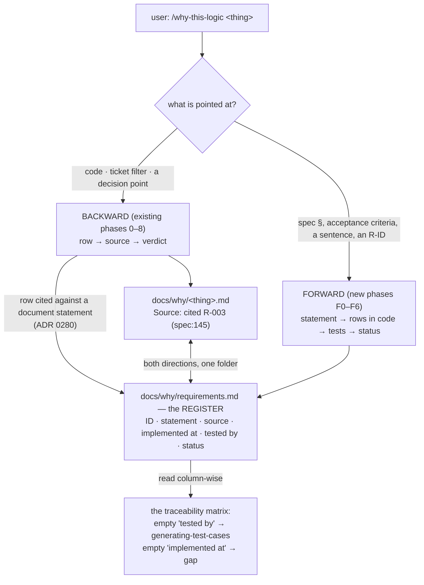
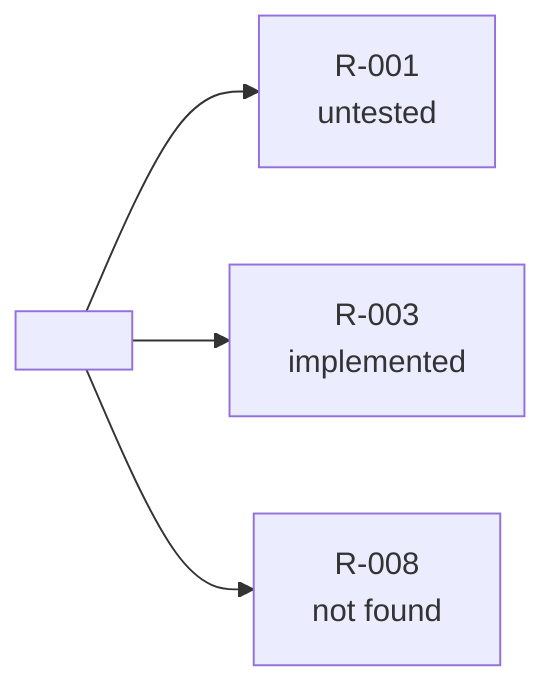

# why-this-logic — requirement traceability: an ID per requirement, a register that is the matrix, and a forward trace from any requirement statement

- **Date:** 2026-10-29
- **Status:** Approved for planning (pending owner sign-off on this spec)
- **Extends:** [2026-10-29-why-this-logic-design.md](2026-10-29-why-this-logic-design.md) (ADRs 0261–0277, as amended). Everything there stands; this spec adds the forward direction and the register.
- **ADRs:**
  [0278](../../adr/workflow-daily-work-0278-a-requirement-is-one-behaviour-binding-statement-with-a-minted-id-in-a-per-project-register.md) a requirement is one statement with a minted ID ·
  [0279](../../adr/workflow-daily-work-0279-the-forward-trace-starts-from-any-requirement-statement-and-reports-implemented-untested-or-not-found.md) the forward trace starts from any statement ·
  [0280](../../adr/workflow-daily-work-0280-every-row-cited-against-a-document-mints-or-reuses-a-requirement-id-so-the-register-grows-from-daily-work.md) every cited row mints or reuses an ID ·
  [0281](../../adr/workflow-daily-work-0281-the-register-lives-beside-the-why-files-in-the-traced-project-and-is-never-written-to-a-tracker.md) the register lives beside the Why files
  (precedents: `architect-and-verify`'s `N-01` rows — one ID on the row, the arrow and the test; `generating-test-cases` step 4 — "forward: every requirement → ≥1 case; backward: every case → real Evidence")
- **Branch:** lands on `why-this-logic` (unmerged, manifests at `0.59.0`). No further version bump while the branch is unreleased; the plan recomputes the global max at merge time and bumps only if another branch has landed a higher version.
- **Glossary:** `CONTEXT.md` *why-this-logic terms* gains **Requirement**, **Register**, **Forward trace**, **Coverage status** (already written).

> **Amended 2026-10-30 at the whole-plan review (ADRs 0282–0287; 0278, 0279, 0281 amended):**
> §5, §6 F2 — a statement is the registered one when its *text* matches; a known locator whose
> text differs is *source changed* in either direction, mints nothing (0282); §6 F0 — the
> register is created by the first minted ID, F0 only opens it (0283); §5, §7 — `(contradicts)`
> is a mark on a locator in *implemented at* or *tested by*, not a fifth status (0284); §5 — a
> ticket comment or attached image that states a requirement mints, locators `#151 comment 3`,
> `#151 image <name>` (0285); §7 — the overview draws one node per open statement and one
> count node for the implemented ones; the header carries a *Still to answer* line; IDs are
> never renumbered *once merged*; a source's own ID is qualified by its ticket when not
> project-unique, `#151/AC-2` (0286; 0278 amended); §4 — on an ambiguous thing the question
> decides the direction (0279 amended); §6 F6 — one offer line per kind, naming every ID of
> that kind; §6 F4 — a `generating-test-cases` case counts when its *Evidence* cell cites the
> ID; §3 — the description is rewritten under the 1,536-character listing cap (0287);
> "`wait-what`'s register" in §4.5 means its plain style. The committed skill files are the
> current text where this spec and they differ.



Read top to bottom: one skill, two directions picked by what the user points at; both write
the same register; the register read column-wise is the matrix (ADR 0281).

## 1. The problem

The skill built so far answers *why is this logic here?* — code to source. A software
engineer's traceability also answers *where is this requirement implemented, and which test
proves it?* — source to code to test — and keeps a matrix that shows, for every
requirement, whether it is implemented, tested, or missing. Today the skill has no
requirement identity, no forward direction and no matrix; a requirement with no code behind
it (spec §4 Workflow 3's "emails the PDF digest to `MG_AdminEmail`" on `Elevate` #151) is
invisible, because the backward trace can only start from code that exists.

## 2. Scope

- **In:** the direction switch in `SKILL.md` phase 0; the ID minting in phase 2 and the
  register write in phases 5 and 7; the new forward phases F0–F6 in `SKILL.md`; a new
  reference `references/register-template.md`; the `Source` line of
  `references/why-file-template.md` carrying the ID; `references/splitting-rules.md` gaining
  the *statement* split rules; two new eval cases (ids 4, 5); the PLAYBOOK row and both
  manifest clauses gaining the forward direction; a supersession banner on the first spec
  (§4.2, §7) and on ADR 0266 (*cited* may carry an ID); the regenerated `skills/` tree.
- **Out (deliberate):**
  - writing IDs back into the source — a spec, a ticket, a tracker (ADR 0281; ADR 0263);
  - generating the missing tests — the *untested* status ends with one line offering
    `generating-test-cases`, and stops;
  - implementing a *not found* requirement — that is `grill-then-plan`'s;
  - a second skill or command for the forward direction (ADR 0279: one skill, direction by
    what is pointed at);
  - a validator script for the register — the evals measure its shape, as for the Why file.

## 3. Files

```
plugins/dev-workflows/skills/why-this-logic/
  SKILL.md                              phase 0 gains the direction switch; phase 2 mints;
                                        phases 5/7 write the register; new section "The
                                        forward run — phases F0 to F6"
  references/register-template.md       NEW — the register's header, overview, table, rules
  references/why-file-template.md       Source line: cited <R-ID> (<file:line>) when the
                                        source is a document statement
  references/splitting-rules.md         NEW section "Splitting a requirement text"
  evals/evals.json                      cases 4 and 5 added (§9)
```

The description (frontmatter) gains one sentence: *"Pointed at a requirement — a spec
section, a ticket's acceptance criteria, a sentence, or an R-ID — it runs forward: splits
it into statements, gives each an ID, finds the decision points that implement it and the
tests that assert it, and writes docs/why/requirements.md, the register that is the
traceability matrix; every backward run feeds the same register."* Trigger phrases added:
"where is this requirement implemented", "is this requirement tested", "traceability",
"requirement coverage", "which requirements have no code", "requirement นี้อยู่ตรงไหน",
"มี test ไหม", "ทำ traceability matrix".

## 4. The direction switch — phase 0

After the one-line shape statement, the skill decides the direction from the thing pointed
at, and says which it chose in one line:

| pointed at | direction |
|---|---|
| a `file:line`, a function, a filter inside a ticket, pasted logic, a decision point | **backward** — phases 0–8 as specified |
| a spec section, a ticket's acceptance criteria, a document paragraph, a typed requirement sentence, an `R-` ID (or the source's own ID) | **forward** — phases F0–F6 |
| ambiguous (a whole ticket with both a description and logic) | ask one question: *"Trace the logic backward to its sources, or trace the requirements forward into the code?"* |

The opening line becomes, for the forward direction: *"I will split this into requirement
statements. For each one I find where it is implemented and which test proves it, explain
it, then ask you one question."*

## 5. Backward run — what changes (ADR 0280)

- **Phase 2, closing a row against a document statement.** When the source is a document
  (spec, ADR, wiki, ticket description or acceptance criterion — not a commit, not a test,
  not a person), the skill finds or mints the statement's ID in `docs/why/requirements.md`:
  the source's own ID if the statement carries one (`FR-12`, `AC-2`), else the next `R-nnn`.
  The row's Source line reads `cited R-003 (spec:145)`; the register's *implemented at* cell
  for R-003 gains `<Why file> row N`. A statement already in the register (same locator, or
  same text) reuses its ID — never two IDs for one sentence.
- **Phase 2, tests.** A test found at search order 6 that asserts the row's value is written
  in the register's *tested by* cell for every requirement the row implements.
- **Phase 5 / phase 7.** The register is refreshed when this run cited or minted any ID — its
  cells, the header's counts and *Last run*; a run that cited no document statement does not
  touch it (and never creates it). A row whose verdict is *contradicts* is listed in
  *implemented at* with `(contradicts)` after its locator: the status words say whether code
  and a test exist, the mark keeps the disagreement visible.
- **Row 0** (origin) never mints — an origin is not a requirement (ADR 0270, 0280).
- Nothing else in phases 0–8 changes.

## 6. Forward run — phases F0 to F6

```mermaid
sequenceDiagram
    participant U as user
    participant W as why-this-logic
    participant R as register
    participant C as code · tests
    U->>W: /why-this-logic spec §4 Workflow 3 — where is it, is it tested?
    W->>U: one line: the forward shape
    W->>R: open docs/why/requirements.md (create if absent)
    W->>W: F1 split the text into statements; F2 find or mint IDs (R-001..R-008, eight statements)
    W->>C: F3 per statement: grep the value, the field, the flow name; read the hits as decision points
    W->>C: F4 per statement: grep tests asserting the value; read generating-test-cases suites citing the ID
    C-->>W: R-001 trigger, no test · R-002 row · R-003 row + test · R-006..R-008 nothing
    W->>R: write/refresh eight lines, statuses
    W->>U: F5 matrix table, then EXPLAIN each statement in plain words; "/wait-what" line
    W->>U: F6 ONE question on the row that matters most (not found first): in your words, why has R-008 no code?
    U-->>W: states the rule
    W->>R: F6 close: Still to answer / offer lines
```

- **F0 — Open.** Say the forward shape line. Open or create `docs/why/requirements.md`
  from `references/register-template.md`.
- **F1 — Split the text into statements** (`references/splitting-rules.md`, new section):
  one statement per clause that binds behaviour — a value, a condition, a trigger, a
  recipient, an ordering; a sentence with "and" between two obligations is two statements;
  an example, a rationale or a heading is none. Quote each statement as written, with its
  locator (`spec:145`, `#151 AC-2`).
- **F2 — Find or mint IDs.** Same rule as §5: the source's own ID when present, else the next
  `R-nnn`; a statement already registered (same locator or same text) reuses its ID.
- **F3 — Search the code for each statement**, in this order, recording every hit as found:
  the literal value (`7`, `08:00`, `MG_AdminEmail`); the field or variable name
  (`mgw_hasthecallbeenactioned`); the flow, function or job name (`mgw_flow_overduereport`);
  an existing Why file whose rows cite the ID. Each hit is read as a decision point and
  written in *implemented at* as `file:line` or `<Why file> row N`. A hit that only mentions
  the value in a comment or a log string is not an implementation. No hit → *implemented at*
  stays `—`.
- **F4 — Search the tests for each statement:** a code test that asserts the value or the
  condition (`expect(isOverdue(31))`), or a case in a `generating-test-cases` suite whose
  Evidence or ID column cites the requirement's ID. Written in *tested by* as `file:line` or
  `<suite> case <id>`.
- **Status** (one per statement): **implemented** — ≥1 decision point and ≥1 test;
  **untested** — ≥1 decision point, no test; **not found** — no decision point;
  **source changed** — on a later run, the text at the locator no longer reads as the
  register records (the status is set and the old text kept beside the new one; nothing else
  is re-derived until the user confirms the new wording).
- **F5 — Matrix, then explain.** Print the register's lines for these statements as a
  monospace table (ID · statement · implemented at · tested by · status). Then explain every
  statement in plain words, wait-what's register, two or three sentences — where it lives,
  what proves it, or that nothing does. End with `Not clear? Type /wait-what on the sentence.`
- **F6 — One question, then close.** Priority: *not found* first, then *untested*, then
  *source changed*. Ask one question in the manner of phase 6 (same answer table, same
  re-explain-then-re-ask rule); when the user states the rule, update the register. End with
  at most two one-line offers and stop: for each *untested* statement, *"R-001 has code and
  no test — generate its case (`generating-test-cases`)?"*; for each *not found* statement,
  *"R-008 has no code — design it (`grill-then-plan`), or file it as a finding?"*. The skill
  writes no test and no code.

The forward run never opens a live system; a value that only the live system could confirm
(a schedule in a flow definition, say) is written *implemented at: told <who, date>* when the
user states it, with the same marks as the backward run (ADR 0266, 0272).

## 7. The register — `references/register-template.md`

```markdown
# Requirements — <project>

- **Register of:** <repo or system name>  ·  **Last run:** <YYYY-MM-DD>  ·  **Statements:** <n> · implemented <a> · untested <b> · not found <c> · source changed <d>
- **Sources:** <spec path(s)> · <ticket(s)> · <folder>



<One sentence: which statements are not found or untested.>

| ID | statement (as written) | source | implemented at | tested by | status |
|---|---|---|---|---|---|
| R-001 | runs Mon-Fri 08:00 AEST | spec:144 | `mgw_flow_overduereport` trigger | — | untested |
| R-003 | call older than 7 days | spec:145 · spec:121 (`MG_ReminderAgeDays (7)`) | `docs/why/elevate-151-overdue-filter.md` row 2 · `src/billing/overdue.ts:14` | `tests/billing/overdue.test.ts:14-15` | implemented |
| R-008 | emails to `MG_AdminEmail` / Liquidators | spec:147 | — | — | not found |
```

Rules: one line per ID, IDs never reused or renumbered; *statement* is quoted as written; a
cell with nothing carries `—`; *implemented at* and *tested by* hold one or more locators
separated by ` · `; *status* is one of the four words of §6; a locator in *implemented at* whose row's verdict is *contradicts* carries `(contradicts)` after it; the source's own ID, when it
has one, is the ID (`FR-12`), and the `R-` sequence is per register. The overview diagram
follows the diagram convention (one lead-in sentence; no double quotes inside labels).

## 8. Boundaries

| not this skill | because | hand-off |
|---|---|---|
| `generating-test-cases` | writes the test cases; this skill only shows which requirement has none | the F6 offer line |
| `fit-gap-analysis` | compares a target against a whole system; this skill traces one requirement text into code | — |
| `architect-and-verify` | its `N-01` rows are needs of a new system; the ID shape is borrowed, the skill is not loaded | — |
| `ticket-trace` | commit ↔ ticket; the register is requirement ↔ code ↔ test | loaded for the ticket hop, as today |
| `study-design-verify` / `grill-then-plan` | design what a *not found* requirement should become | the F6 offer line |

## 9. Evals — two cases added to `evals/evals.json`

| id | name | the situation | what it must show |
|---|---|---|---|
| 4 | `forward-trace-finds-the-gap` | the user points at spec §4 Workflow 3 (four sentences, pasted in the prompt) of a repo whose code has the trigger (no test), the two filter terms (one tested), and nothing for the reminder emails, the counter, the table, the PDF or the digest e-mail; `docs/why/requirements.md` does not exist; the phase-6 answer is scripted | the forward shape line; eight statements R-001..R-008 quoted as written with locators (line 146 is two, line 147 is three); R-003's test cited; R-004..R-008 *not found*; the register created with the §7 shape; the matrix printed before the explanation; the one question targets a *not found* statement; the two offer lines; no code or test written |
| 5 | `backward-run-mints-an-id-and-reuses-it` | a backward run on `if (days > 30)` closes the row against `spec.md:12 "an invoice is overdue after 30 days"`; `docs/why/requirements.md` already holds `R-007` for that locator | the row's Source line reads `cited R-007 (spec.md:12)` — no new ID minted; the register's *implemented at* for R-007 gains the Why file row; the test found at order 6 lands in *tested by*; status becomes *implemented* |

Cases 0–3 are unchanged except case 0's Source lines, which now read `cited <ID> (…)` only
where a document statement is the source (row 0's script is an origin and mints nothing).

## 10. Supersession banners (same change)

- First spec, §4.2 and §7: a row cited against a document statement carries the statement's
  ID on its Source line (ADR 0280); the Why file's neighbour is the register (ADR 0281).
- ADR 0266: *cited* may read `cited R-003 (spec:145)`; the mark is unchanged, the citation
  gains an ID.
- ADR 0268: `docs/why/` now holds the register beside the Why files.

## 11. Self-review

- **Placeholders:** none — `<project>`, `<n>`, `R-nnn` are run-time slots.
- **Consistency:** §4 = ADR 0279 (direction by what is pointed at); §5 = ADR 0280; §6
  statuses = `CONTEXT.md` **Coverage status**; §7 = ADR 0281 and ADR 0278; F5/F6 reuse
  ADRs 0262 and 0267 unchanged; the forward run's marks are ADR 0266/0272's.
- **Load-bearing claims verified 2026-10-29:** `generating-test-cases` step 4 states the
  forward/backward rule and its case columns include `ID` and `Evidence(required)`
  (SKILL.md:44-49); `architect-and-verify`'s document template carries `N-01` / `C-01` /
  `P-01` IDs on rows, arrows and tests (`references/document-template.md:47-50, 131-133`);
  the current Why file template's Source line is
  `<cited file:line | told who, date | measured the query | none>` (line 49), so adding the
  ID is a change to one line; the register path `docs/why/` is the folder ADR 0268 already
  owns.
