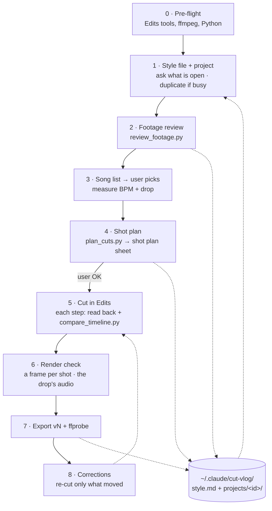
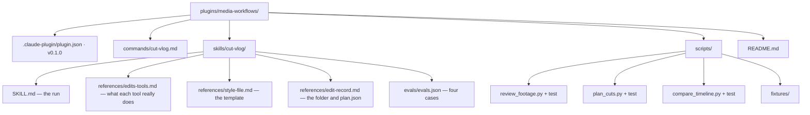
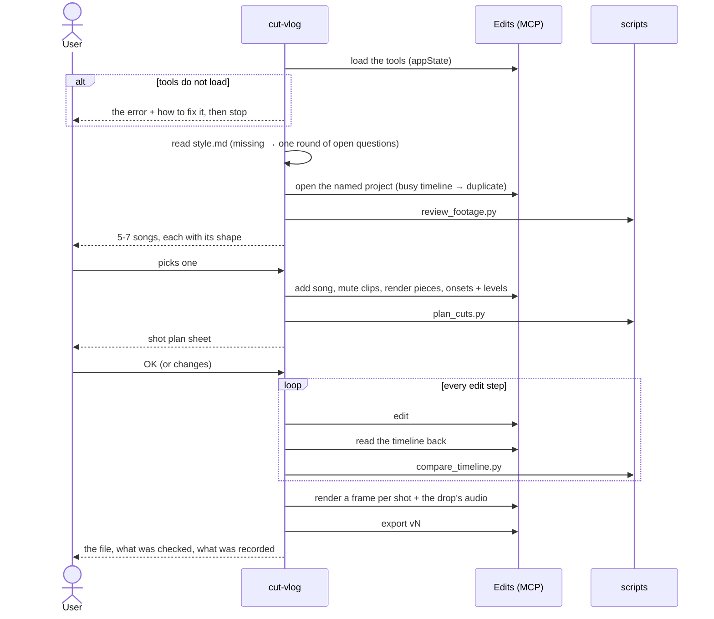
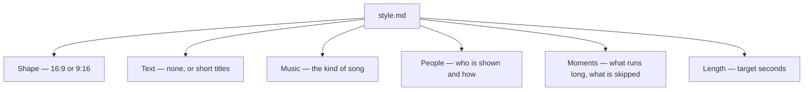
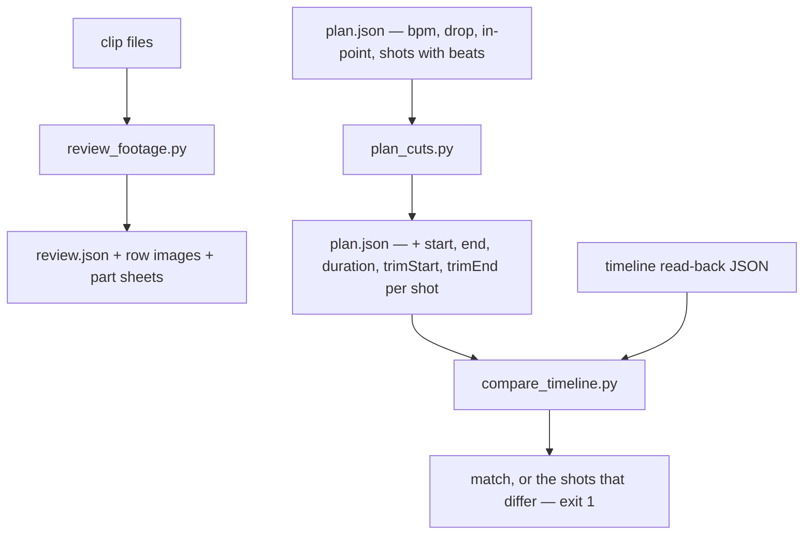
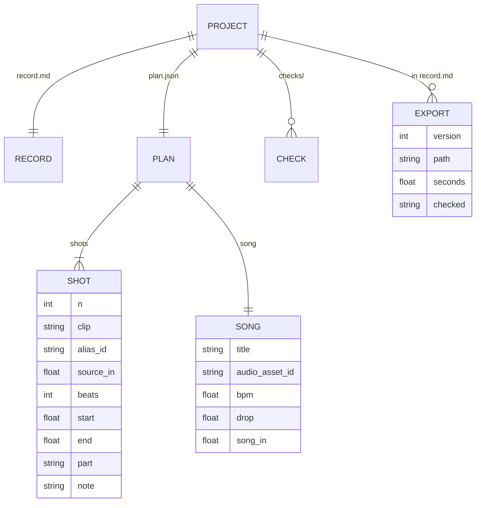

# cut-vlog — a day's footage cut into a vlog in Edits, on the beat, checked against the plan

> **Superseded in part (2026-11-08) by
> [ADR 0313](../../adr/workflow-daily-work-0313-the-user-adds-the-song-by-hand-and-no-timeline-is-ever-emptied.md).**
> The live run found that a project emptied once, and media added through the MCP tools,
> render and export without sound. For what the skill does now, read `SKILL.md` and
> `references/edits-tools.md` — they win over this document.
>
> | This spec says | Actually |
> |---|---|
> | Phase 1: a busy project is duplicated as `<project> – cut-vlog` (ADR 0301) | the user makes a new empty project with that name and the same footage; a duplicate is allowed only if its timeline is never cleared |
> | Phase 3: the agent adds the song, then measures | the user adds the song by hand at 0:00; the agent slips it to in-point 0 and measures; a render with no audio track stops the run |
> | Phase 5: add every planned clip whole, then slip the music | the planned clips go in front of Phase 3's clips, which are then deleted one at a time; the hand-added song is never deleted, only slipped and faded |
> | §7: the tool table, measured 2026-11-07 | `references/edits-tools.md` holds the corrected and extended table, with the known issue |
> | Phase 7: `ffprobe` checks the streams | unchanged, and an export with no audio stream is not delivered |

- **Date:** 2026-11-07
- **Status:** Approved by the owner on 2026-11-07
- **Plugin:** `media-workflows` (new, opt-in) · **Skill:** `cut-vlog` · **Command:** `/media-workflows:cut-vlog`
- **ADRs, one per decision, written as the grilling resolved them:**
  [0290](../../adr/workflow-daily-work-0290-video-editing-ships-as-its-own-opt-in-plugin.md) own opt-in plugin ·
  [0291](../../adr/workflow-daily-work-0291-every-user-specific-file-lives-in-a-folder-outside-the-repo.md) user files outside the repo ·
  [0292](../../adr/workflow-daily-work-0292-the-skill-edits-only-in-the-edits-app-on-a-mac.md) Edits on a Mac only ·
  [0293](../../adr/workflow-daily-work-0293-when-the-edits-tools-do-not-load-the-skill-stops.md) tools do not load → stop ·
  [0294](../../adr/workflow-daily-work-0294-the-user-picks-the-song-from-a-list-before-any-cut.md) the user picks the song ·
  [0295](../../adr/workflow-daily-work-0295-the-user-approves-a-shot-plan-sheet-before-the-cut.md) shot plan sheet ·
  [0296](../../adr/workflow-daily-work-0296-every-edit-step-is-checked-against-the-plan-in-a-second-channel.md) second-channel check ·
  [0297](../../adr/workflow-daily-work-0297-one-edit-record-per-project-in-the-users-folder.md) edit record ·
  [0298](../../adr/workflow-daily-work-0298-three-tested-python-scripts-do-the-repeatable-work.md) three scripts ·
  [0299](../../adr/workflow-daily-work-0299-the-plugin-is-media-workflows-the-skill-is-cut-vlog.md) the names ·
  [0300](../../adr/workflow-daily-work-0300-cut-vlog-is-measured-by-script-tests-four-evals-and-one-live-run.md) how it is measured ·
  [0301](../../adr/workflow-daily-work-0301-a-project-with-work-on-its-timeline-is-duplicated-first.md) duplicate a busy project ·
  [0302](../../adr/workflow-daily-work-0302-the-footage-is-the-named-edits-projects-media.md) footage source ·
  [0303](../../adr/workflow-daily-work-0303-a-first-run-asks-once-only-what-the-user-left-open.md) first-run questions ·
  [0304](../../adr/workflow-daily-work-0304-every-export-is-a-new-numbered-file.md) numbered exports ·
  [0305](../../adr/workflow-daily-work-0305-a-correction-re-cuts-only-what-moved.md) corrections ·
  [0306](../../adr/workflow-daily-work-0306-a-licensed-song-is-measured-from-a-timeline-render.md) measuring a licensed song ·
  [0307](../../adr/workflow-daily-work-0307-the-playbook-gets-an-outside-the-daily-arc-section.md) playbook section
- **Decided in this spec** (§12):
  [0308](../../adr/workflow-daily-work-0308-the-edit-record-is-a-folder-per-project.md) record folder ·
  [0309](../../adr/workflow-daily-work-0309-cut-vlog-is-one-skill-file-three-references-and-three-scripts.md) skill files ·
  [0310](../../adr/workflow-daily-work-0310-the-cut-follows-a-build-and-release-rhythm.md) cut rhythm ·
  [0311](../../adr/workflow-daily-work-0311-hard-cuts-by-default-a-dissolve-only-where-the-place-changes.md) transitions ·
  [0312](../../adr/workflow-daily-work-0312-the-style-rules-are-judged-by-the-agent-on-rendered-frames.md) who judges the style rules
- **Origin:** the first vlog cut by hand on 2026-11-07 — 38 clips, three songs, three
  exports. Every step, failure and correction of that run is the evidence this spec rests on.
  No detail of that family appears here (ADR 0291).



## 1. The problem

A day of phone footage — dozens of clips, most of them a few seconds of walking, a few of
them the moments that matter — has to become one short video that moves with its music.
Doing it by hand with an agent on 2026-11-07 worked, but it took hours, and almost every
hour was lost to one of five things:

1. **The cut was made before the user's rules were known.** The first export had the wrong
   frame shape, text the user did not want, a song they rejected, and shots that framed a
   person in a way the user does not allow. Each rule came out as a correction after an
   export.
2. **The song was chosen after the cut.** Every cut point came from the old song's beat, so
   a new song meant deleting every clip and cutting again.
3. **A still frame could have caught most corrections.** A person framed against the
   rules, a moment out of focus, a moment too short — all visible in one frame per shot,
   all found only after export.
4. **The Edits tools said ok when they had not done it.** A negative trim returned
   `trimmed: true` and changed nothing; a fill transform clamped the zoom to 1; deleting
   every clip also deleted the music.
5. **The repeatable work was rewritten by hand.** The first footage review sampled frames
   unevenly and ran into a timeout; the cut arithmetic was retyped twice.

`cut-vlog` turns that run into a method: the rules first, the song second, the plan seen
before the cut, every edit checked, and the arithmetic in tested scripts.

## 2. Scope

**In:**
- one Edits project on a Mac → one vlog, cut on the beat of one song;
- the style file (frame shape, text or none, music kind, rules for who is shown and how,
  length), written on the first run and grown by corrections;
- a song list for the user to pick from; BPM and drop measured from the app's renders;
- the shot plan sheet, approved before the cut;
- the cut in Edits — clips, trims, music, volumes, reframing and zoom, few transitions,
  short titles only when the style file asks for text;
- the second-channel check after every step and a render check before export;
- numbered exports checked with ffprobe; corrections after export.

**Out (v1):** any editor other than Edits, any machine other than a Mac (ADR 0292); a
fallback when the Edits tools do not load (ADR 0293); voiceover, auto-captions, sound
effects; one video from several Edits projects; posting to a platform.

## 3. The files



The user's own files never enter the repo (ADR 0291):

```
~/.claude/cut-vlog/
  style.md                      the style file
  projects/<edits-project-id>/
    record.md                   the edit record a person reads
    plan.json                   song, shots, computed cuts — the scripts' input
    review/                     review.json, one row image per clip, part sheets
    checks/                     timeline read-backs, frame sheets, drop renders
```

## 4. The run — `SKILL.md`



### Phase 0 — Pre-flight
Load the Edits MCP tools (`appState`). If they do not load — the server is down, or the
agent rejects its tool list as on the first run (`tools/list`: `ttlMs`, `cacheScope`) —
name the error, give the fixes (update Edits, update the agent, restart), and stop (ADR
0293). Check `ffmpeg`/`ffprobe` and Python 3.10+; a missing ffmpeg is offered as
`brew install ffmpeg`, installed only on a yes.

### Phase 1 — Style file and project
Read `~/.claude/cut-vlog/style.md`. When it is missing, ask in one round only the open ones
of: frame shape, text or none, kind of music, rules for who is shown and how, target
length — then write it from the template (ADR 0303). Open the Edits project the user named
(ADR 0302); with no media, ask for a folder and import it. When its timeline has clips,
duplicate it as `<project> – cut-vlog` and work there, and say so (ADR 0301). When
`projects/<id>/` already exists, read it and resume from the last step it records (ADR 0297).

### Phase 2 — Footage review
Run `review_footage.py` over the project's clips (§6). Look at every row image. For each
clip note in `plan.json`'s candidates: what happens, its best in-out, whether it is sharp,
and whether it breaks a style rule. The parts of the day come from the script's time gaps.

### Phase 3 — Song
List 5-7 songs that fit the style file's music kind, from the Edits library (trending tab
and searches by known songs of that kind), each with: title, artist, its shape (where it
builds, where it drops), and an explicit-lyrics warning. Wait for the pick (ADR 0294); place
no clip before it. Then measure (ADR 0306): add the song, set every clip's volume to 0,
render the timeline in 10-second pieces, run `audioOnsets` and `audioLevels` on each render,
read the BPM and the drop (a short dip, then a loud hit), and restore every volume. Read
`beatMarkers` as a cross-check: double its half-tempo `estimatedBpm` and compare. Write the
BPM, the drop's song time and the measurements to `plan.json`.

### Phase 4 — Shot plan
Choose the song's in-point so the slow part is a whole number of bars before the drop. Give
every shot a length in beats (§12-c), put the strongest moment on the drop, and let the
moments the style file says to keep long run long. Run `plan_cuts.py` (§6) for frame-exact
cuts and trims. Render the shot plan sheet — one source frame per shot at its planned
middle, labelled with its number, length and part — and wait for the user's OK or changes
(ADR 0295).

### Phase 5 — Cut
Seek to 0 and add every planned clip whole, in order, in one call on the main track; then trim
each with positive deltas from the plan; slip the music to its in-point and set its fades;
set volumes; reframe or zoom (`setTransform` with `allowBeyondCanvas: true`); add the few
transitions (§12-d). Before each step write the expected values; after it read the timeline
back (`clips`, `elements`, `getTransform`), save the read-back under `checks/`, and run
`compare_timeline.py`. A mismatch is fixed before the next step (ADR 0296). The gotchas that
make this necessary are in `references/edits-tools.md` (§7).

### Phase 6 — Render check
Render one frame from the middle of every shot (`frameSheet`) and look at each against the
style file: who is shown and how, sharpness, framing. Render the audio from the drop to the
end in 10-second pieces and run `audioOnsets` on each: the hit on the drop must fall within
one frame of its cut, and every other cut in the fast part within two frames of a measured
onset wherever the music has one near it (a cut with no onset within 0.3 s is reported, not
failed — quiet bars have no hit to land on). A failure goes back to Phase 5 for that shot.
On the first run this check was made only after delivery; it found the fast cuts within
7-41 ms of the hits, drifting to about two frames by the end.

### Phase 7 — Export
`saveProject`; `setExportSettings` with every field of the preset row (resolution `WxH`,
`resolutionType`, `aspectRatio` as its enum name, `quality`, `dynamicRange`); `export` to
`~/Movies/<project>-v<N>.mp4`, N one more than the highest existing (ADR 0304); poll
`exportStatus`; read the file with `ffprobe` (shape, length, a video and an audio stream).
Write the export and every check to `record.md`. Tell the user the path, what was checked,
and what was recorded where.

### Phase 8 — Corrections
A correction after export changes rows of the plan. Show only the changed shots, before and
after, for an OK; re-cut those; check; export the next version. A rule for every video goes
to `style.md`, a change for this video to `record.md`, and the user is told which (ADR
0305).

## 5. The style file — `references/style-file.md`



A Markdown file with those six headings, each holding the user's rules in their own words,
and a dated line under each rule saying where it came from (asked on the first run, or a
correction on a date). The template in the repo carries neutral examples only, for instance
"no close-ups of the people in the background" — never the user's rules (ADR 0291).

## 6. The scripts

The scripts never call Edits; the agent calls the tools and passes their JSON (ADR 0298).



**`review_footage.py <clip>... --out <dir> [--frames 8] [--gap-minutes 20]`.** For each clip:
duration, size and capture time (`creation_time` tag, else a `YYYYMMDD_HHMMSS` file name,
else the file's mtime); `--frames` frames taken at `(i + 0.5) × duration / frames`, one row
image per clip; a loudness trace in 0.5-second steps. Clips are sorted by capture time and
split into parts wherever two clips are more than `--gap-minutes` apart; each part gets one
stacked sheet. Writes `review.json` with every number. Seeks before decoding (`-ss` ahead of
`-i`) and runs clips in parallel; the target is a 40-clip, 5 GB day in under five minutes
(the hand-written loop on the first run took over ten), measured during the live run (§10).

**`plan_cuts.py <plan.json>`.** Input: `fps`, `bpm`, `song_in` (song seconds at timeline
0), `drop` (song seconds), and `shots` — each with `clip`, `alias_id`, `full_duration`,
`source_in`, `beats`. Computes the cumulative beat time, rounds every boundary to the
nearest frame, and derives each shot's `start`, `end`, `duration`, `source_out`,
`trim_start` and `trim_end`. Rejects a shot whose `source_out` passes `full_duration`, and
reports where the drop lands on the timeline and which boundary it should match. Writes the
fields back into `plan.json`.

**`compare_timeline.py <plan.json> <timeline.json> [--tolerance-frames 1]`.** Matches the
read-back clips to the plan in order and compares start, end, source in and source out
within the tolerance; also checks that the music element exists, starts at 0 and has the
planned in-point. Prints each mismatch as `shot 8: start 15.300 ≠ planned 15.233` and exits
1 when there is any.

Each script has a test file beside it, in the repo's existing `test_*.py` style, with
fixtures built from the first run's real numbers under neutral clip names: a 126 BPM song,
drop at song time 33.35 s, in-point 18.1 s, 21 shots, 30 fps — where the drop must land on
the boundary at 15.233 s.

## 7. What the Edits tools really do — `references/edits-tools.md`

Every line measured on 2026-11-07. The skill reads this file before Phase 5.

| Tool | What its description does not say |
|---|---|
| `addMediaPanelItemsToTimeline` | with `sourceIn`/`sourceOut` the clip lands on a **new overlay track**; add whole clips, then trim. Without `startTime` it inserts at the playhead. |
| `trimClip` | a positive delta trims inward on both sides; a negative delta returns `trimmed: true` and does nothing. A clip cannot grow: delete it and add it again. |
| `seek` | can start playback; call `pause` after it. |
| `setTransform` | `fitMode: "fill"` clamps scale to 1. Zoom with `allowBeyondCanvas: true`, `scale`, and `x = 0.5 + scale × (0.5 − focusX)` (same for y); `keyframes: "clear"` removes autoReframe's keyframes. |
| `autoReframe` | needs a person or face; shots without one stay centred. |
| `delete` | deleting every video clip also deletes the music. |
| music | a licensed song's window is the whole song; choose the section with `slipClip`. `audioLevels`/`audioOnsets` on the song and `previewVideo` with its alias fail — measure from a timeline render (ADR 0306). The track ripples to the video's length; `elements` reports its `sourceInPoint`. |
| `beatMarkers` | empty until the app has analysed the song; then one marker per two beats, `estimatedBpm` at half tempo, and the spacing can wobble around a drop. A cross-check only. |
| `muteTrack` | takes an element id, not a track id; use `setVolume 0` per clip. |
| `previewVideo` | renders at most 10 s; its clip path is readable by the app's own analysis tools, not by the shell; the HTTP clip route is refused. |
| `setExportSettings` | needs every field: `resolution` as `1920x1080`, `resolutionType` (`720p`/`HD`/`2K`/`4K`), `aspectRatio` (`sixteenByNine`, `nineBySixteen`, …), `quality`, `dynamicRange`. |
| project | footage SDR 30 fps in an HLG 60 fps project: set the project to SDR and 30 fps first. |

## 8. The edit record — `references/edit-record.md`



`record.md` opens with one overview diagram (diagram convention, Rule 1) and lists, in
order: the project, the style file's date, the review's summary, the song and why, the plan
approval, each step with its check result, each export, each correction and where it was
recorded. `plan.json` is the single source the scripts read; `record.md` never repeats its
numbers, it points at them.

## 9. Evals — `evals/evals.json`

Four one-turn cases in the repo's `evals.json` shape (ADR 0300), neutral footage and people:

| # | name | the prompt sets up | the skill must |
|---|---|---|---|
| 0 | `tools-do-not-load` | "cut yesterday's clips"; the Edits tools are absent | name the failure and the fixes and stop; run no review, list no song |
| 1 | `first-run-asks-only-what-is-open` | no style file; the message already says landscape and no text | ask, in one round, only music kind, people rules and length; not ask shape or text again; say where the style file will be written |
| 2 | `song-list-before-any-cut` | a style file exists, the review is done | list 5-7 songs with shape and explicit warnings, and place no clip |
| 3 | `correction-reads-the-record` | a record and plan exist; "make the beach shot longer" | read `plan.json`, change that shot's beats, show before/after for that shot only, not review the footage again, and say the change goes to `record.md`, not `style.md` |

## 10. The live run before merge

On a Mac with Edits open, the user picks 5-10 test clips in a fresh project and runs
`/media-workflows:cut-vlog` once, end to end: pre-flight, a first-run style interview, review,
song pick, shot plan sheet, cut with every check, render check, export v1, one correction,
export v2. Pass: both files pass `ffprobe`, `compare_timeline.py` reports no mismatch after
the last step, the drop lands within one frame, and the record holds every step. The result
is written into the plan's final task before merge (ADR 0300).

## 11. Plugin, manifests, playbook, generator

- `plugins/media-workflows/.claude-plugin/plugin.json` — `media-workflows` v0.1.0, an opt-in
  description in the `react-workflows` style ("install it only on a Mac that edits video").
- `.claude-plugin/marketplace.json` — a new plugin entry at 0.1.0; the marketplace's own
  version 0.4.0 → 0.5.0 (a plugin was added). Both minted from the global max, re-checked
  before merge.
- `commands/cut-vlog.md` — thin: `description`, `argument-hint: "[<edits project name>]"`,
  hands `$ARGUMENTS` to the skill.
- `PLAYBOOK.md` — a new section, **Outside the daily arc**, with the cut-vlog row (ADR 0307).
- `README.md` — the plugin table row, the install line, the overview diagram's node.
- `CLAUDE.md` / `AGENTS.md` — "ships five plugins" becomes six.
- `CONTEXT.md` — the video-editing section (already written during the grilling).
- `skills/` — regenerated with `scripts/generate_skills_tree.py`, checked with
  `scripts/check_skills_tree.py`.
- No Antigravity installer: like `decision-map` and `react-workflows`, the new plugin has
  none; the skill text stays harness-neutral all the same.

## 12. Decided in this spec — ADRs 0308-0312

- **a. (ADR 0308) The record is a folder per project** — `record.md` for people, `plan.json` for the
  scripts, `review/` and `checks/` for evidence; rejected: one Markdown file (the scripts
  would parse prose), one JSON file (the user could not read it).
- **b. (ADR 0309) One skill file, three reference files, three scripts** — rejected: everything in
  `SKILL.md` (the tools table and templates would bury the run).
- **c. (ADR 0310) The rhythm:** the slow part is whole bars before the drop with shots of 4-8 beats;
  after the drop shots of 2 beats, 4 for a key moment; a moment the style file keeps long may
  run 12 beats or more; the strongest moment sits on the drop. Rejected: one length for every
  shot (no build, no release).
- **d. (ADR 0311) Transitions:** a hard cut on the drop; a short dissolve only where the day changes
  place in the slow part; a fade at the end; none between fast cuts. Rejected: a transition
  on every cut (the first run's lesson was that most should be hard cuts).
- **e. (ADR 0312) The style rules are judged by the agent on rendered frames**, not by a script — who is
  shown and how is a visual judgment; the scripts check numbers only. Rejected: a face or
  pose detector (a new dependency, and it could not judge a rule it was never trained on,
  such as "no close-ups of the people in the background").

## 13. Self-review

- **Placeholders:** none; every file, phase, script argument and eval case is named.
- **Consistency:** ADR 0294's song pick is Phase 3, before any clip (Phase 5); ADR 0295's
  sheet is Phase 4; ADR 0296's check is in Phase 5 and Phase 6; ADR 0301's duplicate and
  ADR 0302's footage are Phase 1; ADR 0306's measurement is Phase 3; §7 carries every tool
  behaviour the ADRs cite.
- **Scope:** v1 is one project, one song, Edits on a Mac; the out-of-scope list in §2 is the
  boundary the evals hold.
- **Privacy:** no family detail anywhere in this spec, the ADRs, the template or the evals.
- **Risk:** the Edits tools may change. §7 is the place to correct them, and the live run in
  §10 is the gate that finds the change.
