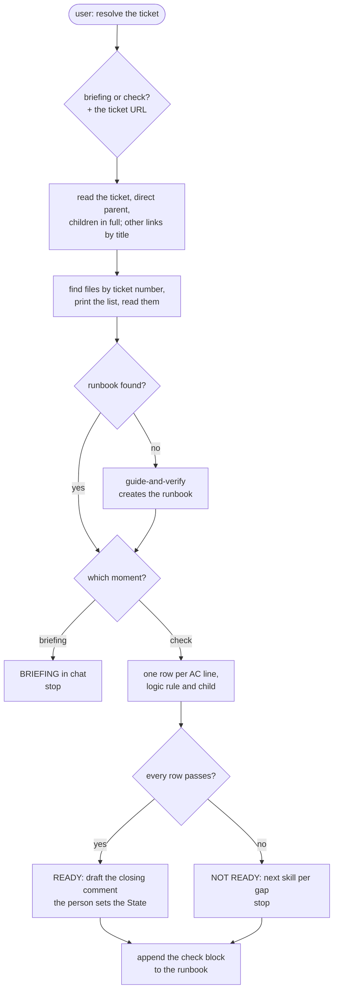
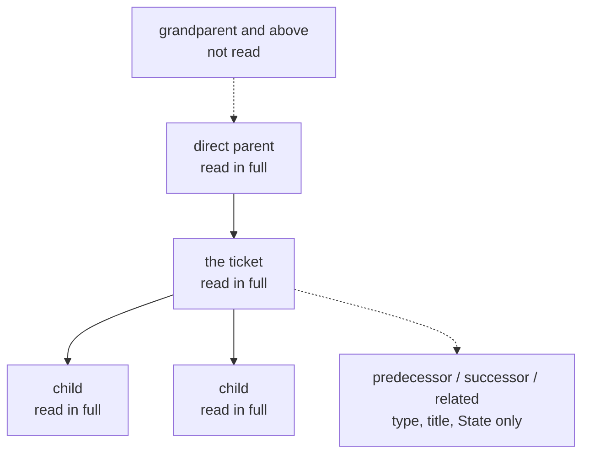
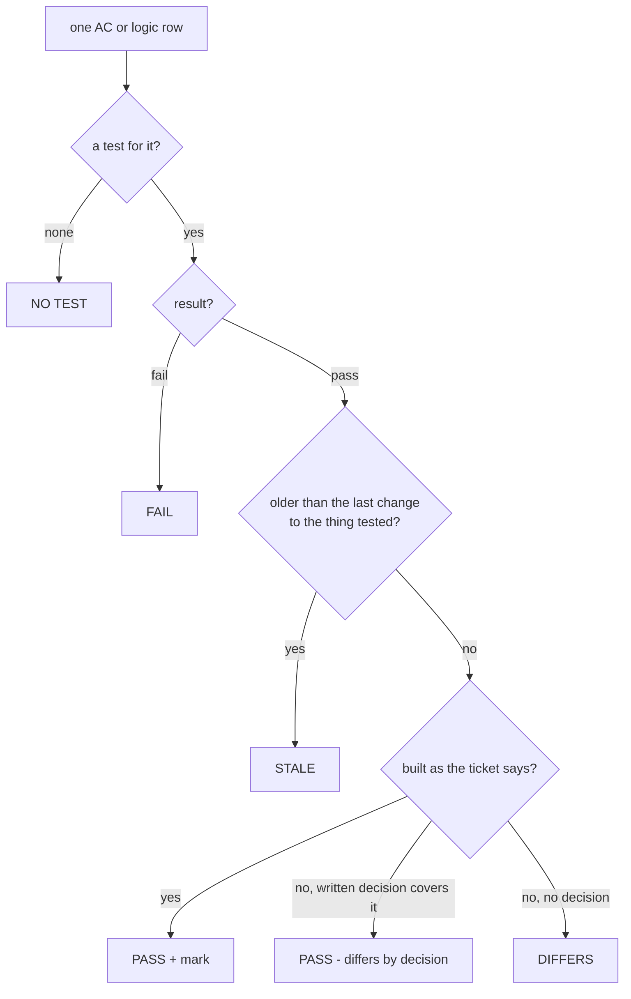

# resolve-the-ticket - design



The diagram shows one run: the skill asks which moment and waits for the URL, reads the
ticket and its files, and ends either as a briefing or as a check with a verdict.

- **Date:** 2026-11-16 · **Status:** approved 2026-11-16
- **Decisions:** ADRs 0316-0329 (repo-root `docs/adr/`, prefix `workflow-daily-work-`)
- **Renumbered:** 2026-11-16, from 0293-0307 (old + 23) - origin/main had minted 0290-0315.
- **Glossary:** `CONTEXT.md`, section *resolve-the-ticket terms* - Ticket, Briefing,
  Resolve check, Ready verdict, Stale pass

## 1. Goal

A skill named `resolve-the-ticket` that a person runs at two moments of one ticket:

1. **Briefing** - before the work starts: what the ticket asks and what surrounds it.
2. **Resolve check** - before the person sets the ticket to its done State: is every
   Acceptance Criteria line and every logic rule in the ticket covered by a passing test?

The failure it prevents: a ticket set to Resolved on "I think it is done", then reopened
because one rule had no passing test at that moment.

## 2. What it never does (ADRs 0316, 0318)

- It builds nothing and fixes nothing.
- It never writes to a tracker: no comment, no State change, no ticked box.
- It never authors a runbook (ADR 0326).
- It never invokes the skill it names for a gap (ADR 0327).
- It never reads its own earlier check blocks as proof of a pass (ADR 0325).

Its only write is the dated *Resolve check* block appended to the ticket's runbook.

## 3. Opening (ADR 0317)

Two things are needed: the **moment** (briefing or check) and the **ticket URL**. The skill
asks only for what the invocation did not give, in one question, and reads nothing until it
has the URL. A bare number is not enough - it asks for the URL.

| URL | tracker | read with |
|---|---|---|
| `dev.azure.com/<org>/<project>/_workitems/edit/<id>` | Azure DevOps | `ticket-trace` Operation B steps 4-5 + this skill's `references/ticket-family.md` |
| `github.com/<owner>/<repo>/issues/<n>` | GitHub Issues | `gh issue view` + `references/ticket-family.md` |
| anything else | - | "I cannot read this tracker." Stop (ADR 0328) |

## 4. Step 1 - read the ticket family (ADRs 0322, 0328)



The graph shows what is read in full, what is read by title, and what is not read.

*In full* means: type, title, State, revision, description (for an Azure DevOps Bug also
the repro steps), Acceptance Criteria, every comment, and every attached image through
`read-picture` (kind `requirement`). An image is often the whole requirement.

| | Azure DevOps | GitHub Issues |
|---|---|---|
| parent | relation `System.LinkTypes.Hierarchy-Reverse` | the issue's parent issue |
| children | relation `System.LinkTypes.Hierarchy-Forward` | `repos/<o>/<r>/issues/<n>/sub_issues` |
| other links | Related, Predecessor, Successor relations | issues linked or mentioned in the body |
| AC | the Acceptance Criteria field | a task list, or an "Acceptance criteria" section of the body |
| done State | the State's category is Resolved or Completed, or the State is named Resolved (ADR 0330) | `closed` |

The worked commands live in `references/ticket-family.md`. Each command is run against a
real ticket before it is written into that file (ADR 0328); a command not yet measured is
marked so in the file.

## 5. Step 2 - find and read the files (ADR 0323)

Search the project the skill runs in for the ticket's number and each child's number:

1. file and folder names (`runbook-ado-151-…`, `151-…`, `ado-151-…`)
2. file contents (`#151`, `AB#151`, `ado-151`)
3. commit messages (`git log --grep`)
4. every file the ticket or the runbook names

The number is matched whole, so `151` does not match `1510` or a date. Print the list
grouped by kind (runbook, why file, register, post-mortem, walkthrough, snapshot folder
with a file count, commits), then read the documents. A snapshot folder is listed, not read
file by file.

**No runbook found (ADR 0326):** say so, and hand off to `guide-and-verify` (loaded through
the harness's mechanism) with what has been read as its head start. It creates the runbook
file in its own shape and the project's own naming. Then continue.

## 6. Moment 1 - the Briefing

Chat output, read-only, in this order:

1. one line: ticket type, title, State, revision, URL
2. the family table (parent, children, linked tickets with type, title, State)
3. the AC lines and the logic rules, each quoted as written with a locator
   (`#151 AC-2`, `#151 description`, `#151 image <name>`)
4. the file list from step 2, and which to open first
5. open points: an AC line that names something no file mentions; a linked ticket that is
   open; a difference between the ticket and the parent

It ends there. It is not written to a file.

## 7. Moment 2 - the Resolve check

### 7.1 Rows

One row per:

- **AC line** - each Acceptance Criteria statement, split with `why-this-logic`'s
  *Splitting a requirement text* rules (one statement per clause that binds behaviour)
- **logic rule** - each decision point in the ticket's details (a filter, a threshold, a
  mapping, a default), split with `why-this-logic`'s splitting rules
- **child** - each direct child ticket, with its State

Rows are quoted as written, with a locator. When the project has a register
(`docs/why/requirements.md`), a row whose statement is registered carries its ID.

### 7.2 What makes a row pass (ADRs 0319, 0320, 0324)



The flowchart shows the order of the questions for one row; only the two PASS ends count
towards READY.

| result | meaning | counts for READY |
|---|---|---|
| **pass** | a passing test, with one mark: **cited** (a result written in the runbook, a ticket comment or a test file - locator and date), **measured** (a test the skill ran in this session), **told** (the user says it was tested - who, date) | yes |
| **pass - differs by decision** | built differently from the ticket, a written and approved decision covers it, and its test passes | yes; listed in the closing comment |
| **no test** | nothing found and the user names none | no |
| **fail** | the test's result is a failure | no |
| **stale** | the pass is older than the last change the skill can see (git commit on the file, a modified date in the runbook or a snapshot, the ticket's revision). Both dates are shown | no - until tested again, or the user says the change does not touch the row (told) |
| **differs** | built differently from the ticket, no written decision | no |
| **open** (child rows) | the child's State is not a done State | no - unless the user says it stays open on purpose (told; written into the closing comment) |

A pass with no date cannot be compared: it shows `pass (no date)` and is counted in the
verdict line with the told rows. A change date only the live system holds is read by one
read-only query, asked per query and per run in `why-this-logic`'s shape; on no, the row
shows `change date not checked`.

A child's own AC are not checked here; the gap line names this skill on the child
(ADR 0321).

### 7.3 The table and the verdict

Printed in monospace:

```
row    what the ticket says        test    result
AC-1   runs Mon-Fri 08:00          S3c     pass   cited (runbook:255, 2026-11-09)
L-2    cut-off = UTC day - 7       S3c     pass   differs by decision D2 (runbook:70)
AC-3   PDF digest to admin         S6c     STALE  passed 2026-11-10; changed 2026-11-12
#297   child Task                  -       OPEN   State = New

READY TO RESOLVE: NO
```

The verdict is READY only when every row counts for READY. It reads
`READY (N rows rest on your word)` when told rows or undated passes exist.

### 7.4 On READY (ADR 0318)

Draft the closing comment as raw Markdown in one code block. Use the project's own comment
format when its `CLAUDE.md` or `AGENTS.md` defines one; otherwise: a result heading with
the UTC time, one line on how it was checked, an `| Item | Result |` table with one row per
check row and its mark, the *differs by decision* rows, the children left open on purpose,
and a pointer to the runbook. Then say: paste it, tick the AC, set the State. The skill
changes nothing on the board.

### 7.5 On NOT READY (ADR 0327)

No comment is drafted. One line per kind of gap, naming every row of that kind:

| gap | line names |
|---|---|
| no test | `generating-test-cases` |
| fail | `debug-mantra` |
| stale | the test step to run again |
| differs, no decision | `grill-then-plan` |
| open child | `resolve-the-ticket` on the child |

Then stop.

### 7.6 The record (ADR 0325)

Append to the runbook, after its last section, never editing a line above:

```
## Resolve check - <date> <time UTC> - READY | NOT READY

Ticket <id> rev <n>. <the table of 7.3>
Gaps: <the lines of 7.5, or "none">
```

A later check on the same ticket reads the last block first, keeps every row that was a
pass and is not stale now, and re-checks the rest. If the ticket's revision changed, the
rows are split again.

## 8. Skills it uses

| skill | how | for |
|---|---|---|
| `ticket-trace` | loaded - Operation B steps 4-5 | fetching a ticket and its attachments |
| `read-picture` | loaded | attached images, kind `requirement` |
| `guide-and-verify` | handed off to | creating a missing runbook |
| `why-this-logic` | its splitting rules, proof-mark words and register are read; its phases are not run | rows, marks, IDs |
| `generating-test-cases`, `debug-mantra`, `grill-then-plan` | named in a gap line only | closing gaps |

Not this skill: `work-map` resolves a **Decision ticket**; `dual-verifier` verifies one
finished task from its diff; `why-this-logic` traces and teaches row by row.

## 9. Files to ship (ADR 0329)

| file | content |
|---|---|
| `plugins/dev-workflows/skills/resolve-the-ticket/SKILL.md` | the skill; harness-neutral wording; frontmatter `name` + trigger-rich `description` (English and Thai phrases: "resolve the ticket", "is this ticket ready to resolve", "ticket นี้ resolve ได้ยัง", "brief me on this ticket") under the listing cap |
| `…/resolve-the-ticket/references/ticket-family.md` | measured commands: parent, children, links, done State - both trackers |
| `…/resolve-the-ticket/evals/evals.json` | cases in the sibling skills' shape (section 10) |
| `plugins/dev-workflows/commands/resolve-the-ticket.md` | thin wrapper, `argument-hint: "[brief|check] <ticket URL>"` |
| `PLAYBOOK.md` | one router edge and one table row |
| `plugins/dev-workflows/skills/daily/SKILL.md` | one row in the WORK table, and the name in the description list |
| `plugins/dev-workflows/.claude-plugin/plugin.json`, `.claude-plugin/marketplace.json` | 0.62.0 -> 0.63.0 (global max re-checked before merge), description clause |
| `skills/resolve-the-ticket/` | regenerated with `scripts/generate_skills_tree.py`, checked with `check_skills_tree.py` |

No script ships: the reads are a handful of worked commands.

## 10. Eval cases

1. **Check, not ready** - a ticket with one AC with a cited pass, one filter rule that
   splits into two rows with no test, one open child: NOT READY, four rows, two gap lines,
   no comment drafted, nothing written to the tracker.
2. **Check, ready with a told row** - all rows pass, one on the user's word: verdict
   `READY (1 row rests on your word)`, comment drafted with the mark, the State left to
   the person.
3. **Stale pass** - a pass dated before a later commit: STALE with both dates, NOT READY.
4. **Differs by decision** - built unlike the ticket under a written decision: passes and
   is listed in the comment; the same case without the decision is DIFFERS.
5. **Briefing** - a new ticket: family table, AC quoted with locators, file list; no check
   table, no file written.
6. **No runbook** - says so and hands off to `guide-and-verify`; does not write a runbook.
7. **Opening** - invoked with a bare number: asks for the URL and the moment and reads
   nothing first; an unknown tracker URL stops.

Each prompt scripts the answers the skill will ask for (ADR 0269).

## 11. Out of scope

Jira; any tracker write; checking a child's own AC in the parent's run; reading ancestors
above the direct parent; running hand-made test steps again on the user's behalf.
