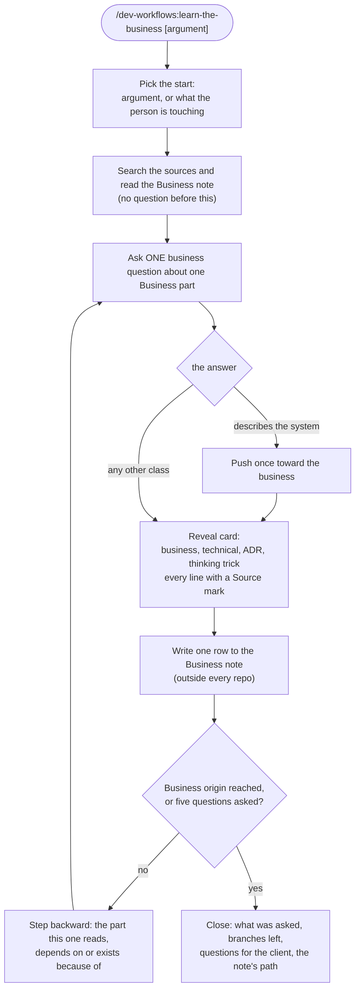

# learn-the-business - design



A developer can build a part of a program and still not be able to say why the business
needs it. `learn-the-business` asks them, one question at a time, starting at the part they
are touching and walking backward to the business origin. After each answer it shows the
business reason first, then the technical choice that follows from it, then the ADR text,
then the way of thinking that reaches such an answer. It keeps a note of what it asked,
outside git.

Decisions: ADRs 0368-0377 (repo root `docs/adr/`). Terms: the *learn-the-business terms*
section of `CONTEXT.md`.

## 1. Scope

**In:** one new skill in the `dev-workflows` plugin, its command, one reference file of
thinking tricks, and the registration work in section 9.

**Out:**

- The person asking and the skill answering - that is `feynman-explain` (ADR 0369).
- Any write to the project's repo, a tracker or a live system. The skill writes one file:
  the Business note.
- A script. The note is Markdown read and written by the model (the precedent is ADR 0183).
- A change to `resolve-the-ticket` to offer this skill at a stage.
- A map of the whole program built in advance. "The whole program" works only when the
  person asks for it by name (ADR 0371).

## 2. What may be asked - the Business part (ADR 0370)

A **Business part** is one part of the program that has a business decision behind it. Six
kinds, an open set:

| kind | examples | the business question behind it |
|---|---|---|
| data | table, field, choice value, relationship | what real thing does this stand for |
| process | flow, job, trigger, order of steps | how does the real work move, who hands to whom |
| rule | condition, threshold, validation, default | who set it, and what happens if it is wrong |
| people | role, permission, recipient | who may do what, and why not the others |
| output | report, email, document, screen | who reads it, and what do they do next |
| connection | external system, API, import, export | why must the program talk to that system |

A part the platform made (`createdon`, an id, an owner column) is not a Business part. The
skill does not ask about it and lists the skipped parts on one line.

## 3. The start and the Backward chain (ADRs 0371, 0372)

**The start.** An argument wins: a ticket URL, a part's name, a file, or "the whole
program". With no argument the start is what the person is touching, read in this order:
the uncommitted changes, the ticket named by the branch or the last commits, the session so
far. The skill's first line names what it picked - "Starting at: `<part>` (from `<where>`)"
- so a wrong pick costs the person one line.

**The chain.** Each next question is one step backward: the part the last one reads,
depends on, or exists because of. Example shape:

```
start   the overdue-callback report flow     (the uncommitted change)
  ↑ 2   the field the flow filters on
  ↑ 3   the table that holds the field
  ↑ 4   who writes a row, and when
  ↑ 5   why the firm must call a creditor back   <- Business origin
```

**The stop.** The chain stops at the first of:

- a **Business origin** - the answer is a person, money, a law or a contract, and nothing in
  the program stands behind it;
- no source says more - the point is written as a question for the client (section 5);
- five questions asked in this sitting. "Continue" starts the next five from the same point.

Where the chain forks (a flow reads three fields), the skill walks one branch and writes the
others in the note as not yet asked. The five rests on no evidence; say so when it matters.

## 4. One turn

**Ground first.** Before the first question the skill searches, per part, in this order and
stops at the first source that states a business reason: ADRs; specs and documents in the
repo; the ticket with its comments and attached images (through `read-picture`, kind
`requirement`); `CONTEXT.md`; commit messages; tests. It also reads the Business note. No
question is sent before this search.

**The question turn.** At most three lines of evidence, then one question, then stop:

```
<the part, its kind, and where it lives: path:line>

**คำถาม: <one sentence about the business, not the mechanism>**
```

The question is about a person, money, a rule or a consequence - "if this field were gone
for a month, who could not do their work?" - never "what does this flow do".

**The answer's class picks the move (ADR 0377):**

| the answer | the move |
|---|---|
| reaches the business and is right | say so in one line, show the card in short, go on |
| half right | name the right half, add the missing half as fact |
| describes the system, not the business | push **once**: "that is what the system does - who is the person that is hurt?"; reveal after the second answer, whatever it is |
| wrong | reveal with the source; the verdict is on the answer, never on the person |
| does not know | reveal at once; do not ask that question again this sitting |

When the card's business line is *assumed* (section 5) the answer gets no verdict at all.

## 5. The Reveal card (ADRs 0369, 0373, 0374)

Fixed order, fixed headings in the person's language:

```
① ธุรกิจ    <the business reason, 1-3 short sentences>          (<Source mark>)
② เทคนิค    <the technical choice it leads to, with path:line>  (<Source mark>)
③ ADR       "<the sentence that decided it>" (ADR nnnn)   |  ไม่มี ADR พูดถึงส่วนนี้
④ วิธีคิด
   💡 ทริก: "<name>"
      1. <step>
      2. <step>
      3. <step>
   👉 <which step the person's answer reached>
   📌 ใช้อีกเมื่อ: <when to use it again>
📝 จดแล้ว: <part>  ->  <full path of the note>
```

**Source mark** - every line of ① and ② carries exactly one:

| mark | meaning | written as |
|---|---|---|
| *cited* (อ้างอิง) | an ADR, file, ticket, commit or test says it | the place: `ADR 0123`, `path:line`, `#151 comment 3` |
| *told* (บอกมา) | a person said it | who and the date |
| *general knowledge* (ความรู้ทั่วไป) | how the trade works in general, not a fact of this project | the words themselves |
| *assumed* (สันนิษฐาน) | the skill's guess | the words themselves, and the line goes to the note's client questions |

Rules: a guess is never written without *assumed*. The person's own answer to a part with no
source is recorded as *told*, never *cited*. *general knowledge* never closes a question
about this project's own rule (why 7 days and not 5) - that stays *assumed*. The ③ line
quotes the ADR's own sentence; it does not paraphrase.

**Thinking trick.** Slot ④ names one trick from `references/thinking-tricks.md`, gives its
three steps applied to this part, says which step the person's answer reached, and says when
to use it again. The file is an open list; each entry has a name, the three steps, and "use
it again when". Starter entries:

| trick | the three steps |
|---|---|
| who reads this value | find who writes and who reads it; the reader is who needs it; ask what the reader decides with it |
| gone for a month | remove the part in your head; name who notices first; name what it costs them |
| before the system | ask how it was done by hand; find the pain in that; the part answers that pain |
| who set this number | a number comes from a law, a contract, capacity or habit; find which; a habit is a question for the client |
| follow the money | who pays, who is paid; what a delay costs; the part protects one of them |

A way of thinking not on the list is added to the file in the same run.

**Beginner level.** Short sentences. One idea per sentence. A business word gets a gloss of
a few words in brackets on first use. No sentence leans on a term the card has not glossed.

## 6. The Business note (ADRs 0375, 0376)

**Where:** `~/.claude/learn-the-business/<project>.md`. `<project>` is the folder name of
the **main** git root - the first entry of `git worktree list` - so every worktree of one
project shares one file. Outside a git repo it is the working folder's name. The file is
never inside a repo, so it cannot be committed. Nothing is written to any harness memory
index.

**Shape:**

```markdown
# Business note - <project>

## Asked
| date | part | kind | result | trick | answer (one line) | mark |
|---|---|---|---|---|---|---|
| 2026-11-21 | mgw_phonelog.mgw_hasthecallbeenactioned | data | half | who reads this value | says whether a call still needs a call back | cited ADR 0123 |

## Not yet asked
- <part> - reached from <part>, <date>

## Questions for the client or BA
- <part>: <the question> - assumed: <the guess>, <date>
```

`result` is one of `right`, `half`, `system`, `wrong`, `did not know`, `not judged`.

**How the next run uses it:**

- A part with `right` is not asked again.
- A part with any other result is asked again when at least 3 days have passed **and** the
  person is touching that part again. The 3 rests on no evidence.
- A row whose ADR or code changed after the row's date is marked `may be old` and may be
  asked again.
- *Not yet asked* is where "continue" and the next sitting pick up.
- A client question that later gets a source or an answer moves to *Asked* with its new mark.

**Rules:** the skill writes the row right after the card, not at the end of the sitting.
It says the file's full path every time it writes. The person may edit the file and their
edit wins. With no file, or a file it cannot read, the skill starts from nothing and still
asks - it never refuses. On request it shows the note or clears it.

## 7. The close

When the chain stops, emit exactly:

```
**ถามไปแล้ว** - the parts of this sitting, one line each, with the result
**ทางแยกที่ยังไม่ได้ถาม** - the branches written to the note
**ต้องถามลูกค้าหรือ BA** - the assumed lines, as questions
**โน้ต** - the full path
→ ต่อ / ทำ flashcard (learn-with-flashcard) / จบ
```

## 8. Boundaries with the neighbours

| skill | it does | hand-off |
|---|---|---|
| `asking-to-understand` | asks about the **mechanism** of an artifact, does not reveal, keeps nothing | "how does this work, ask me" goes there |
| `feynman-explain` | the person asks, the skill explains | "just explain it" goes there |
| `why-this-logic` | traces one value or condition to its source, with a verdict | "is this 7 right, where is it from" goes there |
| `explain-condition` | one condition in five parts | - |
| `learn-with-flashcard` | builds review cards | takes the Business note as its source, offered at the close |
| `read-picture` | reads a ticket image for one question | loaded during the ground search |

`asking-to-understand` and `feynman-explain` each gain one row in their hand-off tables
pointing here; `asking-to-understand`'s description gains "not for the business reason
behind a program (learn-the-business)".

Language: mirror the person's. Identifiers, paths and the four Source mark words may stay in
English.

The skill stays harness-neutral: it names actions, not one harness's tools, and uses
`${CLAUDE_PLUGIN_ROOT}` in no new shape (its own reference is the skill-relative
`references/thinking-tricks.md`).

## 9. Files to add or change

| file | change |
|---|---|
| `plugins/dev-workflows/skills/learn-the-business/SKILL.md` | new - frontmatter (`name`, trigger-rich `description`, `effort: max`) and sections 2-8 as procedure |
| `plugins/dev-workflows/skills/learn-the-business/references/thinking-tricks.md` | new - the open list |
| `plugins/dev-workflows/commands/learn-the-business.md` | new - thin wrapper, `$ARGUMENTS` |
| `plugins/dev-workflows/skills/asking-to-understand/SKILL.md`, `feynman-explain/SKILL.md` | one hand-off row each; one clause in the first one's description |
| `PLAYBOOK.md` | one row and one router edge, in the same commit as the skill |
| `plugins/dev-workflows/.claude-plugin/plugin.json`, `.claude-plugin/marketplace.json` | description, keywords, version `0.66.0` -> the global max + 0.1.0 at merge time, both files the same |
| `skills/` (the Generated tree) | regenerate with `scripts/generate_skills_tree.py`, check with `scripts/check_skills_tree.py`; never hand-edit |
| `CONTEXT.md`, `docs/adr/…0368-0377` | done in the design session |

Trigger phrases for the description: "ถามเรื่อง business", "ถามธุรกิจของงานนี้", "ทำไมธุรกิจ
ต้องการแบบนี้ ถามผมหน่อย", "learn the business", "ask me about the business behind this",
"quiz me on why the business needs this".

## 10. Checks before it is called done

- A sitting run on a real repo with ADRs: the first line names the start; one question per
  turn; a system answer is pushed once and only once; each card has the four slots in order
  and a mark on every line of ① and ②; a part with no source shows *assumed* and lands in
  the client questions; the note exists at the stated path, outside the repo, with one row
  per question.
- A second sitting in another worktree of the same project reads the same note and does not
  re-ask a `right` row.
- `git status` in the project shows no file from the skill.
- `python scripts/check_skills_tree.py` passes; both manifests report the same version.

## 11. Measured before this spec was approved

- A new skill's footprint was read off `learn-with-flashcard`: its skill folder, its
  command, both manifests, `PLAYBOOK.md` and the Generated tree. The `/daily` router's
  SKILL.md names no single skill, so it needs no edit.
- `dev-workflows` is `0.66.0` on `main` and `origin/main`, the highest on any ref, in both
  manifests (2026-11-21).
- The Generated tree is produced by `scripts/generate_skills_tree.py` and checked by
  `scripts/check_skills_tree.py`.
- Another session minted ADRs 0361-0367 while this design ran; 0368-0377 were minted from
  the global max and must be re-checked immediately before the merge.
