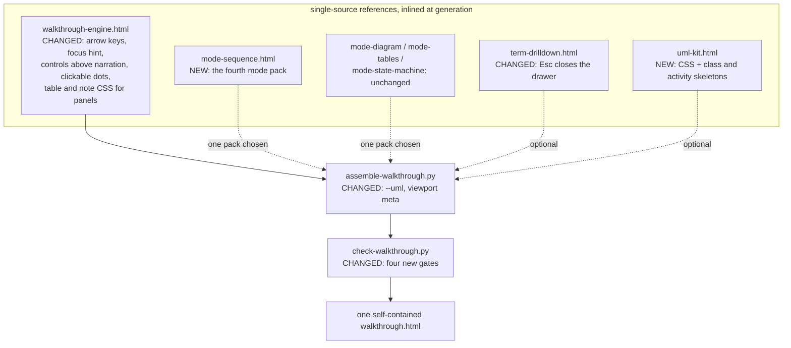
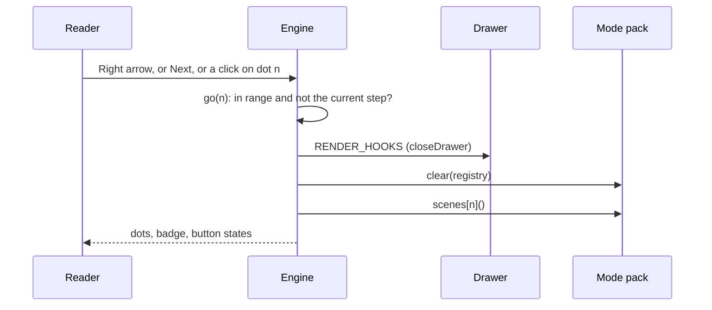
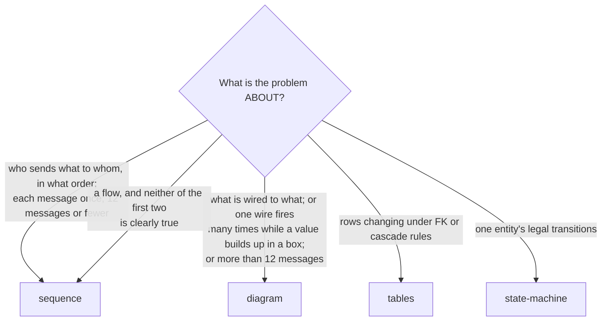

# Design — problem-description: arrow keys, a sequence mode, and UML supporting diagrams

Two requests, made about a walkthrough published on 2026-11-20: the arrow keys do not step it, and its use of UML should become what the skill
does. This design adds keyboard stepping and three other navigation changes to the shared
engine, adds a fourth mode pack that draws a UML sequence diagram, and adds a UML kit for
the small class and activity diagrams a walkthrough shows in its panels. The three existing
mode packs do not change.



## Why

**The arrow keys.** The engine binds the `onclick` of three buttons and nothing else. No
file in the skill contains a `keydown` listener, so the keys never worked. Measured on the
assembled diagram demo, 2026-11-21: after pressing the Right arrow the badge still read
`Step 0 / 3`; after a click on Next it read `Step 1 / 3`.

**UML.** The published walkthrough drew a UML sequence diagram as its main diagram, and two
class diagrams and one activity diagram in its panels. All of that was written in that one
session: about sixty lines of `.seq-*` and `.uml-*` CSS on a hand-edited copy of
`mode-diagram.html`. Nothing in `references/` holds it, so the next walkthrough cannot
reproduce it and `check-walkthrough.py` cannot test it. It also broke UML in two places: a
reply drawn like a call, and a dashed line used to mean "happening now".

## Decisions

Every decision has its own ADR in `docs/adr/` (prefix `workflow-daily-work-`).

| # | Decision | ADR |
|---|---|---|
| 1 | Right and Left arrow step the walkthrough; Esc closes the drawer; a key with Alt, Ctrl, Meta or Shift is left alone | 0356 |
| 2 | The page never takes focus; it shows a hint while it does not have focus | 0357 |
| 3 | The controls sit above the narration | 0358 |
| 4 | A click on a step dot goes to that step | 0359 |
| 5 | Sequence is a fourth mode pack; the diagram pack stays as it is | 0360 |
| 6 | Supporting diagrams are drawn from one UML kit, with class and activity skeletons | 0361 |
| 7 | A supporting diagram has no states | 0362 |
| 8 | A picture labelled UML follows a small correct subset and carries a legend | 0363 |
| 9 | A supporting diagram must answer a question the main diagram cannot; three is the most | 0364 |
| 10 | Between the diagram and sequence modes, a tie goes to sequence | 0365 |
| 11 | The sequence pack is authored as SVG on a grid and reads its registry from the markup | 0366 |
| 12 | The arrow keys are proved in the real viewer with a published demo | 0367 |
| 13 | The engine styles a table and a note inside a panel | 0378 |
| 14 | The skill still only saves a file; the page is built to fit an embedded viewer | 0379 |
| 15 | `check-walkthrough.py` gains four gates; the two walkthrough scripts get tests | 0380 |

Terms added to `CONTEXT.md`: **Mode pack**, **Main diagram**, **Supporting diagram**,
**UML kit**.

All paths below are relative to `plugins/dev-workflows/skills/problem-description/` unless
they start with `plugins/`, `scripts/`, `docs/` or `skills/`.

## 1. Engine — `references/walkthrough-engine.html`

### 1.1 Shell order (§HTML)

The controls move from after the mode content to directly under the step dots. The subtitle
names the keys. The hint is a new element inside the controls.

```html
<div class="container">
  <h1>[INSERT: walkthrough title]</h1>
  <h2>กด <strong>→</strong> หรือ <strong>←</strong> บนคีย์บอร์ด หรือกดปุ่มด้านล่าง เพื่อดูทีละ step</h2>

  <div class="step-progress" id="stepProgress"></div>

  <div class="controls">
    <button id="prevBtn" class="tertiary" disabled>← ย้อนกลับ</button>
    <button id="nextBtn">ถัดไป →</button>
    <button id="resetBtn" class="tertiary">↻ เริ่มใหม่</button>
    <span class="key-hint off" id="keyHint">คลิกที่หน้านี้หนึ่งครั้ง เพื่อใช้ปุ่ม ← → บนคีย์บอร์ด</span>
  </div>

  <div class="narration" id="narration"> … unchanged … </div>

  <!-- ===== MODE CONTENT — assembly inserts the chosen mode pack's §HTML here ===== -->
  <!-- term drill-down drawer §HTML inlined here at generation -->
</div>
```

The two marker comments the assembler looks for keep their exact text. The DEMO ONLY block
stays where the mode content goes.

### 1.2 Navigation: one function, four ways in (§JS)

```js
function go(step) {
  if (step < 0 || step > TOTAL || step === currentStep) return;
  currentStep = step;
  render(step);
}

document.getElementById('prevBtn').onclick  = () => go(currentStep - 1);
document.getElementById('nextBtn').onclick  = () => go(currentStep + 1);
document.getElementById('resetBtn').onclick = () => { currentStep = 0; render(0); };

document.getElementById('stepProgress').addEventListener('click', (e) => {
  const dot = e.target.closest('.step-dot');
  if (dot) go(Number(dot.dataset.step));
});

document.addEventListener('keydown', (e) => {
  if (e.defaultPrevented || e.altKey || e.ctrlKey || e.metaKey || e.shiftKey) return;
  const t = e.target;
  if (t && (t.isContentEditable || /^(INPUT|TEXTAREA|SELECT)$/.test(t.tagName))) return;
  if (e.key === 'ArrowRight')     { e.preventDefault(); go(currentStep + 1); }
  else if (e.key === 'ArrowLeft') { e.preventDefault(); go(currentStep - 1); }
});
```

- Reset still renders step 0 even when the reader is already on it, as it does today.
- `buildProgressDots()` sets `d.dataset.step = i` and `d.title = 'ไป step ' + i` on each dot.
- `render()` is not changed. It still runs `RENDER_HOOKS`, then the mode's `clear()`, then
  the scene. `check-walkthrough.py` gate C (RENDER_HOOKS first) keeps passing.



### 1.3 Focus hint (§JS)

```js
function syncKeyHint() {
  document.getElementById('keyHint').classList.toggle('off', document.hasFocus());
}
window.addEventListener('focus', syncKeyHint);
window.addEventListener('blur', syncKeyHint);
syncKeyHint();
```

The engine never calls `window.focus()`. The hint is engine chrome; no scene and no mode
`clear()` touches it.

### 1.4 CSS additions (§CSS)

All use `:root` tokens only.

- `:root` gains `color-scheme: dark;`.
- `.controls`: `margin: 0 0 14px` (was `margin-top: 16px`), `flex-wrap: wrap`,
  `align-items: center`.
- `.step-dot`: `cursor: pointer`; `.step-dot:hover`: an accent outline.
- `.key-hint`: small muted text on a row of its own under the buttons (`flex-basis: 100%`,
  centred). The engine hides it with the class `off` (`visibility: hidden`), not `hidden`,
  so the row keeps its height and the buttons never move under a click (ADR 0381).
- Panel content: `.wt-panel table`, `.wt-panel th`, `.wt-panel td`, `.wt-panel .tbl-wrap`
  (`overflow-x: auto`), and `.wt-note` (small muted line for a source or a caveat).

### 1.5 The standalone demo

The engine file is also a runnable demo. Its DEMO ONLY blocks keep working with the new
shell: opened directly, the engine demo steps with the arrow keys and the dots.

## 2. Drawer — `references/term-drilldown.html`

One listener is added to §JS:

```js
document.addEventListener('keydown', (e) => {
  if (e.key === 'Escape' && !document.getElementById('termDrawer').classList.contains('hidden')) closeDrawer();
});
```

It lives here and not in the engine because the engine does not know the drawer exists
(ADR 0019). The arrow keys need no drawer code: stepping already closes the drawer through
`RENDER_HOOKS`.

## 3. The sequence pack — `references/mode-sequence.html` (new)

Same file shape as the other packs: a header comment, `§CSS`, `§HTML`, `§JS`, and a
`DEMO-BOOTSTRAP` block the assembler uses with `--demo`. Not standalone; verified by
assembly.

### 3.1 When it is chosen



The tie-break changes from "when in doubt → diagram" to "a tie between diagram and sequence
goes to sequence" (ADR 0365).

### 3.2 What it registers (§JS)

```js
modeRenderers['sequence'] = {
  registry: { LIFELINES: [], MESSAGES: [] },   // filled from the markup by collect()
  clear(reg) { … },
  collect() { … },
  fitLabels() { … },
  queueFit() { … },              // fitLabels() once, after the current step's code has run
  setLife(id, state) { … },
  setMsg(ids, state) { … },      // ids: one id, or an array of ids
  setText(id, text) { … },
  assertRegistryComplete() { … },
};
modeRenderers['sequence'].collect();
modeRenderers['sequence'].fitLabels();
```

`registry` and `clear(` come first in the object, inside the first 5000 characters after the
registration, because checker gate B looks for them there.

- `collect()` sets `registry.LIFELINES` to the ids of every `.seq-life` and
  `registry.MESSAGES` to the ids of every `.seq-msg`, in document order.
- `fitLabels()` sets each `.seq-label-bg` rectangle from its text's `getBBox()`: 8 units of
  padding left and right, 3 above and below. If the box has zero width (the page is not
  rendered yet) it leaves the rectangle alone. Wrapped in `try`/`catch`.
- `queueFit()` schedules one `fitLabels()` in a microtask. `clear()` and `setText()` call
  it, because a label's text can change (a message label may carry `data-default` and be
  set by a scene). It is deferred because measuring forces a layout: done between `clear()`
  and the scene it would restart every transition and animation on every step.
- The setters are aliased to bare names by the bootstrap, so `setLife`, `setMsg` and
  `setText` do not use `this`.
- `clear(reg)` sets every lifeline and message to the idle state, restores the text of
  every element that has a `data-default` attribute, hides every `.wt-panel`, and calls
  `queueFit()`.
- `setLife(id, state)` replaces the class with `seq-life` plus the state.
- `setMsg(ids, state)` replaces the class with `seq-msg` plus the state and sets the arrow's
  `marker-end` from the engine's five markerheads: idle and `dimmed` → `arrowhead`, `active`
  → `arrowhead-active`, `done` → `arrowhead-done`, `error` → `arrowhead-error`, `magic` →
  `arrowhead-magic`.
- `assertRegistryComplete()` runs `collect()` again and throws, naming the element, when: a
  `.seq-life` or `.seq-msg` has no id; two elements share an id; a message's `data-kind` is
  not `call`, `reply` or `self`; a message has no `.seq-arrow` or no `.seq-label-text`;
  there is no `#seqLegend`; there is no lifeline or no message.

The bootstrap follows the same order as every pack:

```js
MODE = 'sequence';
const { setLife, setMsg, setText } = modeRenderers[MODE];
const scenes = [ … ];
TOTAL = scenes.length - 1;
modeRenderers[MODE].assertRegistryComplete();
buildProgressDots();
render(0);
```

### 3.3 States (§CSS)

| Element | States | Notes |
|---|---|---|
| lifeline `.seq-life` | idle, `active`, `firing`, `locked`, `blocked`, `done`, `error`, `dimmed` | same names and same look as the diagram pack's component states |
| message `.seq-msg` | idle, `active`, `done`, `error`, `magic`, `dimmed` | idle and `dimmed`: arrow faint, label hidden. The other four show the label |

- `active` is a thicker line with a glow. It does **not** change `stroke-dasharray`.
- `.seq-msg[data-kind="reply"] .seq-arrow` is dashed in every state. No other message is
  dashed in any state.
- A `done` message keeps its label, in quiet text.
- Frames and notes are fixed decoration. They have no states and no setter.
- Colours: `:root` tokens, and the state background hexes already used by the diagram pack
  for the same state. No hex that is not already in the engine or the diagram pack.

### 3.4 Markup contract (§HTML)

```html
<div class="seq-layout">
  <div class="seq-wrap">
    <svg class="seq" viewBox="0 0 1000 514" xmlns="http://www.w3.org/2000/svg" role="img" aria-label="…">
      <!-- frames first, so they paint behind -->
      <g class="seq-frag" data-op="opt">
        <rect class="seq-frag-box" x="18" y="242" width="964" height="194"/>
        <path class="seq-frag-tab" d="M 18 242 h 46 v 16 l -10 10 H 18 Z"/>
        <text class="seq-frag-op" x="26" y="260">opt</text>
        <text class="seq-frag-guard" x="74" y="260">[user row found]</text>
      </g>
      <!-- lifelines -->
      <g class="seq-life" id="lfApi">
        <line class="seq-line" x1="375" y1="82" x2="375" y2="500"/>
        <rect class="seq-head" x="285" y="12" width="180" height="70" rx="8"/>
        <text class="seq-title" x="375" y="36" text-anchor="middle">⚙️ Demo API</text>
        <text class="seq-sub" x="375" y="55" text-anchor="middle">reset handler</text>
        <text class="seq-val" x="375" y="73" text-anchor="middle" id="apiVal" data-default="token: none">token: none</text>
      </g>
      <!-- messages: one group = the arrow and its label -->
      <g class="seq-msg" id="m2" data-kind="call">
        <path class="seq-arrow" d="M 379 168 L 619 168" marker-end="url(#arrowhead)"/>
        <g class="seq-label"><rect class="seq-label-bg" rx="5"/>
          <text class="seq-label-text" x="500" y="157" text-anchor="middle">2: find user by email</text></g>
      </g>
    </svg>
  </div>
  <div class="seq-side">
    <!-- the walkthrough's .wt-panel elements, all declared up front with class hidden -->
    <div class="seq-legend" id="seqLegend"> … </div>
  </div>
</div>
```

The author writes no width for a label background and types no id list.

### 3.5 The grid

The view box is 1000 wide. The formulas are the contract; the pack's header comment states
them and the pack's demo follows them.

| Thing | Rule |
|---|---|
| Lifelines | 2 to 5. Centre of lifeline *i* of *N*: `x = 1000 × (2i − 1) / (2N)`, rounded |
| Head box | width `w = min(180, 1000 / N − 20)`; `x − w/2`, `y = 12`, height 70. Title at `y = 36`, subtitle at `y = 55`, live value at `y = 73` |
| Lifeline line | from `y = 82` to `y = H − 14` |
| Row *k* | `y = 118 + 50 × (k − 1)` |
| Message, left to right | `M (xFrom + 4) y L (xTo − 6) y`. Label at `x = (xFrom + xTo) / 2`, `y − 11`, anchored in the middle |
| Message, right to left | `M (xFrom − 4) y L (xTo + 6) y`. Label as above |
| Self-message | takes two rows. At row *k*: `M (x + 4) y L (x + 72) y L (x + 72) (y + 28) L (x + 10) (y + 28)`. Label at `x + 80`, `y + 19`, anchored at the start. The next message is at row *k + 2* |
| Frame | its header takes one row *h* with no message. Box: `x = 18`, `y = yH − 26`, width 964, height `(yLast − yH) + 44`. Tab: `M 18 (yH − 26) h 46 v 16 l -10 10 H 18 Z`. Operator text at `x = 26`, guard text at `x = 74`, both at `y = yH − 8` |
| Height | `H = yLastRow + 46` |
| Size limit | 12 messages or fewer (ADR 0365) |

Worked example, the pack's demo (4 lifelines, 8 rows):

- Lifeline centres: 125, 375, 625, 875. Head width `min(180, 230) = 180`.
- Rows 1 to 8: 118, 168, 218, 268, 318, 368, 418, 468.
- Row 4 is the frame header; row 5 is a self-message, so it also takes row 6.
- Frame box: `y = 268 − 26 = 242`; last message inside is row 7 (`y = 418`), so height
  `(418 − 268) + 44 = 194` and the box ends at 436, which is 32 above the row-8 arrow.
- `H = 468 + 46 = 514`; lifeline lines end at 500.

### 3.6 Layout and legend

- `.seq-layout` is a grid: `minmax(0, 1.55fr) minmax(0, 1fr)`. Below 1300px it is one
  column, the diagram first. The breakpoint is where the diagram column would become
  narrower than the diagram's minimum: at 1300px the column is 756px. (Measured on the
  prototype, 2026-11-22: with a 1100px breakpoint a 1280px page showed a scrollbar inside
  the diagram box and hid the fourth lifeline.)
- `.seq-wrap` has `overflow-x: auto` and `svg.seq` has `min-width: 740px`, so a narrow page
  scrolls the diagram inside its box and the page itself never scrolls sideways.
- `.seq-legend#seqLegend` is always visible. It is not a `.wt-panel`, so `clear()` does not
  hide it. It says: what a head box and its dashed line are; solid arrow = a message or a
  call; dashed arrow = a reply; the number before a message = its order; what a frame and
  its `[guard]` mean; the colours for happening now, already happened, and a problem; that a
  dotted-underlined word can be clicked (when the drawer is assembled); and the one
  departure from UML: every arrowhead is the same filled shape.

### 3.7 The demo

The demo is the pack's fixture. It uses invented data only, so it can be published (ADR
0367). It must exercise: four lifelines; at least one `call`, one `reply` and one `self`
message; one `opt` frame; one live value; an `error` message; a `.wt-panel.question`; one
class diagram and one activity diagram from the UML kit, each with a caption; the legend.

Recommended scenario: a password-reset request. Lifelines: User, Demo API, Demo DB, Mail
service. Messages: 1 `POST /reset` (call), 2 find user by email (call), 3 user row (reply),
4 make a token (self), 5 send the link (call), 6 `200 OK` (reply). Frame: `opt [user row
found]` around 4 and 5. Key question: what does the API answer when the email is not in the
database? Failure step: a naive API answers `404`, which tells a caller which emails exist;
message 6 turns `error`. Class diagram: `User` 1 to 0..* `ResetToken`. Activity diagram:
the check and its two guarded branches.

## 4. The UML kit — `references/uml-kit.html` (new)

### 4.1 File

A header comment, a `§CSS` section, and a body that shows the two skeletons. The assembler
inlines only the `§CSS`. The skeletons are for copying into a panel.

### 4.2 Parts (§CSS)

All colours are `:root` tokens; arrows use the engine's `#arrowhead` markerhead.

| Class | Is |
|---|---|
| `svg.uml` | a supporting diagram: full panel width, height from the view box |
| `.uml-box`, with `.hot`, `.bad`, `.good` | a class box or an object box; the variants are fixed emphasis |
| `.uml-t`, with `.b`, `.dim`, `.amb`, `.err`, `.ok`, `.mono` | text |
| `.uml-line` | an association, or the line between compartments |
| `.uml-dep` | a dependency: dashed, with an arrowhead |
| `.uml-flow` | an activity flow: solid, with an arrowhead |
| `.uml-start`, `.uml-end`, `.uml-end-ring` | the initial node and the final node |
| `.uml-dia` | a decision |
| `.uml-act`, with `.good`, `.bad` | an action |
| `.uml-cap` | the caption under a picture |

### 4.3 Skeletons

- **Class diagram**: two boxes with a name compartment (one with a stereotype) and attribute
  lines in the form `name : Type = value`; one association with a multiplicity at each end;
  one dependency with its stereotype.
- **Activity diagram**: initial node, one action, one decision whose two outgoing flows are
  drawn arrows with a `[guard]` each, one action on each branch, final node.

Each skeleton is a complete `.wt-panel`:

```html
<div class="wt-panel hidden" id="pnlTokenClass">
  <div class="wt-panel-title">UML class diagram: where the token lives</div>
  <svg class="uml" data-uml="class" viewBox="0 0 540 250" xmlns="http://www.w3.org/2000/svg" role="img" aria-label="…"> … </svg>
  <div class="uml-cap">Answers: which table holds the token, and how many tokens can one user have? A box is a table; a line is a relationship; the numbers at its ends say how many.</div>
</div>
```

### 4.4 Rules

1. A supporting diagram is drawn only for a question the main diagram cannot answer. The
   question is written as the first sentence of the caption (ADR 0364).
2. Class diagram for "what does the data look like, which field, how many to how many".
   Activity diagram for "what is checked, in what order, where does the path split".
3. At most three in a walkthrough. None is correct.
4. It has no states. A scene shows or hides the panel with `show()` and `hide()`.
5. Its `<svg>` has `class="uml"` and a `data-uml` attribute naming the type.
6. It has a `.uml-cap` caption that says how to read it.
7. Another UML type is drawn from the same parts. Its skeleton joins the kit when a second
   walkthrough needs it.
8. A walkthrough adds no CSS of its own. A style that is missing belongs in a reference.

## 5. Assembler — `scripts/assemble-walkthrough.py`

- New optional argument `--uml FILE`. Reads the kit's `§CSS` and appends it after the drawer
  CSS. The kit has no `§HTML` or `§JS` to inline.
- The output head gains `<meta name="viewport" content="width=device-width, initial-scale=1">`.
- The final message names the kit when it was inlined.
- Everything else, including the JS order (engine, drawer, mode, bootstrap), is unchanged.

## 6. Checker — `scripts/check-walkthrough.py`

Four gates are added to gates A to G. Each adds one line to the checker's docstring.

| Gate | Fails when | Message contains |
|---|---|---|
| H. Keyboard | the script has no `addEventListener('keydown'`, or lacks `'ArrowRight'` or `'ArrowLeft'` | `keydown` |
| I. Controls first | `id="prevBtn"` comes after `id="narration"` in the file | `controls` |
| J. UML kit | a `<svg class="uml"` exists and the `<style>` has no `svg.uml` rule; or the rule exists and no picture does; or a picture has no `data-uml`; or there are fewer `class="uml-cap"` than pictures; or there are more than three pictures | `uml` |
| K. Sequence | `MODE` is `sequence` and there is no `id="seqLegend"`; or a `class="seq-msg"` element has no `data-kind` of `call`, `reply` or `self` | `sequence` |

The existing scene-id pass (F2) is extended, for every mode: `setLife` and `setMsg` join the
list of setters, and a setter whose first argument is an array literal has every quoted id
in the array checked. A helper that builds an id by joining strings cannot be checked, and
SKILL.md says not to write one.

The closing `OK:` line reports the kit the way it reports the drawer.

### Tests — `plugins/dev-workflows/scripts/test_walkthrough_scripts.py` (new)

Run with `python plugins/dev-workflows/scripts/test_walkthrough_scripts.py`, like the
plugin's other script tests. It calls the two scripts as subprocesses and works in a
temporary directory.

- Assembles the demo of each of the four packs (the sequence demo with `--uml`) and expects
  the checker to exit 0.
- Assembles the diagram pack with the drawer and a small bootstrap that marks one term, and
  expects exit 0.
- Builds one broken file per failure condition in the table above, and one with a mistyped
  id in `setMsg('…')` and one in `setMsg([…])`, and expects exit 1 with that gate's word in
  the output.
- Asserts the assembled output contains the viewport meta.

## 7. `SKILL.md`

The frontmatter (`name`, `description`, `effort`) does not change.

| Section | Change |
|---|---|
| Overview | navigation is the arrow keys, the buttons, or a click on a step dot |
| Architecture | the assembly formula gains the optional UML kit; the engine's list of what it owns gains keyboard navigation |
| Pick the mode | a `sequence` row; the rule and tie-break of ADR 0365 replace "when in doubt → diagram" and the sentence about a future timeline mode |
| new: Supporting diagrams | the rules of §4.4 and the table of which type answers which question |
| new: UML notation | the subset of ADR 0363, the stated departure, the legend and caption duty |
| Phase 1 | a fifth item: list the planned supporting diagrams, each with its question; tell the user the mode and that list |
| Phase 3 | a standard skeleton for the sequence mode: overview with every message faint; one message per step; key question; failure; counter-example; summary |
| Phase 4 | the sequence setters; `--uml`; the grid lives in the pack's header; no CSS of the walkthrough's own; no ids built by joining strings |
| Phase 4.5 | the report line names the keys and the dots |
| Phase 5 | new checklist lines: arrow keys and dots work; a reply is declared a reply; no dashes for "now"; every supporting diagram has its question and caption; three at most; the legend is complete |
| Design decisions | the sequence pack's setters and states; a pack may read its registry from the markup (ADR 0366) |
| Common mistakes | new rows: a reply drawn solid; dashes meaning "now"; a UML picture with no question; more than three; a missing legend or caption; an id built by joining strings; CSS written for one walkthrough |
| Reference files | `mode-sequence.html`, `uml-kit.html` |

The Phase 0 text about an app screen mock names the diagram pack's `.comp` groups. It is not
changed by this work.

## 8. Other documents

- `plugins/dev-workflows/README.md`, section "problem-description": the keys, the fourth
  mode, the kit, and the new tie-break. The word "(default)" moves off `diagram`.
- `docs/superpowers/specs/2026-06-27-problem-description-mode-framework-design.md` gets a
  supersession banner at the top, in the same commit that changes SKILL.md: it says the
  tie-break is "when in doubt → diagram" and lists three packs; now a tie between diagram
  and sequence goes to sequence (ADR 0365), there is a fourth pack (ADR 0360), and the
  controls sit above the narration (ADR 0358).
- `PLAYBOOK.md`: no change. Its row for the skill names no mode.
- `CONTEXT.md`: already updated with the four terms.

## 9. Release

- `dev-workflows` takes the next minor version after the highest on any ref, in
  `plugins/dev-workflows/.claude-plugin/plugin.json` and in `.claude-plugin/marketplace.json`.
  On 2026-11-22 the highest is 0.67.0 (taken that day by learn-the-business), so this work
  takes 0.68.0. The number is taken again from the highest across every ref and worktree
  immediately before the merge, because another session is working in this repository.
- `skills/` is regenerated with `python scripts/generate_skills_tree.py` and proved with
  `python scripts/check_skills_tree.py`. The workflow `.github/workflows/skills-tree.yml`
  fails a push whose tree is stale. The new test file is not copied into the tree: the
  generator leaves out `test_*` files.
- `.agents/skills/` and `skills-lock.json` are an installed copy, not a generated one. They
  are already behind (`.agents/skills/daily/SKILL.md` differs from the plugin's). This work
  does not refresh them.
- The two files in `docs/problem-description/` were assembled from the old engine. They are
  left as they are.

## 10. Verification

1. **Tests.** `test_walkthrough_scripts.py` passes; `check_skills_tree.py` exits 0.
2. **Browser, local.** On the assembled sequence demo, opened directly: the Right arrow
   steps forward and the Left arrow back; with the Next button focused the Right arrow moves
   one step, not two; Alt+Right and Shift+Right do nothing; a click on a dot goes to that
   step; Esc closes an open drawer; `assertRegistryComplete()` does not throw; no label
   background is narrower than its text.
3. **Browser, embedded.** The same page inside a sandboxed iframe on another origin: before
   a click the hint shows and the keys do not reach the page; after one click the hint is
   gone and the keys step; when focus returns to the host page the hint shows again.
4. **The real viewer.** The sequence demo is published as a new private artifact. The owner
   checks the three points of item 3 there and the result is recorded (ADR 0367).
5. **The old packs.** The three existing demos still assemble and pass the checker with the
   changed engine, and each still steps correctly when opened.

## 11. Out of scope

- The three existing packs: their registries, their layouts, a legend for them.
- Rebuilding the 2026-11-20 walkthrough, or any change to its artifact.
- A publish step in the skill.
- More UML types in the kit than class and activity.
- Open arrowheads, or any new markerhead (ADR 0022 stands).
- Step links inside the narration (ADR 0359).
- Home, End and Space as keys (ADR 0356).
- Refreshing `.agents/skills/`.

## 12. Claims about the existing system, checked before approval

| Claim | How it was checked (2026-11-21) | Result |
|---|---|---|
| No keyboard handling exists | search for `keydown`, `keyup`, `keypress`, `ArrowLeft`, `ArrowRight` in all three copies of the skill and in the published walkthrough | no match |
| The Right arrow does nothing today; a click works | assembled diagram demo in a browser | `Step 0 / 3` after the key, `Step 1 / 3` after the click |
| A `document` `keydown` listener with the guards of §1.2 behaves as designed | the same demo with the §1.2 and §1.3 code added | Right → step 1; with Next focused, Right → step 2 (one step); Alt+Right and Shift+Right → no change; Left → step 1 |
| An embedded page gets no keys until it is clicked, and `document.hasFocus()` tracks that | that page in an `allow-scripts` iframe on another port, the host's input focused | before a click: step 0, `hasFocus` false, hint shown. After one click: `hasFocus` true, hint hidden, Right → step 1. Focus back to the host: hint shown again |
| `getBBox()` measures a label that is not visible yet | a diagram-pack label at opacity 0 | width 26, not 0 |
| The assembler and checker work today on all three packs | assembled each demo and ran the checker | three times `OK` |
| Every existing mode's `clear()` hides `.wt-panel` | read the three packs | true for all three |
| The published walkthrough ran on the unmodified engine | read its script | `MODE = 'diagram'`, engine code identical |
| `skills/` is generated and checked in CI; test files stay out of it | read `generate_skills_tree.py`, `check_skills_tree.py`, `.github/workflows/` | true; `is_excluded()` drops `test_*` |
| `.agents/skills/` is not kept in step | compared `daily/SKILL.md` with the plugin's | different |
| Neither walkthrough script has a test; no script or workflow runs them | searched the repo | none |
| The highest `dev-workflows` version on any ref | scanned every branch | 0.66.0 on 2026-11-21; 0.67.0 on 2026-11-22 after learn-the-business merged, so this work takes 0.68.0 |
