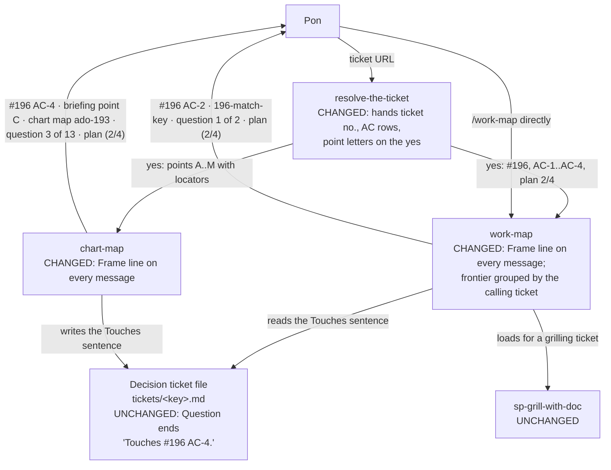
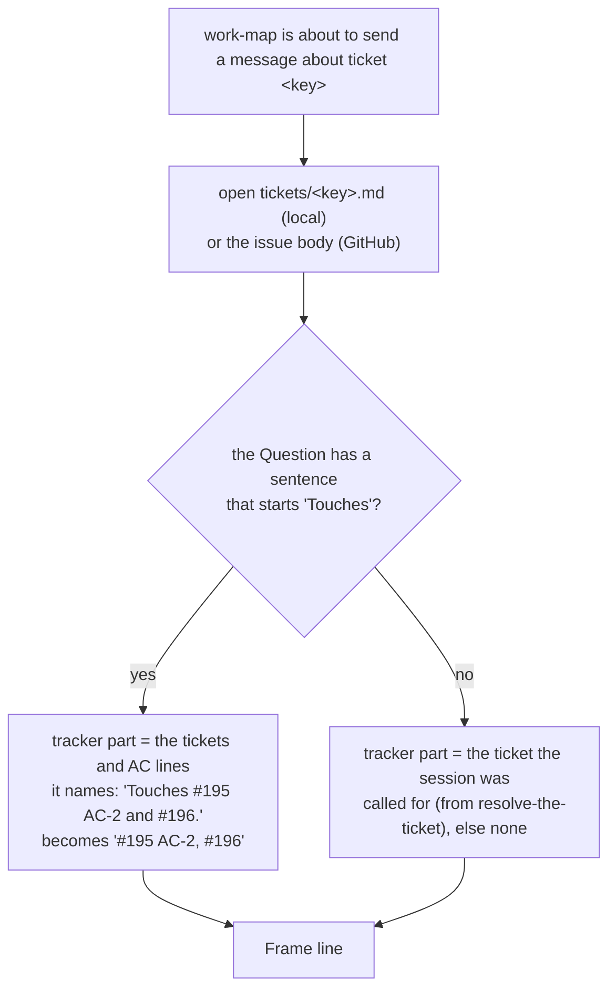

# Design — the Frame line: every plan-stage message says which ticket it serves

Pon worked ADO #196 through `resolve-the-ticket` on 2026-11-24 and could not tell, from the
questions `work-map` asked, which tracker ticket, which AC line and which Decision ticket a
question served ("งง ไม่รู้ว่า map ที่กำลังตอบคำถาม แก้ ticket ข้อไหน"). This design adds one fixed
first line - the **Frame line** - to every message the plan stage sends the person, makes
`work-map` list the calling ticket's Decision tickets first, and hands the facts for the
line from `resolve-the-ticket` to the two map skills. Decisions: ADRs 0392-0397; ADR 0338
amended.



## Why

Measured on the session of 2026-11-24 09:48-11:00 (`resolve-the-ticket` on #196, then
`work-map` on `196-match-key`):

| time | what the person saw | what the person did |
|---|---|---|
| 10:00 | the dry-run report after three tickets were added: merge lines, lint, fog, the whole Feature map's frontier in four milestones | `/wait-what` |
| 10:24 | "### Question 1 of 2: does ADR 0062 still hold? Context. Each day the sync reads a case …" | `/wait-what` |
| 10:29 | "### Question 2 of 2: how does the sync write the IPS case ID? Context. IPS Cloud sends …" | `/wait-what` |
| 10:34 | "Still open: Dev has no key on mgw_ipsportalcaseid yet …" | "อันนี้คือไร" |

Every re-pitch that landed opened with one line the message lacked: "We are on map ticket
`196-match-key` for the daily sync (#196)". The facts for that line exist on every Decision
ticket (the "Touches" sentence at the end of its Question, ADR 0346), but no skill carries
them to the front of a message. `work-map` Step 3 says "restate where the session has got
to immediately before asking", and the session restated the domain instead of the ticket.
Two of the three `work-map` runs that day were direct calls (07:45, 10:23), not through
`resolve-the-ticket`, so a request carried only by the entry skill would have missed them.

## The Frame line (ADRs 0392, 0396)

One line, first in the message, parts separated by ` · `, in this order:

| part | value | when present |
|---|---|---|
| tracker ticket + AC line | `#196 AC-2` - from the Decision ticket's "Touches" sentence, or the ticket the session was called for | when known; the AC part only when the sentence names one |
| Decision ticket | the key: `196-match-key`; on chart-map, before the ticket exists, `briefing point C` | always on work-map; the point letter on chart-map when resolve-the-ticket handed letters |
| map | `chart map ado-193-ips-api-feed` | chart-map only (work-map's key already belongs to one map) |
| question number | `question 1 of 2`; `question 1` when M is not known | on a question only |
| stage | `plan (2/4)` | when loaded by resolve-the-ticket; a direct call writes `work-map` or `chart-map` instead |

Examples, one per message kind:

```
frontier     #196 · map ado-193-ips-api-feed · plan (2/4)
dry-run gate #196 AC-4 · 196-retry-shape (new) · plan (2/4)
question     #196 AC-2 · 196-match-key · question 1 of 2 · plan (2/4)
close report #196 AC-2 · 196-match-key closed · plan (2/4): #196 has 7 open
chart-map    #196 AC-4 · briefing point C · chart map ado-193-ips-api-feed · question 3 of 13 · plan (2/4)
sweep        #193 · sweep · chart map ado-193-ips-api-feed · question 14 of 14 · plan (2/4)
```

Identifiers stay in English; the rest of the message mirrors the person's language. The
line is plain text, not a heading, and nothing comes before it.

## Where the line's facts come from (ADR 0395)



`read` and `frontier` return key, title, type, status, gist and milestone, not the Question
(data contract, read 2026-11-24), so the skill opens the ticket document, as it already
opens the map document for the fog region. Measured on
`docs/decision-map/ado-193-ips-api-feed/tickets/` (25 files): every Question ends with a
"Touches" sentence; 20 name an AC line or another item, 5 name the ticket alone.

## Changes in `resolve-the-ticket` (dev-workflows)

Stage 2, the hand-off. On the yes, hand the map skill these things more:

| to | what | why |
|---|---|---|
| `work-map` | the tracker ticket's number (`#196`) and, for a Feature call, the child the family walk is on | the frontier group (ADR 0394), and the tracker part of the line when a ticket has no "Touches" sentence |
| `work-map` | the row list of 4.1 (`AC-1` … quoted as written) | the AC part of the line is checked against the row list, so `AC-4` means the same thing in the plan and in the check |
| `work-map`, `chart-map` | the stage count `plan (2/4)` | the stage part |
| `chart-map` | each group 1 and 2 point with its letter and its locator (`C · #196 AC-4`) | the point part of chart-map's line, and the "Touches" sentence it writes on the ticket (ADR 0346 already asks for the sentence; the letter is new) |

The request wording follows the pattern of Stage 3 (ADR 0340): "open every message to the
person with the Frame line: …", naming the parts. The entry's own messages already open
with the ticket ("Next for #195: …") and do not change. The end-of-run line after the map
skill stops names the ticket too: "#196: 7 Decision tickets still open on
`docs/decision-map/ado-193-ips-api-feed/`. Call resolve-the-ticket again for the next one."

## Changes in `work-map` (decision-map) - ADRs 0393, 0394, 0396

**Step 1, the frontier.** When the caller named a tracker ticket, group first:

```
#196 · map ado-193-ips-api-feed · plan (2/4)

Tickets for #196 - 8 of 10 open:
  196-status-rule (grilling, AC-3) · 196-match-key (grilling, AC-2) · 196-retry-shape (grilling, AC-4)
  196-staff-source (task, AC-3) · 196-portal-login-source (task) · 196-alert-recipients (task)
  196-vnet-path (task) · 196-schema-in-staging (task, Brad)
Other tickets on this map: 1 for #195 (195-ip-loss-recovery), 1 for #197.
```

A ticket is in the group when its "Touches" sentence names the tracker ticket; a ticket
that touches several tracker tickets is in each group (accepted, ADR 0394). The
recommendation of Step 2 picks inside the group, by the existing heuristic (the ticket
that unblocks the most); the two-level milestone rule applies only inside the group. A
direct call with no tracker ticket shows the milestone view as today.

**Step 3, the question.** The sentence "Restate where the session has got to immediately
before asking" becomes the rule: *every message to the person opens with the Frame line*,
with the parts table above. The restatement of the domain that follows is unchanged. The
line is written by work-map itself, also on the questions the loaded grilling skill asks:
work-map's request to `sp-grill-with-doc` says "open every question with this Frame line,
counting the question number".

**Step 6, the close report** opens with the line in its closed form and says what the
tracker ticket still has open: `#196 AC-2 · 196-match-key closed · plan (2/4): #196 has 7
open`.

## Changes in `chart-map` (decision-map) - ADR 0397

The same rule, as one paragraph under the HITL guard: every message to the person opens
with the Frame line. Before a ticket exists the ticket part is `briefing point <letter>`
when the caller handed letters, and the map part is `chart map <slug>`. The destination
question is `question 1 of M`, where M is the count of points handed in plus one; the sweep
is one more question. A direct chart-map call, with no briefing behind it, writes
`chart map <slug> · <step> · question N` - no tracker part, no letter.

## Worked example - #196 on 2026-11-24, as it would run after the change

```mermaid
sequenceDiagram
    participant P as Pon
    participant R as resolve-the-ticket
    participant W as work-map
    P->>R: #196 URL
    R-->>P: briefing; "Next for #196: plan - 8 Decision tickets open. Load work-map?"
    P->>R: yes
    R->>W: #196 · AC-1..AC-4 (quoted) · plan (2/4)
    W-->>P: "#196 · map ado-193-ips-api-feed · plan (2/4)" + tickets for #196 first
    P->>W: start 196-match-key
    W-->>P: "#196 AC-2 · 196-match-key · question 1 of 2 · plan (2/4)" + the question
    P->>W: yes, use IPS case ID
    W-->>P: "#196 AC-2 · 196-match-key · question 2 of 2 · plan (2/4)" + the question
    P->>W: yes, digits only
    W-->>P: "#196 AC-2 · 196-match-key closed · plan (2/4): #196 has 7 open" + the report
```

## Edge cases

| case | the line |
|---|---|
| direct `/work-map` call, ticket has a "Touches" sentence | `#196 AC-4 · 196-retry-shape · question 1 · work-map` |
| direct call, ticket has no "Touches" sentence (a map not charted through the entry) | `196-retry-shape · question 1 · work-map` |
| ticket touches several tracker tickets | on a direct call `#195 AC-2, #196 · 195-signin-code · …`; when the caller named a tracker ticket, that ticket and its AC line only (`#196 · 195-signin-code · …` for a `for #196` call); listed in both groups |
| ticket has no "Touches" sentence, caller named a tracker ticket | counted in the Other line as `N with no Touches sentence`; an empty group falls back to the milestone view with one line saying why |
| the "Touches" sentence names an AC line the row list does not have | the line keeps the sentence's words and adds `(not in the row list)`, so the mismatch is seen, not hidden |
| GitHub backend | the sentence is read from the issue body; the line is the same |
| Feature call during the family walk | the tracker part is the child the walk is on, named by resolve-the-ticket |
| M not known (a grilling that opens new branches) | `question 3` with no "of" |

## What does not change

- `sp-grill-with-doc`, `guide-and-verify`, `sp-writing-plans`: not edited (ADR 0338).
- The map scripts and the data contract: no new field; the "Touches" sentence stays
  free text in the Question (ADR 0395).
- Existing Decision tickets: none is edited; all 25 on the one real map already carry the
  sentence.
- The one-session stop of both map skills (ADR 0348), the claim discipline, the gate.

## Tests

| what | how |
|---|---|
| resolve-the-ticket hands the facts | one eval in `plugins/dev-workflows/skills/resolve-the-ticket/evals/evals.json`: a plan-stage call on a child ticket whose Feature map exists; expected: the work-map offer names the ticket number, the row list and `plan (2/4)` |
| work-map's line and group | one eval in a new `plugins/decision-map/skills/work-map/evals/evals.json` (the skill has none today): a call "for #196" on a fixture map with tickets touching #195, #196, #197; expected: the first line of every message is the Frame line, the frontier lists the #196 group first, the recommendation is inside it |
| chart-map's line | one eval in `plugins/decision-map/skills/chart-map/evals/evals.json`: points handed with letters; expected: the destination question opens `#193 · briefing · chart map <slug> · question 1 of N` |
| the generated tree | `python scripts/generate_skills_tree.py --repo . --out <scratch>` then `check_skills_tree.py --repo .` pass; `git diff --ignore-cr-at-eol` shows only the three skills |
| the live copies | `~/.claude/skills/{resolve-the-ticket,work-map,chart-map}` equal the generated tree after the `~/.claude/skills/` path rewrite (the only diff today, measured 2026-11-24) |
| the real map | a dry run of `resolve-the-ticket` on #196 in `MG-AI-Creditor-Enquiry-Agent`: the first message of work-map opens with `#196 · map ado-193-ips-api-feed · plan (2/4)` |

## Files

| file | change |
|---|---|
| `plugins/dev-workflows/skills/resolve-the-ticket/SKILL.md` | Stage 2 hand-off: the new items; the end-of-run line |
| `plugins/decision-map/skills/work-map/SKILL.md` | Step 1 group, Step 3 rule, Step 6 report |
| `plugins/decision-map/skills/chart-map/SKILL.md` | the rule under the HITL guard |
| `plugins/dev-workflows/.claude-plugin/plugin.json`, `plugins/decision-map/.claude-plugin/plugin.json`, `.claude-plugin/marketplace.json` | dev-workflows 0.69.0 to 0.70.0; decision-map 0.14.0 to 0.15.0, in sync |
| `skills/` (generated) | regenerated for the three skills |
| `CONTEXT.md` | **Frame line** (written 2026-11-24) |
| `docs/adr/workflow-daily-work-0392` to `0397`, `0338` amendment | written 2026-11-24 |
| the three evals files | one case each |
