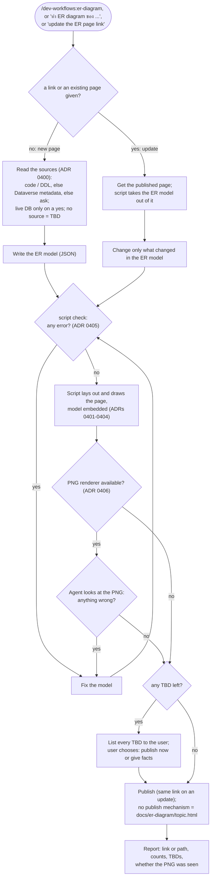
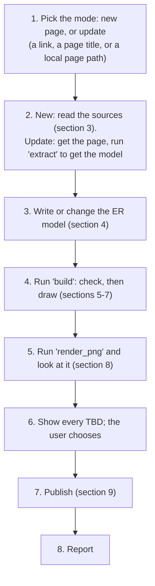

# er-diagram - design



A developer often needs one page that shows where a system keeps its data: every table and
column, what one row means, what each table is for, and how the tables join, across several
systems (an API, two database schemas, a CRM). Such a page was drawn for a client project on
2026-11-26 by a hand-written Python file with a fixed x/y for every box and line. A key change
moved the rows, every line into that table had to be placed again by hand, and labels overlapped
twice. `er-diagram` keeps that page's look and makes it from an **ER model**: the agent writes the
content, a bundled script places, draws and checks.

Decisions: ADRs 0398-0409 (repo root `docs/adr/`, prefix `workflow-daily-work-`). Terms: the
*ER diagram skill terms* section of `CONTEXT.md` (**ER model**). This repo is public: every
example here is the made-up **Bookshop order sync** (ADR 0409); the client page stays on Pon's PC.

## 1. Scope

**In:** one new skill `er-diagram` in the `dev-workflows` plugin: its `SKILL.md`, one Python
entry script with a small library beside it (model check, layout, drawing, page, model
extraction), one Node script (PNG render), one page template (the hand-drawn page's look), the ER
model reference, one worked example model (Bookshop order sync), tests, its command, the
registration work in section 10, and one "not for" clause in each of `sa-doc` and
`problem-description` (ADR 0408).

**Out:**

- A full SA&D document - that is `sa-doc` (ADR 0408).
- A step-by-step explanation of a problem - that is `problem-description` (ADR 0408).
- Free HTML in the page, new box or line kinds per page (ADRs 0402, 0404).
- Reading row data from any database; reading a live database without the user's yes (ADR 0400).
- Automatic reordering of tables, a layout library (ADR 0401).
- A restyle of the page: the hand-drawn look is kept (Pon, 2026-11-26).
- Any client schema, name or ticket number in a committed file (ADR 0409).

## 2. The run



1. **Mode.** A link to a published page, a page title, or a path to a page in
   `docs/er-diagram/` means an update; anything else is a new page.
2. **Get the facts or the model.** New: section 3. Update: get the page (by the link; by the title
   in the user's list of published pages; or the local file), then
   `python scripts/er_diagram.py extract <page.html> --out <model.json>`. The page the host returns
   may carry the host's own wrapper (measured 2026-11-27: `<!doctype html><html><head>...` is
   added before the page), so `extract` finds the model block anywhere in the file.
3. **Write or change the model.** On an update, change only the tables, columns, lines, notes
   and highlights that changed; keep the order (ADR 0401).
4. **Build.** `python scripts/er_diagram.py build <model.json> --out <page.html>`. On errors
   (section 7) it writes no page, prints every error with the item name, and exits 1; the agent
   fixes the model and runs again. It also writes `<page>.check.svg` (section 8).
5. **Look.** `node scripts/render_png.js <page>.check.svg <page>.png` and look at the PNG
   (section 8). Fix by changing the model, never a position; go back to step 4.
6. **TBD.** `build` prints every `TBD` (item and field). If there is any, list them to the user
   and ask: publish now, or give the facts first.
7. **Publish** (section 9).
8. **Report.** The link or path; the number of tiers, tables, endpoints and lines; every TBD
   left; whether the PNG was seen ("not checked by eye: no PNG renderer" otherwise); which source
   each part came from (code file, metadata, ADR, ticket).

The working files (model JSON, SVG, PNG, page) go in a temporary folder; the published page is
the saved copy (ADR 0399).

## 3. Sources (ADR 0400)

```
1. Is the schema in the open project? (EF model builder, entity classes, migrations, SQL DDL)
     Yes --> names, types, keys, foreign keys, indexes from the code
     No  --> Is it Dataverse? Yes --> table metadata through the Web API (read-only)
                              No  --> ask the user where the schema is
2. Is a fact only in the live database?
     Yes --> ask the user first; then schema only, read-only, never row data
     No  --> never touch a database
3. Description, row meaning, purpose, line tooltip: from ADRs, tickets, docs.
     None found --> "TBD", never an invented value
```

The report names the source of each part. A value is copied exactly (names, types, keys).

## 4. The ER model (JSON)

One JSON object, written one key per line (indent 2), so a diff of it reads line by line. JSON,
not YAML: PyYAML is not installed on Pon's PC; the script needs only the Python standard library.

```json
{
  "erModel": 1,
  "page": {
    "title": "Bookshop Order Sync",
    "eyebrow": "Bookshop · order sync",
    "heading": "ข้อมูลของ order sync เก็บที่ไหนบ้าง",
    "intro": "order sync อ่าน order จาก Shop API ทุกชั่วโมง ...",
    "lang": "th"
  },
  "overview": {
    "heading": "ข้อมูลไหลอย่างไร",
    "text": "ทุก run เขียนสองชั้น: `shop_raw` เป็นสมุดบันทึก ...",
    "mermaid": "flowchart LR\n  API[\"Shop API\"] --> RAW[\"shop_raw\"]\n ..."
  },
  "diagram": {
    "heading": "ER diagram แยกตามระบบ",
    "text": "ครบทุกตารางและทุกคอลัมน์ตาม model ในโค้ด ..."
  },
  "tiers": [
    {
      "id": "api",
      "title": "Shop API",
      "subtitle": "endpoint ที่ sync อ่าน",
      "boxes": [
        { "kind": "endpoint", "id": "OrdersChanged",
          "lines": ["OrderId, OrderNo,", "CustomerId, Status"] }
      ]
    },
    {
      "id": "raw",
      "title": "PostgreSQL · shop_raw",
      "subtitle": "สมุดบันทึก: เพิ่มอย่างเดียว",
      "boxes": [
        {
          "kind": "table",
          "id": "raw_orders",
          "rowMeaning": "1 แถว = อ่าน order 1 ครั้ง",
          "purpose": "เก็บทุก record ที่อ่านจาก OrdersChanged เป็นประวัติ",
          "columns": [
            { "name": "RawId", "type": "bigint", "key": "PK",
              "short": "เลขแถว (รันเอง)", "desc": "เลขรันของแถว เพิ่มขึ้นเอง" }
          ]
        }
      ]
    }
  ],
  "lines": [
    { "kind": "fk",
      "from": { "box": "raw_orders", "column": "SyncRunId" },
      "to": { "box": "sync_run", "column": "RunId" },
      "label": "FK: SyncRunId = RunId",
      "tooltip": "ตาราง raw ทุกตัว → sync_run ...",
      "mult": ["*", "1"] }
  ],
  "notes": [
    { "kind": "change",
      "heading": "order_line: 1 แถว = 1 line ของร้าน (key = LinePk)",
      "paragraphs": ["key เดิมคือ order + หนังสือ ..."],
      "before": { "tag": "เดิม: 1 แถว = 1 order × 1 หนังสือ",
                  "rows": "shop_raw.raw_order_lines ...", "result": "ผล: crm_bookcount = 0" },
      "after":  { "tag": "ใหม่: 1 แถว = 1 line (PK = LinePk)",
                  "rows": "shop.order_line ...", "result": "ผล: crm_bookcount = 1" },
      "status": "เลือกแล้ว ยังไม่ได้แก้โค้ด" }
  ]
}
```

(The sketch shows one item of each list; `assets/example-bookshop.er.json` holds the whole page.)

Fields:

| Object | Required | Optional |
|---|---|---|
| `page` | `title` (2-4 words, the browser tab), `heading`, `lang` (`th` or `en`: the language of the legend) | `eyebrow`, `intro` |
| `overview` | - (the whole object is optional) | `heading`, `text`, `mermaid` |
| `diagram` | - | `heading`, `text` |
| tier | `id`, `title`, `boxes` (at least one) | `subtitle` |
| table box | `kind: "table"`, `id`, `rowMeaning`, `purpose`, `columns` (at least one) | `footnotes` (short lines under the box), `highlight` |
| endpoint box | `kind: "endpoint"`, `id`, `lines` (1 or 2) | `purpose`, `highlight` |
| column | `name`, `type`, `short` | `key` (one of `PK`, `FK`, `AK`, `IX`, `UQ`), `desc` (the tooltip; `short` when absent), `highlight` |
| line | `kind` (`fk`, `same-value`, `flow`), `from`, `to`, `label`, `tooltip`, `mult` (two of `1`, `0..1`, `*`, `1..*`) | `highlight` |
| line end | `box` | `column` (required for `fk` and `same-value`; a `flow` end without a column attaches at the box middle) |
| highlight | `kind` (`problem`, `change`), `note` | - |
| note section | `kind`, `heading`, `paragraphs` | `before`, `after` (each `tag`, `rows`, `result`), `status` |

Box `id` is the name shown on the box and is unique in the model. A `flow` line may join any two
boxes; `fk` and `same-value` join two tables. Any string may be `TBD` except `page.title`,
`page.heading`, `page.lang`, ids, kinds, keys and multiplicities.

**Text is plain text.** The script escapes it. Two marks are allowed in `intro`, `text`,
`paragraphs`, `status` and `result`: `` `x` `` becomes `<code>x</code>` and `**x**` becomes
`<b>x</b>`. `rows` is shown as it is, in a monospace box. No other HTML reaches the page
(ADR 0404).

## 5. Layout (ADR 0401)

The script computes every position. The agent controls only the order of tiers, boxes and lines.

1. **Tiers** are columns from left to right, in model order. Each is a band (alternating two band
   colours) with its title and subtitle at the top.
2. **Boxes** in a tier go from top to bottom, in model order, 18 apart. A table is as tall as its
   rows (header 48 + 20 per column + 6, plus 18 per footnote); an endpoint is 80 high.
   **Refinement (ADR 0401 amendment, Pon 2026-11-27):** a box whose first line (in model order) to
   a box in the next tier on its right exists is centred level with that box when the place is
   free; otherwise it goes below the box above it. Tiers are placed from right to left, so the
   right-hand box is already placed.
3. **Box width** follows the longest text: in a tier, all tables have one width, and the type, key
   and description columns start at the same x, measured from the longest name, type and short
   description in that tier (estimated character widths of the page fonts).
4. **Lines between two neighbouring tiers** are drawn left to right: they leave the right edge of
   the left box and enter the left edge of the right box, each at the row of its column:
   horizontal, vertical in a lane, horizontal. Each line gets its own lane in the gap; two lines
   share a lane only when their vertical spans do not overlap. A line whose two ends are at the
   same height needs no lane. Several lines that leave or enter the same row are spread over that
   row (up to ±6 px), so their ends do not sit on one another.
5. **Many `fk` lines to one column** from boxes of one tier share one **bus**: a lane with each
   source joining it and one segment from the bus to the target row.
6. **Lines inside one tier** use lanes at the right edge of that tier, and the tier band widens for
   them. **Lines across more than one tier** run horizontally at the source height while no box in
   the tiers between covers it; otherwise they go up or down in a lane of the first gap to the
   nearest free height, across, and in a lane of the last gap to the target height.
7. **Labels** sit on the last segment of the line (the one that enters the right-hand box), just
   above it, in a label column to the right of all lanes of that gap; labels that would touch go
   to the next label column. **Multiplicities** sit at each end, beside the box edge: above the
   line on the left, below it on the right. Lines inside one tier have their label to the right of
   their lane, at the middle of the vertical segment.
8. **Overlap:** the script tests every label and multiplicity against the other labels,
   multiplicities, boxes and line segments. On an overlap it widens that gap by 24 px and lays out
   again, at most 20 times; an overlap after that is an error (section 7).

## 6. The page (ADRs 0402-0404)

**Shell.** The page template is the hand-drawn page's shell, unchanged in look: CSS colour tokens
on `:root` for light, the same tokens for dark under `@media (prefers-color-scheme: dark)`
(guarded by `:root:not([data-theme="light"])`) and under `:root[data-theme="dark"]`; fonts
Anuphan, IBM Plex Sans Thai and IBM Plex Mono from Google Fonts; one reading column (max 1180 px)
with a wide scroll box for the diagram; 16 px side gutter. The SVG uses the classes `er-box`,
`er-head`, `er-row`, `er-info`, `ep-box`, `fk`, `rel`, `flow`, `er-mult`, `er-link-label`, `chg`
(change) and `bad` (problem; same rules as `chg` with `--bad` / `--bad-soft`).

**Sections**, in this order:

1. Header: eyebrow, heading, intro.
2. Overview flow (if the model has one): heading, text, and the Mermaid text in a
   `<pre class="mermaid">`. The template loads Mermaid 10.9.1 from cdnjs and renders it, as the
   `learn-with-flashcard` template does, so the flow also renders when the page is opened as a
   local file (the hand-drawn page had no script: only the claude.ai host rendered its flow).
3. ER diagram: heading, text, the legend, the SVG.
4. Note sections, in model order: heading, paragraphs, the before/after block (two columns with
   `tag`, `rows` in a monospace box, `result`), `status`; the border and heading colour follow the
   kind.

**Kinds** (ADR 0402): `table` box with columns; `endpoint` box with an accent border and its
lines; `fk` solid line; `same-value` dashed muted line; `flow` accent line with an arrow and a bold
label. **Highlights** (ADR 0403): `problem` uses `--bad`, `change` uses `--good`, on the box border
and header, the row text, the line, its label and its multiplicities; the note is added to the
item's tooltip.

**Tooltips** (SVG `<title>`): table (i) = `id: purpose (+ highlight note)`; column =
`name: desc (+ highlight note)`; line = `tooltip (+ highlight note)`. Each row, the (i) dot and each
line have a hover target.

**Legend** is built from what the page uses, in `page.lang`: only the line kinds, multiplicities,
key letters and highlight kinds that appear.

**Model block.** The model is written into the page as
`<script type="application/json" id="er-model">` (the browser does not run it). The script
escapes `<` inside it as `<`, so text in the model cannot close the block.

## 7. Checks (ADR 0405)

**Errors** (no page; every error listed with the item name; exit 1):

1. A box, line, highlight or note kind, a column key or a multiplicity not in the fixed lists.
2. A missing required field (section 4); a box id used twice.
3. A line end that names a box or column not in the model; an `fk` or `same-value` end with no
   column, or on an endpoint.
4. A table without `rowMeaning` or `purpose` (an empty string counts as missing; `TBD` does not).
5. A line without `label`, `tooltip`, or both `mult` values.
6. A highlight without a `note`.
7. An overlap still there after the layout's 20 tries (section 5, rule 8).

**Warnings** (the page is drawn; listed; the user chooses before publishing): every field whose
value is `TBD`, as `<item>: <field> TBD`.

## 8. The PNG (ADR 0406)

`build` also writes `<page>.check.svg`: the SVG with the light colour tokens resolved and the
fonts replaced by installed fallbacks (Tahoma, Consolas), because the renderer reads no CSS
variables. `node scripts/render_png.js <check.svg> <png>` renders it with `@resvg/resvg-js`. When
the module is missing, the skill tells the agent to run `npm install @resvg/resvg-js@2.6.2` in a
temporary folder and set `NODE_PATH` to its `node_modules` (no admin rights; 2.6.2 worked on
2026-11-26). No Node, or the install fails: publish, and report "not checked by eye: no PNG
renderer". Headless browsers are not used.

## 9. Publish and update (ADR 0399)

Harness-neutral wording, after `learn-with-flashcard` step 7: "If your harness can publish an HTML
page as a shareable artifact, publish the page there and follow that mechanism's own rules (for
example, a required first-step call before a new artifact, or reading the published version before
an update). On an update, publish to the same place. With no such mechanism, save the page to
`<open project>/docs/er-diagram/<topic>.html` (create the folder) and give its full path; an update
then starts from that file." `<topic>` is a lowercase-kebab name from `page.title`.

## 10. Files to add or change

| file | change |
|---|---|
| `plugins/dev-workflows/skills/er-diagram/SKILL.md` | new - frontmatter (`name`, trigger-rich `description` with a "Do NOT use" line per ADR 0408, `effort: max`); the run of section 2 as steps |
| `plugins/dev-workflows/skills/er-diagram/scripts/er_diagram.py` | new - the entry: `extract`, `build` |
| `plugins/dev-workflows/skills/er-diagram/scripts/erlib/` | new - `model.py` (constants, load), `check.py`, `measure.py`, `layout.py`, `svg.py`, `page.py`; standard library only |
| `plugins/dev-workflows/skills/er-diagram/scripts/render_png.js` | new - SVG to PNG with `@resvg/resvg-js`; a plain error when the module is missing |
| `plugins/dev-workflows/skills/er-diagram/assets/er-page-template.html` | new - the shell with placeholders |
| `plugins/dev-workflows/skills/er-diagram/assets/example-bookshop.er.json` | new - the made-up Bookshop order sync (the worked example and the test input, ADR 0409) |
| `plugins/dev-workflows/skills/er-diagram/references/er-model.md` | new - the model contract of section 4, the only place its schema is defined |
| `plugins/dev-workflows/skills/er-diagram/tests/` | new - `unittest`: one test per error and the TBD warning; lane sharing; bus; alignment; the example builds with no error and no overlap; `extract` round-trip |
| `plugins/dev-workflows/commands/er-diagram.md` | new - thin wrapper, `$ARGUMENTS` |
| `plugins/dev-workflows/skills/problem-description/SKILL.md` | one clause in the description: not for an ER page of a system's tables (er-diagram) |
| `plugins/dev-workflows/skills/sa-doc/SKILL.md` | one clause in the description: not for a single ER page (er-diagram) |
| `PLAYBOOK.md` | one row ("need an ER page of a system's tables" -> `er-diagram`) and one router arrow, in the same commit as the skill |
| `plugins/dev-workflows/.claude-plugin/plugin.json`, `.claude-plugin/marketplace.json` | description, keywords; version `0.70.0` -> the global max + 0.1.0 at merge time, both files the same |
| `skills/` (the Generated tree) | regenerate with `scripts/generate_skills_tree.py`, check with `scripts/check_skills_tree.py`; never hand-edit; then copy `skills/er-diagram/` to `~/.claude/skills/er-diagram/` (not automatic) |
| `CONTEXT.md`, `docs/adr/workflow-daily-work-0398…0409` | done in the design session |

Script paths in `SKILL.md` are skill-relative (`scripts/er_diagram.py`), per the repo CLAUDE.md.

Trigger phrases for the description: "ทำ ER diagram", "วาด ER diagram ของ", "ER diagram ของตาราง",
"data model page", "ข้อมูลเก็บที่ไหนบ้าง", "update the ER page", "แก้ ER page", "tiered ER diagram".

## 11. Checks before it is called done

- `python -m unittest discover -s plugins/dev-workflows/skills/er-diagram/tests` passes.
- The Bookshop example builds with no error; its PNG, looked at, shows the four tiers, every table
  and column, every line with its label and both multiplicities, the `change` highlight on
  `order_line` / `LinePk`, and no overlap.
- Each error of section 7 is shown by one broken copy of the example (the tests).
- The page opens in light and dark (the PNG uses light; dark is checked by the token blocks).
- A publish, then an update from the link alone (a new session, no local file): `extract` gives
  back the same model, one table is changed, the page is published to the same link.
- **On Pon's PC only, not committed (ADR 0409):** the client page's model, written into Pon's
  reference folder, builds with no error and its PNG shows every table, column and line of the
  hand-drawn page. The result is reported without the client's data.
- `python scripts/check_skills_tree.py` passes; both manifests report the same version.

## 12. Measured before this spec was approved

- 2026-11-27: reading a published page by its link returns raw HTML with the host's wrapper added
  before the page (`<!doctype html><html><head>...<body>`), so `extract` must not expect the
  model at a fixed place.
- 2026-11-27: Python 3.12.10 and Node v24.22.1 on Pon's PC; `json`, `html`, `pathlib` load.
- 2026-11-26: `@resvg/resvg-js` 2.6.2 rendered the hand-drawn SVG to PNG; headless Edge hangs on
  this PC.
- 2026-11-27: the hand-drawn page has no `<script>`; its overview flow rendered only because the
  claude.ai host renders `pre.mermaid` itself.
- 2026-11-27: no skill named `er-diagram` in the six plugins; `dev-workflows` is at `0.70.0`.
- 2026-11-27: this repo is public (`gh repo view`), so the example is made up (ADR 0409).
