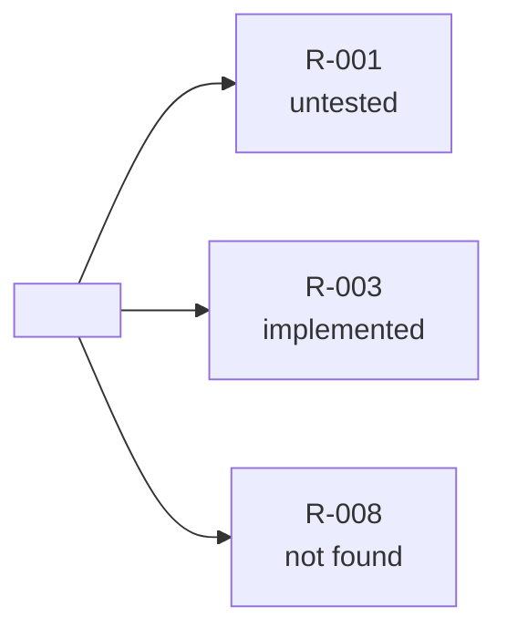

# The register - `docs/why/requirements.md`

One file per project, beside the Why files. One line per requirement ID. Read column-wise it
is the traceability matrix: an empty *tested by* cell is `generating-test-cases`' work, an
empty *implemented at* cell is a gap (ADR 0281).

## Rules

- **One line per ID; IDs are never reused or renumbered.** The source's own ID when the
  statement carries one (`FR-12`, `AC-2`); else `R-001`, `R-002` … per register (ADR 0278).
- **A statement already registered reuses its ID** - same locator, or same text.
- **statement** is quoted as written in the source; **source** is its locator
  (`spec:145`, `#151 AC-2`, `spec:121 (MG_ReminderAgeDays (7))`).
- **implemented at** and **tested by** hold one or more locators separated by ` · `:
  `file:line`, `<Why file> row N`, `<suite> case <id>`; a cell with nothing carries `—`.
- **status** is one of four words: `implemented`, `untested`, `not found`, `source changed`.
- **A fact only the live system could confirm** is written `told <who, date>` in
  *implemented at* when the user states it - the backward run's marks apply (ADR 0266, 0272).
- The header's counts and *Last run* are refreshed by every run that cited or minted an
  ID, in either direction; a run that cited no document statement leaves the file alone.
- A locator in *implemented at* whose row's verdict is *contradicts* carries `(contradicts)`
  after it - the status says whether code and a test exist, the mark keeps the disagreement
  visible.
- The overview is Mermaid; one lead-in sentence follows it; no double quotes inside labels.

## Template

````markdown
# Requirements - <project>

- **Register of:** <repo or system name>  ·  **Last run:** <YYYY-MM-DD>  ·  **Statements:** <n> · implemented <a> · untested <b> · not found <c> · source changed <d>
- **Sources:** <spec path(s)> · <ticket(s)> · <folder>
- **Still to answer:** <R-nnn — the question, or —>



<One sentence: which statements are not found or untested.>

| ID | statement (as written) | source | implemented at | tested by | status |
|---|---|---|---|---|---|
| R-001 | <statement> | <locator> | <file:line · Why file row N · —> | <file:line · suite case id · —> | <status> |
````

## Worked lines - `Elevate`, spec §4 Workflow 3

| ID | statement (as written) | source | implemented at | tested by | status |
|---|---|---|---|---|---|
| R-001 | Runs Mon-Fri 08:00 AEST | spec:144 | `mgw_flow_overduereport` trigger | — | untested |
| R-003 | callDateTime < Now - 7 days | spec:145 · spec:121 (`MG_ReminderAgeDays (7)`) | `docs/why/elevate-151-overdue-filter.md` row 2 · `src/billing/overdue.ts:14` | `tests/billing/overdue.test.ts:14-15` | implemented |
| R-008 | emails to `MG_AdminEmail` / Liquidators | spec:147 | — | — | not found |
