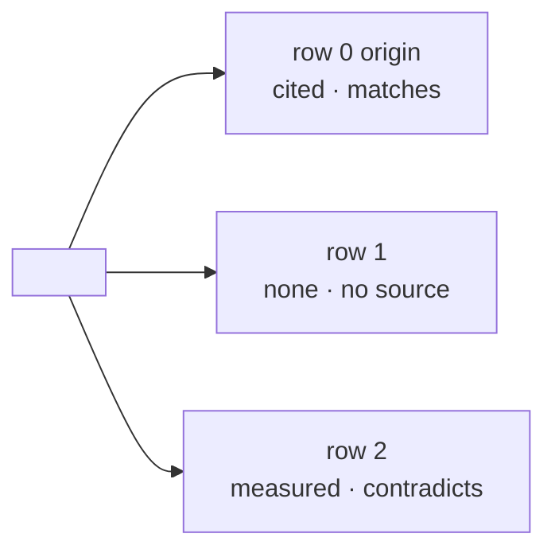

# The Why file - `docs/why/<thing>.md`

One file per thing traced, in the project being traced. Its shape is copied from
`guide-and-verify`'s runbook step: every block has every line, the reader learns the
shape once. Fill the slots; keep every label.

## Rules

- **Every block has all six lines.** A line with nothing to say carries `—`.
- **The Source line carries exactly one mark or `none`:** `cited <file:line | commit>`,
  `told <who, date>`, `measured <the query>`, or `none`.
- **The Verdict line is one of four words:** `matches`, `contradicts`, `no source`,
  `cannot check from the document`.
- **To close it yourself** on an open row is a command, a document to find, or a person
  to ask - never "ask around".
- **In plain words** is the same text the user saw during the run - two or three short
  sentences, Simplified Technical English, the project's `CONTEXT.md` words.
- **Still to answer** is a header line, filled only when a question stayed open after the
  close (phase 6); the block stays six lines (ADR 0276).
- Short names in the overview carry no double quotes - a quote inside a label breaks the
  rendering.
- The file is written as a skeleton after the split (every line `—`), filled as hits are
  found, completed when the rows are explained, and updated by the close (ADR 0274).
- The overview is Mermaid (a document renders it); the run's own table was monospace.

## Template

````markdown
# Why: <the thing, in the user's words>

- **Thing:** <file:line | ticket URL | document path>  ·  **Origin hash:** <row 0's commit, or —>
- **Traced:** <YYYY-MM-DD>  ·  **Rows:** <n> · closed <k> · open <n−k>
- **Sources searched:** git · ticket (+<m> images) · <folder> · specs · scripts · tests
- **Still to answer:** <row N — the question, or —>



<One sentence: which rows are open and why.>

## Row 0 — origin of the text

**Where:** <file:line | ticket #n | document path>
**Why it exists:** <one sentence, or "no document says">
**Source:** <cited file:line | told who, date | measured the query | none>
**Verdict:** <matches | contradicts | no source | cannot check from the document>
**To close it yourself:** <the read-only command | the document to find | whom to ask | —>
**In plain words:** <two or three sentences>

## Row 1 — <the decision point, quoted as written>

**Where:** …
**Why it exists:** …
**Source:** …
**Verdict:** …
**To close it yourself:** …
**In plain words:** …
````

## Worked block - `Elevate` #151, row 2, after the user said yes to the query

````markdown
## Row 2 — `914120001` and `914120003`

**Where:** story #151, OData filter, third term (generated by `scripts/populate_teams_agent_backlog.py:388`)
**Why it exists:** limits the reminder sweep to two of the four logging statuses
**Source:** measured `GET <org>/api/data/v9.2/EntityDefinitions(LogicalName='mgw_telephoneenquiry')/Attributes(LogicalName='mgw_loggingstatus')/Microsoft.Dynamics.CRM.PicklistAttributeMetadata?$expand=OptionSet($select=Options)` → 914120001 = Created, 914120003 = Failed
**Verdict:** contradicts
**To close it yourself:** —
**In plain words:** The spec names four statuses, and the filter keeps two: Created and Failed. Partial records - enquiries logged only in part - get no reminder. No document asks for that.
````
