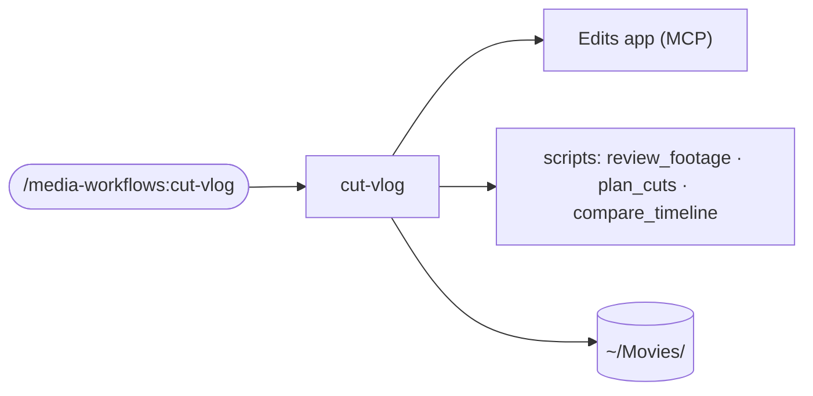

# media-workflows

Opt-in. Install it only on a Mac that edits video with Meta's Edits app.



| Skill | What it does | Start with |
|---|---|---|
| `cut-vlog` | A day's footage in an Edits project becomes a vlog cut on the beat of a song you pick. A short plan is shown for your OK before anything changes, your style rules come first, a shot plan sheet is approved before the cut, every edit is read back and compared with the plan, and every export is a new numbered file. | `/media-workflows:cut-vlog <edits project name>` |

## Known issue (2026-11-08)

Media added to an Edits timeline through the MCP tools rendered without sound, and a
project whose timeline was once emptied lost its audio in every render and export. So the
skill asks you to add the song by hand and never empties a timeline.

## Requires

- A Mac with Edits installed and its MCP server connected to your agent.
- `ffmpeg` and `ffprobe` (`brew install ffmpeg`).
- Python 3.10 or newer. No third-party packages.

## Your files

Everything about you stays on your machine, in your video-editing folder: your style file
at `~/Movies/cut-vlog/style.md`, and one folder per project, `~/Movies/<project>/`, holding
the edit record and the exports (`<project>-v1.mp4`, `-v2.mp4`, ...) beside it. Nothing is
written into this repository.

## Tests

```bash
python3 -m unittest discover -s plugins/media-workflows/scripts -p 'test_*.py'
```

The `review_footage.py` tests that need ffmpeg are skipped when it is not installed.
