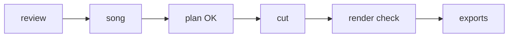

# The edit record

One folder per Edits project, in the user's folder, named by the Edits project id:

```
~/.claude/cut-vlog/projects/<edits-project-id>/
  record.md      what a person reads: the run, step by step
  plan.json      the song, the candidates and the shots: the only file the scripts read
  review/        review.json, one row image per clip, one sheet per part (review_footage.py)
  checks/        each stage's timeline read-back, the frame sheets, onsets.json
```

## record.md

Opens with one overview diagram, then these sections in order:

````markdown
# <project name> - cut-vlog record



## Project
Edits project `<name>` (`<id>`); working project `<name> – cut-vlog` if the named one was busy (new, or a duplicate).
Style file read: dated <the newest date in style.md>.

## Review
<clips> clips, <parts> parts; review/review.json.

## Song
<title> - <artist>. Why: <one line>. BPM, drop and in-point: plan.json.

## Plan
Approved <date>. Shots and cuts: plan.json.

## Steps
| Step | Check | Result |
|---|---|---|
| clips | checks/added.json | match |

## Exports
| Version | Path | Checked |
|---|---|---|
| 1 | ~/Movies/<project>-v1.mp4 | 1920x1080, 37.1 s, video + audio |

## Corrections
| Date | What the user said | Changed | Written to |
|---|---|---|---|
````

`record.md` never repeats the numbers in `plan.json`; it points at them.

## plan.json

```json
{
  "fps": 30,
  "bpm": 126,
  "song_in": 18.1,
  "drop": 33.35,
  "song": {"title": "Example Song", "audio_asset_id": "SONG-1"},
  "measurements": {"pieces": [{"start": 0, "onsets": [0.012, 0.128], "levels_db": [-36, -42.5]}]},
  "candidates": [
    {"clip": "clip-01.mov", "alias_id": "ALIAS-01", "full_duration": 8.8,
     "what": "a wave breaks on the beach", "source_in": 0.5, "sharp": true, "breaks_rule": null}
  ],
  "shots": [
    {"clip": "clip-01.mov", "alias_id": "ALIAS-01", "full_duration": 8.8,
     "source_in": 0.5, "beats": 8, "part": "slow", "note": "opening wide shot"}
  ]
}
```

| Field | Written by | Meaning |
|---|---|---|
| `fps`, `bpm` | the agent, Phase 3 | the project's frame rate; the measured tempo |
| `drop` | the agent, Phase 3 | the drop's time in the song, seconds |
| `song_in` | the agent, Phase 4 | the song time at timeline 0 |
| `song` | the agent, Phase 3 | title and `audio_asset_id` of the song the user added by hand |
| `measurements` | the agent, Phase 3 | each render piece's onsets and levels |
| `candidates` | the agent, Phase 2 | every usable clip, with its best in-point |
| `full_duration` (candidates and shots) | the agent, Phase 2; replaced in Phase 5 | the clip's whole length: review.json's `duration` at first, replaced by the `sourceOutPoint` Edits reads back once the clips are added whole |
| `shots[].clip … part` | the agent, Phase 4 | the plan in beats; `part` is `slow` or `fast`; `plan_cuts.py` snaps `source_in` to a frame |
| `shots[].n, start, end, duration, source_out, trim_start, trim_end` | `plan_cuts.py` | frame-exact cuts and the trims that make them |
| `drop_check` | `plan_cuts.py` | where the drop lands, against the first fast shot |

## checks/<stage>.json

The timeline read back after a step, named by its `compare_timeline.py` stage (`added`,
`trimmed`, `final`), as `compare_timeline.py` reads it:

```json
{"tracks": [<the tracks tool's "tracks">], "elements": [<the elements tool's "elements">]}
```

Read `elements` with the fields `id, trackId, content, aliasId, startTime, endTime,
duration, sourceInPoint, sourceOutPoint`. The main track is the `video` track whose `behavior` is
`magnetic`; any other track that is not `audio` (Edits types them `overlay`) is an overlay
track; the music is the `audio`-track element whose `content` is `music` (a `soundEffect`
there is not the song).

## checks/onsets.json

```json
{"pieces": [{"start": 15.0, "duration": 10.0, "onsets": [0.253, 2.153]}]}
```

`start` is the piece's timeline time; `onsets` are seconds inside the piece.
